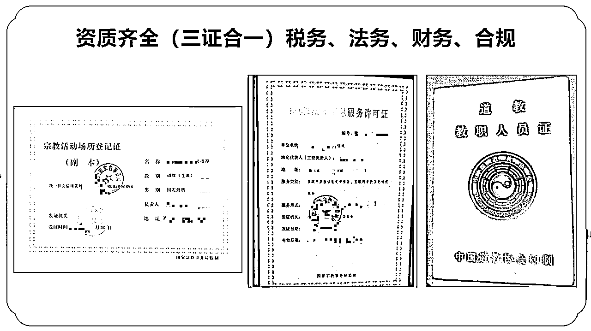
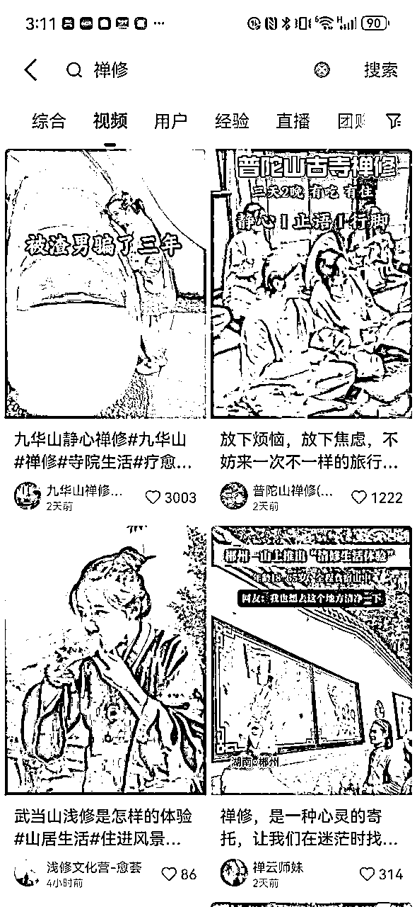
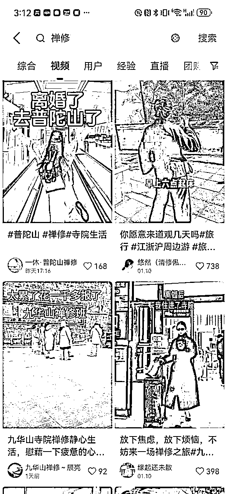
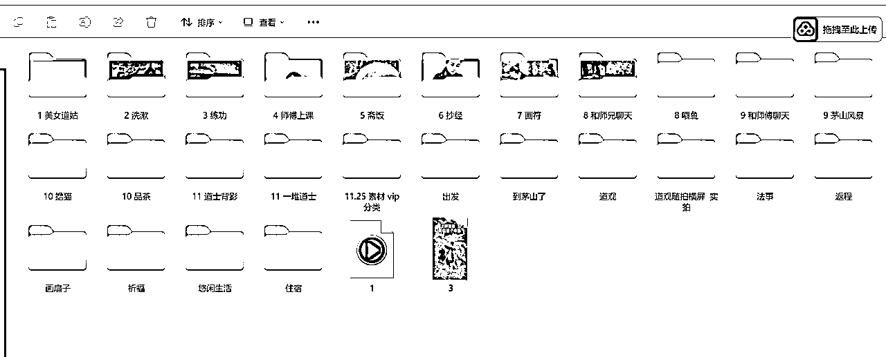
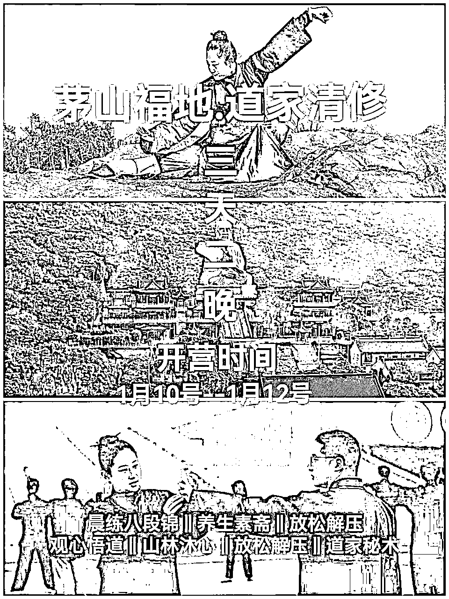
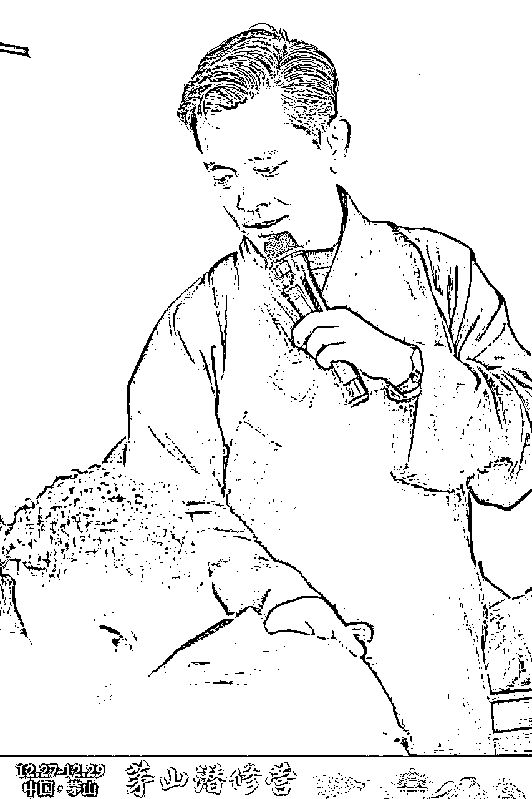
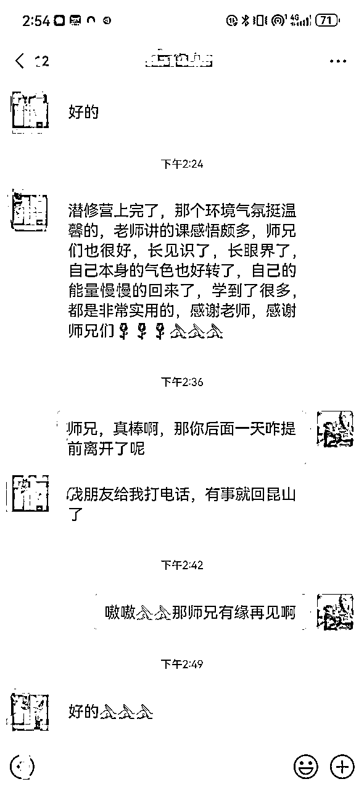
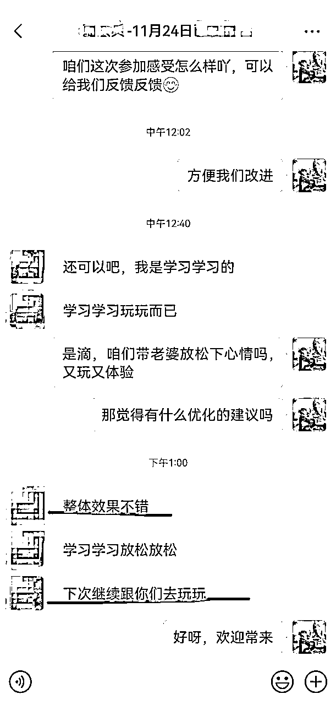
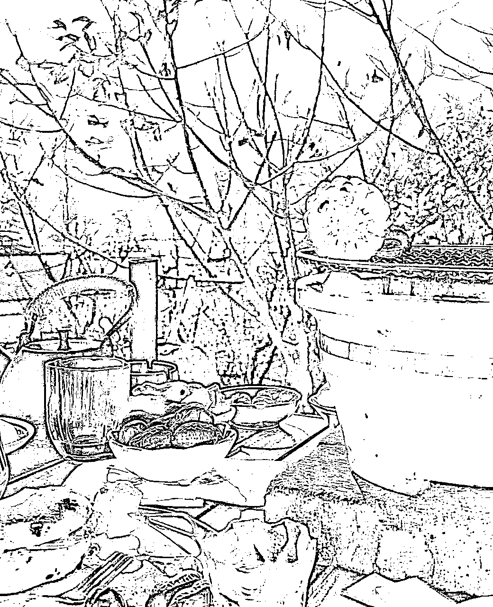

# 我在寺庙禅修里，跑通了一个月变现六位数的生意

大家好，我是奶茶。

先简单介绍一下我自己：曾经在互联网大厂做运营总监，后来决心出来创业，自己开了工作室。第一个月，我就跑通了短视频矩阵的获客模型，每天稳定能加到50到100个精准流量，配合私域成交的打法，整个业务很快就进入了正向变现的阶段。现在团队还在持续扩张。

能有今天的成绩，很大程度要归功于在龙哥盟的学习。每次翻看圈友们的分享，总能获得新的灵感和思考。今天想把自己亲手跑通的一个项目——寺庙禅修/道观清修，完整地拆解给大家，希望能对各位有所启发。

## 这个生意，到底长什么样？

先说结论：这是一个非常适合小工作室操作的赛道，启动成本不高，却有不俗的产出。

从属性上看，它跟旅游类目很像，节假日就是明显的流量高峰。眼下临近过年，数据尤其好看，我们一个账号的日GMV就能做到6000到10000块。我这边铺了几十个账号，过年期间打算直接加码，继续接单、持续放大。

项目的底层逻辑，说穿了就是借助名山大川这类天然IP，把用户引到寺庙禅修、道观清修的线下体验场景里，本质上是文旅赛道。

线上要做的事情非常聚焦：把流量和变现端口打通就够了。不需要真人出镜，也不用自己下场做交付。限制也很明显——受天气、假期影响比较大，周期性明显，淡旺季界限清楚。但对于有流量获客经验的伙伴来说，起盘的难度确实不大。

## 现在入局，晚了吗？

一点都不晚。

最近我观察到，武汉有一支团队新起了10个号，用的就是我们这套视频引流模板，每条内容播放量都能稳定过万，有些甚至冲到十几万。在这个圈子里，已经算得上小爆款了。

当然，新手从零开始需要一定时间的摸索和适应，我的建议是：不要贪多，先专注把流量或者变现的某一个环节打透，这样更容易在短时间内拿到正反馈。

## 这个项目是怎么一步步火起来的？

回头看，禅修相关内容早在2023年就开始在各平台冒头了，相信不少人刷到过这类视频。不过当时真正下场做业务的人，少之又少。

我在2024年1月前后正式入局。那时候已经有一些做流量的团队抢先布局，主要围绕九华山、武当山等宗教圣地做推广。那阵子妥妥是流量红利期，几乎发一条视频就能爆一条。我们单靠一个账号的一条短视频，就能轻松引流100多个精准客户。

到了9月左右，越来越多的流量团队涌入，市场开始出现内卷苗头。

而最近这段时间，随着双11大促结束，叠加年关将至，寺庙禅修和道观清修相关内容的流量又迎来了一波明显回暖，整个市场正在走向爆发期。我自己最近的成交数据就涨得很明显。

## 想要跑通这个项目，要过哪几道关？

### 第一关：合规

交付是在线下完成的，核心体验是让用户静下来、慢下来。

关于佛教和道教这块，只要提前和相关的协会渠道做好沟通洽谈，基本都能顺利推进。像大家熟悉的茅山、武当山、九华山这些地方，都是允许在寺庙或道观内部开展经营活动的。渠道怎么找？下面会细说。

### 第二关：流量

这个赛道因为和宗教话题相关，平台封号是常有的事，所以账号要多准备几个，别把鸡蛋放在一个篮子里。

做流量的核心方法，就是去找近期对标的爆款视频，拆解它的封面、配音、文案这些关键要素，然后按场景切分整理。比如我们内部会把素材按照实拍场景归类，一个镜头一个镜头地拆开，最后再重新排列组合。

### 第三关：转化

要先有一个心理预期：禅修产品受用户时间、课程排期、地理位置等因素影响，转化周期相对较长。但如果我们把时间轴拉长来看，整体的转化数据其实相当可观。

还有一点很重要：我们在用户面前扮演的是佛道教信徒的角色，所以营销动作不能太激进，色彩越淡越好。尽量不要让用户产生被推销的感觉，做好基本的回复和解答就够了。

### 第四关：交付

线下的体验环节很丰富：打坐静心、练习养生功、吃素斋、学习八字风水等等，整个流程下来用户能明显感受到身心的放松。这背后，是我们打磨了将近一年的交付团队在支撑，体验和口碑都有保障。

## 从零到一，我是怎么一步步通关的？

### 1. 流量怎么打？

平台选择上，我们测下来，抖音是目前最适合做禅修流量的渠道，变现效率明显高于其他平台。

素材来源有两块：一是自己到现场实拍，二是找网上的素材做混剪。可以自己动手剪，也可以外包给别人做。

账号数量上，新手建议先用三个手机起三个号，跑通了再加量。

操作路径是：先搜集一批爆款视频模板，拆解模仿并二次创作，然后分发到3到10个手机账号上，就可以正式起号了。

### 2. 导流怎么做？

评论区：但凡有效评论，我们都会一一回复。怎么判断有效？比如用户问“怎么去”“我想报名”“多少钱”，这类都是高意向信号，必须第一时间回复，一个都不漏。

关注：只要是主动关注我们的人，我们都会回关，并附带一段导流话术，引导用户留下联系方式。

私信：每一个评论和关注，都会认真回复。而且也是越及时回复，用户的添加意愿越强烈。亲测有效。

### 3. 销售怎么转？

用户来咨询时，我们一般通过一问一答来判断意向级别：

- A类（高意向）：直接锁定，引导交定金预约名额。
- B类（普通意向）：会说“这段时间没空”“等年后再说”之类的话，这种就不用逼单，保持正常交流就好，想来的人自然会来。
- C类（暂时没意向）：用朋友圈慢慢养着，后期可以给这类用户推一些寺庙周边产品，比如手串、符箓之类，也能带来不少额外收入。

### 4. 交付体验怎么保证？

用户的反馈普遍不错。我们的定价策略是：报名一次，后续三次免费归营。这样既降低了用户的决策门槛，也为我们的禅修产品迭代积累了稳定的口碑和复购基础。

拿我们目前的产品来说：包含道观参观、老子33米铜像游览、打坐静心、养生功练习等环节，整个行程一共3天，客单价1000多块。期间吃喝玩乐全都不用用户操心，到点有人安排，来了只管体验和放松。

### 5. 合规渠道怎么找？

给大家三个实操路径：

- 在抖音上搜：很多山头本身就有自己的IP账号，比如九华山、普陀山、茅山、武当山，先找到他们，再顺着去建联。
- 自己上门拜访：直接去寺庙或道观打听，绝大多数地方其实都是愿意接待的。不过第一次去很可能找不到门路，建议先去👸号上找到对接人，约好了再上门。
- 加入成熟的组织：如果只想做流量、前期不想碰交付，可以直接加入已经建联好渠道的组织，省心省力，直接起量赚钱。

## 未来怎么放大？

如果你已经跑通了矩阵获客加变现的闭环，接下来有两条清晰的放大路径：

### 一、复制更多山头

这套内容和打法是可以直接复制的。比如我们现在做茅山，后面还有武当山、九华山、普陀山可以去打，方法论完全一样，换个素材和场景就能跑通。

### 二、复制玩法到更多渠道方

整套方法论本身也可以打包出去。这套从打粉到变现的打法非常适合小型工作室，我们可以把这套玩法交付给他们，一起合作变现。这也是我们现在正在走的路。

最后，衷心感谢龙哥、七天，以及赚钱的伙伴们。赚钱这个平台传递的东西非常美好，希望未来能继续和大家一起同行，把真善美传递下去。