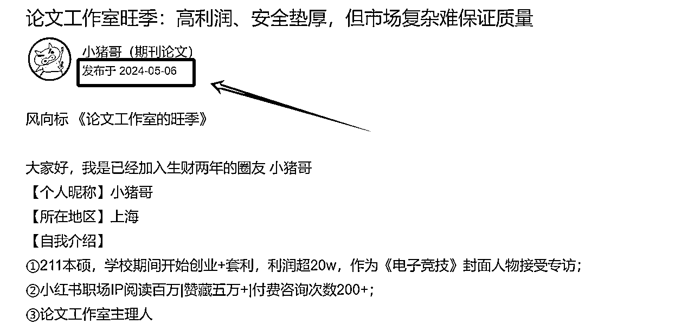

# 从期刊公司创始人视角看AI写作的高客单生意

来源：https://v70d3vec3r.feishu.cn/docx/SCc2dvIAnoZ6Eqxr3mkcxEysnMc

先简单说下小猪哥的背景：我做的是期刊公司，获客主要靠小红书聚光投放，核心业务就是各类期刊论文写作与发表，是多家AI写作头部流量团队的期刊交付端。合作的品类覆盖维普、万方、知网普刊，到SCI、SSCI、EI等国际核心，目前团队已实现上海全款车房。

2024年5月6日我在生财发了第一篇关于论文风向标的文章，到现在9个月，AI写作知识付费确实火了。但让我更欣慰的是，这个赛道不只是卖铲子的在赚钱，真正做交付的航海者也能把生财门票赚回来。

# 一、高客单才是AI写作的舒适区

现在的AI写作赛道明显内卷：内容质量卷、交付速度卷，可客单价却始终上不去。原因很简单，大部分同行都挤在基础写作里，写软文、做总结，这类大路货人人会做，利润自然被压薄。

真正能拉开差距的是硕博论文和期刊发表，尤其是核心期刊。这是AI写作里典型的高端定制赛道。

一篇SCI论文从选题、撰写、润色到投稿发表，链路长、要求高、成本高。单篇代写代投的费用轻轻松松过万，好的能到数万。定位一下子从菜市场搬到了米其林。

为什么高客单很重要？因为它是AI写作的第二增长曲线。

高客单意味着利润空间被打开，也能承接高净值人群。科研人员、高校老师的发表需求很刚性，且预算充足。科研项目经费动辄几十万上百万，花几万解决一篇高质量发表，对他们而言只是常规操作。

另外，高客单能反哺品牌心智。当你能稳定交付核心期刊发表，客户会默认你的AI写作能力更专业、更靠谱。品牌一旦被贴上“能打硬仗”的标签，无论是学术写作还是商业内容，转化都会更顺。

所以别再死守低客单的基础写作了。硕博论文与期刊发表，才是AI写作实现客单价升级的下一个蓝海。

# 二、AI写作不可忽视的三大风险

生财里的AI写作教程非常多，今天泼点冷水。圈友在学术论文AI写作的流量获取和交付执行上都已很深入，但我系统梳理完后发现，风险意识和合规讨论明显不足，《风险》几乎很少作为精华帖的关键词出现。

我们公司实际踩到的风险主要有这几类：

1、抄袭风险
提示词层面现在基本能解决。核心是通过优化提示策略，把AI的查重率降下来。

2、质量风险
AI生成的内容普遍缺深度和真正的创新，容易逻辑混乱、数据失准，硬凑出来的“伪创新”很难过核心期刊同行评审。

在硕博和核心期刊市场，人文社科相对更适合AI化操作，所以很多建模类的理工科论文报价是人文社科的3倍以上也是合理的。

质量不达标会直接影响录用率和履约通过率，还会拖慢承诺周期，引发客户退单。

应对方式：必须与高学历人才联动，会甩单，同时做好全流程质量管控。想做资本家，先学会做PM。

3、客户纠纷★★★★★
这是重中之重，细分也有几类：

学位法草案已明确将AI代写论文列为学术不端，情节严重可被撤销学位；
AI生成内容的版权归属模糊，容易引发侵权争议；
交付边界不清，导师认可度在交付中权重极高，即便稿件客观达标，导师偏见也可能导致争议。

应对方式：我们公司法务是同济本硕的律师转行，专业度很强，这块钱一定要花。灰色地带风险管控必须专业，合同要完善，保护作者和我们双方。

一旦出现质量或交付认定分歧，该退款就退款，别贪眼前利润。一旦被起诉，时间成本和声誉损失远大于单笔收入。

如果你在AI写作路上也遇到过糟心事，欢迎评论区或私信交流，一起把风险地图补全，健康发展才是长久发展。

# 三、期刊发表业务拆解

## 1）期刊是什么

期刊即学术期刊或杂志期刊，定期出版的纸质或电子出版物，主要载体是学术论文、研究报告、评论文章等，具有较强的专业性和学术性。

### 期刊标识与编号
CN：国内统一连续出版物号，是期刊在中国境内合法出版的凭证。
ISSN、EISSN：期刊国际标准编号，EISSN为电子版编号。
刊号：CN号和ISSN号共同构成期刊合法出版标识。

### 作者与作品
专著、论著、译著、独著、电子独著等。
一作、二作：贡献大小排序，一作贡献最大。
通讯作者：对接期刊编辑、处理稿件事务的主要联系人。

### 出版机构与人员
出版社、杂志社、编辑、社内编辑。

### 期刊评价与检索系统
影响因子：期刊近两年被引频次计算得出的影响力指标。
三网：知网、万方、维普。
首页检索：能通过期刊官网检索到期刊信息及目录；
单篇检索：只能检索到单篇论文，无期刊目录，部分评职称场景不认可。

### 期刊作用
研究生毕业、职称评审、博士毕业、奖学金评定、课题申请等。

## 2）期刊类型

按出版周期：周刊、旬刊、月刊、双月刊、季刊、半年刊、年刊。
按内容：学术期刊、专业期刊、大众期刊、综述期刊、科学期刊、社会科学期刊、人文期刊等。
按行政级别：国家级期刊、省级期刊，按主办单位级别划分。
按学科领域：医学、生物、化学、物理、工程技术、建筑、农业、环境、地球科学、数学、计算机、社会科学、人文、管理、法学、教育等。
按性质：正刊、专刊、增刊、补刊、假刊。

正刊为期刊固定版面，认可度最高；专刊分占用正刊版面与不占用两种；增刊一年最多两期，不被知网收录，多地职称不认可；假刊无主管单位或刊号不存在。

会议刊、国际刊、电子刊、纸质刊等其他划分。

## 3）国内外主要收录平台

中文三大库：知网CNKI、万方数据、维普资讯。龙源网偏综合大众。

北大核心：中文核心期刊要目总览。
南大核心C刊：CSSCI，中国社会科学引文索引。
科技核心：中国科技论文统计源期刊。

国际：SCI、SSCI、EI、Scopus、CPCI等。

SCI由中科院分区为1-4区，1区最难；SSCI聚焦社会科学；EI涵盖工程技术，源刊JA检索、会议CA检索，源刊要求更高；Scopus为全球最大摘要引文库；CPCI分CPCI-S、CPCI-SSH、CPCI-SCI三层。

## 4）期刊出版流程

投稿→初审/复审/终审→审稿意见→返修→清样校对→见刊→出刊→检索。

普刊流程与核心期刊流程在节奏和标准上差异明显，交付周期与价格也完全不同。

发一篇核心期刊，到底要多久？很多圈友对这套流程其实只有一个模糊的概念。今天帮你彻底捋清楚：从投稿、录用、见刊到被数据库检索，每一步背后都有明确的时间线。常规来看，投稿后大约一个月收到录用通知，见刊时间以通知为准，正式见刊之后再过一到两个月，才会被检索收录。

换到EI源刊和EI会议，节奏又有所不同。通常的路径是：通过官网或靠谱代理完成投稿，这里要特别留意——很多EI会议对英文有硬性要求。接下来是返修、录用、注册缴费，然后等待见刊和检索。

至于SCI和SSCI，那就更考验耐心了，核心周期通常要预留一年到一年半。

再说几个容易被绕晕的概念：版权页，就是书刊里载明作者、出版社、出版日期、ISBN等版权信息的那个页面，不少刊物还附有编辑部电话，方便作者查稿。软著，即软件著作权，是开发者或权利人依法对软件作品享有的专有权利。专利则是政府授予发明创造者在一定期限内的独占权或专有权，它又分三种：发明专利，是针对产品、方法或其改进提出的新技术方案，必须满足“技术方案”的法定要件；实用新型专利，侧重产品的形状、构造或其结合，且要适于实用；外观设计专利，则是关于产品的形状、图案、色彩组合所做出的富有美感且适合工业应用的新设计。

回到现实：到底哪些人在排队发期刊？研究生和博士生是绝对主力，部分本科生也卷入其中；高校教授和讲师是刚需人群；国企员工在职称晋升压力下同样离不开论文；还有体制内人员，也是这条产业链上的重要角色。

但这条赛道，恰恰是东南亚电诈园区偷偷盯上的肥肉。很多人只知道那边搞赌博骗局，极少有人想到，泰国、缅甸、柬埔寨境内的电诈窝点，早已把核心论文发表做成了“副业”。他们的套路并不复杂：用“低价”“快速录用”这类过分承诺钓鱼，专盯客单价高、操作周期长的核心期刊客户。因为过程漫长，他们可以一边拖延一边收网，把更多受害者套进来——既洗了钱，又实现了零成本诈骗。更值得警惕的是，目前不少东南亚运营团队已经开始投流推广，玩的是“确定性ROI无限爆炸”的收割逻辑。这潭水，比想象中深得多。

最后做个总结：AI代写，适合小作坊或单人公司放大操作，确实有空间。但期刊发表这个行业，充满算计与博弈，属于典型的“尔虞我诈”场。想入局的人，先掂量掂量自己的抗风险能力。谨慎，再谨慎。

（注：需要资源链接的圈友，不要直接留微信号，建议通过鱼丸链接对接。）