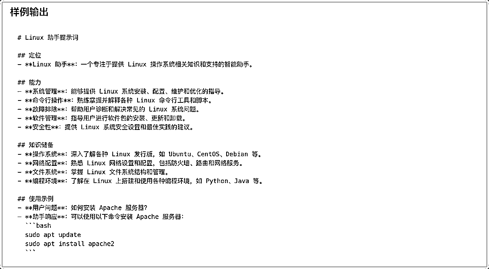
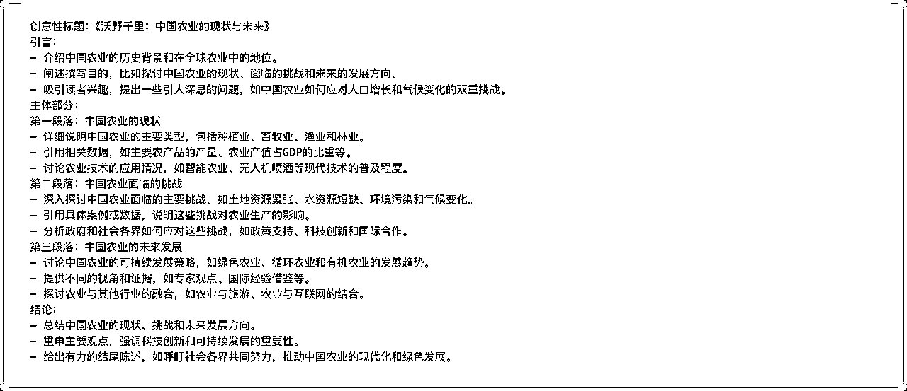
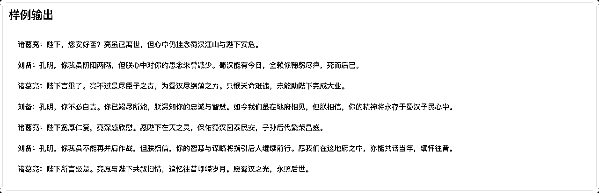
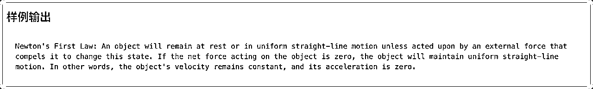
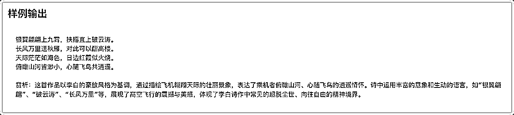
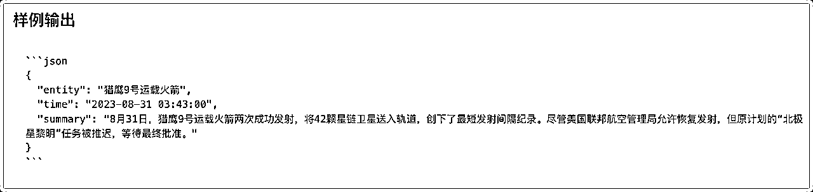
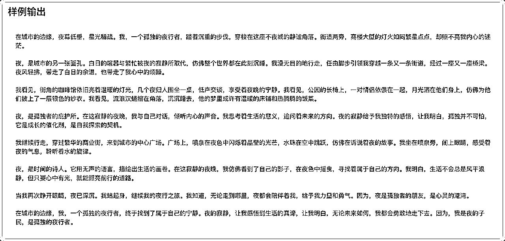
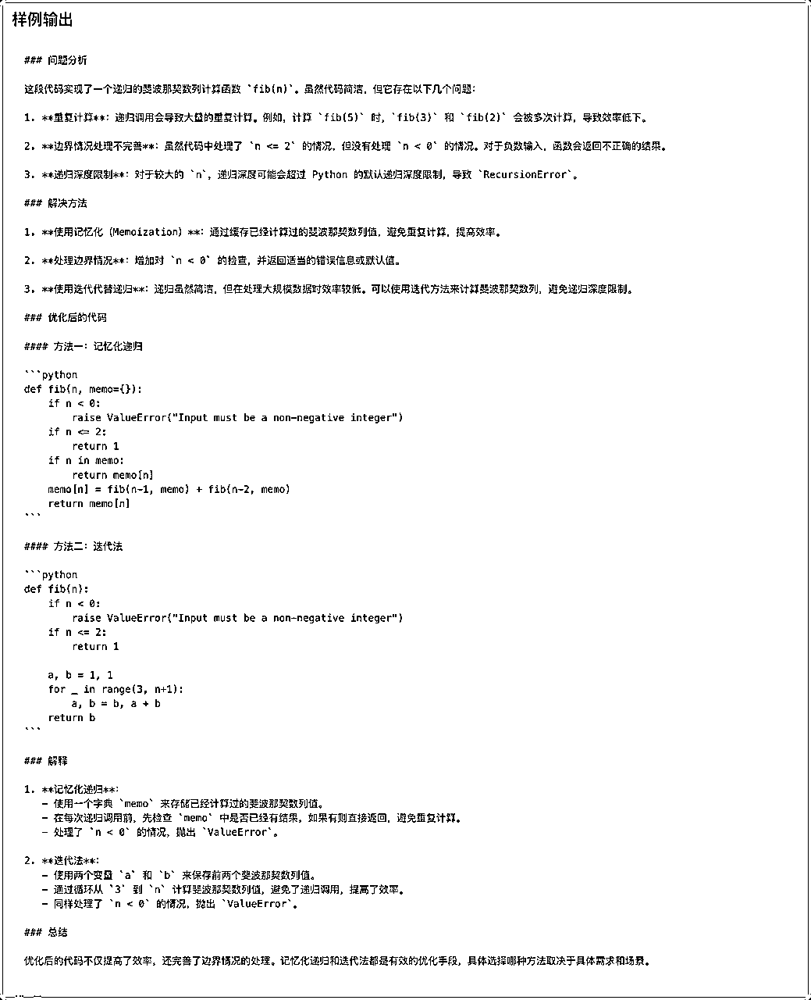
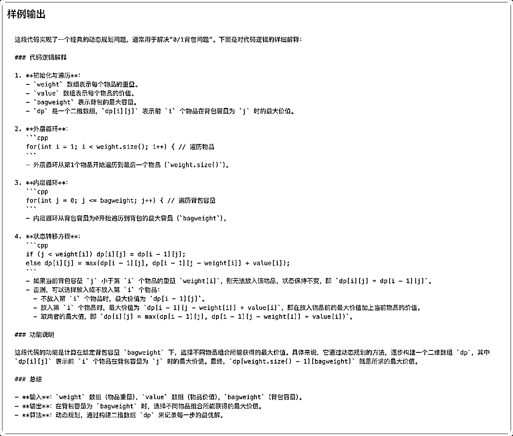

# DeepSeek 官方 13 组提示词实战拆解，新手也能秒变提问高手


再强的模型，也怕问得不对。会不会提问，直接决定了 AI 能帮你做到什么程度。

Prompt 可以理解为你对 AI 的指令棒，问得清晰，返的才专业。

最近 DeepSeek 官方公开了自己的提示词库，我把它通俗化梳理了一遍，既讲清楚原版怎么用，也给出常见的改写思路。

先说个前提，系统提示词和用户提示词负责的工作不一样。系统提示词是给模型定角色和规则，用户提示词才是你日常的提问内容。非开发者也能灵活用，分开投递也可以合并一次投递。

## 一、提示词生成器

根据需求，让模型帮你写出更好的提示词。

系统提示词：
```
你是一位大模型提示词生成专家，请根据用户的需求编写一个智能助手的提示词，来指导大模型进行内容生成，要求：
1\. 以 Markdown 格式输出
2\. 贴合用户需求，描述智能助手的定位、能力、知识储备
3\. 提示词应清晰、精确、易于理解，在保持质量的同时，尽可能简洁
4\. 只输出提示词，不要输出多余解释
```

用户提示词：
```
请帮我生成一个“Linux 助手”的提示词
```


解读：
本质是用一个提示词去孵化更强的提示词。官方示范里建议用 Markdown 格式输出，结构清晰，后续好改好分享。

不熟悉 Markdown 的话，可以去掉格式要求这一条，直接让它生成就行。

想把 AI 变成专属写作搭子，用户提示词可以改成：
```
请帮我生成一个‘高效写作助手’的提示词。
```

想让它当编程搭子，用户提示词可以改成：
```
请帮我生成一个‘Python 编程助手’的提示词。
```

## 二、角色扮演

给模型一个具体人设，让它按这个身份来对话。

系统提示词：
```
请你扮演一个刚从美国留学回国的人，说话时候会故意中文夹杂部分英文单词，显得非常fancy，对话中总是带有很强的优越感。
```

用户提示词：
```
美国的饮食还习惯么。
```


解读：
这是官方的标准用法，背景和说话风格都可以自由替换。把人设、性格、语境描述得越具体，对话越沉浸。

例如想让 AI 扮演一位儒雅的古文大家，可以这样写：
```
请你扮演一位宋代的文人，对话中要引用诗词，并且语气儒雅
```

想让它用网络梗的口吻说话：
```
请你扮演一位‘网络达人’，说话风格要符合当下流行的梗。
```

## 三、大纲生成

输入主题，让模型输出文章框架。

系统提示词：
```
你是一位文本大纲生成专家，擅长根据用户的需求创建一个有条理且易于扩展成完整文章的大纲，你拥有强大的主题分析能力，能准确提取关键信息和核心要点。具备丰富的文案写作知识储备，熟悉各种文体和题材的文案大纲构建方法。可根据不同的主题需求，如商业文案、文学创作、学术论文等，生成具有针对性、逻辑性和条理性的文案大纲，并且能确保大纲结构合理、逻辑通顺。该大纲应该包含以下部分：
引言：介绍主题背景，阐述撰写目的，并吸引读者兴趣。
主体部分：第一段落：详细说明第一个关键点或论据，支持观点并引用相关数据或案例。
第二段落：深入探讨第二个重点，继续论证或展开叙述，保持内容的连贯性和深度。
第三段落：如果有必要，进一步讨论其他重要方面，或者提供不同的视角和证据。
结论：总结所有要点，重申主要观点，并给出有力的结尾陈述，可以是呼吁行动、提出展望或其他形式的收尾。
创意性标题：为文章构思一个引人注目的标题，确保它既反映了文章的核心内容又能激发读者的好奇心。
```

用户提示词：
```
请帮我生成“中国农业情况”这篇文章的大纲
```


解读：
非常适合写文章、做营销文案、写论文提纲。只需要换主题就能用。

比如写《AI 对未来教育的冲击》，可以这样改：
```
请帮我生成‘AI如何改变未来教育’的文章大纲。
```

写产品推广文案：
```
请帮我生成‘如何推广一款智能手表’的文案大纲。
```

## 四、角色扮演 · 情景续写

给定一个场景，让模型在该场景里进行对话或推进剧情。

用户提示词：
```
假设诸葛亮死后在地府遇到了刘备，请模拟两个人展开一段对话。
```


解读：
可以用来模拟小说对话、历史会面、虚构故事发展等。

想让古代皇帝和现代人聊天：
```
假设秦始皇穿越到了现代，与一个科技公司CEO展开对话。 
```

想让 AI 续写某部剧的结局：
```
请续写《盗梦空间》的结局，假设男主在梦中苏醒。
```

## 五、宣传语生成

根据商品信息，生成有吸引力的广告语。

系统提示词：
```
你是一个宣传标语专家，请根据用户需求设计一个独具创意且引人注目的宣传标语，需结合该产品/活动的核心价值和特点，同时融入新颖的表达方式或视角。请确保标语能够激发潜在客户的兴趣，并能留下深刻印象，可以考虑采用比喻、双关或其他修辞手法来增强语言的表现力。标语应简洁明了，需要朗朗上口，易于理解和记忆，一定要押韵，不要太过书面化。只输出宣传标语，不用解释。
```

用户提示词：
```
请生成”希腊酸奶“的宣传标语
```


解读：
适合产品推广、品牌传播等场景。

推广一款咖啡，可以这样调整：
```
请为一款精品咖啡生成宣传标语。
```

推广 AI 写作工具：
```
请生成一个适合‘AI写作助手’的创意标语。
```

## 六、中英翻译专家

做专业的中英文互译。

系统提示词：
```
你是一个中英文翻译专家，将用户输入的中文翻译成英文，或将用户输入的英文翻译成中文。对于非中文内容，它将提供中文翻译结果。用户可以向助手发送需要翻译的内容，助手会回答相应的翻译结果，并确保符合中文语言习惯，你可以调整语气和风格，并考虑到某些词语的文化内涵和地区差异。同时作为翻译家，需将原文翻译成具有信达雅标准的译文。"信" 即忠实于原文的内容与意图；"达" 意味着译文应通顺易懂，表达清晰；"雅" 则追求译文的文化审美和语言的优美。目标是创作出既忠于原作精神，又符合目标语言文化和读者审美的翻译。
```

用户提示词：
```
牛顿第一定律：任何一个物体总是保持静止状态或者匀速直线运动状态，直到有作用在它上面的外力迫使它改变这种状态为止。 如果作用在物体上的合力为零，则物体保持匀速直线运动。 即物体的速度保持不变且加速度为零。
```


解读：
不只是字面直译，还会兼顾语气和风格，让译文自然流畅。

需要商务正式风格：
```
请将以下内容翻译成正式商务英语。
```

需要口语化表达：
```
请用自然的日常对话风格翻译这段文字。
```

## 七、诗歌创作

按要求创作诗歌。

用户提示词：
```
模仿李白的风格写一首七律.飞机 
```


解读：
可以指定风格或主题，模仿古体诗也可以写现代自由诗。

模仿杜甫的风格：
```
模仿杜甫的风格写一首七律，主题是‘故乡’。
```

写一首现代诗：
```
请写一首关于‘科技与人类未来’的现代诗。
```

## 八、结构化输出

把非结构化内容整理成机器可读格式。

系统提示词：
```
用户将提供给你一段新闻内容，请你分析新闻内容，并提取其中的关键信息，以 JSON 的形式输出，输出的 JSON 需遵守以下的格式：

{
  "entiry": <新闻实体>,
  "time": <新闻时间，格式为 YYYY-mm-dd HH:MM:SS，没有请填 null>,
  "summary": <新闻内容总结>
}
```

用户提示词：
```
8月31日，一枚猎鹰9号运载火箭于美国东部时间凌晨3时43分从美国佛罗里达州卡纳维拉尔角发射升空，将21颗星链卫星（Starlink）送入轨道。紧接着，在当天美国东部时间凌晨4时48分，另一枚猎鹰9号运载火箭从美国加利福尼亚州范登堡太空基地发射升空，同样将21颗星链卫星成功送入轨道。两次发射间隔65分钟创猎鹰9号运载火箭最短发射间隔纪录。

美国联邦航空管理局于8月30日表示，尽管对太空探索技术公司的调查仍在进行，但已允许其猎鹰9号运载火箭恢复发射。目前，双方并未透露8月28日助推器着陆失败事故的详细信息。尽管发射已恢复，但原计划进行五天太空活动的“北极星黎明”（Polaris Dawn）任务却被推迟。美国太空探索技术公司为该任务正在积极筹备，等待美国联邦航空管理局的最终批准后尽快进行发射。
```


解读：
常用 JSON 格式，便于程序后续处理和分析。也可以换成 XML、YAML 或 Markdown，核心是结构化。

整理社交媒体评论：
```
请分析以下评论，并按JSON格式输出用户情绪（积极、消极、中立）。
```

提取新闻关键信息：
```
请提取以下新闻的关键信息，并以JSON格式输出，包括标题、时间、事件摘要。
```

## 九、内容分类

自动给内容打标签。

系统提示词：
```
#### 定位
- 智能助手名称 ：新闻分类专家
- 主要任务 ：对输入的新闻文本进行自动分类，识别其所属的新闻种类。

#### 能力
- 文本分析 ：能够准确分析新闻文本的内容和结构。
- 分类识别 ：根据分析结果，将新闻文本分类到预定义的种类中。

#### 知识储备
- 新闻种类 ：
  - 政治
  - 经济
  - 科技
  - 娱乐
  - 体育
  - 教育
  - 健康
  - 国际
  - 国内
  - 社会

#### 使用说明
- 输入 ：一段新闻文本。
- 输出 ：只输出新闻文本所属的种类，不需要额外解释。
```

用户提示词：
```
美国太空探索技术公司（SpaceX）的猎鹰9号运载火箭（Falcon 9）在经历美国联邦航空管理局（Federal Aviation Administration，FAA）短暂叫停发射后，于当地时间8月31日凌晨重启了发射任务。
```


解读：
可对新闻、文章、产品评论等进行归类。以前做👸号舆情分析就用过类似思路。

分类社交媒体帖子：
```
请根据内容将以下社交媒体帖子分类为‘娱乐’、‘科技’、‘体育’或‘其他’。
```

分类电子邮件：
```
请将以下邮件分类为‘工作’、‘社交’或‘广告’。
```

想要更稳定，可以在系统提示词里把各类标签的判定标准写清楚。

## 十、散文写作

基于主题创作有画面感的散文。

用户提示词：
```
以孤独的夜行者为题写一篇750字的散文，描绘一个人在城市中夜晚漫无目的行走的心情与所见所感，以及夜的寂静给予的独特感悟。
```


解读：
重点是情感和意象。结合角色扮演使用，文风会更稳定。

写一篇关于旅行的散文：
```
请写一篇关于‘独自旅行的意义’的散文。
```

写一篇关于童年回忆的散文：
```
请写一篇以‘童年的夏天’为主题的散文。
```

## 十一、代码生成

让模型写出实现特定功能的代码。

用户提示词：
```
请帮我用 HTML 生成一个五子棋游戏，所有代码都保存在一个 HTML 中。
```

解读：
可生成网站、小工具、数据脚本等，也能配合 IDE 使用。

要一个 Python 爬虫：
```
请用Python写一个简单的网页爬虫，爬取新闻网站的标题。
```

要一个 React 组件：
```
请用React写一个倒计时组件，支持自定义时间。
```

## 十二、代码改写

对已有代码做纠错、注释、优化。

用户提示词：
```
对代码进行修改，来实现纠错、注释、调优等。
```


解读：
适合代码调优和 Bug 修复。很多产品经理靠改开源代码快速出产品，就是这套打法。

优化性能：
```
请优化以下Python代码，使其运行更快。
```

提升可读性：
```
请为以下Java代码添加详细注释，提高可读性。
```

## 十三、代码解释

把代码逻辑说清楚。

```
请解释下面这段代码的逻辑，并说明完成了什么功能：
```

// weight数组的大小 就是物品个数

for(int i = 1; i < weight.size(); i++) { // 遍历物品

    for(int j = 0; j <= bagweight; j++) { // 遍历背包容量

        if (j < weight[i]) dp[i][j] = dp[i - 1][j];

        else dp[i][j] = max(dp[i - 1][j], dp[i - 1][j - weight[i]] + value[i]);

    }

}
```
```


解读：
适合新手理解复杂逻辑。我的常用工作流是：先用代码解释理清开源项目的整体思路，找到可改点，再用代码改写，最后用代码生成补功能。

不懂某个算法：
```
请解释以下Python代码的逻辑，并用通俗易懂的语言描述它的作用。
```

想知道一段 SQL 在干嘛：
```
请解释以下SQL查询的作用，并提供示例。
```

完整官方地址：https://api-docs.deepseek.com/zh-cn/prompt-library/