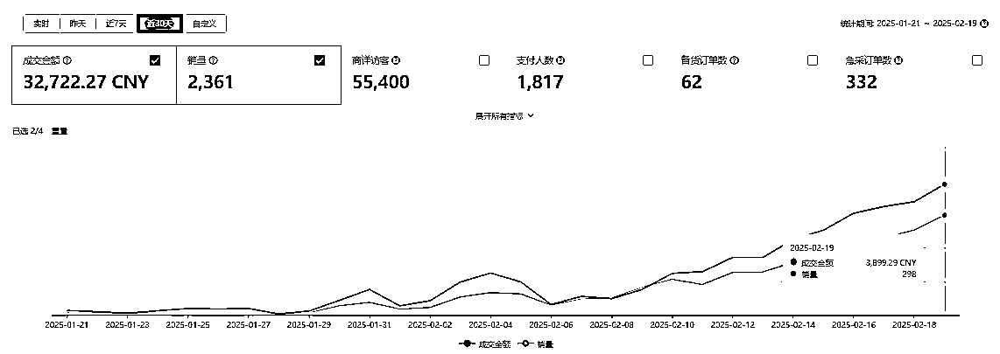
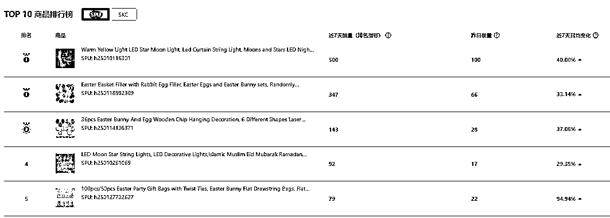

# 【航海好事】Shein 新店实操：两个月做到日均百单的航海笔记

## 先自我介绍一下

我是龙哥，成都的西北汉子，工科背景。

这次航海我带的一个店，销售额已经冲到3万+了，所以赶紧来把过程复盘一下。

我之前的履历几乎都在国内玩：

17-19年做天猫女装运营，从0做起做到年销售额3000万左右；
19-22年和人合伙做抖音IP，粉丝80万，月单量400万，赚到钱最后还是散伙；
22年到现在自己在做📕女鞋。

在上船之前，很多人劝我做跨境，我一直觉得陌生，经验不好迁移。

结果没想到一上船就真香了。

## 店铺成绩先报一下

这家店是12月25号才开的，到现在接近两个月，近30天累计销售额3万多，而且每天还在往上走。

运营这个店是我们组三个人在扛。

三个人里，两人是跨境小白，一个只玩过eBay算半个老手。

完全是靠1:1消化航海教练的方法论。

现在你看，每个人手里都有自己的小爆款。

这当然不是一夜之间发生的。

下面就把我们这俩月踩过的坑和摸到的路说清楚。

## 实操干货拆解

**第一，选品占七成，但不能瞎抄。**

光跟大爆款，你就是炮灰。

真正的思路是找：站外需求很足，站内竞争却还很空的品类。

听起来简单，做起来教练一天能毙掉我们十来个备选。

不是站内已经卷烂了，就是站外根本没人要。

正是因为这种即时打回，才逼着我们快速建立了品相判断的直觉。

航海里的方法论和人脉也起了大作用。

教练分享的榜单选品、跟卖选品、先发散后收敛，都很管用。

组里还有技术大哥写脚本，能快速筛潜力量。

大家一起碰撞后，我们从一天选不出一个品，到现在能批量筛出达标的款。

店里现在每个在卖的热销品，都来自组员的成果。

**第二，上架占三成，用心就能赢。**

Shein现在很多店铺还在复制粘贴式上架，卷度还不够。

同一款货同时上，谁做得细谁就能出头。

别人只抄爆款标题，我们就把多个爆款标题拆解重组，覆盖更广的搜索词。

别人图随意拍，我们把主图、场景图、细节图分层设计：第一张抓点击，第二张推转化，最后一张给决策支撑。

甚至同款用不同场景拆成多SKU上架，把流量口吃满。

**第三，定价核价决定生死。**

国内电商可以自己定价，Shein不行，平台会锁定采购价。

价格给得高，利润高，还能去报活动拿流量。

这点是航海期间最难啃的骨头。

我们最早上的几批货，平台核价比1688还低，让人窒息。

当时只能靠P图、AI改图、换版型来绕过图搜。

好在后来上车的款，基本都做到了20%-50%的毛利。

## 两个关键心得

1. 节奏和大盘必须顺。

航海初期被圣诞季吃掉需求，紧接着海外放假消费停摆，再叠加国内春节工厂放假，几乎选不出能卖的品。

直到小善团队带我们提前布局3月的斋月节点，年前就开始备货踩线，这才迎来一波整体上涨，店铺顺利起量。

2. Shein启动慢，要有扛周期心态。

和国内玩法不同，Shein从选到卖很长。

选中款-上架-平台审核1天-定价1-3天-终审1-4天-排期上架，顺利也要5-8天一个循环。

爆款靠概率堆出来的，不是单点。

我们做好了撞一个月南墙的准备，也见过不少同学在周期里直接退群。

但越难走的赛道越不卷，熬过去就是优势。

## 最后说点心里话

2022年底我爸妈生病住院，闲着无聊试了刚退出的📕电商，挂了几件没写笔记就出单了。

当时我就觉得这是个供需失衡的蓝海。

Shein给我同样的感觉。

就算在我们起步的12月，需求低、选品差、上架水平松散，三重debuff叠满，还能出单甚至小爆。

这说明需求还在，只是没人认真喂养。

必须给他们整点精细货，这就是机会。

纵有疾风起，日行三公里。

感谢赚钱，感谢航海，让我遇到这么硬核的团队，也希望你能找到自己的那条船。

有问题想交流Shein实操的，可以私信鱼丸或联系小善团队。
