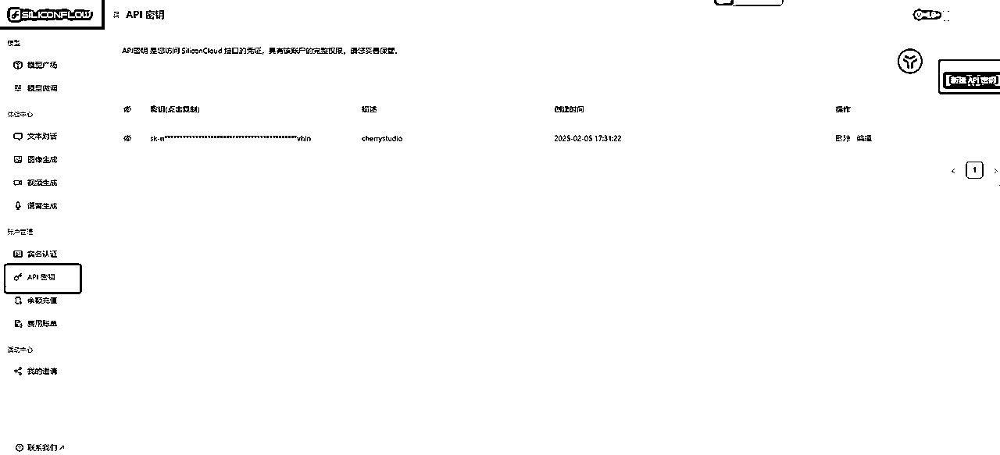
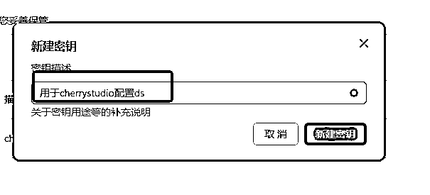
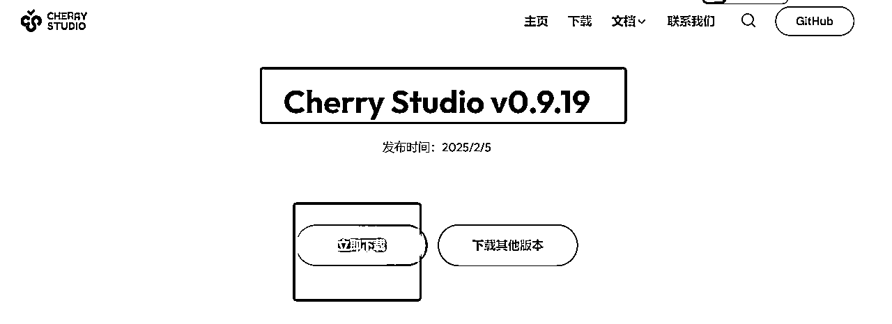
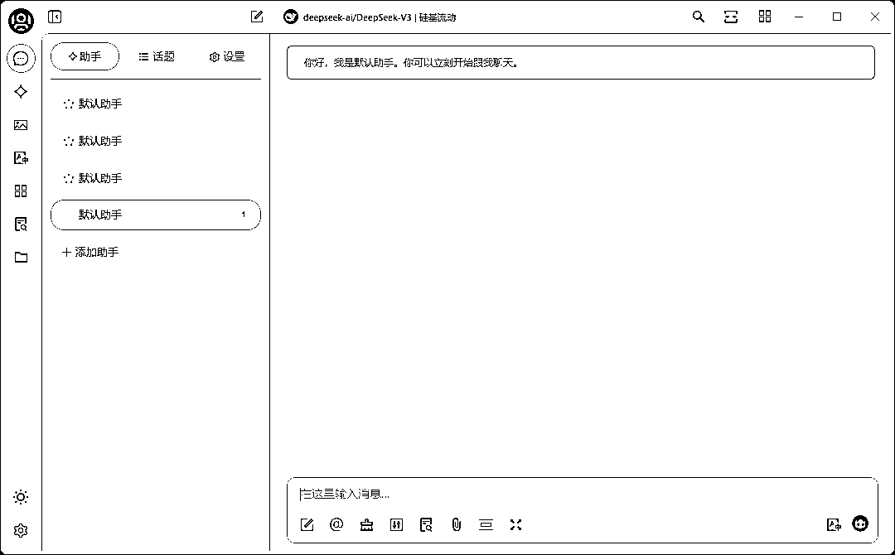
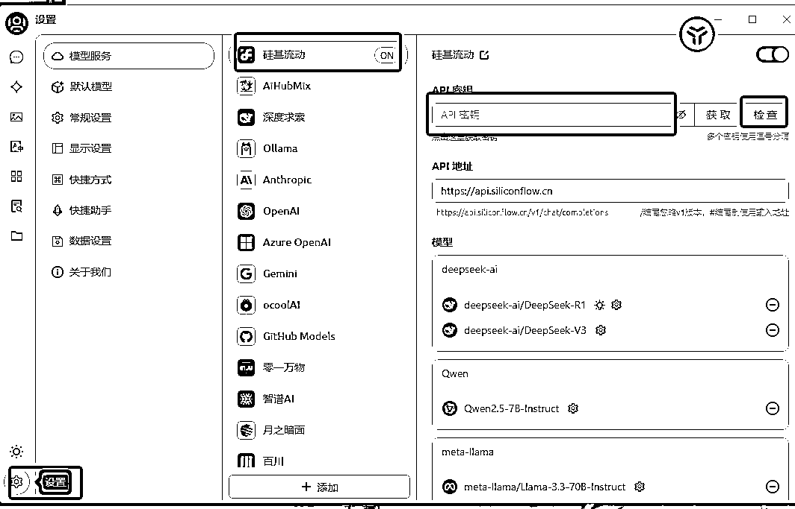
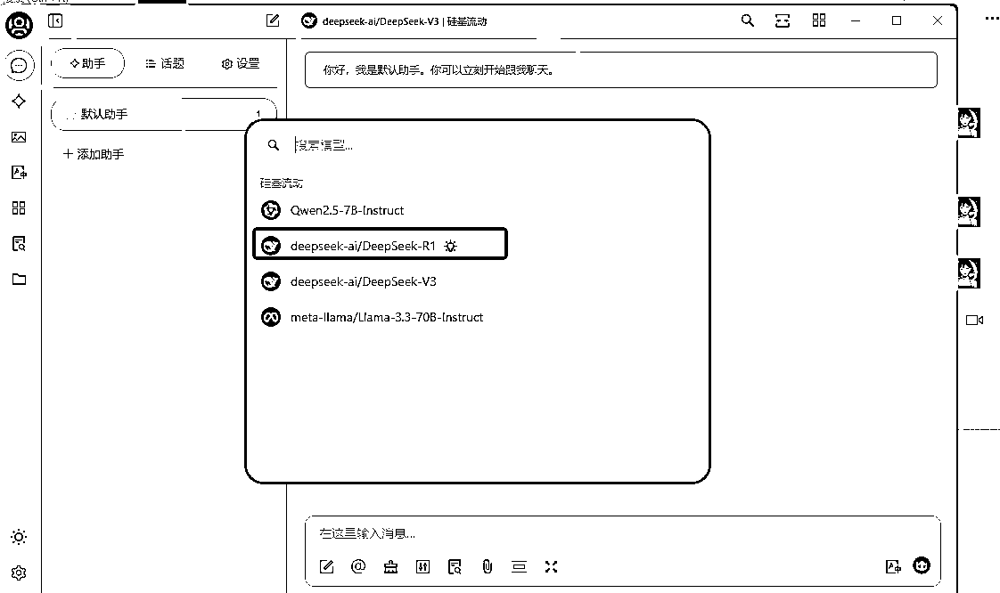
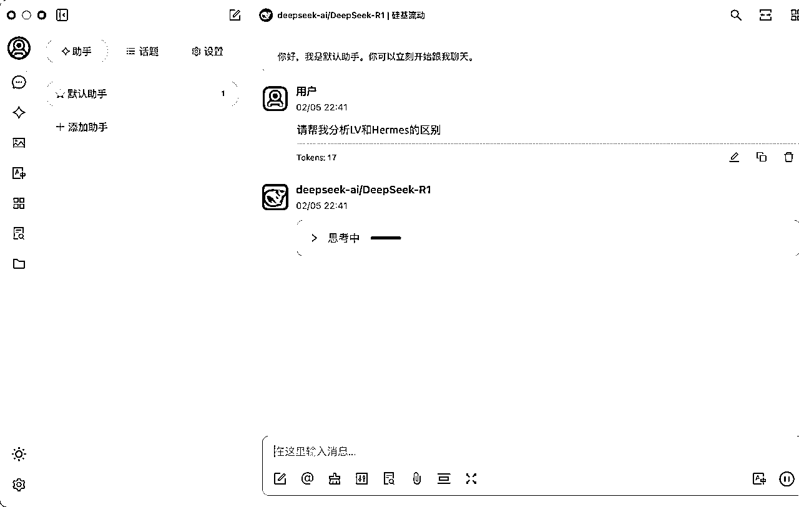
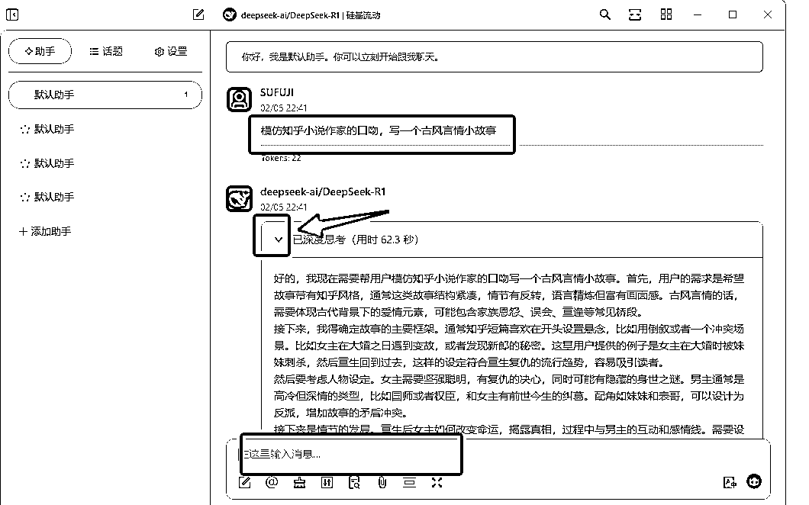

DeepSeek API 小白配置全攻略：官方直连/硅基智能手把手教学

最近不少朋友吐槽，网页版 DeepSeek 越用越卡，App 端也经常弹出“服务器繁忙”。如果你是刚入门的小白，这篇文章就是一份现成的备用方案。

平时拿来聊天、当个人助理的话，还是优先选官方版本更靠谱。毕竟官方服务器的响应速度、模型版本以及底层优化都是保持最新的。第三方接入的虽然也是 DeepSeek 开放出的模型，但在时效性和优化程度上可能会稍微打点折扣。

先聊聊基础概念。

API 是什么？简单说，它就像一把钥匙，形态是一串字符，比如 sk-xxxxx。但光有一把钥匙没法直接用，你总不能对着一串文本对话吧。想用钥匙打开 AI 模型那扇门，就必须有个软件载体，比如电脑上的客户端或者其他应用。把密钥填进这个软件，它就和 AI 的服务器搭上了桥，服务器也就能识别你调用的是哪家 AI、哪台机器。所以开工之前要准备两样东西：一个支持 API 接口、但不内置 AI 的“空壳软件”，以及一串用来认领 AI 服务的 API 密钥。

那官方版和第三方 API 到底哪个好？正常局面下，官方 App、网页和原生 API 的稳定性是最高的。其次才是各家厂商提供的 API 接口——他们的服务器资源、算力基础、模型版本都可能存在差异。如果把开源的 DeepSeek 大模型比作一份公开菜谱，那谁都能照着做菜。官方相当于用自己的厨房按菜谱现做，可惜厨房里人太多，想吃到好菜得排队，甚至还有个别想“炸厨房”的。这时候其他饭店也拿到了菜谱，而且不用排队，但厨具和厨师可能有差别，端上来的菜会有一点点口感差异——比如官方已经悄悄迭代加料了，那些拿着旧菜谱的饭馆还停在历史版本里。

再说说 token 到底是个啥。Token 就意味着算力。你用 API 连接上 AI 的主服务器，服务器为你跑任务就要消耗能量，这股能量就是算力，也就是 token。跟汽车烧油一个道理，开车就得加油，想让 AI 干活就得买算力。不同的平台基本都提供 API，目前 DeepSeek 官方、硅基智能等平台注册就送算力，相当于买车送一箱油，先用着体验一下，油跑完了再掏钱充值就行。

下面进入实操流程。

准备工具：
- 对话客户端：CherryStudio，下载地址 https://cherry-ai.com/download
- 获取 API 密钥的平台：DeepSeek 官方（https://platform.deepseek.com/usage，注意目前只恢复老用户访问，新用户注册不了）；推荐备选平台硅基流动（https://cloud.siliconflow.cn/i/5sgdzBUa）
- 其他备胎：阿里百炼、百度千帆 modelbuilder、腾讯云 TI 平台、华为云和潞晨科技联合的平台、字节火山方舟。这些我都还没亲自测过，不过各家通稿都发了，大家搜出来看看测评再自己选。

第一步，去硅基流动搞到 API。
用手机号注册账号，注册完平台会送 14 元对应的 token 算力。接着在左侧菜单栏找到“API 密钥”，点右上角“新建 API 密钥”，描述随便填，不影响使用。我个人的习惯是：给不同工具各建一套密钥，这样月底看账单就知道哪个工具烧的 token 最多，也好决定要不要换更省钱的模型。创建完就会得到一串代码，鼠标悬停上去就能复制。密钥自己保存好，千万别发到公共平台上，否则别人拿你的密钥去连 AI，消耗的是你账户里的算力——在大模型的世界里，算力等于真金白银。

第二步，下载安装 CherryStudio。

装完打开，界面是这样的：

点击左下角设置按钮，在列表里找到第一项“硅基流动”，开启并把第一步得到的密钥填进去。注意，点“检查”的时候先用 qwen 模型验证，别选 DeepSeek-R1。因为 R1 目前很容易因为太拥堵连不上，这不代表硅基流动有问题，而是模型本身在闹脾气。这一步我们要确保的是能连上硅基流动这个平台，毕竟这个平台上不止有 DeepSeek，还有很多其他大模型。

连接成功后，点左侧第一个对话按钮，选择默认助手，然后点上方的模型名称，把它从 V3 切换成 R1。R1 是带深度思考的，V3 不带思考，但价格便宜，适合做写标题、翻译这类不用太烧脑的活。

配置完成，现在就可以开始对话测试了。注意深度思考的过程，思考中旁边那个按钮，点开就能看到详细思路。

到这，你已经完成了一次完整的 API 配置和大模型接入。其实 CherryStudio 能玩的东西还有很多，它自带了不少提示词模板，建议多探索探索。前面也列了其他几个 API 平台，思路完全一样：在不同平台拿 API 密钥，然后回到 CherryStudio 里填上直接用。各平台送的算力多少不一定，官方额度不够的时候，完全可以去别的平台搭一套自己的 API 通道。