# 月入上万？玩着“车祸模拟器”也能在海外变现的冷门赛道
作者：龙哥

| 版本 | 更新描述 | 作者 | 更新日期 |

| V1.0 | 新建文档 | 科学羊 | 2024-01-15 |

| V1.1 | 增加云端玩法，家里没有电脑也可以玩 | 科学羊 | 2025-02-14 |

| V1.2 | 增加云端扫码登陆异常的处理方法 | 科学羊 | 2025-02-24 |

大家好，我是龙哥，👸号每天更新的专栏作者，也是签约媒体编辑、做海外内容创业的实践者，同时也在做游戏视频创作。

春节假期马上到了，在放假前想和大家聊一个特别小众但很有潜力的方向，假期空下来可以好好琢磨。先谢一下平台和各位支持我的星友，这是我第一次系统公开分享变现赛道的内容。

这个赛道我前后研究了大半年，从技术制作到海外投放一条龙都跑通了。说实话，目前国内把这个赛道做透并出完整教程的，我应该是第一人。已经有十多个朋友跟着我一起入场，如果你感兴趣，完全可以现在加入。

⚠️ 先说清楚，这个方向和大家想象的可能有些出入，门槛不低。更适合有创作热爱、想做原创输出的人。

门槛确实偏高，难度也大，基本做不了纯搬运，必须靠真材实料的打磨和对游戏本身的喜爱。但一旦沉下来做，回报是实打实的。

废话不多说，直接进入主题。

* * *

# 一、方向总览

面向市场：海外用户

主要平台：YouTube + TikTok

内容形式：游戏视频

游戏本体：BeamNG.drive，国内玩家俗称“车祸模拟器”

视频形态：中长视频 + Shorts + TikTok 中视频

核心受众：儿童、青少年、汽车爱好者

变现路径：平台广告分成、创作者奖励、国内承接游戏视频制作订单

所需能力栈：

1、热爱驾驶类游戏，有单机游戏基础操作经验
2、会用游戏模组
3、能写简单的游戏脚本，懂点编程加分
4、懂 3D 建模与 Blender，比如人物、车辆建模及动画制作
5、有镜头调度经验，有导演思维
6、具备基础视频剪辑能力

通俗讲，就是基于原游戏画面和场景，自行搭建内容，把游玩过程录下来，加故事包装后输出给海外观众。

游戏核心介绍：

BeamNG.drive 是一套以高精度物理引擎著称的赛车模拟软件。它的卖点是超真实的车辆物理和碰撞反馈，开放沙盒环境，让玩家可以自由试车、做实验、玩破坏。

# 二、玩法拆解与流量逻辑

## 2.1 中长视频

### 车祸模拟

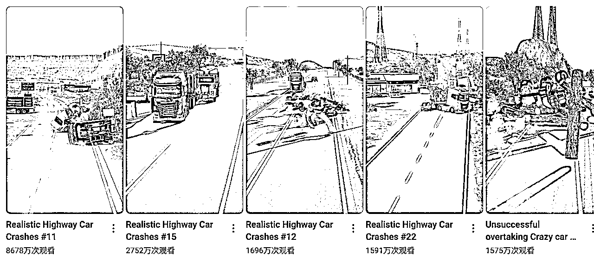

### 趣味模拟

这是 2025 年刚起号时的作品

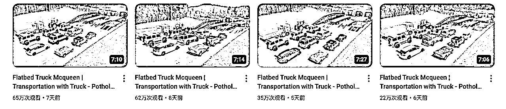

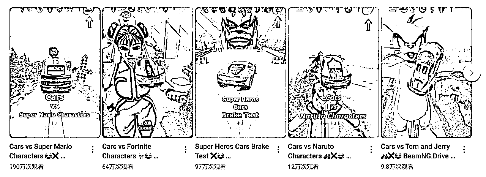

### 游戏电影

玩法是模仿影视片段在游戏里还原，这类内容很容易冲到百万播放，也是该游戏内容的天花板。

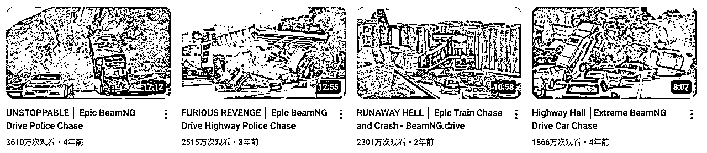

## 2.2 短视频

### 趣味测试

主要是碰撞测试，在 TikTok 上这类内容流量非常好

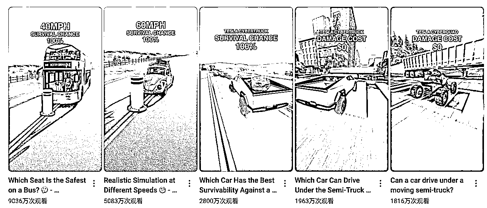

### 盲盒测试

很适合做儿童向账号

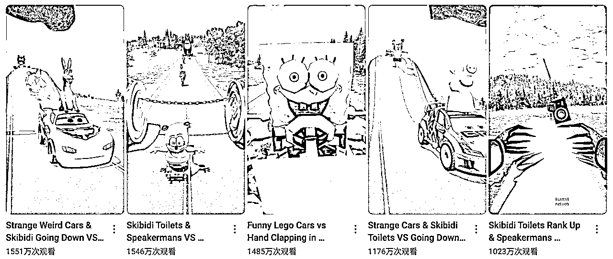

### 跳跃比拼

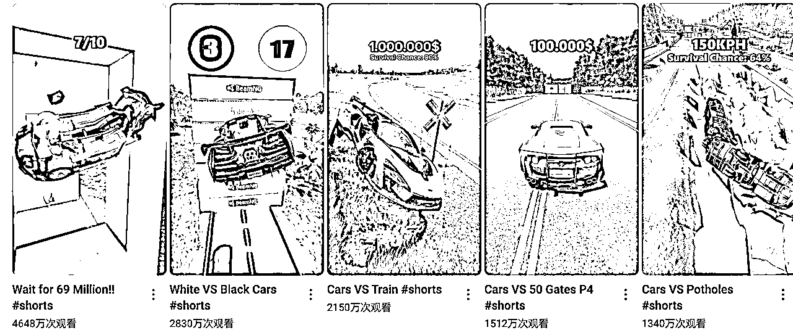

### 道具测试

这类视频普遍播放量过亿，受众极广而且制作门槛相对低

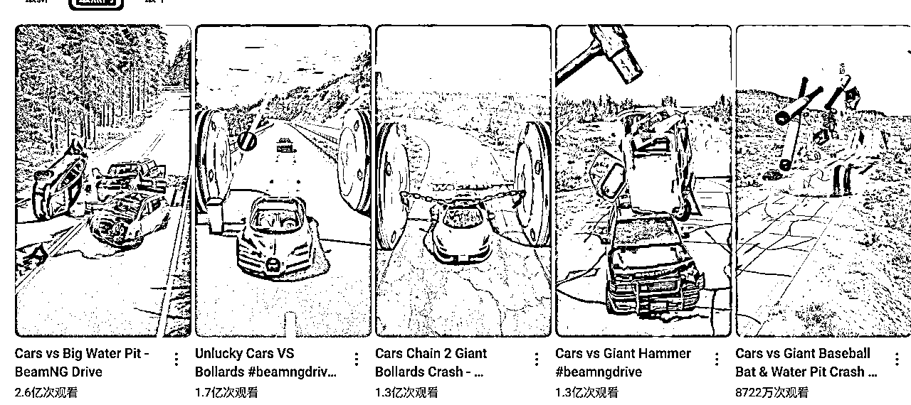

## 2.3 汽车广告接单

我之前就给一个汽车导演做过单，用车祸模拟器给他出一条广告，1分钟报价约500元人民币，发挥空间很大。

案例参考如下。

## 2.4 收益预期

按我的观察，这个赛道做到稳定月入数万问题不大，甚至更高。下面几个月我带人入场，一个月就能看到高爆发收益。视频单价均价在1.1以上。

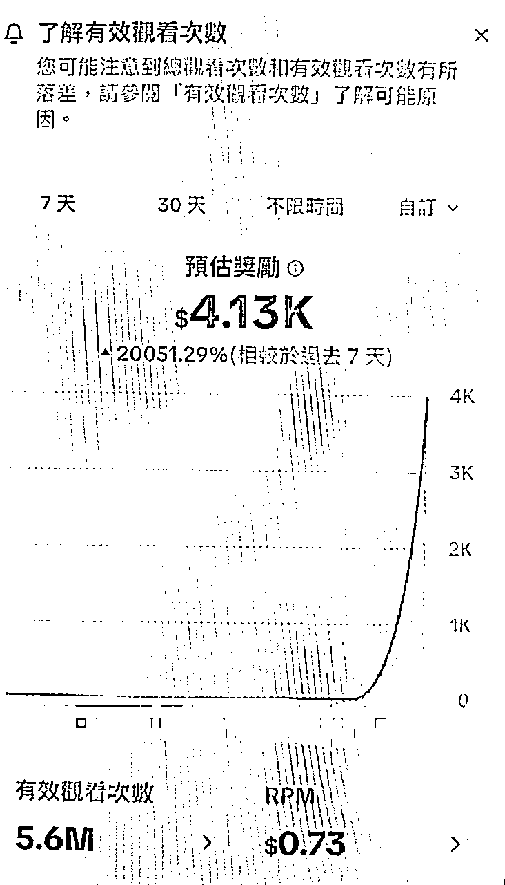

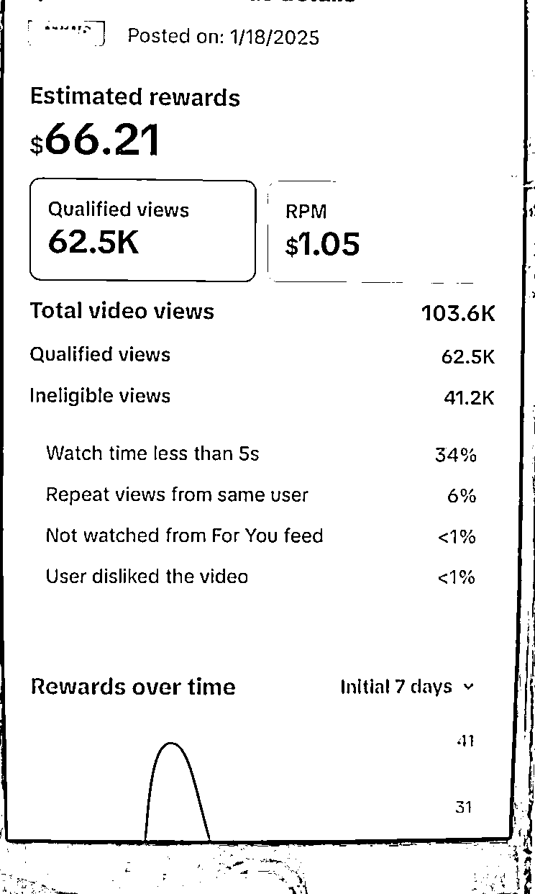

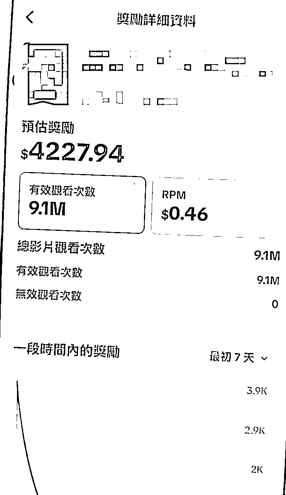

YouTube 收益参考

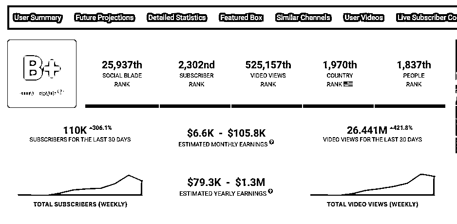

# 三、游戏部署与配置

想系统学习游戏操作，可以看我在 B站的课程：

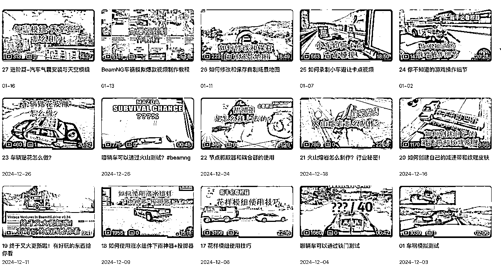

https://space.bilibili.com/301162993?spm_id_from=333.1007.0.0

## 2.1 安装与硬件要求

先把基础配置搞懂，这个赛道必须先会玩游戏，不然海外平台根本不会给你推流。哪怕你想搬运也没用。

我的建议是踏实学一下，既能玩游戏又能赚钱，两全其美。

有单机游戏经验的人，2-3天就能上手。

官方网站：https://www.beamng.com/game/cn/

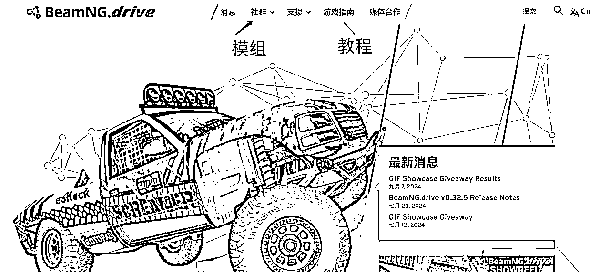

⚠️ 建议内存最好有 32G

推荐配置 1080p

操作系统: Windows 10 64 Bit
处理器: AMD Ryzen 7 1700 3.0Ghz / Intel Core i7-6700 3.4Ghz 或更好
内存: 32 GB RAM
显卡: AMD R9 290 / Nvidia GeForce GTX 970
DirectX 版本: 11
存储空间：50GB 可用空间
备注：装模组会占用更多空间，建议配游戏手柄。

最低配置 720p

操作系统: Windows 7 Service Pack 1 64-bit
处理器: AMD FX 6300 3.5Ghz / Intel Core i3-6300 3.8Ghz
内存: 16GB RAM
显卡: Radeon HD 7750 / Nvidia GeForce GTX 550 Ti
DirectX 版本: 11
存储空间: 45GB 可用空间

## 2.2 下载渠道

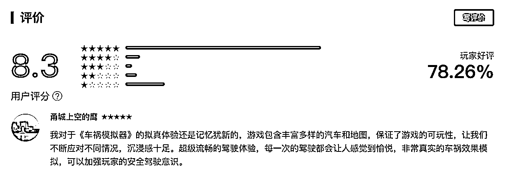

首推 Steam 平台下载

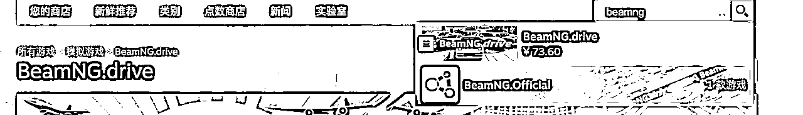

下载完成后直接运行即可。游戏为付费产品，约 ¥73.60，建议支持正版。

## 2.3 界面基础指南

## 2.4 模组获取与安装

想要内容更丰富，最好自己下载模组来搭建场景。

### 2.4.1 精品载具模组

https://www.modfans.cc/

这个站能找到大量 BeamNG 载具模组，部分付费，我买过几个质量不错。

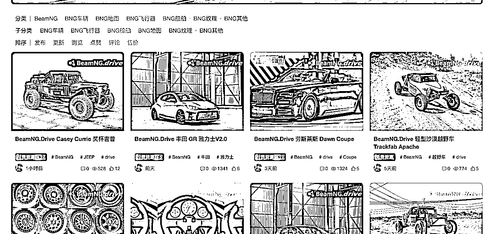

### 2.4.2 官方模组库

https://www.beamng.com/resources/

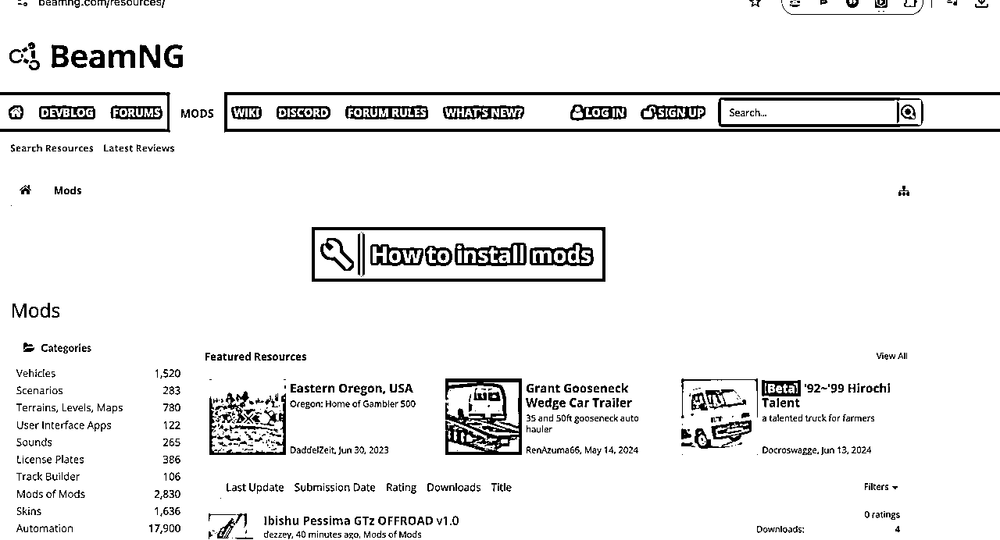

### 2.4.3 其他参考站点

https://www.patreon.com/surski57/shop
https://www.modland.net/beamng.drive-mods
https://www.worldofmods.com/beamng/maps/

### 2.4.4 安装方式

有两种：游戏内一键下载安装，或在第三方站下载后手动安装。

### 3.4.1 在线安装

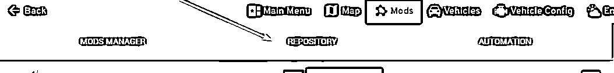

### 2.4.2 手动安装

Step1：下载想要的模组，通常是 zip 格式
Step2：打开游戏根目录，找到 mods 文件夹，把 zip 直接拖进去，没有就新建一个
⚠️ 警告：部分模组可能损坏，使用前自行检查

官方详细教程可查阅：

How to install mods

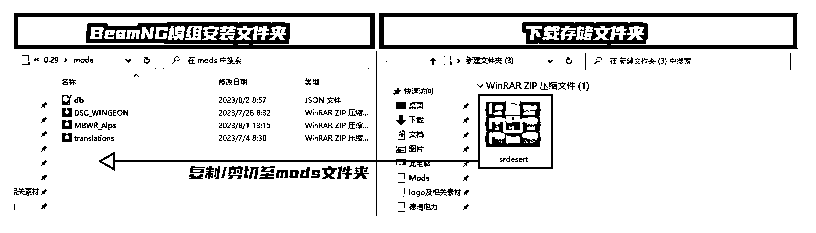

# 四、无本地高配电脑的云端方案

家里没台式机或者配置不够怎么办？

可以参考这期横评：能玩《悟空》的赛博网吧？海马云电脑/网易云游戏/腾讯Start云游戏/顺网云电脑/ToDesk云电脑横评

云端电脑入口：https://pc.todesk.com/

第一步：下载个人版客户端

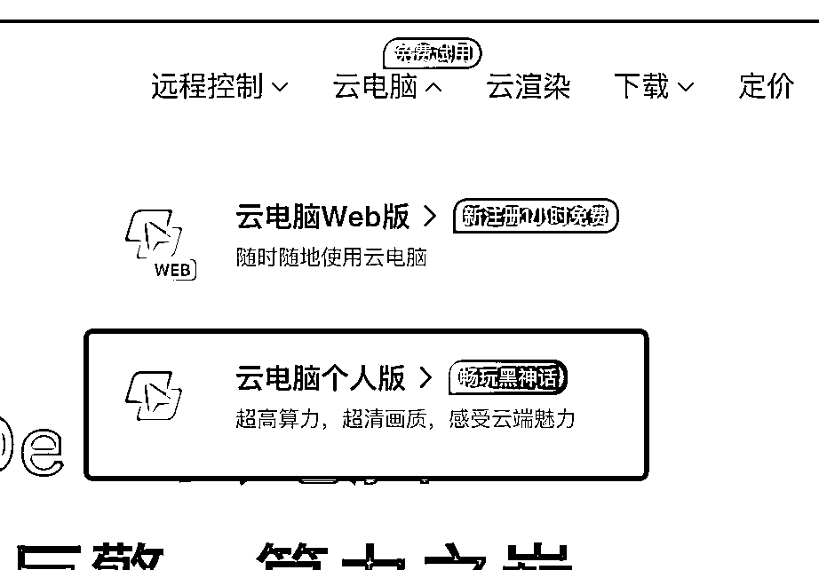

第二步：选配置，简单剧情录制 3060 就够了，十几辆车的大场面建议 4070，套餐选按时计费。

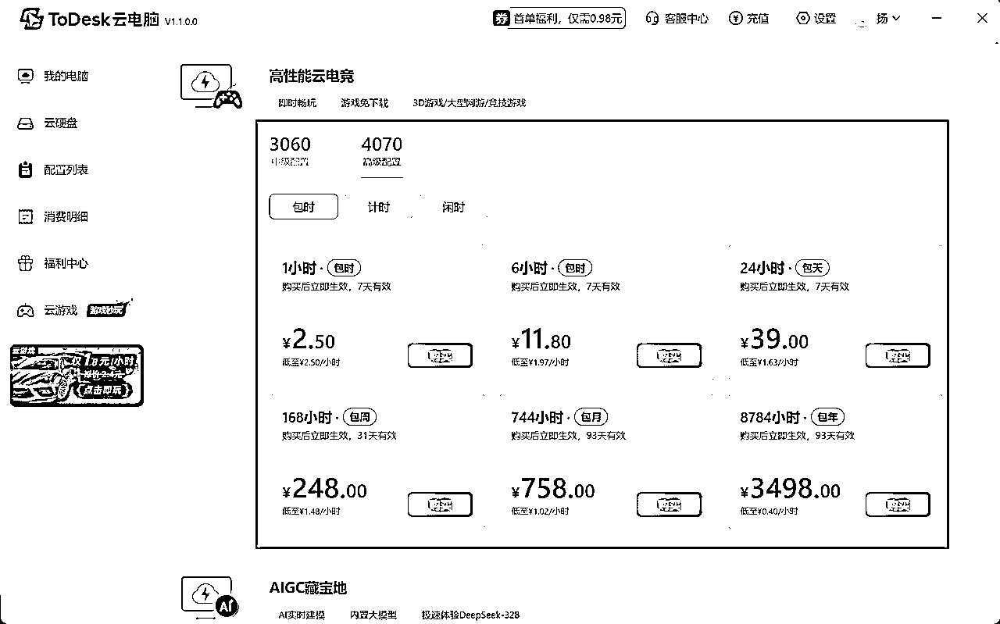

第三步：进入云电脑后安装必要软件。云端一般自带 Steam，只需装 BeamNG 即可。录屏建议用本地录制。

实测反馈：学员用云端录的素材和本地几乎无差别，效果很惊人。

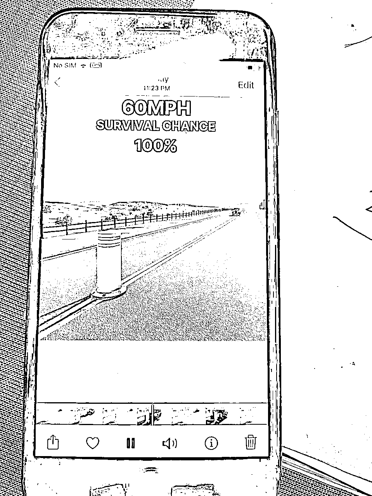

注意：如果云电脑登录 Steam 扫码异常

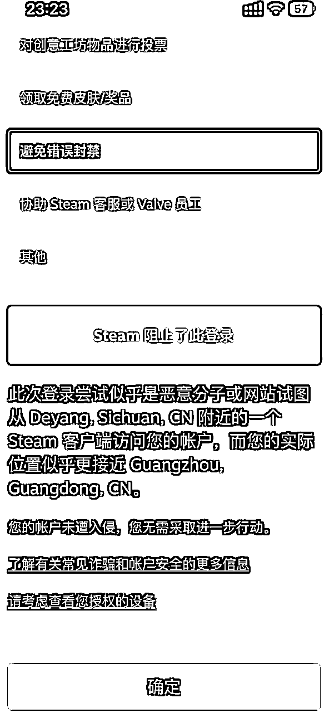

扫码后手机会显示云电脑登录位置，注意看清并选对选项。若仍无法解决，可参考：https://www.bilibili.com/video/BV1AXSuYAEd7/?vd_source=42b4fec78bfbc6c161a4d8f2f68d2a57

# 五、收尾与建议

最后再强调一遍，这个赛道前期需要投入时间和精力去积累，一旦上手其实不难，熟练后流程会越来越顺。

祝大家新春快乐！