# 小红书旅游攻略 | 实战手册

内容出品人：张微笑

手册出品方：龙哥盟团队

出品时间：2025 年 1 月 20 日

建议：如果需要快速定位到精确内容，可以使用快捷键 Ctrl + F/command + F 的形式，搜索「关键字/词」，查找你想要的内容

## 一、项目介绍

### 1.1 项目是什么

小红书旅游攻略变现的底层逻辑，是在笔记评论区完成用户拦截，再把流量导入微信完成资料付费交付，属于虚拟资料的轻量玩法，前期投入几乎为零。

很多人会质疑这种截流是否合规。

我最初也感到不安，后来被同行点醒：原笔记主本人并不售卖同类产品，并不构成直接竞争；而且评论区长期有用户追问时，平台会判定笔记互动价值高，对原作者也是正向。

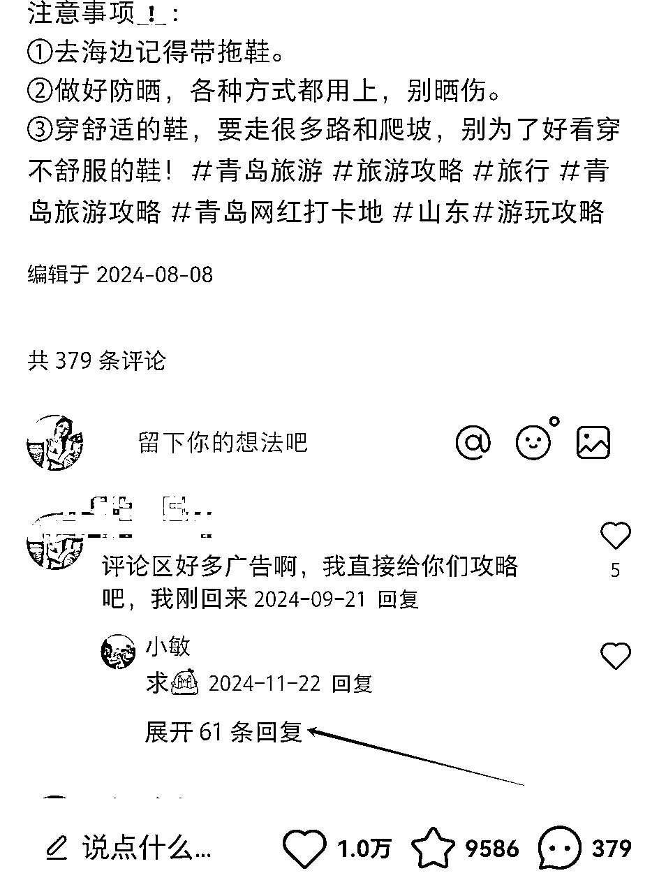

我之前蹭过一条热评，下方回复数量一度超过两百条都在求攻略，后来笔记找不到了。

### 1.2 项目玩法

整体思路很直接：

新注册一个小红书号，检索各城市旅游攻略类内容，在评论区埋设钩子引导私信，再将用户拉至微信出售定制或通用版攻略。

资料大致分两类：通用合集和个性定制。通用合集多为低价收来的同行资料包，个性定制主要靠 AI 快速生成。

核心就三点：

1. 如何挑到相对安全的笔记去评论，这决定了你能撬动的流量体量。
2. 如何拉升客单价，后续会拆解成交技巧与产品组合，这决定了同等流量能变现的上限。
3. 若想做长久，后续必须做微信朋友圈人设经营，关系到复购与口碑传播。

### 1.3 预期调整

该赛道单价偏低，适合赚点副业零花，不适合追求高额收益的人。

我入局较晚，24年8月初验证首单，至10月国庆后累计到账约2万余。每天投入时长取决于收益目标，半小时、一小时甚至更久皆可。我个人两个月累计变现两万。

给新手的建议是起步每天抽1小时左右，评论20-30条内容即可。等流量起来后，按自身节奏处理私信。

现实情况是微信申请和私信永远处理不完，你愿意投入的时间直接决定回报上限。

图片是加不完的微信和回不完的私信，所以你愿意投入多少时间去回消息，就有多少收益。

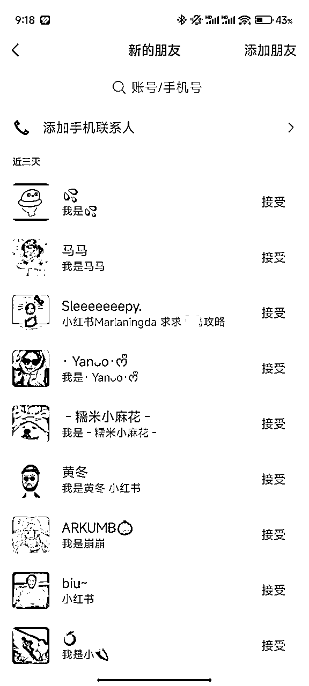

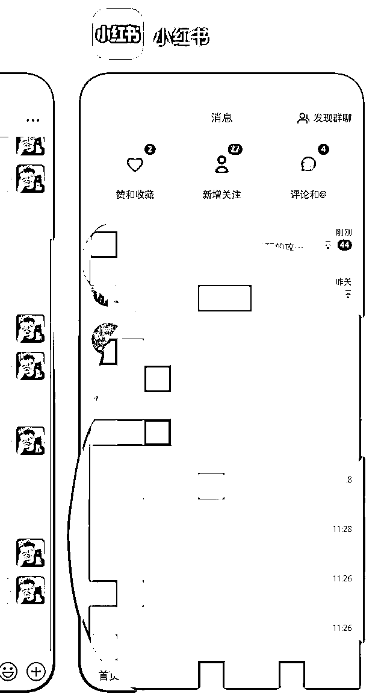

被截流带来的用户付费意愿有限，熟练后可小幅提价，但客单价普遍不建议超过70元。

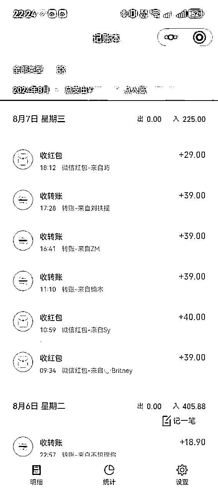

再补充两点供参考：

1. 要有账号出现问题的心理准备，建议用新号起步。按下面方法操作，风险可控。
2. 项目有明显淡旺季，可春节先跑通流程，五一、暑期、国庆再集中冲刺，平日也会有复购和长尾流量补充。

请务必先建立正确预期再入场，否则容易中途放弃，任何项目都一样。

## 二、账号基础搭建

### 2.1 账号设置

起步阶段两个新号足够，其中一个负责引流。账号太多易触发风控，也顾不过来。

注册完先养号，每天刷30-40分钟内容，养两天后再开始截流。

可用家中长辈不常用的手机号注册，若封号也不会影响常用号码，账号也更方便处置。

账号包装：

走素人高能量旅游小姐姐路线。头像和背景都要体现阳光、热爱生活、爱旅行的感觉。

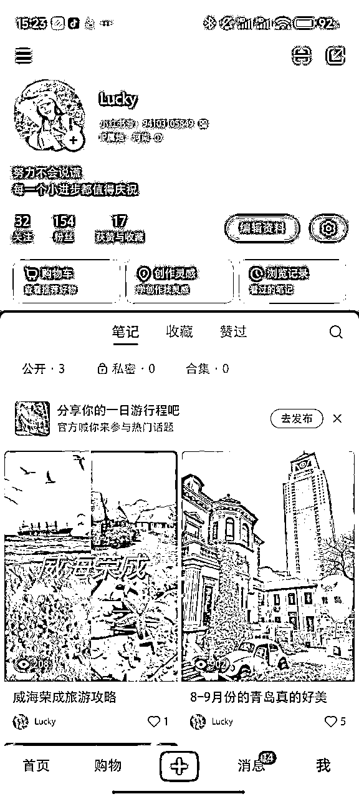

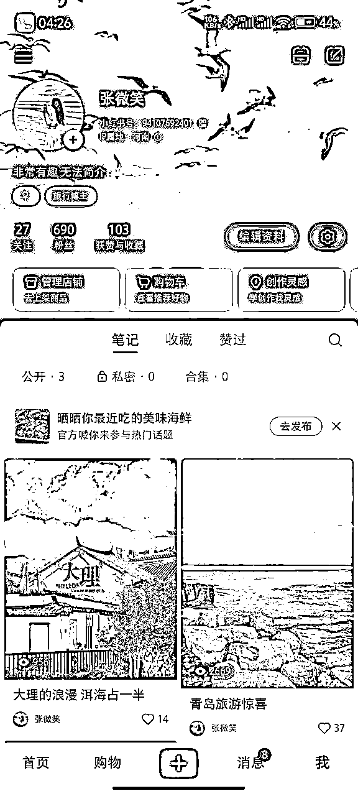

### 2.2 发布图文笔记

会有人问：我们主打截流，为什么还要发图文？

发图文的唯一目的，是让博主看起来确实去过该地且体验不错，增强可信度。

所以我自己账号的笔记数据并不好看，不必在意，流量并非来自自有内容。

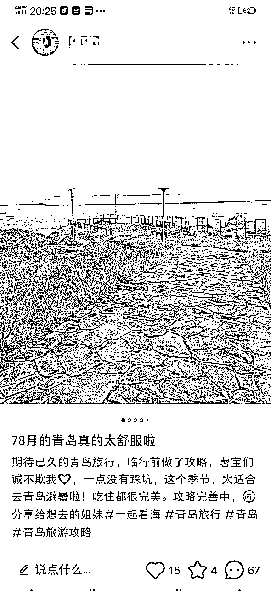

图文素材怎么来？

图片素材：

去抖音等平台检索目的地的风景图，优先带人物的背影图，正脸易与账号人设冲突显得假。

目的是提升真实感，去水印后发布即可。我习惯用微信小程序“轻抖短视频实用工具”的去水印功能。

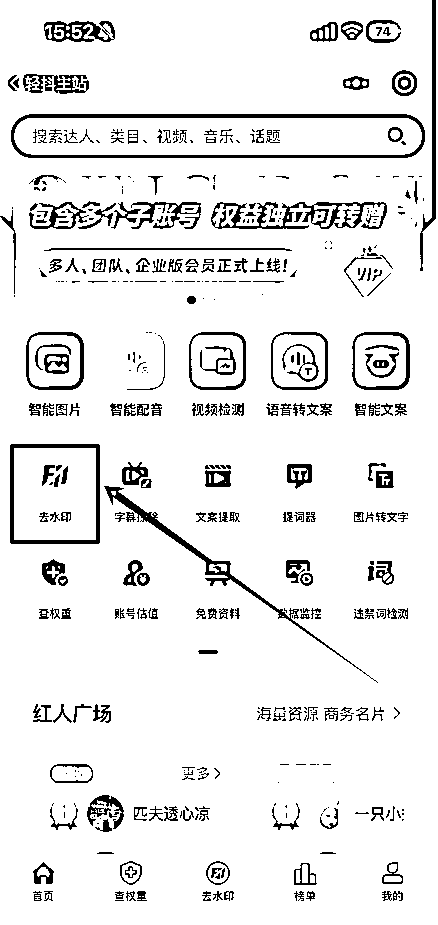

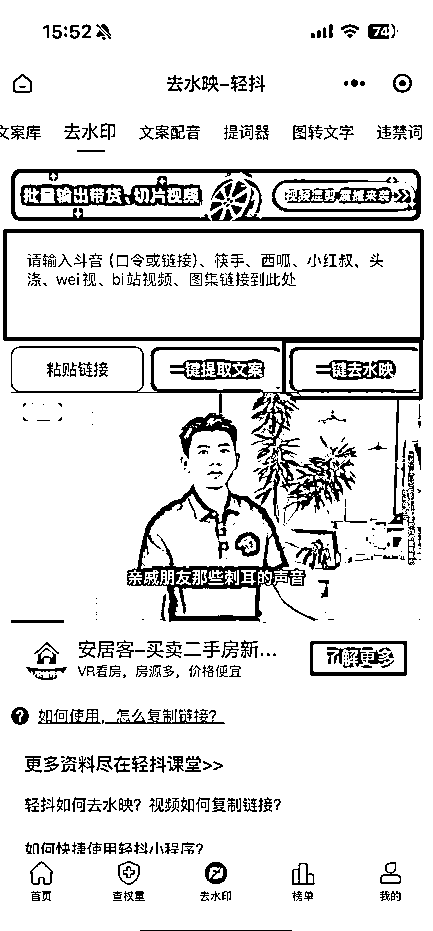

文案素材：

要求不高，核心是表达：风景好、住宿舒服、美食有特色。

具体内容需自己动手写。

## 三、开始截流&引流（关键）

### 3.1 截流步骤

#### 先锁定热门旅游城市

打开携程、去哪儿这类平台，看旅游专区首页单独展示的城市，就是当前最热的，比如丽江、三亚、哈尔滨、海南等。

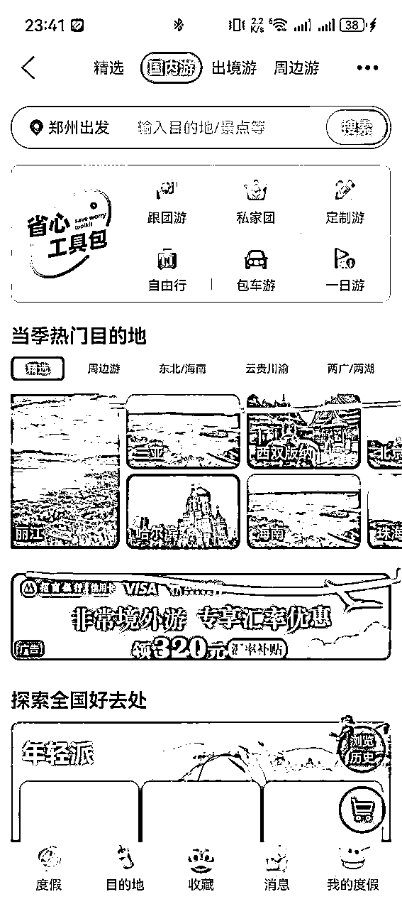

建议深度耕一个城市及周边即可。

用户往往会把周边一起玩掉，比如青岛很多人会顺路去威海、烟台。深耕一个城市后，还能对接本地玩乐项目如海钓、旅拍做分销，收益不止攻略本身。后续【六、拓展玩法】会讲怎么对接商家。

#### 去小红书找关键词

检索格式：城市＋旅游攻略 / 三日游攻略 / 亲子游攻略 / 蜜月游攻略 等等

#### 筛选可评论的笔记

筛选标准：

第一、点赞数最好在1000以上
第二、发布时效越新越好
第三、评论区活跃，最近一天内有新评论
第四、避开作者频繁回复评论的笔记，这类作者易举报。

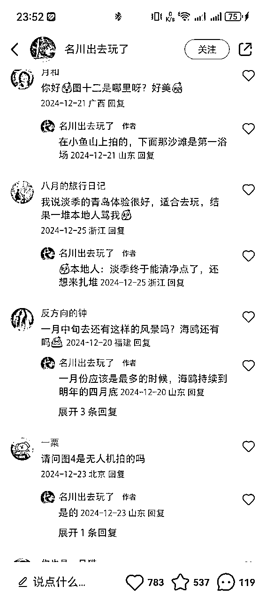

#### 评论区下钩子

话术仅供参考，可按城市微调：

案例1

威海读了四年大学，对当地景点很熟，需要威海攻略的姐妹可以滴滴，我整理了一份。

案例2

在青岛生活七八年，景点基本都踩过，前段时间刚做完一份攻略。

案例3

上个月全家去青岛，出发前整理的攻略全用上了，需要的可以滴我。

案例4

前几天带娃去了青岛，老公花两天整理的攻略超详细，基本没踩坑。

案例5

之前没去过青岛，出发前找本地人花点钱定制了份攻略，体验很好，需要的可以滴。

评论频率建议：

同个模板不要连发，适当改写后发下一条，模仿真实用户行为。

每隔2-3分钟发一条，10条左右休息一下，约30分钟后换关键词继续。

评论被吞、被删很正常。评论就像撒种子，前期一天撒20条，持续撒，第三天你会收到前两天的复利流量。

### 3.2 引流方式

我常用三种，其中前两种用大号，第三种用小号：

1. 把微信号做成图片录成视频发过去。

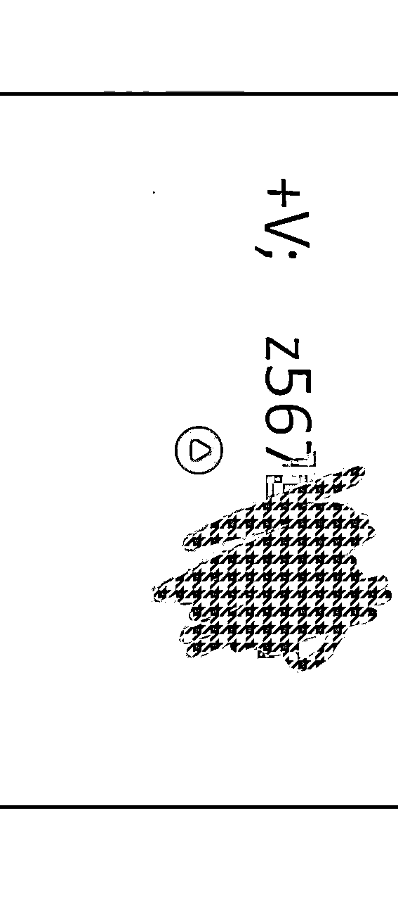

踩过坑：微信号里的小写z容易被认成数字2，导致加不上。这个方式可作为补充，主方案还是第三种。

1. 让对方主动发微信号，话术如下：

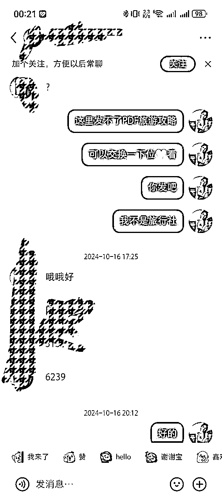

相对安全，但有时对方发会被吞，可过会追问：宝子发了吗？发不出就我们这边发。

注意：不要用同一句回复十几条私信，间隔1-2分钟并微调措辞，比如“这里没办法发PDF文件”。

1. 主页简介@引流号，引流号发布一条藏有微信号的笔记。即使封号也是小号受损。

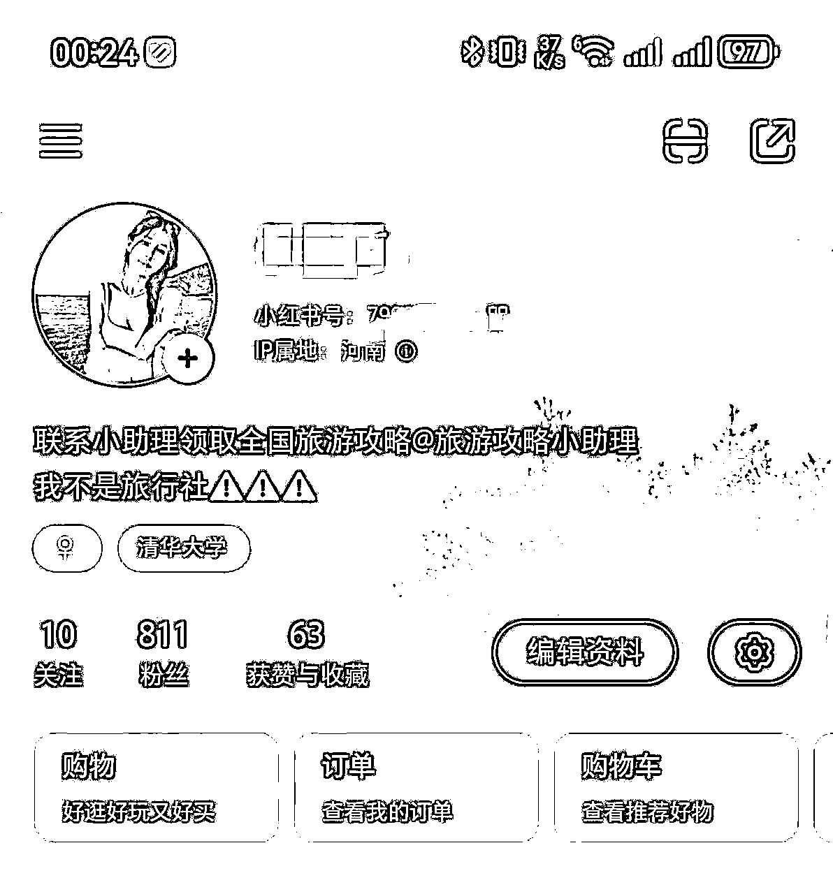

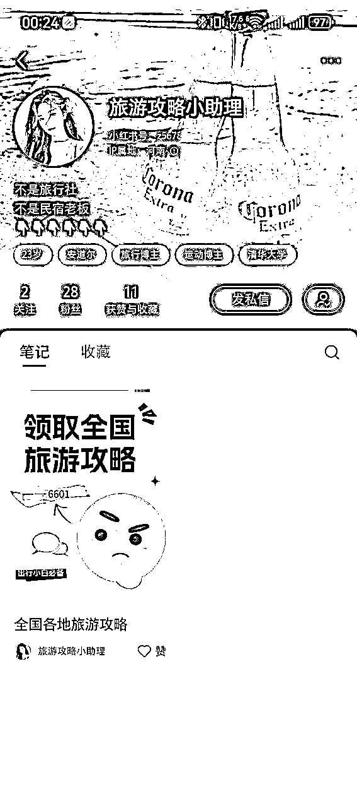

### 3.3 注意事项

实操细节补充：

1. 关于引流

我更推荐第三种@引流号的方式，一个个复制微信号效率低，让用户主动申请加好友更省事。

1. 当用户在小红书问是不是免费，切勿讨论价格，容易被判定违规。建议直接放弃这类用户。
2. 微信号设置

建议字母3-4位+数字3-4位，例如adgm1234、mpt220

注意：

* 避免i/I/1/o/0/u/U等易混淆字符
* 优先用九宫格首字母，如A/D等
* 能小写尽量小写
* 做矩阵可编号mpt220/mpt221/mpt222，封号时用户会自行试加邻号

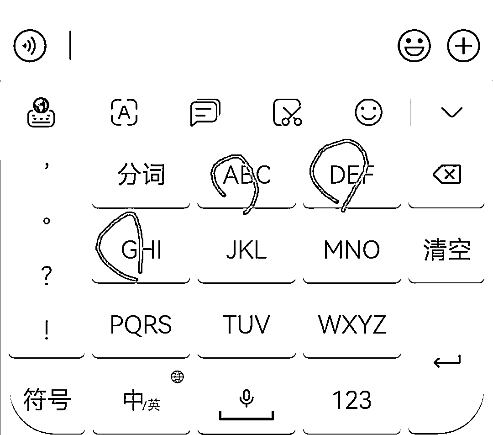

这个思路来自赚钱航海教练@希平，用起来很顺手。

1. 关于封号提醒

目前常见的是禁言1天或3-7天，屡次违规才有永久封禁风险，手机号也解绑不掉，毕竟是白嫖平台流量。

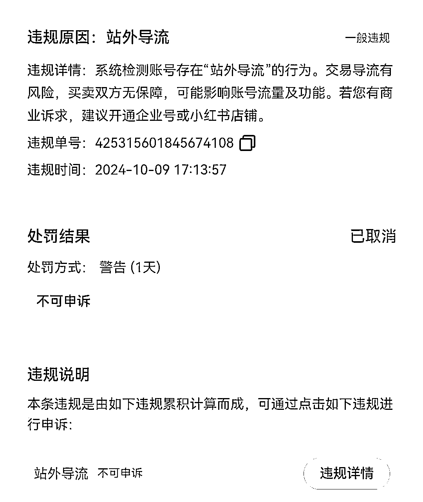

那如何降低封号风险？

* 账号注册好以后，可以每天刷 30-40 分钟的内容，养两天号，再去进行截流操作。
* 我在方法2 举例的话术模板，不要一次性用来连着回复10条左右的私信，可以休息1-2分钟，然后把话术模板稍加修改再发送过去。
* 建议大家尽量还是选择上面的第 3 种引流方法来操作，安全系数高一点。

1. 错误示范

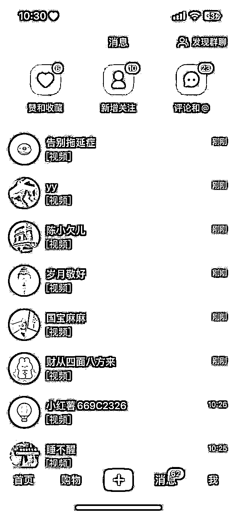

短时间内，一次性连着用同样的截流视频，回复了多条私信。

## 四、私域转化

### 4.1 微信聊天话术

转化的核心是体现对景点的熟悉，塑造专业感。

深耕一个城市后，对吃喝玩乐了如指掌，自然能建立信任。

我跟进的方式拆解如下，成交率大概在10%左右：

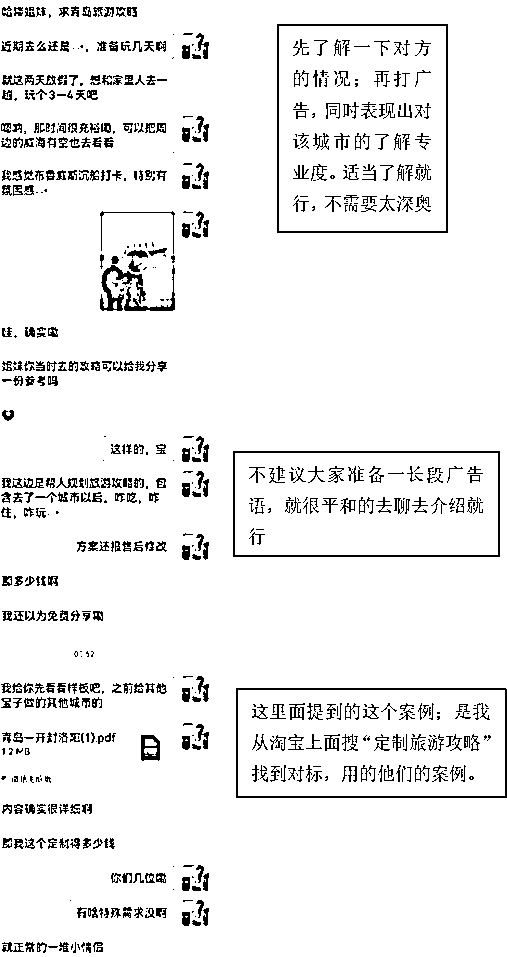

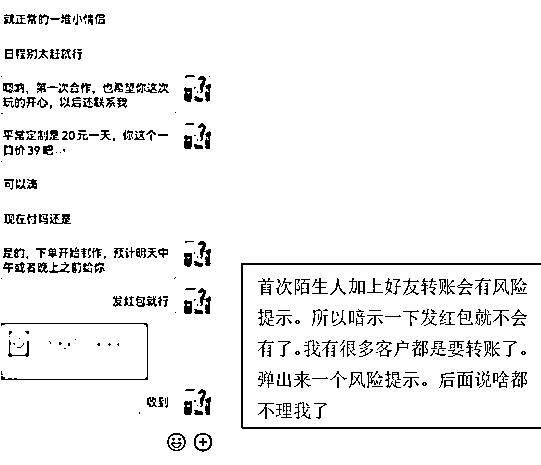

上来就嫌收费的人很多，直接删好友或不回也正常。只要没被删，后续朋友圈也能慢慢培养下单欲望。

没有神话术，新手可以先定个目标：今天先聊30-40个用户练手。久没出单就考虑迭代话术。

### 4.2 定价建议

目前两类产品：通用版和定制版，交付和价格不同。

通用版：

在拼多多搜“全国旅游攻略”，几块钱买网盘资源，基本覆盖大部分城市。

优点是交付快，直接转发即可。缺点是内容同质化严重，容易被说成电子垃圾。

定制版：

用AI生成，如豆包，参考拼多多/淘宝定价20元/天，3日游60元。成本几乎为零。

还可以伪装成客户去和拼多多商家聊，把他们的案例模板拿来给客户参考。

建议：前期定价9.9元或19.9元，先出单建立正反馈，再逐步提价。

### 4.3 朋友圈运营

朋友圈是做复购的触点。

我踩过的坑是频繁群发广告，前几次有效果，后面会被拉黑。应以朋友圈营销为主。

朋友圈要传递的形象：

第一：销量不错，很多人找你下单。可适当让大号伪装客户对话截图。

第二：生活有烟火气，销售之余分享有趣日常。

我微信里有个销售，我不买他的东西，但文案有趣就留着了。

朋友圈示例：

展示多人咨询下单的

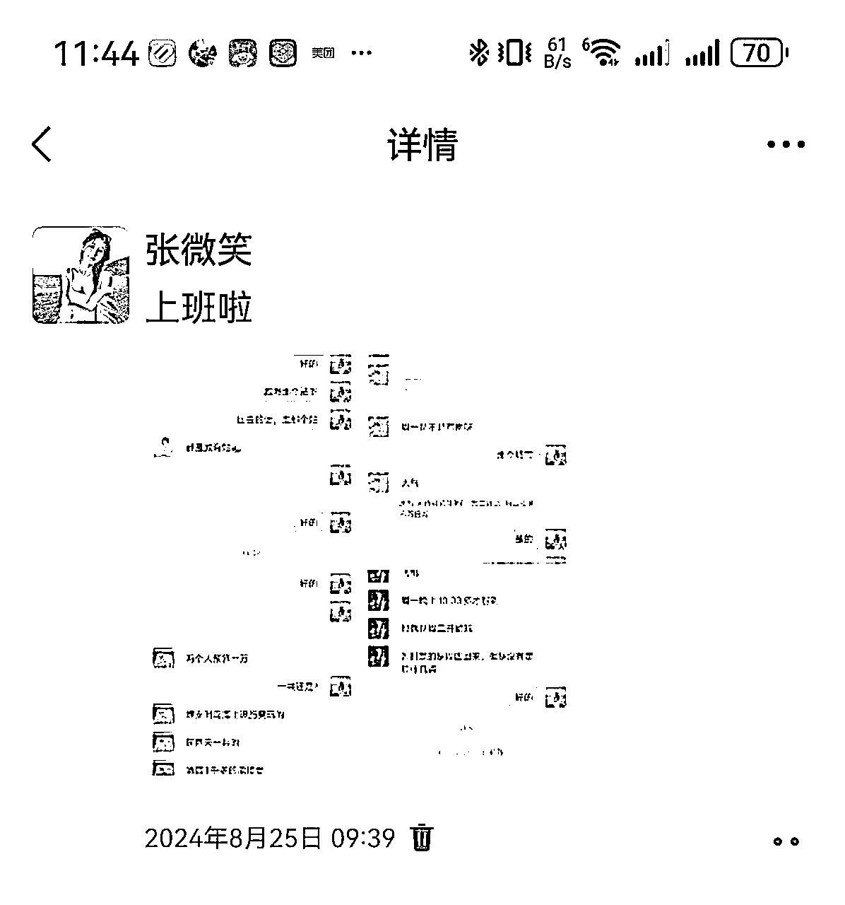

展示专业度的

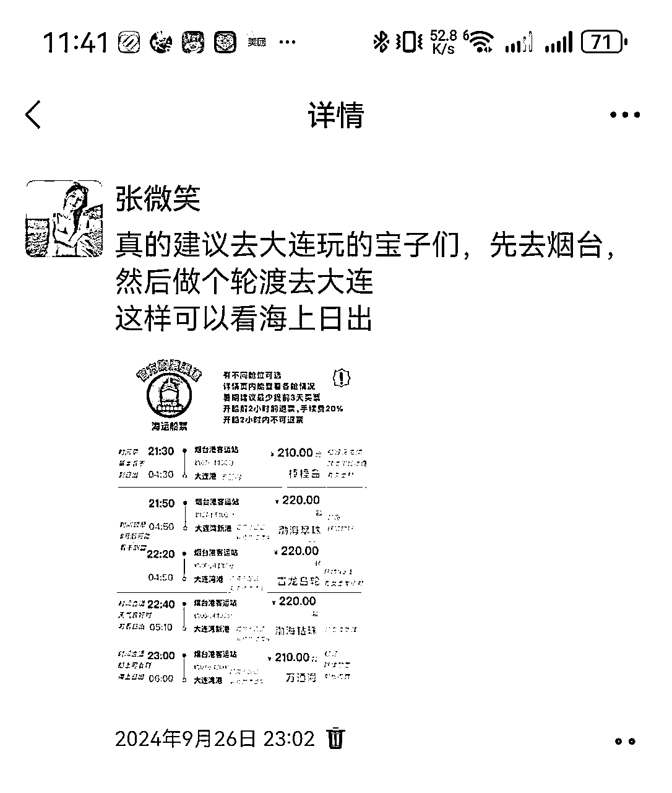

展示有回购的

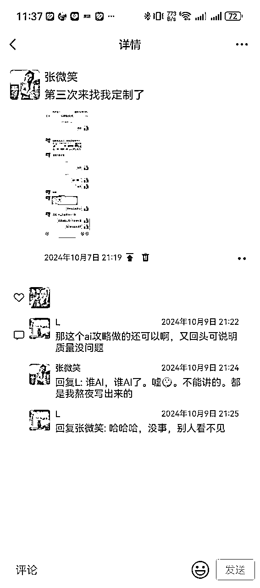

展示生活丰富、上进的小姐姐人设

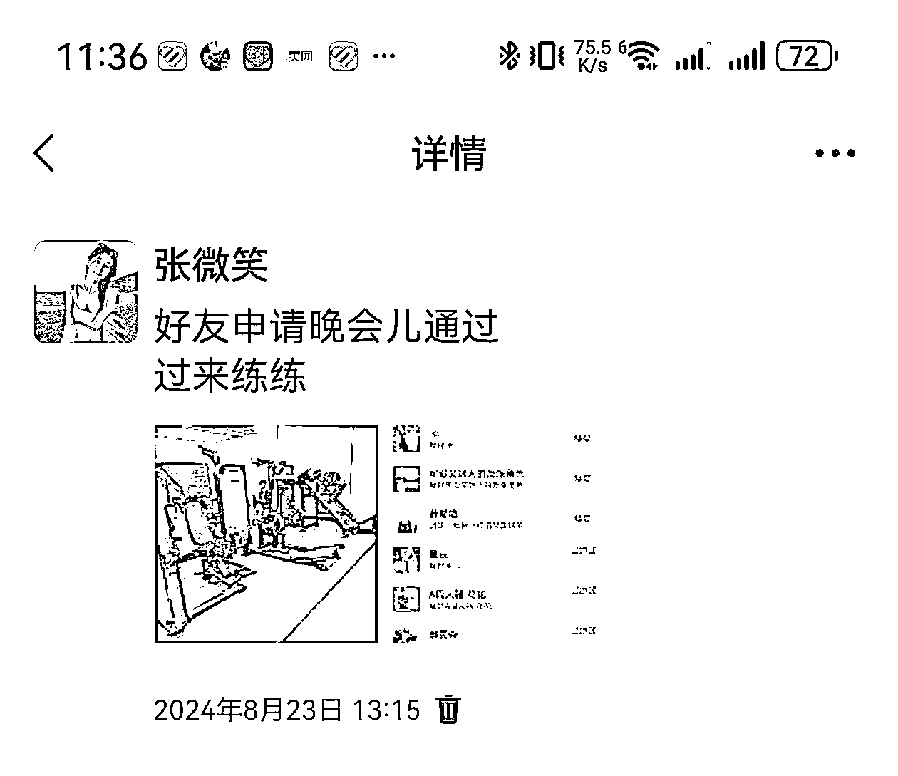

展示有孝心

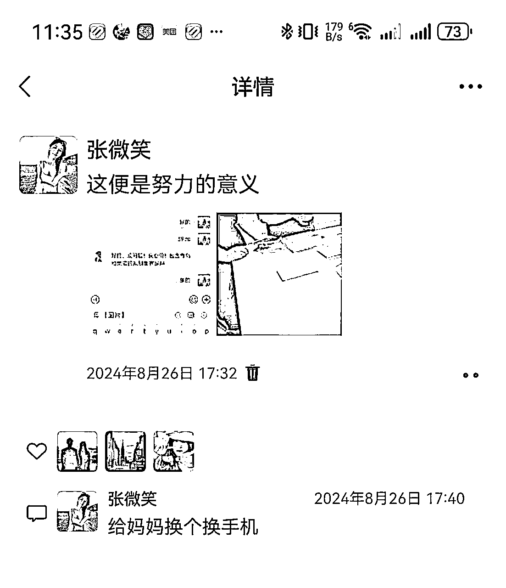

注意：发业绩截图务必打码客户头像和姓名，曾因忘了打码被提醒，很尴尬。

## 五、怎么交付

### 5.2 如何采购通用版旅游攻略

直接淘宝搜索“全国旅游攻略网盘资料”，几块钱搞定。

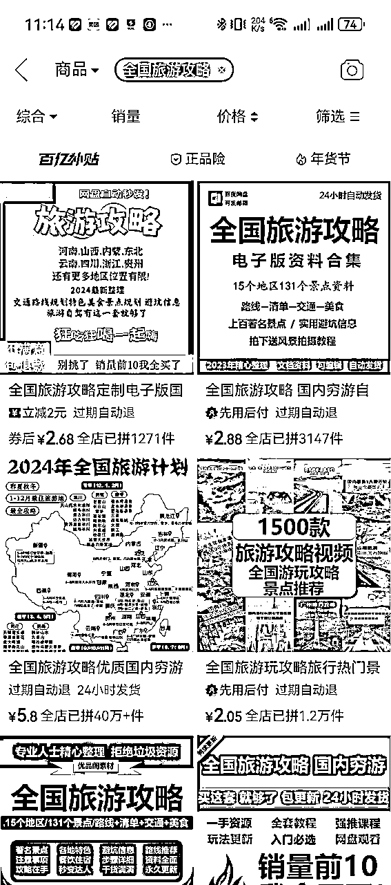

我自己的网盘合集可取用：

国内外旅游攻略合集

链接： https://pan.baidu.com/s/11IjLVXxHREJN61ttMfIPNA?pwd=1230 提取码： 1230

个别城市缺失，可搜两篇小红书帖子提取文案和图片，拼成Word转PDF交付。

### 5.2 如何用 AI 写攻略

工具：浏览器搜“豆包网页版”，免费。

提示词思路：围绕身份、背景、目标、限制提问即可。AI一次生成不一定满意，多轮调整。

我常用提示词示例：

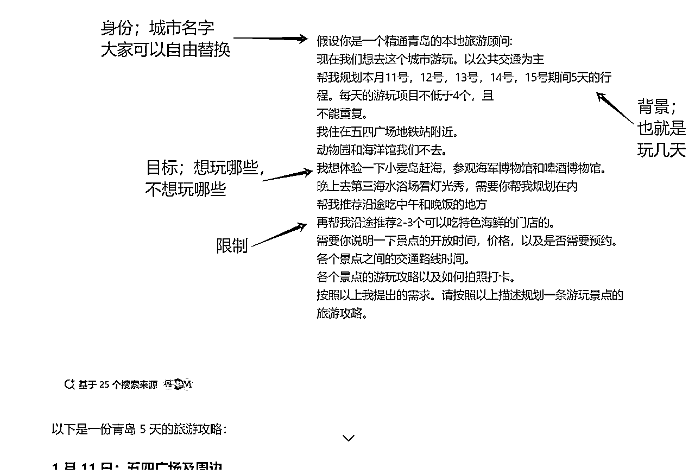

附提示词参考（文字版）：

假设你是一个精通青岛的本地旅游顾问：

现在我们想去这个城市游玩。以公共交通为主帮我规划本月 11 号，12 号，13 号，14 号，15 号期间 5 天的行程。每天的游玩项目不低于 4 个，且不能重复。

我住在五四广场地铁站附近，

动物园和海洋馆我们不去。

我想体验一下小麦岛赶海，参观海军博物馆和啤酒博物馆。晚上去第三海水浴场看灯光秀，需要你帮我规划在内

帮我推荐沿途吃中午和晚饭的地方

再帮我沿途推荐 2-3 个可以吃特色海鲜的门店的。

需要你说明一下景点的开放时间，价格，以及是否需要预约。

做定制旅游这行，很多人以为只需要排个路线就行，其实真正让客户觉得值、也让咱们赚到钱的，是藏在细节里的一套功夫。今天就把这套我跑过无数次的经验拆给你看。

一、先解决“怎么走、怎么玩、怎么拍”

拿到一个目的地，第一件事就是把景点之间的交通时间给捋清楚。别让客人一整天都在赶路，体验会大打折扣。再往下，就是每个景点的玩法设计：几点去人少、哪个入口更方便、哪些项目值得体验，全都要心里有数。拍照打卡这块也别落下，给客人标出几个出片机位，他们开心，你就省心。

还有个小细节：不管哪个城市，博物馆、海洋馆、动物园这些地方其实都大差不差。和客户聊初稿的时候，不妨顺嘴问一句这些要不要安排。当然也有例外，比如重庆的动物园，冲着独有的大熊猫就值得专程去一趟。

二、AI 出的方案，别急着照单全收

AI 生成的内容，不可能每次都合客户心意。用的时候动点脑筋——先看哪里不符合需求，把具体问题抛回去，让它针对性地补一段。这样一来一回改几次，方案基本就能用了。

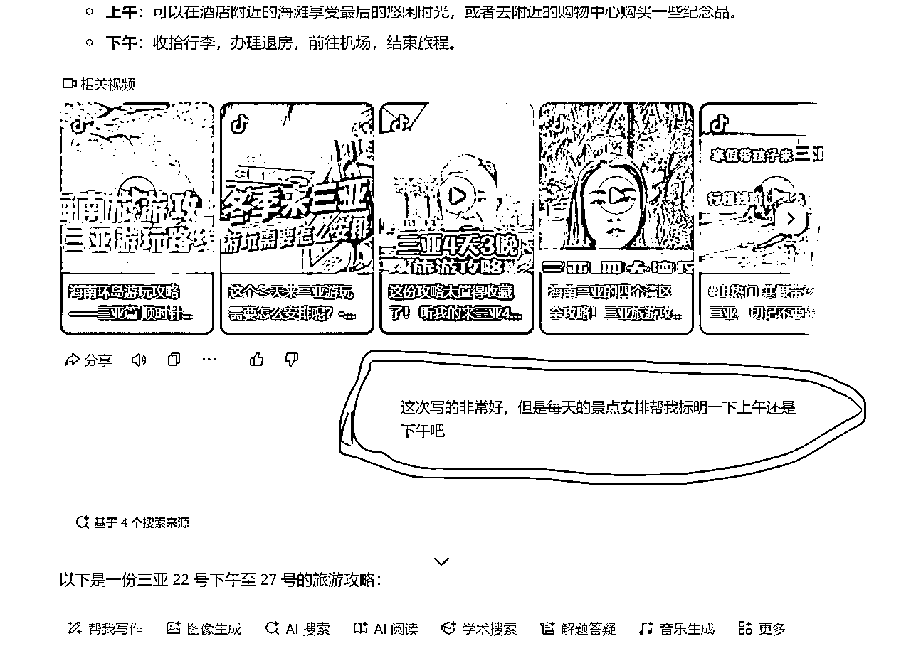

三、酒店这块，别小看它

定制攻略里，订酒店是免不了的环节。我的习惯是：打开美团，找评分在 4.9 左右、参与评价人数够多的，直接筛选出合适的就好。至于地理位置，按这几个标准来选。酒店定下来之后，把位置信息发给 AI，让它围绕住所去排每天的路线，这样行程和住宿就不会打架。

顺便提醒一句：咱们是帮客户挑酒店、给链接，不是替他下单。

具体操作要领也不难：

先选好入住的日期和城市。

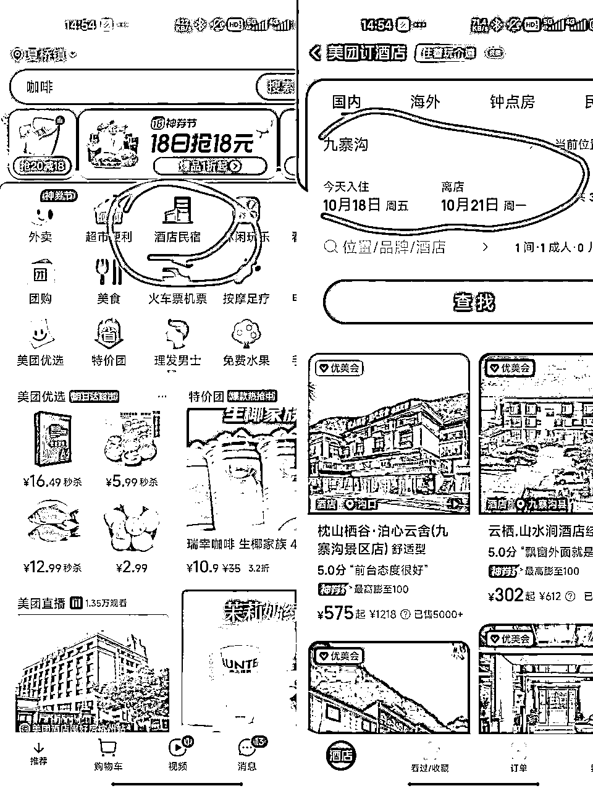

再看位置，挑热门景区或商圈附近、别人推荐多的就行。

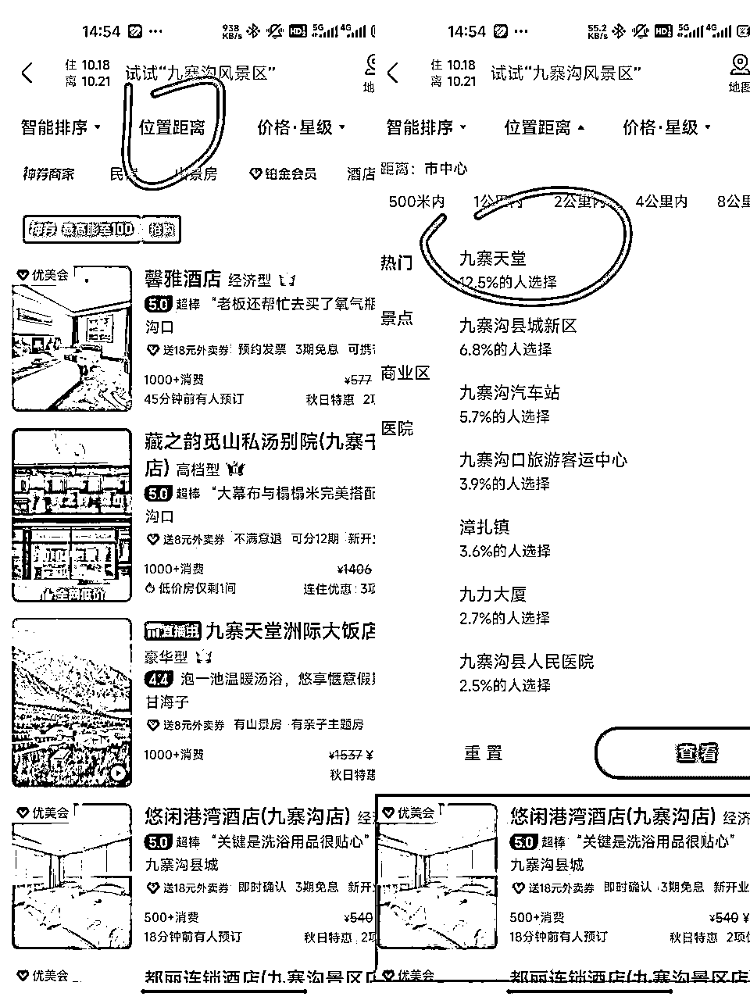

评分锁定 4.7 到 5.0，参评人数越多越有参考价值，然后把酒店链接复制好发给客户就行。

做久了我发现一个很有意思的现象：客人自己上网翻订单，翻一小时都不一定拿定主意；你花一分钟发一个给他，他反而大概率会接受。因为大家潜意识里总觉得自己找的不如别人推荐的靠谱，更何况在他眼里，你还是个做定制的专业人士。

四、别只盯着攻略钱，路上还有更多赚头

旅途中，客人随时都会冒出新需求。我们完全可以顺手接下周边服务，把沿途的钱也落袋为安。比如：

- 机票代订（单价 800 以上的单子）
- 五星级酒店代订
- 部分沿海城市的海钓体验
- 甚至本地地陪服务

跟客户聊天时，适时问一句“需不需要”，不必刻意安利。

这些都是高客单价的项目，而且咱们手里握着精准用户。找到了合适的商家，直接谈利润分成，前期分个五成左右就差不多，让一部分利也没事，跟着商家先跑起来，少赚也算赚。

那商家上哪儿找？我一般在小红书或者闲鱼搜。比如“青岛海钓”“青岛地陪”，闲鱼上直接搜“代定酒店”“代定机票”，多对比几家，总会有靠谱的。一定要多聊，找到愿意长期合作的再往下走。

至于怎么和商家配合，我自己的经验是：代订这事儿往往要反复查档期、甚至垫付资金，麻烦得很。所以我从来都是拉个三人群——客户、商家和我。让他们俩直接对接，我在旁边看过程，不主动碰钱；事成之后，商家把佣金转我就行。省心又安全。

这是我之前做青岛海钓分销的记录：

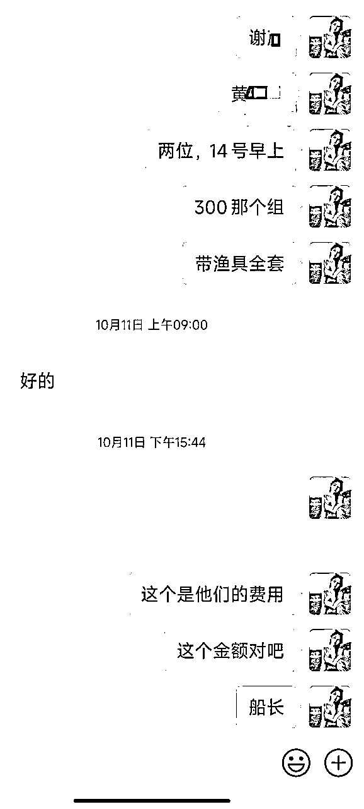

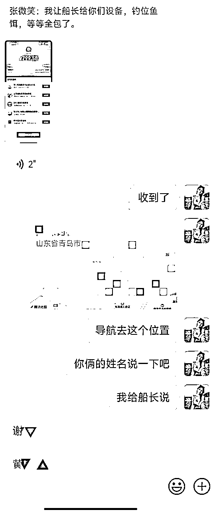

上面那个例子，我给船家 600 元，客户那边收 800 元，一单净赚 200 元，就这么简单。

这是当时代订酒店和机票的对接群截图：

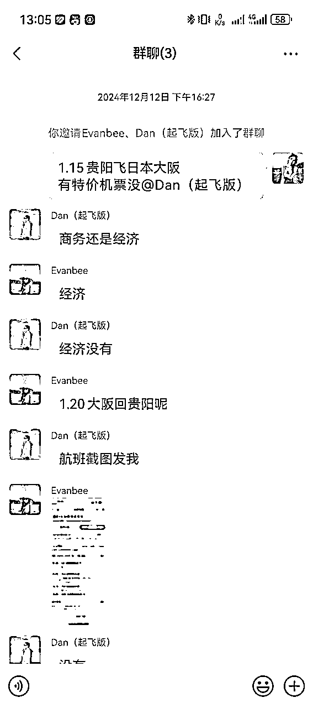

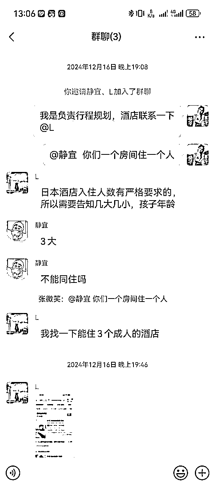

至于代订酒店方面的长期资源，可以在星球里翻一翻相关的对接帖子和精华内容，很多现成的渠道都能用得起来。

五、最后的心里话

这整套玩法，说到底就是两个字：执行。你愿意一个个客户去聊、一单单去跟，私信自然会响到停不下来。这行真的不太看运气，就看谁肯下功夫。你付出多少，收获就会是多少，一点不虚。

