# 用爱好+技能+AI，我给自己造了一个跑步配速器小程序
作者：龙哥


大家好，我是龙哥，一个跑步上瘾的程序员。

过去我总在抄别人的作业，这次把个人兴趣、本身会的技术和AI工具结合起来啃下一块硬骨头，结果远比我想象的要甜。

# 一、发生了什么

## 第一步：先上网页试水

用cursor随便搭了个网页版雏形，通过👸号引流测试。没想到文章直接炸了，还收到打赏，好几十个人加我进来。
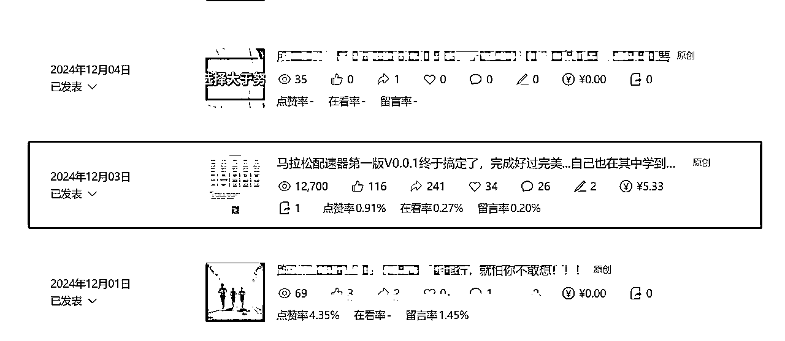

页面丑到不好意思，但数据说明问题就是存在。
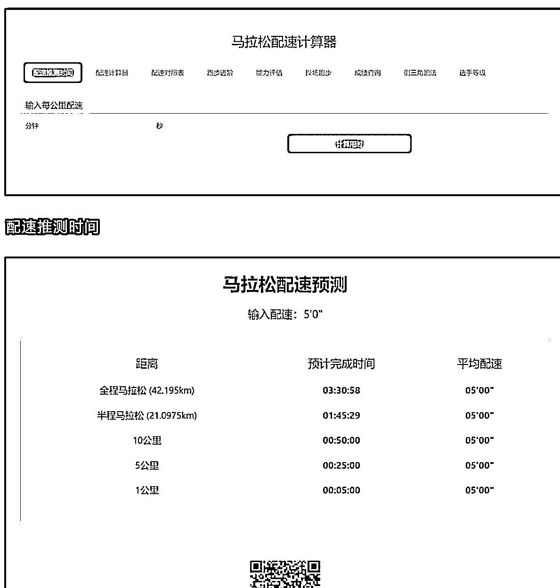

## 第二步：转战🛰️小程序

第一波反馈不错，我就顺势把👸号和🛰️小程序绑一起，双线收割。

认证加备案花了3天，30块一年搞定。2天就把流量主开了。整件事我没碰后端，纯前端跑通，省掉了域名和服务器的成本。

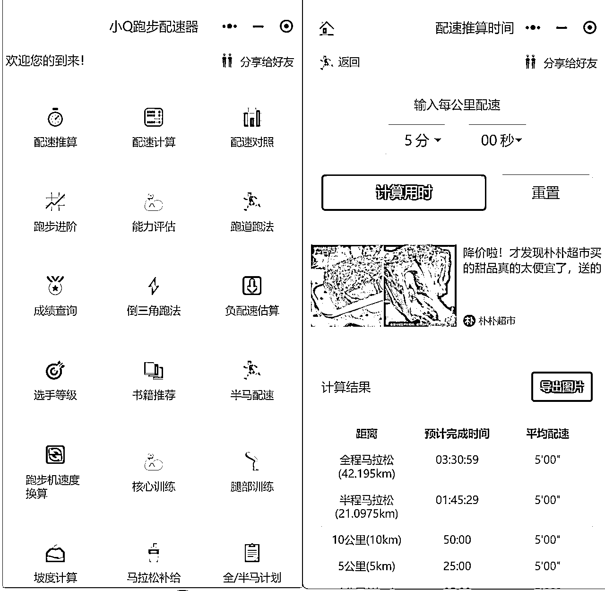

# 二、怎么一步步做出来的

## 灵感从哪来

我常跑马拉松，每次都要翻📕、百度找配速表。想着这么频繁的需求，为什么不自己做一个？正好手上cursor用得顺手，于是就决定用兴趣+技能+AI把这个跑步配速小工具做出来。


## 和cursor的配合方式

我对产品形态其实没概念，直接按 Ctrl+I 输入：做一个功能完整的跑步辅助🛰️小程序，帮跑友规划训练和比赛。AI就把我的模糊想法拆解成可跑的代码直接吐出来。报错了就把日志丢回去，让它修。我相当于产品经理+测试，AI是执行开发。

```
# 小Q跑步配速器

一个功能全面的跑步辅助小程序，帮助跑步爱好者更好地规划训练和比赛。

## 功能模块

### 1\. 基础配速工具

#### 1.1 配速倒推时间
- 输入目标配速
- 选择目标距离
- 计算完成时间
- 支持图片导出

#### 1.2 配速计算器
- 输入距离和时间
- 计算每公里配速
- 显示详细配速信息
- 支持图片导出

#### 1.3 配速对照表
- 展示常用配速对照
- 支持5公里到全马距离
- 清晰的表格展示
- 支持图片导出

### 2\. 进阶训练工具

#### 2.1 跑步进阶
- 入门指南
- 呼吸技巧
- 配速控制
- 赛前准备
- 恢复训练

#### 2.2 能力评估
- 根据比赛成绩评估
- 计算VO2Max
- 预测其他距离成绩
- 提供训练建议
- 支持图片导出

#### 2.3 操场跑步
- 支持多种操场长度
- 圈数距离换算
- 提供训练建议
- 支持图片导出

### 3\. 比赛辅助工具

#### 3.1 成绩查询
- 支持多个马拉松赛事
- 号码布成绩查询
- 显示完整比赛数据
- 分段配速分析
- 支持图片导出

#### 3.2 倒三角跑法
- 科学的马拉松配速策略
- 三阶段配速规划
- 详细的配速建议
- 适用半马和全马
- 支持图片导出

#### 3.3 选手等级
- 五个等级标准
- 多个距离标准
- 详细的等级说明
- 支持图片导出

## 技术特点

### 1\. 用户界面
- 统一的设计风格
- 清晰的功能分类
- 简洁的操作流程
- 美观的视觉效果

### 2\. 数据处理
- 精确的计算逻辑
- 合理的数据范围
- 完善的错误处理
- 友好的提示信息

### 3\. 图片导出
- 统一的导出工具
- 美观的排版布局
- 清晰的文字显示
- 便捷的分享功能

### 4\. 代码质量
- TypeScript 类型定义
- 组件化开发
- 统一的错误处理
- 规范的代码风格

## 开发环境

- Node.js
- Vue 3
- TypeScript
- uni-app
- Sass

## 安装说明

1\. 克隆项目
```bash

git clone [项目地址]

```

2\. 安装依赖
```bash

cd frontend

npm install

```

3\. 运行开发服务器
```bash

npm run dev:mp-weixin

```

4\. 使用微信开发者工具打开项目目录下的 `dist/dev/mp-weixin` 文件夹

## 使用说明

1\. 首页功能导航
   - 点击功能卡片进入对应功能
   - 功能分类清晰明了
   - 简短的功能说明

2\. 数据输入
   - 支持数字键盘输入
   - 合理的输入范围限制
   - 即时的输入验证

3\. 结果展示
   - 清晰的数据展示
   - 详细的说明信息
   - 便捷的图片导出

4\. 图片分享
   - 保存到相册
   - 美观的排版
   - 便于社交分享

## 注意事项

1\. 配速计算
   - 输入数据需在合理范围内
   - 建议参考个人实际能力
   - 计算结果仅供参考

2\. 训练建议
   - 根据个人情况调整
   - 循序渐进，避免受伤
   - 注意合理休息

3\. 图片导出
   - 需要相册权限
   - 建议在网络良好时使用
   - 支持重试机制

## 更新计划

1\. 近期计划
   - [ ] 添加数据统计功能
   - [ ] 优化图片导出质量
   - [ ] 增加用户设置选项

2\. 长期计划
   - [ ] 添加社交功能
   - [ ] 支持数据同步
   - [ ] 增加更多训练计划

```

## 以BMI模块举例

我说一句：给我加个BMI计算模块。
AI就自动生成整套逻辑，我只需要盯着别让它乱改现有功能，然后测准不准。

它当时是这样理解我的需求的：

主要功能：
BMI计算：
输入身高cm和体重kg
自动算出BMI数值
给出身体状态划分
BMI分级标准：
偏瘦：< 18.5
正常：18.5 - 23.9
过重：24.0 - 27.9
肥胖：≥ 28.0
页面样式：
醒目的输入区
结果突出展示
配上BMI对照表
健康建议提示
交互细节：
实时算数
当前区间高亮
不同状态配不同颜色
支持一键分享
其他：
输入校验
计算精确
友好的提示文案
使用说明：
填身高，填体重
自动出结果和状态
表格里高亮当前区间
看建议
另外它还提醒我需要在 pages.json 里加页面配置、导航入口、路由跳转。

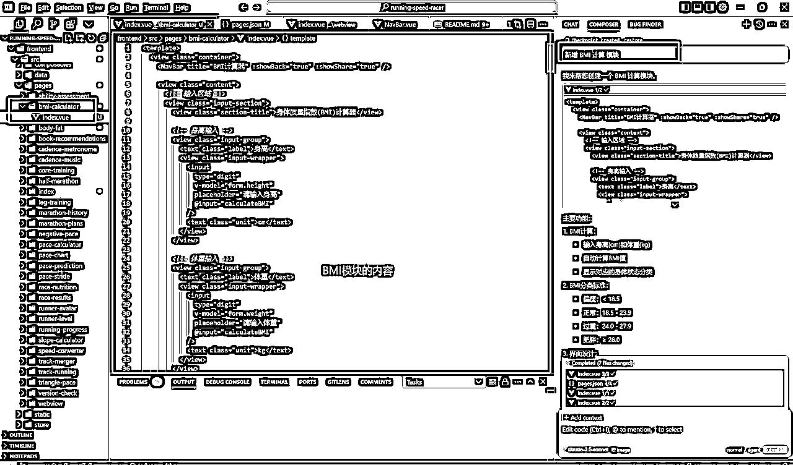
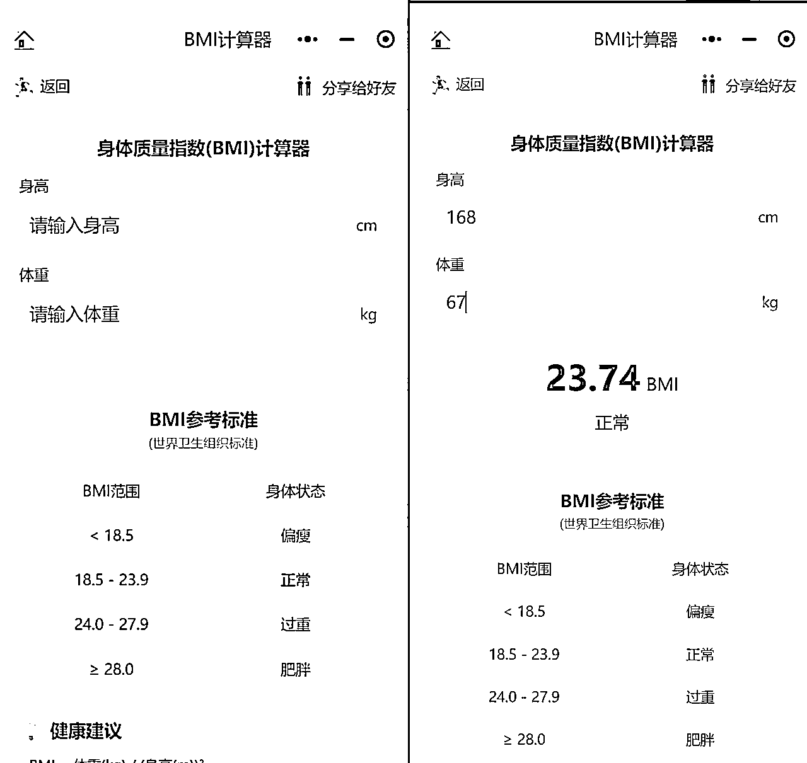

我完全没法描述有多快，差不多3分钟，一个模块就上线了。

## 用cursor的一些心得

1. 用git做版本保护
cursor有时候会手滑改好代码，用git对比线上和本地差异很关键。我习惯用Sourcetree，也能用cursor自带的功能。
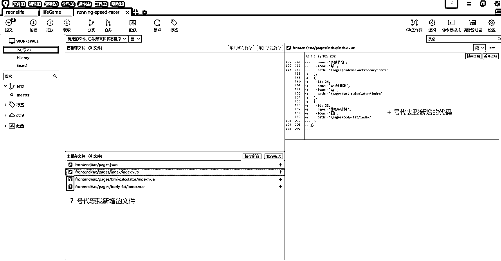
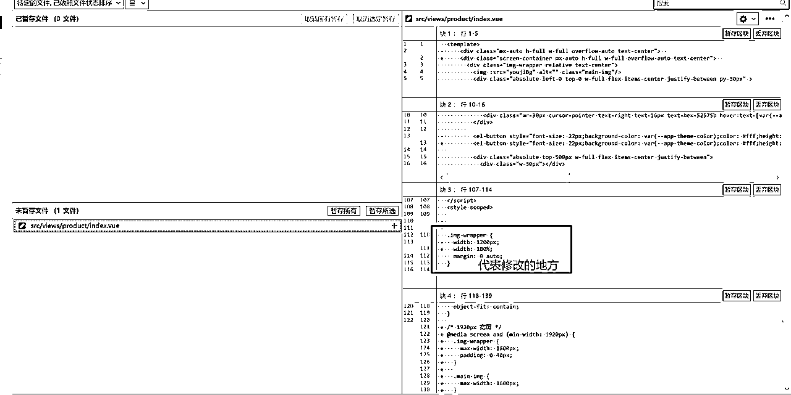

2. 模块化沟通
每个功能单独一个文件。改的时候用 Ctrl+L 或 Ctrl+I，再把文件拖进对话框，AI就知道上下文。或者只选中几行代码再点指令，就只改这一块。
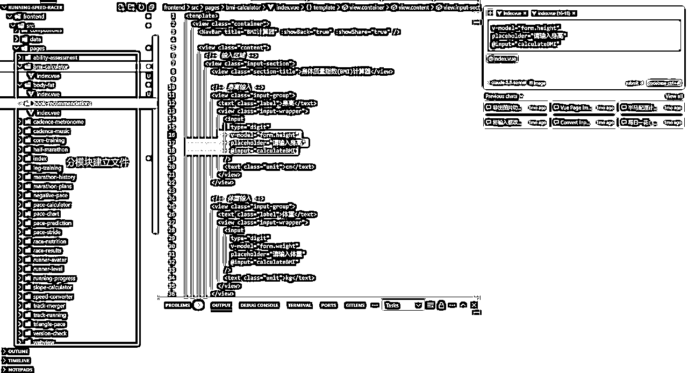

3. 不懂就问AI
遇到卡点直接问，问多了对话就顺了。

4. 其他小建议
参考同行做法：提问时末尾别加“不要改其他代码”这种限制，反而加.cursorrules文件来约束行为，不知道怎么写就让AI生成。
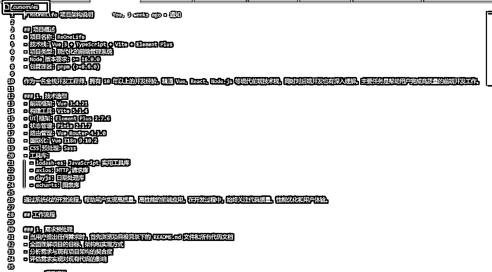

## 小程序上线注意点

流程网上很多，万事皆可问AI，让它手把手带。
要点：
1. 审核基本2小时左右，加急也差不多这个速度。
1. 上线前在体验版里多测几遍。

#小Q跑步配速器

# 三、流量打法

1. 👸号、小程序、视频号三端互导，一个用户吃三遍价值。
1. 把跑步爱好和程序员身份打包，做一个跨界IP。

# 四、收益情况

1. 👸号+小程序流量主：粉丝累计5221，收入已经到142.86元。
1. 定制需求：已有3个人想找我做同款小程序。
1. 技术咨询：有1家公司想挖我去做跑步相关产品的开发。

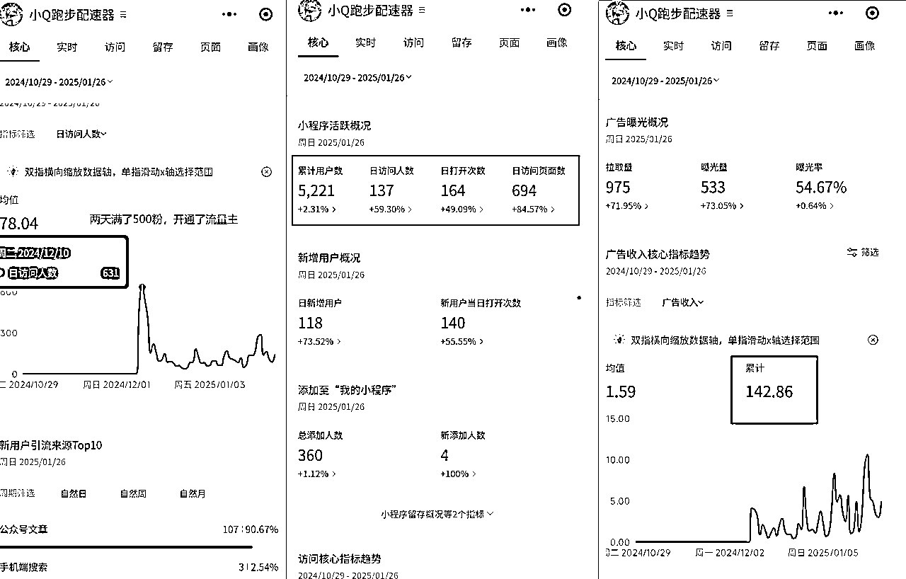

# 五、总结

从灵感到上线，总共花了3小时。
AI之前，我想都不敢想这么快。以前做个小程序至少得一周。


1. cursor不只是提效工具，它已经有中级程序员的水平。以前程序员靠 Ctrl+C Ctrl+V，现在靠按 Tab。
1. 拥抱AI，想法落地速度完全变了。我后来还照这个思路做了一个提升👸号工作效率的站点，以前要开4个网站找素材，现在一个网址搞定，效率提升50%以上。
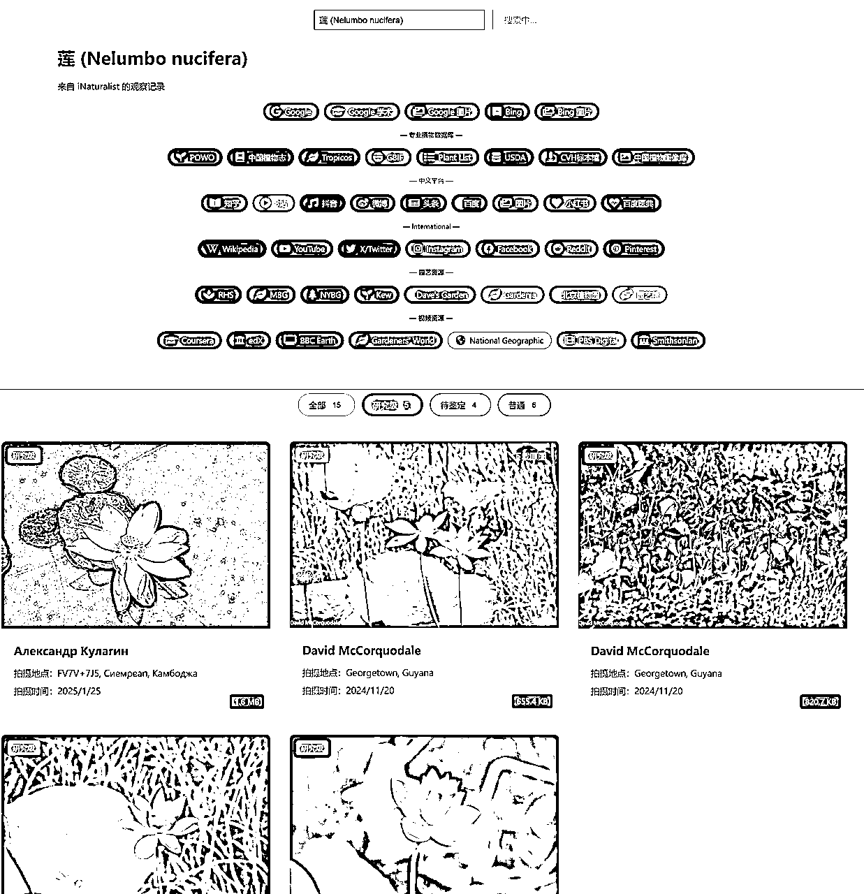

1. 互联网本质是代码堆起来的，在AI加持下，几乎没有做不成的事。

# 补充

我最近在用一个网站做个人工具库，能收住所用到的日历、联系人、心愿单、工具集合。一个项目用到哪些网址，直接归类好，一打开电脑就定位到。我的工具库地址在这里：

https://www.shilistory.com/login

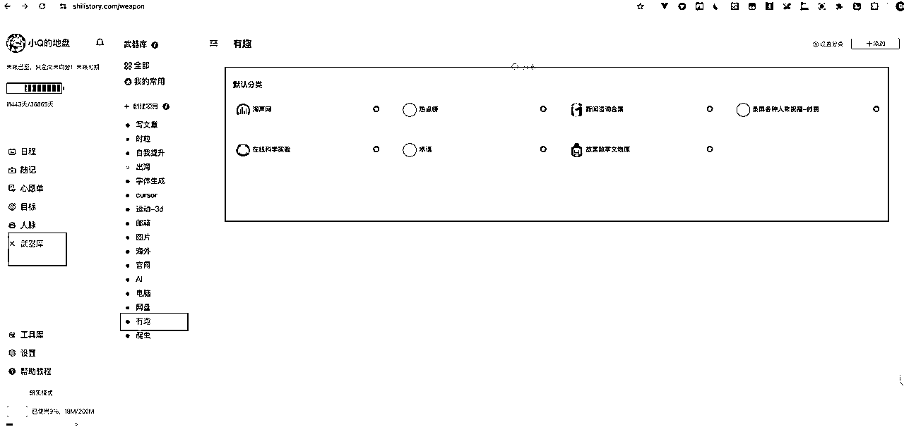

end...thanks