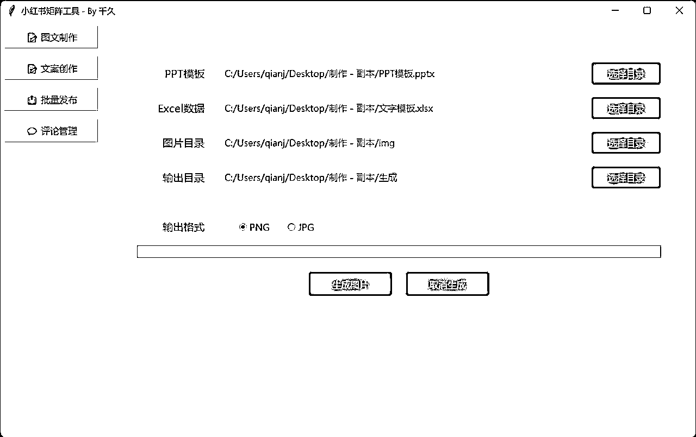
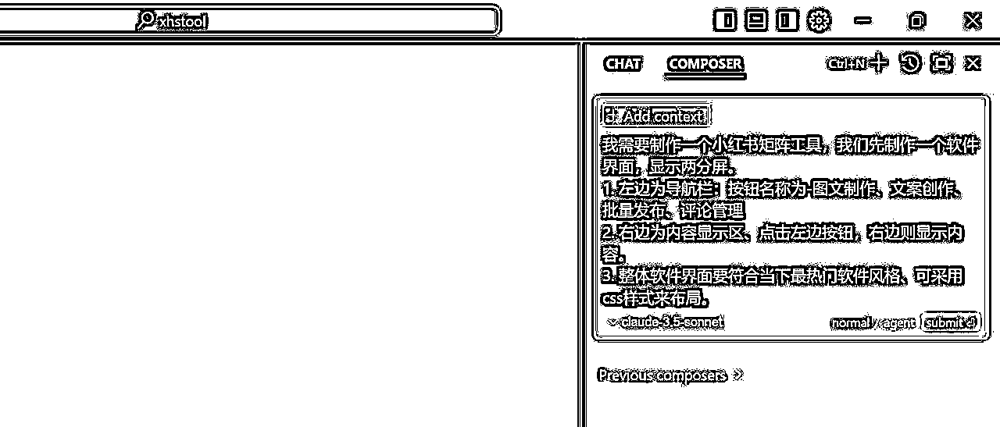
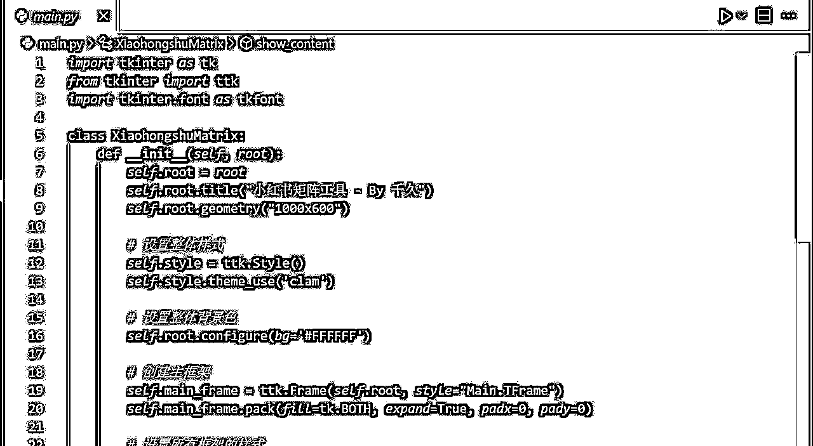
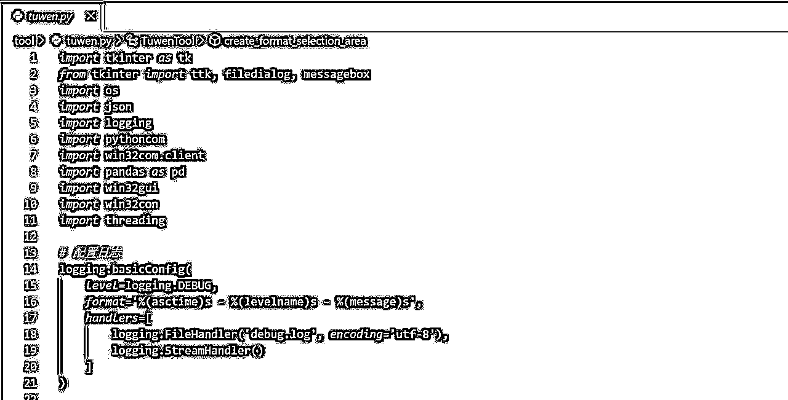
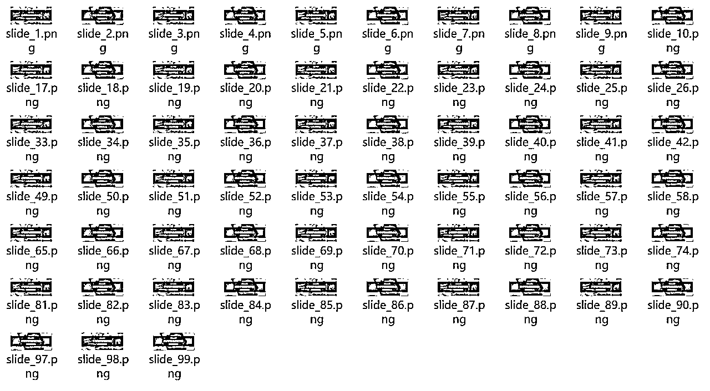

# 用Cursor零基础搭出小红书图文批量工厂

> 来源：[https://si7o8nqh3o3.feishu.cn/docx/WfFYdKhNjoqXcFxA3ZBccSJPnNf](https://si7o8nqh3o3.feishu.cn/docx/WfFYdKhNjoqXcFxA3ZBccSJPnNf)

大家好，我是千久！一个不懂代码也能做工具的实践者。今天带你拆解一套小红书图文批量生产的搭建思路，用Cursor就能完成。整体门槛不高，难点集中在调试阶段容易卡住。核心就在于选型，两条路：一种是借助内置的 python-pptx 库，跑起来快但文字样式、排版精度很难把控；另一种是调用本地的 PowerPoint，通过 COM 接口操控，效果更贴近真实但隐藏窗口时极易触发死循环。



先把整个逻辑捋清楚，思路其实很清晰：

1\. 提前做一个通用型 PPT 模板，把占位图片、文字框、背景元素都放好
2\. 利用 PPT 窗格属性把需要固定的参数锁死
3\. 用 Excel 表格去映射窗格名称，建立数据与模板的对应关系
4\. 程序读取表格内容，驱动模板批量出图



第一步，先在 Cursor 的 COMPOSER 里下指令建主框架：

我需要做一个小红书矩阵工具，先搭一个软件主界面，采用左右分栏。

1\. 左侧是导航菜单，按钮分别是-图文制作、文案创作、批量发布、评论管理
2\. 右侧是内容展示区，点左边哪个按钮，右边就切到对应内容
3\. 整体风格要贴合当前主流软件审美，可以用 css 做布局



执行完后，Cursor 会生成 main.py，主要负责全局界面的调度，底层用的是 tkinter。随后新建一个 tool 文件夹，用来存放各个功能模块，并在里面新建 tuwen.py 专门承接图文制作的逻辑。把功能拆开的好处是后续扩展不会互相污染，Cursor 迭代时不容易把别的模块改乱。

接着继续喂给 Cursor 第二段需求：

# 批量图文功能的要求如下：

1\. 支持用户自行设计通用 PPT 模板，包含图片、文字、背景
2\. 通过 PPT 窗格属性设定固定参数，结合 Excel 表格控制模板样式
4\. 一键生成后自动导出 PNG 或 JPG 格式图片
5\. 相关代码全部收敛在 /tool/tuwen.py 内部



这一步 Cursor 会把核心代码写入 tuwen.py，紧接着就是调试期。通常会遇到两种典型问题：背景图没换掉、文字框空白。遇到背景能换文字不显示，先别怀疑程序，九成是 PPT 里图层顺序被盖住了。调试过程中点生成，软件会调用本机安装的 WPS 或微软 PowerPoint 在后台完成替换。等功能稳定后，最关键的一步是把执行窗口隐藏起来，这一步最容易掉进死循环。我折腾了很久才找到可用的写法，下面直接给你可用代码，复制给 Cursor 就能让后台静默运行的问题迎刃而解。



这套小红书图文批量工具的效率非常夸张，实测 100 张素材不到一分钟就能完成。

它本质上是一个 PowerPoint 批量自动化程序，支持全程无界面后台运行。

## 核心能力

- PPT 模板批量处理
- 文本与图片智能替换
- 完全后台静默执行
- 保留原始图层层级
- 输出 PNG/JPG 两种格式

## 快速上手

### 安装环境

```bash

pip install pywin32 pandas python-pptx

```

### 基本操作流程

1\. 准备好 PPT 模板文件
2\. 准备好 Excel 数据文件
3\. 准备好需要批量替换的图片素材
4\. 运行程序，分别选择以上文件
5\. 点击生成图片，开始批量处理

## PowerPoint 后台运行最佳实践

### 1\. 关键代码

```python

# COM 对象初始化

pythoncom.CoInitialize()

# PowerPoint 实例配置

powerpoint = win32com.client.Dispatch("PowerPoint.Application")

powerpoint.DisplayAlerts = False # 禁用警告

powerpoint.WindowState = 2 # 最小化窗口

# 打开文件的完整参数

presentation = powerpoint.Presentations.Open(

template_path,

ReadOnly=False, # 读写模式

Untitled=False, # 使用原文件名

WithWindow=False # 不显示窗口

)

```

### 2\. 完整实现示例

```python

def start_generate(self):

"""开始生成图片"""

self.is_generating = True

self.generate_btn.config(state='disabled')

self.cancel_btn.config(state='normal')

def run_in_background():

try:

# 初始化COM

pythoncom.CoInitialize()

powerpoint = None

presentation = None

try:

# 初始化 PowerPoint

powerpoint = win32com.client.Dispatch("PowerPoint.Application")

powerpoint.DisplayAlerts = False # 禁用警告

powerpoint.WindowState = 2 # 最小化

# 打开模板

presentation = powerpoint.Presentations.Open(

self.ppt_template,

ReadOnly=False,

Untitled=False,

WithWindow=False # 不显示窗口

)

# ... 处理幻灯片内容 ...

finally:

# 清理资源

try:

if presentation:

presentation.Close()

if powerpoint:

powerpoint.Quit()

except:

pass

pythoncom.CoUninitialize()

except Exception as e:

logging.error(f"生成过程出错: {str(e)}")

messagebox.showerror("错误", f"生成过程出错：{str(e)}")

finally:

self.is_generating = False

self.generate_btn.config(state='normal')

self.cancel_btn.config(state='disabled')

# 在新线程中运行

threading.Thread(target=run_in_background, daemon=True).start()

```

### 3\. 核心参数解读

- `DisplayAlerts = False`：关闭所有弹窗提示
- `WindowState = 2`：窗口最小化
- `WithWindow = False`：不创建可见窗口
- `ReadOnly = False`：以读写模式打开
- `Untitled = False`：保留原文件名

### 4\. 实现要点

1\. COM 对象的初始化与释放
- 调用 `pythoncom.CoInitialize()`
- finally 块中执行 `pythoncom.CoUninitialize()`

2\. PowerPoint 窗口控制
- `DisplayAlerts = False` 杜绝警告框
- `WindowState = 2` 实现最小化
- `WithWindow = False` 禁止弹出界面

3\. 多线程处理
- 用 `threading.Thread` 把任务丢到后台
- `daemon=True` 保证主程序退出时子线程同步结束

4\. 资源回收
- 嵌套 try-finally 确保资源释放顺序正确
- 关闭顺序：先关闭 presentation，再关闭 powerpoint 实例

### 5\. 常见问题与对策

1\. COM 对象报错
- 检查初始化与清理是否成对出现
- try-finally 保证资源一定释放

2\. 窗口仍会闪现
- 确认 `WithWindow=False` 已生效
- 配合 `WindowState=2` 使用

3\. 多线程异常
- PowerPoint 操作必须在独立线程执行
- 采用守护线程避免僵死进程

### 6\. 文档使用方法

遇到 PowerPoint 自动化问题时可以这样提问：

1\. 关键词检索：
- "PowerPoint 后台执行"
- "win32com 无界面"
- "PowerPoint 自动化隐藏窗口"

2\. 提供代码上下文：

```python

# 当前代码

powerpoint = win32com.client.Dispatch("PowerPoint.Application")

powerpoint.Visible = True # 需要修改为后台执行

```

3\. 明确目标：
"请把当前的 PowerPoint 操作改为完全后台运行，不要出现任何界面"

## 依赖清单

- Python 3.6及以上
- pywin32
- pandas
- python-pptx

## 使用提醒

1\. 电脑需预装 Microsoft PowerPoint
2\. 运行建议使用管理员权限
3\. 首次启动可能需要注册 COM 组件

## 许可证

MIT License