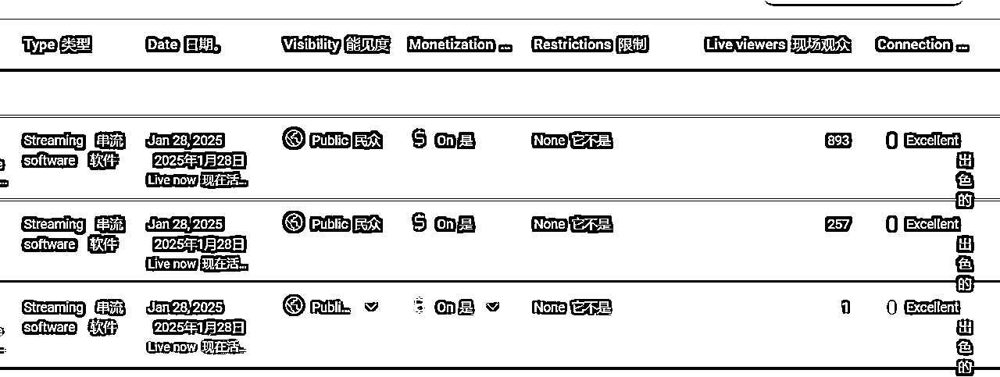
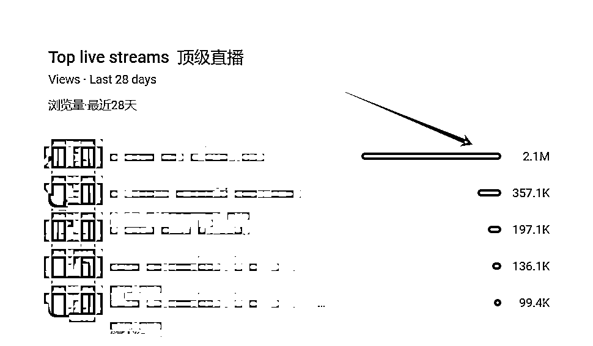
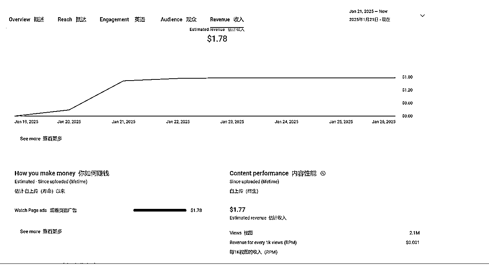
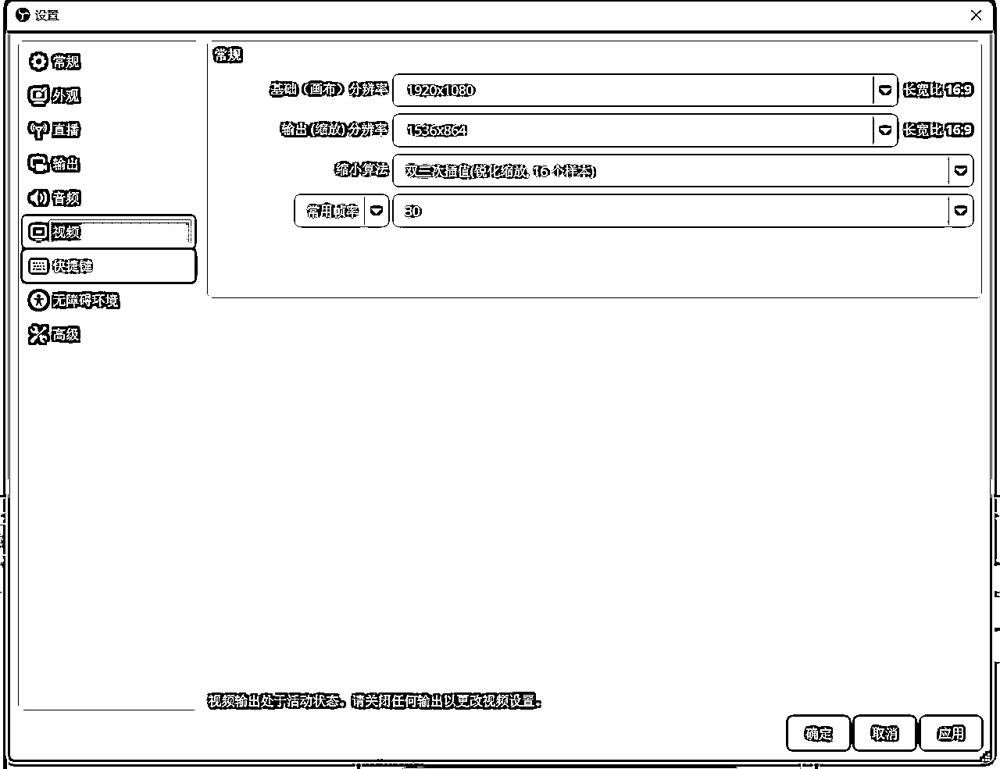
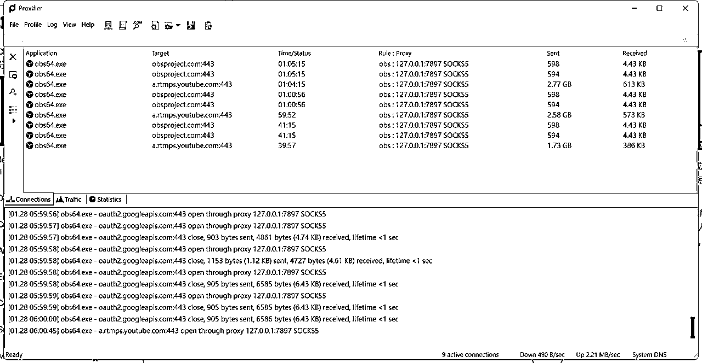
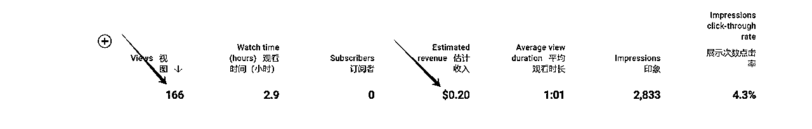
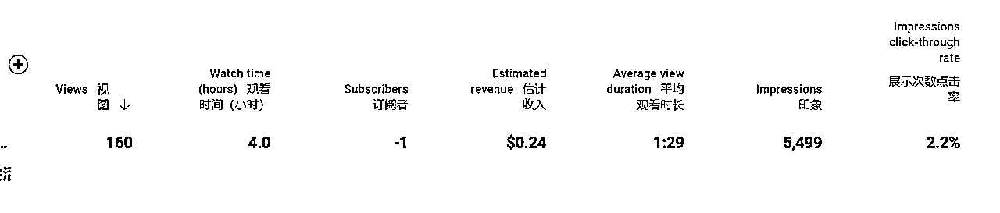

# 24小时自动推流，我的YouTube直播一天涨粉五六千的方法

# 直播间实时数据照

哈喽各位，今天来聊聊我在YouTube上操作的直播涨粉套路。图里是我写稿时同时在跑的3个直播间的实时在线人数。

下面这张是我之前几场直播的汇总数据。

场观破210万这场是1月21号开的，当天粉丝净增六七千。很明显，涨粉速度很猛，但直播本身的广告分成几乎可以忽略。所以我总结的经验是：这种玩法属于纯涨粉向，变现能力弱。如果你手里有自己的产品、服务或者私域入口，这个流量就非常值得去吃一波。

下面说说具体的实操思路。

此前我分享过用AI画面+AI音乐快速起号的思路，做音乐号的同行基本都在搞直播，所以我就专门去拆解了一下直播的玩法。

# 纵向直播间从零搭建

目前YouTube直播大致分两种形态，横屏和竖屏。竖屏直播是平台最近才大力扶持的一种形态，我观察下来，它的结构化流量源很猛，直播间会被分发到短视频信息流里。只要内容不算太差，场观十几万很容易达成。

怎么建一个竖屏直播间？其实门槛很低，有两条路，一条是直接用手机开播，另一条就是今天要讲的，用OBS推流。OBS推流的最大好处是可以做到7*24小时无人值守。

进入OBS的视频设置界面，默认分辨率是横向的1920x1080，这个数值是可以手动改的。把分辨率改成1080x1920推流，YouTube端就会识别为竖屏直播，从而吃到竖屏直播的推荐位和短视频动态的曝光。

直播流量的体量非常可观，所以粉丝积累速度也快。我那场210万场观的直播，前后算下来涨粉接近1万。加上OBS支持无限循环播放，平台也是允许的，只要素材达标就能实现真正意义上的无人直播。实现的前提是电脑保持开机，或者后续我打算用的云服务器方案，目前云服务器推流我还在测试，有进展会再分享。

要让OBS顺利推上去，还需要一个小工具来调整网络连接，叫做Proxifier。装好后做个基础设置就能用了。

# 直播素材怎么准备

素材部分很简单，可以是一个短视频，也可以把几条短视频剪成几分钟的合集，然后循环播。但有一点必须注意，背景音乐一定要用无版权音源，这样在保证涨粉的同时还能拿到一点广告收益，YouTube对版权的审查很严格。AI生成画面加配乐，现在做起来特别快，当然自己实拍也是可以的。

# 现在的运营组合

目前我是长视频、短视频、横屏直播、竖屏直播四条线一起跑。下一步的计划是上云服务器，把本地电脑的资源解放出来。

竖屏直播我主要用来做冷启动涨粉，比发短视频快得多，而且一键启动，素材做好后开机就能跑。

横屏直播我用来做收益测试，实测下来CPM和长视频水平差不多，均价能到1.5美元左右。下面是我横屏直播的真实数据记录。

写到这里，希望这篇拆解能起到抛砖引玉的作用，认识更多做YouTube的同行，一起探索更多变现打法。我入局YouTube快两个月了，越做越觉得，真正值钱的玩法都在小圈子里流通。

# 工具获取

OBS推流软件官网

https://obsproject.com/download

Proxifier

https://www.proxifier.com/download/