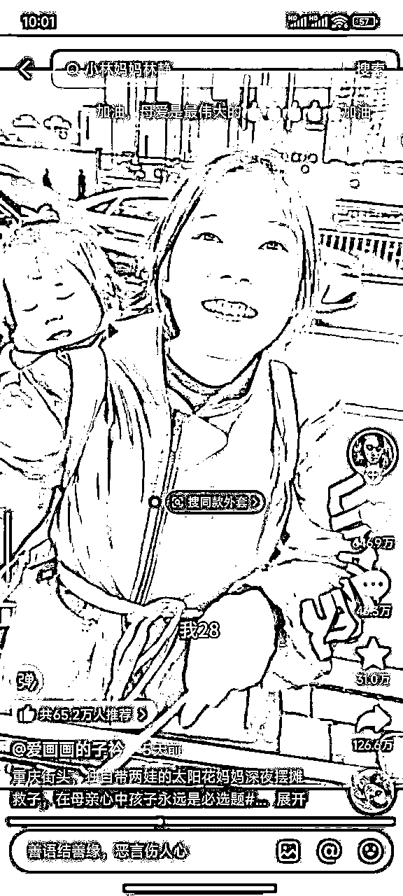
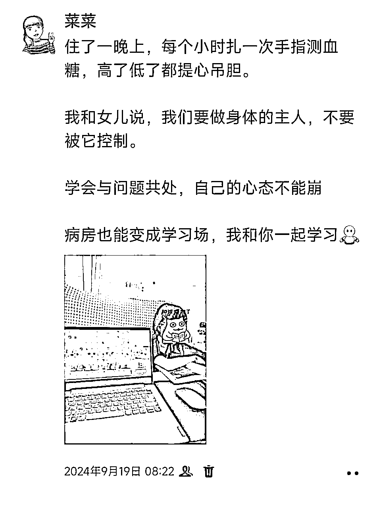
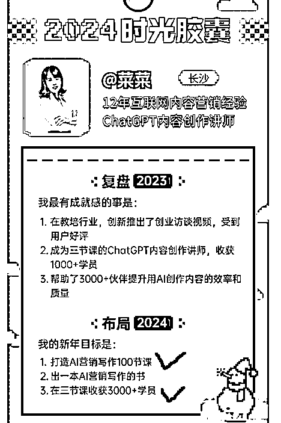
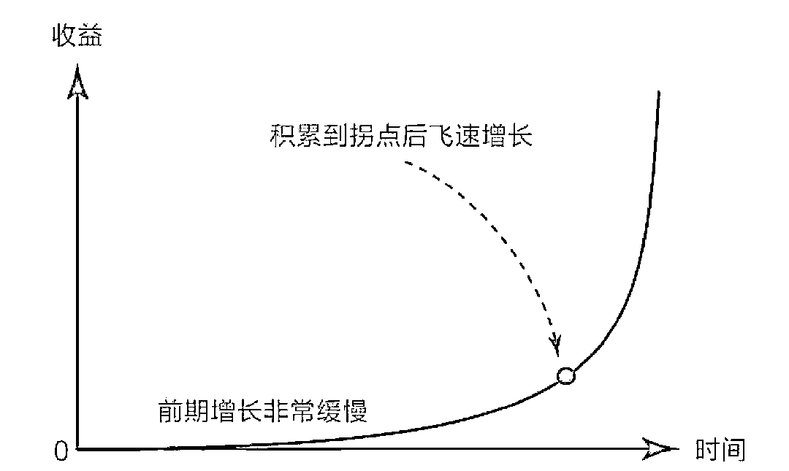
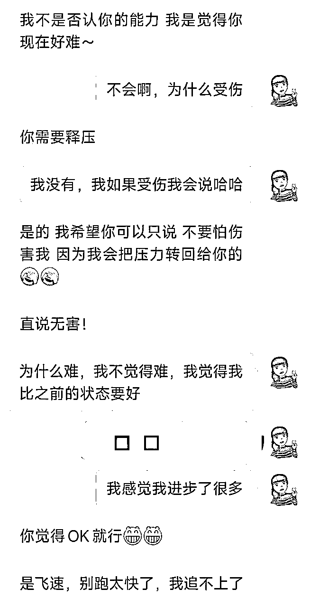

# 四十岁从头来：17年打工生涯的终点，竟是我人生重启的起点

年初刷到一条短视频，讲了一个叫小林妈妈的女人。她才28岁，独自带着两个娃，其中一个是先天性心脏病的男孩，另一个是刚会走路的女孩。大冬天的，她们一家三口在重庆街头摆摊卖烤苕皮。抖音上“爱画画的子衿”也曾分享过她的故事。镜头里的那个女孩笑得灿烂，完全看不出背后藏着怎样的苦。

子衿感慨：“我在她身上一点阴霾都看不到。”女孩笑着答：“阴霾我留给自己了。”这句话像针一样扎在我心里。因为2024年的我，也正走在类似的路上。

三月份，我结束了整整17年的工龄。

原本想着要松绑起飞，正当看到一点希望的时候。

九月十八日，这个日子我一辈子都记得。

我的大女儿被确诊为一型糖尿病，从此要靠胰岛素活着。

那段时间像掉进了一个不见天日的黑洞。

更猝不及防的是，接下来的两个月里，维持了十几年的婚姻宣告结束。

我带着两个孩子搬出了那个每一块砖瓦都刻着我们回忆的房子，开始了单亲的生活。

我经常问自己，这到底是现实还是噩梦？

每天睁眼，我都希望这一切是假的。

可现实无情地告诉我，这就是我接下来要扛的人生。

在这一年里，我的角色和心态都发生了剧烈翻转。

第一次翻转，是从领固定工资的打工人，变成没有底薪的自媒体创业者。

收入说没就没，容易陷入焦虑；经济环境不好，更容易陷入悲观。

第二次翻转，是从完整家庭的父母，变成独自带娃的单亲妈妈。

我得一个人承担两个人的活儿——

赚钱养家、照顾孩子起居、收拾家务，还要逼自己变成“准医生”。

女儿得了一型糖尿病，我从零开始啃专业知识。

这个病太折磨人，血糖像脱缰的野马，忽高忽低。

必须时刻监测数据找规律，饮食要称重算碳水，对应打胰岛素。

每天四次皮下注射，对成年人都是折磨，更何况一个11岁的孩子。

刚开始每次扎针，她都要做半天的心理建设。

到真正下针时，她强忍着恐惧，战战兢兢地扎进肚皮，连呼吸都不敢，大腿紧绷得发抖。

看着她，我的心在滴血。

可我只能装作坚定，因为一型糖尿病的孩子很容易抑郁，我必须随时是她的后盾。

就在这么艰难的时候，我却发现自己在飞速成长。

生活上，我从手残小白变成了能干的主人。

比如装个书桌怎么省力？—— 打开微信小程序找“万师傅”，师傅上门搞定。

比如花洒用久了不出热水？—— 小苏打兑水泡一泡，热水器就能恢复。

比如天然气欠费了？—— 缴费后记得打开保护阀，不然气还是不通。

工作上，2023年底立下的三个目标，2024年完成了三分之二。

说实话，如果不是人生突如其来的两记重击，我觉得三个目标都能达成。

今天想和大家聊聊，我是怎么撑过这一年的。

不是为了博取同情，只是想把真相说出来。

家丑谁都想遮着，但世界本就有B面。

总需要有人告诉你，苦难来临时，我们该用什么姿态站稳脚跟。

就像我在糖尿病互助群里常对新确诊的家长说：这场风暴没有看起来那么可怕，我们一定能找到路走过去。

2024年，帮我走出阴影的六条心得

1. 转换驱动力

创业最难的不是没钱，是心里没底。

看着账户余额一天天掉，交付的项目还得做，投入的成本还得花。

我后来把心态调了下，把创业当成付费进修。

我正在做的“AI营销100节课”，本质就是把公司营销部的所有活拆开，用AI重做一遍，做成傻瓜方案。

现在没回报没关系，我每天都在攒知识攒案例，这都是未来的资产。

学糖尿病管理也一样。

起初“支链淀粉”、“碳水系数”、“餐后峰值”这些词像天书。

后来我换个说法：这不就是一门新技能吗？万一哪天营销不行了，我还能靠这个帮别人谋生。

把它当成增收本事，动力就上来了。

结果还真有家长来找我请教，不过我实在忙不过来。

2. 学会等复利

创业哪有每月都赚钱的？低谷期怎么办？

我信一个事：复利需要时间。

就像种树，前期看不出变化，到拐点就爆发。

现在市面上还没人做系统化的内容营销全场景AI方案，只要我坚持做下去，价值早晚会出来。

我们之所以焦虑，是因为总把当下的状况当成永远。

就像孩子学打胰岛素。

刚开始她能拖三小时不敢扎，急得我直拍床。

我当时绝望：她以后每一次都要这样折腾吗？我不在了谁来管她？

慢慢她从三小时、到一小时、到半小时，到现在完全不怕了。

还能自己算想吃的零食碳水，给自己打针，实现了“想吃就吃”。

那些曾经难到想哭的事，现在都成了日常。

给子弹一点时间，它会自己飞起来。

3. 把糊涂变清楚

焦虑、情绪化、迷茫的根源，都是前路不清。

要么选择太多，要么状态太乱。

我情绪低落时会拿笔记下来问自己：

是什么事让我沮丧？我在怕什么？背后有什么没被满足的需求？我能怎么做？

如果最坏的结果来了，我能承受吗？我真的无计可施吗？我看到的是全部真相吗？

写完后，心就静了。

项目上也是。

做“AI生产直播带货文案”方案时，我想做情绪驱动销售。

可什么是情绪驱动？怎么起作用？步骤是什么？

我只能一条条拆：翻资料、画流程、靠实操验证。

AI帮了我大忙，想不清的时候让它先列点，我再筛。

4. 先把自己照顾好

要想爱别人，先爱自己。

搬出来后，我居然爱上了布置家。

房子是租的，但生活是自己的。我买了不少小物件。

睡前用电动泡脚桶做个SPA；孩子睡了，我在复古台灯下看书，学别人成功的经验，那种满足感很大。

三个人的小家一天天温馨起来，我尝到了不一样的幸福。

我也学会温柔对待自己。

早上起不来就再睡会儿；某天不想工作就放假，和朋友聚会。

给孩子买冰淇淋时，我也给自己买一支。多巴胺上来，心情就好。

不爱做饭没时间？请个阿姨来做。

照顾好自己的需求，才有力气照顾别人。

5. 织一张支持网

最难的时候，我没有关起门来哭，而是去参加聚会。

朋友圈里，我们会毫不设防地聊各自的至暗时刻，互相打气。

有位单亲爸爸朋友，曾经年入60万，一夜跌到负债累累，现在靠兼职养家还债，他依然积极乐观，这给了我很大力量。

在这些场合，我感受到被爱被接住，也获得了持续向前的能量。

6. 做减法

选择太多会耗死人。

以前给孩子买衣服，要比几家、领券、等折扣。

现在就是去商场，看中就买，不再回头。

省下的时间精力拿去赚钱，不香吗？

说完我在做的，再说说我踩过的坑，也是让我内耗到崩溃的三个原因。

2024年最耗我的三个坑

1.  不够专注

我常常一心多用，身体在做A，脑子里跑B C D。

做课程时想着胰岛素没买；学营销时分心看血糖数据。

最后样样都做，样样都糟糕。晚上反省，第二天还犯。

后来我改了两件事：

一天只定1-2件最重要的事，做好就行；把能分出去的活分出去。

比如血糖监测，我放手让孩子自己管。

我和她约定：想买墨水屏阅读器，就自行管理血糖90天，达标80分以上就买。

她积极性起来了，我才能把专注力钉在业务上。

2.  一直责备过去的自己

“当时为什么不那样选？”“早点决定就好了。”

这些念头像蛆一样啃我，让我羞愧又自恨。

现在我明白，过去的决定是当时能力范围内最好的选择。

正是当年的懵懂，才换来了今天的清醒。

要接纳那个不完美的自己，也要接纳现在的自己。

3.  边界感缺失

这是最深的坑。

接到让我不舒服的请求，我总想维持“善良、好说话”的形象。

即使不情愿也硬扛，甚至在别人越界时反思自己做得不够好。

后来我明白，这对谁都不好。

不舒服就要说出来，立好边界。

不是因为你不够好才被冒犯。

不要怕立边界会丢关系，靠委屈维系的关系，不值得留。

边界感不是对立，是让关系更健康。

我现在开始练习从小事立边界。

有一次学员让我把星球的付费帖子复制给他，说是“小忙”。

这是他第二次开口了。

第一次我碍于面子给了，第二次我拒绝了。

把付费内容倒卖，既不尊重作者也不尊重付费用户，被发现我俩都会被骂白嫖盗版。

拒绝那一刻，我轻松了。

他后来再也没提过。

当你把边界立起来，别人反而更尊重你。

所以现在，对那些让我不舒服的事，我会毫不犹豫说“不”。

这不是自私，是对自己负责，也是对别人负责。

昨天好朋友跟我说：我觉得你现在好辛苦，但你又进步得好快，我都追不上你了。

命运朝我扔泥巴，我拿泥巴来种花，有这种能力，接下来不会太差~