# 春节期间闲鱼做上门喂养复盘：50块投入换来一次独立变现体验

有一句感悟我一直记着：读别人的复盘，知识只在表层流转；亲手写下复盘，认知才会在自己身体里生根。

把事情做到位，仅有结果不够，还得懂得致谢和沉淀。感谢@HEXIN老师赠送的《明知创富指南》，里面那句话点醒了我，这篇总结才得以成型。

## 起初差点被想象吓退

去年看到一条关于春节期间上门照看宠物的帖子，评论区有人担心“陌生环境会不会扯出财物纠纷”。我当时也完全共鸣，亦仁的一句回复让我清醒：“这就是想得太多。”紧接着有人提议胸前挂设备录像，我立马去搜，结果一堆几千元的运动设备跳出来，瞬间打退堂鼓。回头看，是我自己搜寻能力太差，明明有低成本方案，却因不会找而把想法搁置了。

## 转机来自12月的闲鱼虚拟资料航海

跟随@大钟教练的节奏，我在航海期第一次实现现金流，一分一毛地赚到手，成就感爆棚。

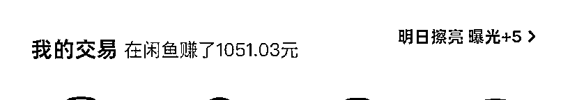

航海结束后，推力迅速下降，曝光也跟着下滑。临近春节，原本想彻底放松，惰性冒头。于是我报名了官方的“生财小组大作战”，强迫自己在假期里坚持刷帖、打标签。

刷帖本身很享受，既长见识又找灵感，不过我最大的毛病是只看不练。于是给自己立规矩：假期内至少把一篇帖子吃透并实操。先锁定亦仁的高标帖子，原计划主攻AI方向，可自己又没能力独立成项目。刷着刷着看到上门喂养的标品，时间点正好赶上春节，于是决定从这里入手。

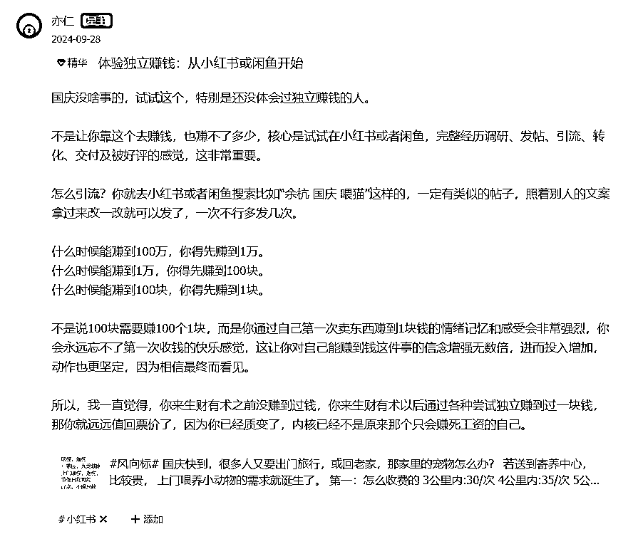

先盘点投入：

第一视角记录：胸前夹16.5元+闲置手机，基本零成本
一次性用品：鞋套9.9元、防抓手套15.8元，其余用家里常备的厨房手套、垃圾袋、疫情剩下的口罩
直播工具：用腾讯会议做任务获取免费时长

总支出不到50元，就开干了。

稻盛和夫说过，渔夫出海前并不知道鱼在何处，但仍选择出发，因为相信终会满载而归。很多时候，先行动才有机会，先相信才可能发生。

我脑补过最糟的画面：攻击性猫、恶作剧猫、应激猫、可能扯皮的委托人、脏乱差的居所。我都接受了，也就不怕了。

剽悍一只猫讲过：成长的快径是不断接触真实的人、真实的场景、真实的问题。这不就是这次项目的全部内核吗？要面对性格各异的委托人，真实喂养、真实铲屎、真实处理突发。整个过程既是自我迭代，也构成了赚钱闭环。

## 先做市场验证

我本身不排斥猫，小区流浪猫常喂，被抓过两次也补了狂犬疫苗，但它们蹭腿、喵叫的治愈感，仍让人上头。

恰好朋友家有两只猫，其中一只在孕期，平常养猫问题都问她，她很放心把猫交给我过年照看，还答应请我吃饭。这个练手机会，我自然不会放过。

美团上朋友说宠物店寄养要60元/天，我核查了本地商家，价格在59~80元区间，订单量普遍上百，也有30~48元的低价位，但评价不多。

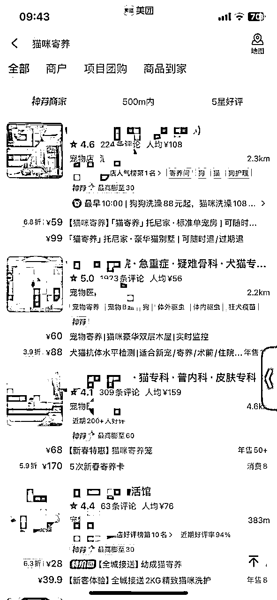

闲鱼上检索同城喂养，有商家标价20元/次，想要数超200，浏览数破2000。数据说明需求扎实。点进动态，她做了两年，最高一单收入1100元，其他同行23元、35元都有，但关注度远不及她。我想，哪怕派一小部分给自己，哪怕十个收藏、一百个浏览，她也不可能一个人吃下全城的需求。

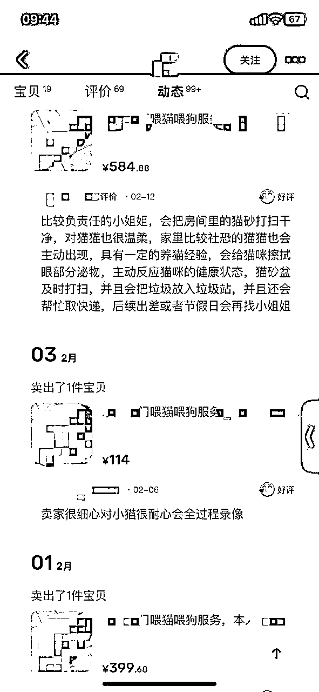

## 发帖策略参考航海手册

按虚拟资料航海的思路，先找对标，照抄框架再替换自己的收费信息。

### 商品筛选

搜索“上门喂养”等核心词，看一线城市的头部商品，收藏与浏览比≥1:10的优先研究。

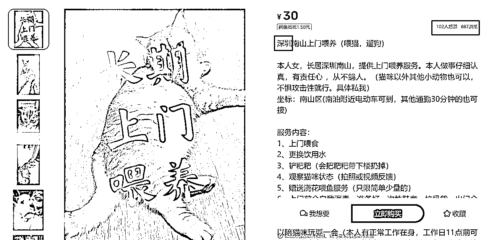

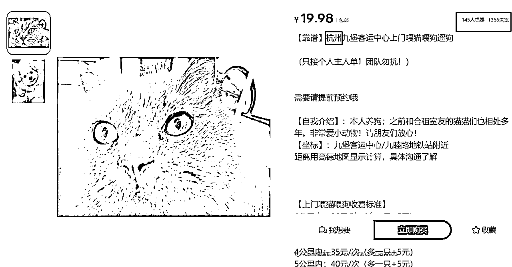

### 看运营数据

重点看近期成交节奏，持续出单优于零星出单。一般“连续多天都有成交＞仅三天内成交”。

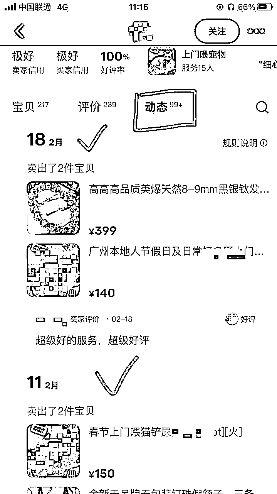

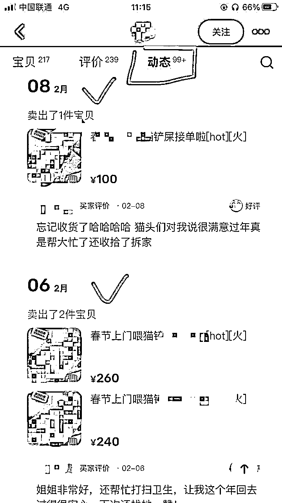

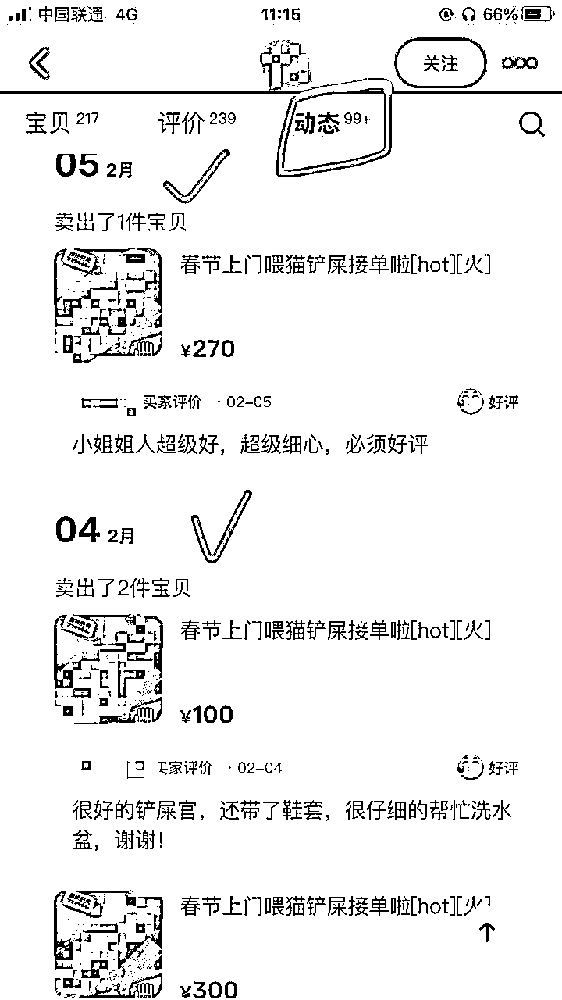

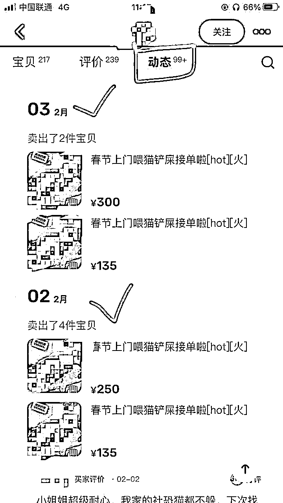

若动态被隐藏，就结合评价、留言时间、回复速度、成交量等多维度判断，并多家对比。

### 详情页编辑

我当时的闲鱼店铺之前卖虚拟资料，属于杂货铺，店铺名和头像都是清新手感，并未做垂直改动，但对流量影响不大。新号建议把头像、店名、简介调成宠物相关，具体开店步骤可参考航海手册。

核心要点如下。

#### 标题组合

借鉴对标进行关键词堆砌，提升搜索曝光。

示例：
- 过年中秋国庆放假节日代喂养 随时可联系 广州上门喂养陪玩遛狗
- 广州白云区上门喂养服务，本人在白云区岭南新世界附近
- 广州上门喂养，长期接单，周一到周五晚间空闲，周末全天可约
- 【上门喂养】南山区+宝安区
- ❗2025春节不提价！南岸区喂养逗猫35元/次，喂狗遛狗45元/次

#### 文案要点

降低沟通成本：
a 用“XX小区/XX商场”作为位置锚点
b 写清“4公里内免路费，每增加2公里加5元+每多一只加5元”

价格引流：
c 节假日同行易涨价，我在标题写“春节不加价”，目的不是打价格战，而是争取初始曝光，先抢首批客户
d 参考同行4公里内一只猫20~30元，我取中位25元

消除雇主顾虑：
e 年前刚补打狂犬疫苗加强针，半年内被抓无需重复接种，家猫普遍已免疫，所以写明“已完成疫苗加强”
f 从未照顾过患病猫，不做喂药、滴眼、洗耳、驱虫，避免交叉感染，写明“不接收患病猫”
g 微信视频只能录屏，通话结束即中断，关门、检查等收尾无法留证，故需“全程录像录音，不接受无设备监控”

### 主图与次图

主图清晰干净，突出价格和服务范围；次图可从同行、拼多多、淘宝、小红书截取，或用自己喂猫的实拍。我主图用朋友猫舍的小猫，次图用小区流浪猫的照片。

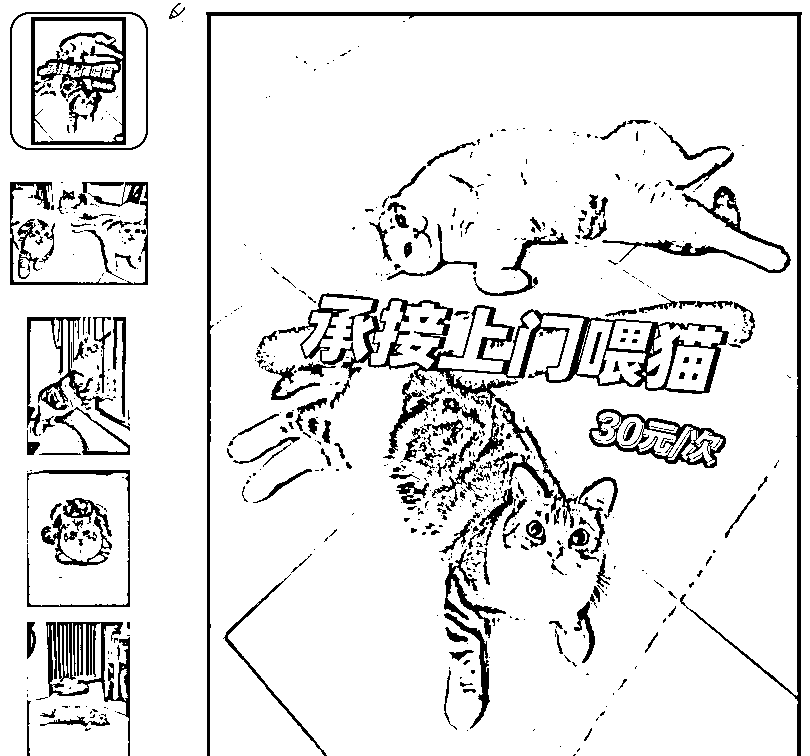

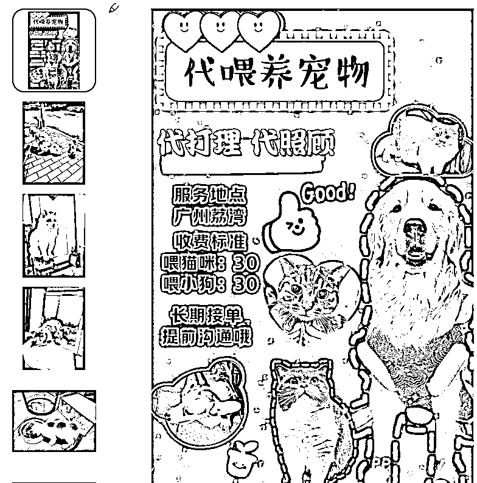

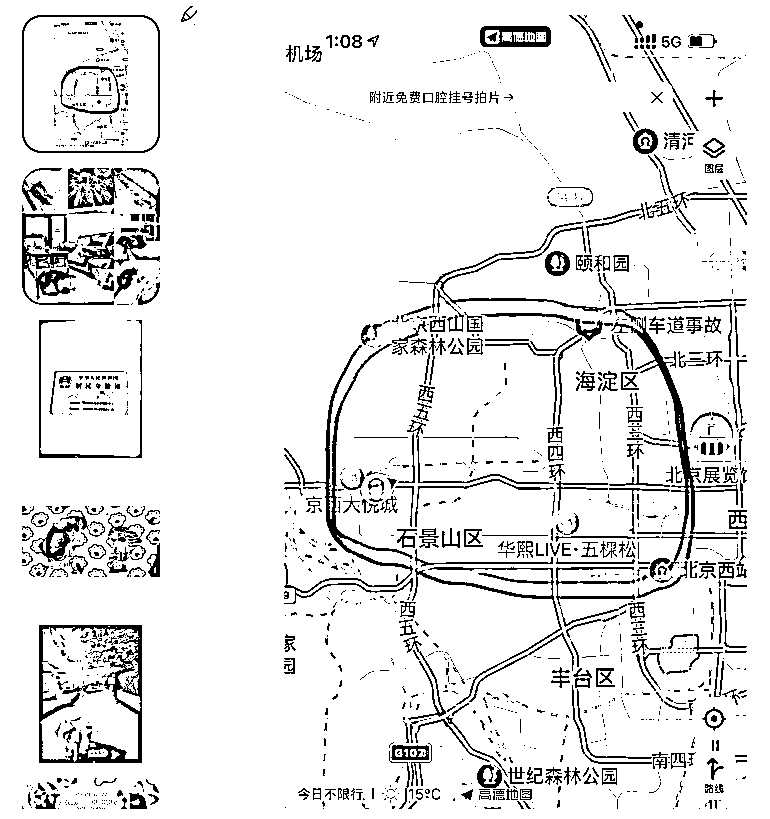

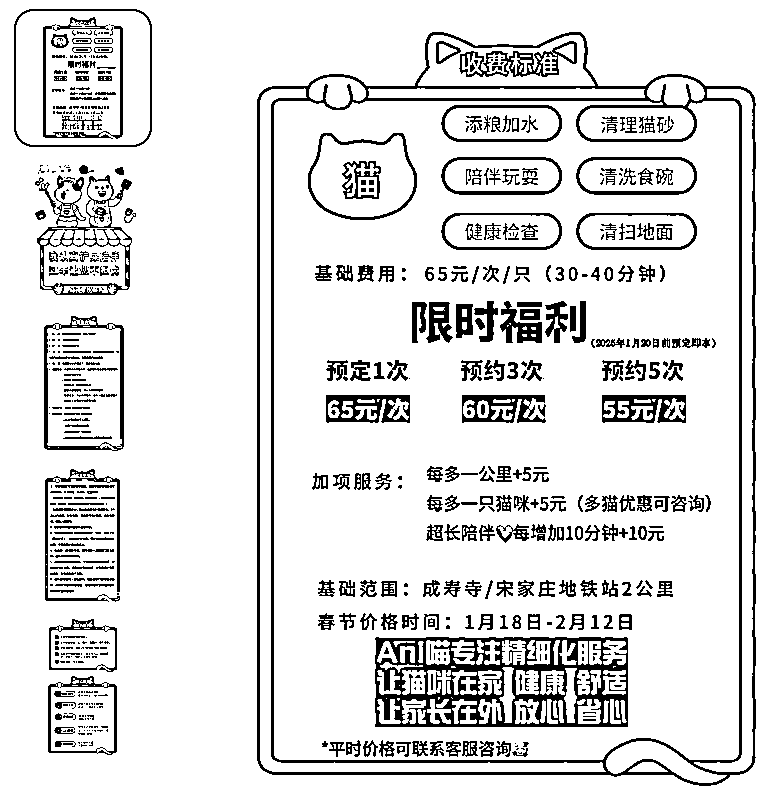

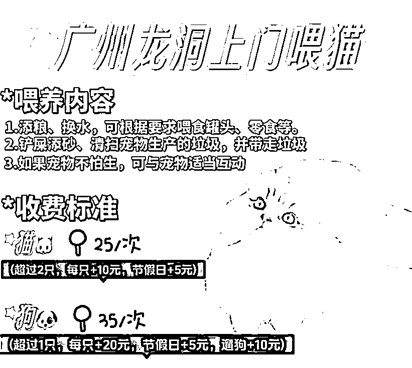

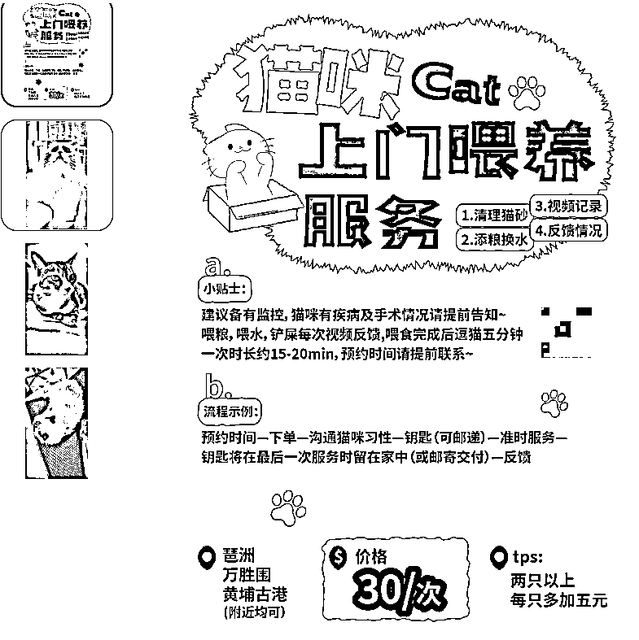

文字参考可混搭使用：

【标题】
a.喂养接单【深圳南山西丽塘朗长岭陂深圳北站上门喂养铲屎】基础版 崇文花园 塘朗村 田寮 御领公馆 朗麓家园 深圳大学城 宝能城 塘朗城 南山智园 御景峯 阅山境
b.春节上门喂养遛狗服务正常接单，三林浦锦前滩均可覆盖
c.佛山南海长期上门喂养铲屎陪玩，养猫两年经验

【价格】
a.春节上门60元起，详询私聊
b.三公里内猫35狗40，多一只+5
c.3公里内猫35/只，狗40/只，多猫+5多狗+10；3-5公里50/只；更远私聊，交通费可报销，不接大型猛犬
d.地铁塘朗站5公里内1.5元/分钟，最低30分钟起，远距离另计

【个人介绍】
a.做事细致，擅长互动，持有猫行为管理师资质，正在学习营养学
b.90后女生，多年上门经验，春节留沪，可随时沟通
c.广州本地人，会粤语，养猫多年，一对一沟通需求
d.六年养猫经历，家有三猫，芝麻分良好，折耳猫养护可交流

【服务内容】
a.添粮换水、铲屎清理、状态观察、陪玩、视频反馈、其他基础事项
b.喂食换水洗碗换砂、按需喂零食、周边清洁、陪玩20分钟、服务约35分钟
c.自备手套鞋套，不接幼猫/患病/攻击性猫咪，以南山地铁口为中心，节假日上浮10-30%，超猫加价，步梯4楼以上加价，提前备好物资，剪指甲提醒，钥匙交接方式多样，需提前一天预约，急单加价

【免责说明】
a.需提前告知健康状况、孕期、护食等信息，建议安装摄像头，无设备则全程录像
b.贵重物品请收好，提前告知性格疫苗情况，备齐物资
c.请自行安装监控，锁好卧室，财物丢失与本人无关
d.只接健康且已免疫的猫狗，狗需性格稳定，不接生病怀孕高龄猫，贵重物品自管，封窗防危险品，楼梯房只接猫及20斤内小型犬
e.宠物需健康已免疫，家中物品自理，提前备好粮砂水，封好门窗，特殊情况提前说明

### 上架流程

进入闲鱼→卖闲置→填写标题文案→上传图片→定位服务起点→分类选宠物寄养/喂养→选服务时长→宠物种类→服务方式选上门→计价元/次→填写最低价，后续根据情况调整→原价可填2倍作优惠感→支付方式包邮→发布。

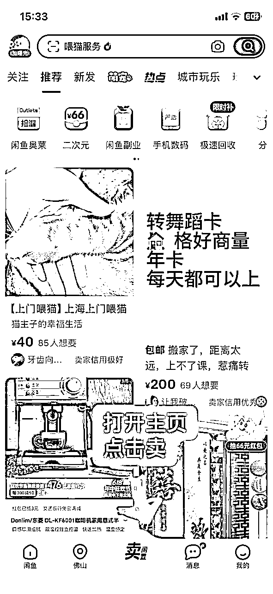

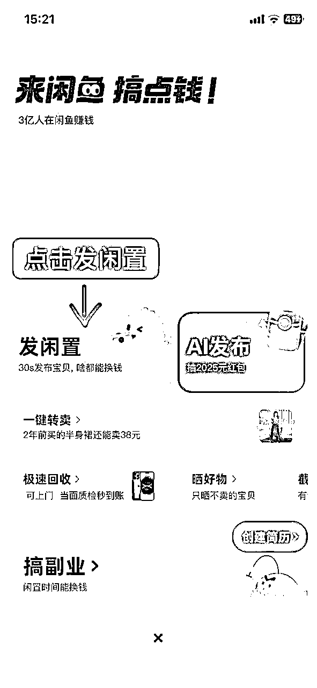

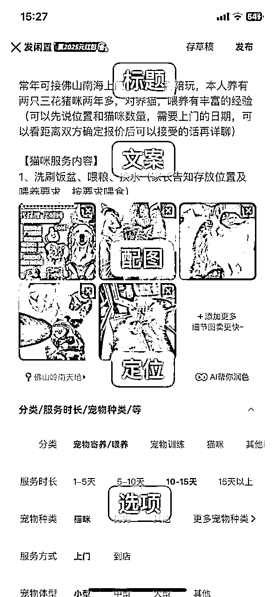

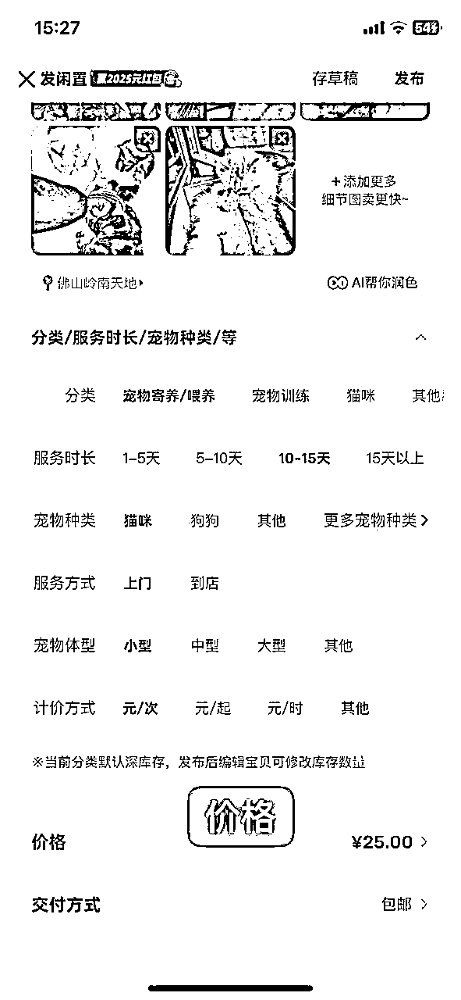

发布时间建议早8、晚8、中12。发布时用手机流量，避免公共WiFi和多账号切换，影响分发。

## 日常运营

及时回复私信，晚回复易丢单，但错过就当无缘。开启消息提醒，订单多时可使用@骄阳圈友的提醒插件。

设置自动回复，产品页→管理→自动回复，预设常见问题话术。

每天擦亮，越早越好，最晚不超过上午10点。路径：我的→我的交易→一键擦亮。

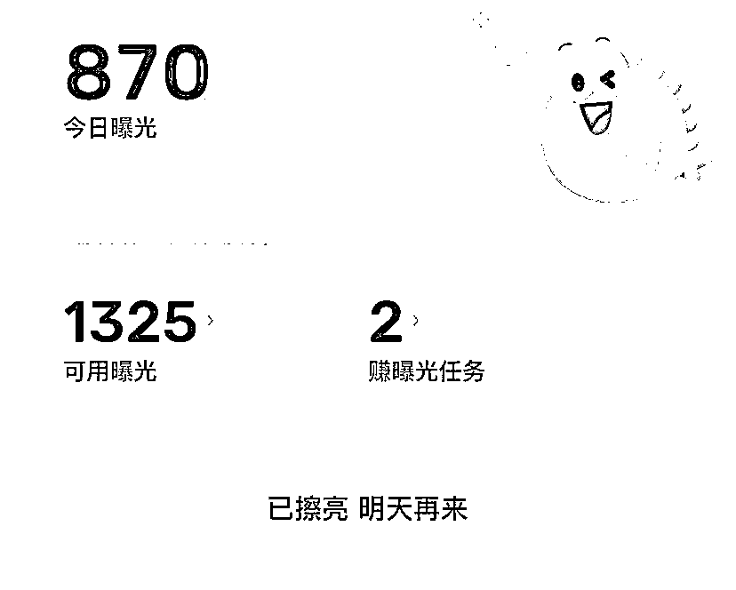

及时评价买家，提升信用和鱼力。

及时复发链接，未开通鱼小铺的店铺，拍下后自动下架，需原样重新发布，可获得二次流量。

每天至少上一个新品，保持活跃，链接可微调服务内容或分区，系统审核后即可恢复。

在小县城市场验证后，我对自己的服务更有底气，反馈也更直接。

## 引流技巧

意向客户都是上帝，尽量满足需求。引导客户主动提供联系方式，用“我该怎么联系您？”“方便通过什么方式发直播录像？”等话术，让对方先发，避免被举报。

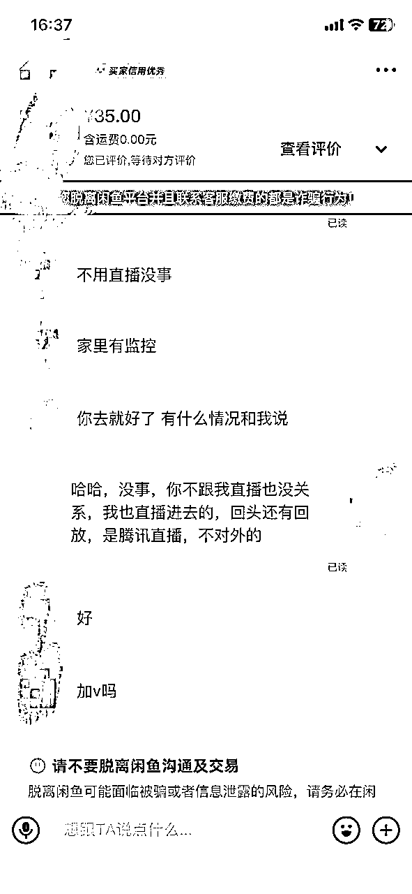

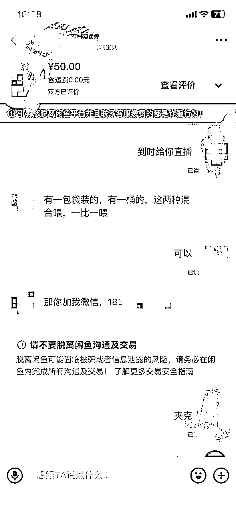

## 成交转化

不便接单时，给出合理理由，如“正在路上”“刚结束一单，需一小时后”“刚把时间给了另一位客户”，减少冲突。

爽快型客户多回信息，体现诚意，成交后微信备注，服务之外赠送扫地、倒垃圾、浇花、额外视频照片，提升惊喜感。

优质客户就更不用说，认真对待即可。

整体投入不到50元，却换来了实打实的独立变现体验和对真实世界的直接体感，这本身就是最有效的成长。

上门喂猫这单生意，干着干着反倒遇上了不少暖心事：聊需求的时候转一笔钱，人到家了又转一笔，服务收尾还塞来拜年红包，七七八八加起来早就超过了原本的报价。碰上这种买家，谁能不捧着？

### 爱砍价的客户，各有各的招

**a.** 12公里就为一只猫，开价45元，想着顺路捎上另一位客人，给个八折36元。客户嫌路远不肯加钱，折后价还是嫌贵。无所谓，谈不拢就谈不拢，不强求。

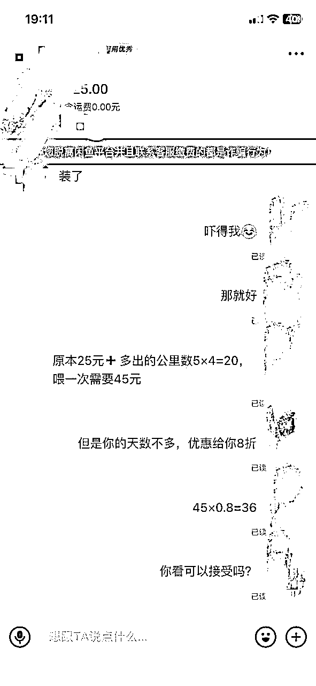

**b.** 4公里11只猫，一只喂5粒药，十只有感冒症状要擦鼻涕擦眼屎滴眼药水，连喂10天。按单价25元算，一次75元，十天750元；周期长给八折，600元，折算下来一次才60元，11只病猫全包，简直白菜价。结果客户说上一任喂猫的40元全包，这价压得没边了。健康猫我早就接了，全是病号，只能婉拒，干脆放弃。

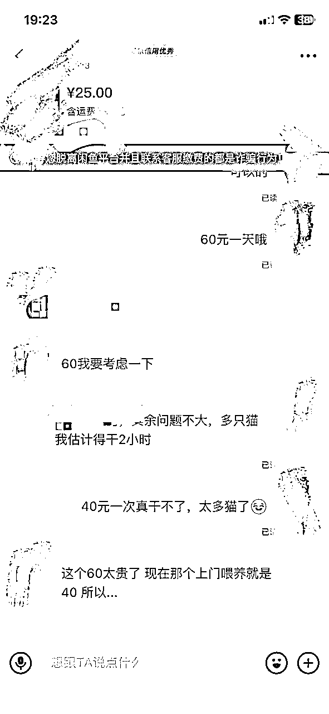

**c.** 18公里两只猫，喂10天，按公里数和猫数算一次65元，正价650元。周期长给折扣，520元能谈。客户照样嫌贵嫌远。偏远地方有人愿意跑一趟就知足吧，好好珍惜。

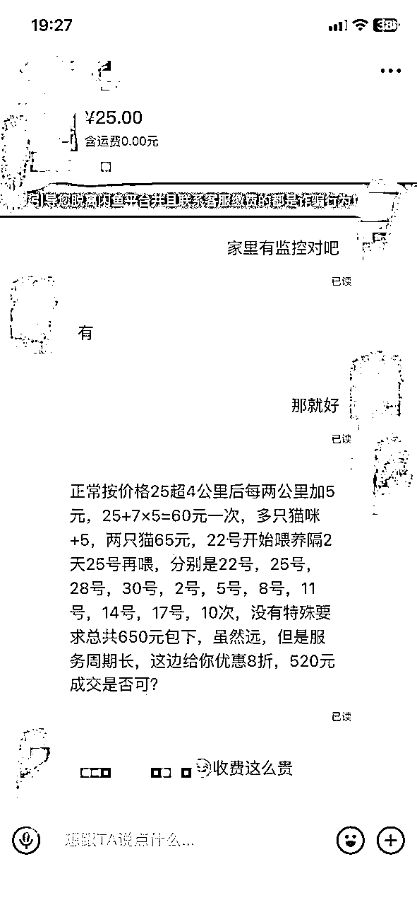

后面还得看实际需求去打磨服务质量。

#### 提前摸清需求
第一次沟通时就主动探口风，比如直接问“你最在意猫咪的安全，还是价格？”一下子就能分辨出谁是价格敏感型。

#### 温和但坚定
把高价背后的成本讲清楚，用细节说话：“这个费用包含了上门的时间成本、处理宠物突发状况的经验，还有每天的照片视频反馈，都是为了猫咪的安全。”

#### 换一种方案
预算有限的客人，可以提供简配版（比如缩短互动时间、只管铲屎加粮），或者用赠品代替降价（送点自己力所能及的小福利）。

#### 把规则说在前面
一开始就摆明“价格透明，已经是最优解”，省得后面来回拉扯。要是客户还在磨价，可以委婉讲“可能暂时满足不了你的需求”，给彼此留个台阶。

#### 优化定价策略
多看看同行的价位，让价格与服务质量匹配，按服务复杂度（多猫家庭、喂药需求）分档设置，让客户自己选。

#### 塑造专业形象
客户的好评就是最好的招牌，比如“100%零事故”，信任感一下子就上来了。

要接受客户分层这件事——不是所有人都该是你的目标客户。靠低价抢单，最后赔上的是服务质量；专注服务愿意为品质买单的人，才走得长久。这样既守住了服务的价值，又能筛出对的客户，成交率和满意度反而更高。

# 交付

## 闲鱼接单流程

用户在闲鱼下单付款后，别等上门当天，立刻点发货，不用填邮寄地址，整单就当定金锁住。这样一来需求才算真正定下来。就算客人服务完忘了确认收货，7天后平台自动到账，钱稳稳落袋。

要是下单后还没服务就被放鸽子，可以结束订单原路退款，或者让客户自己申请退款，也可以让他补个辛苦费再退钱。年初三那位客人临时不出游了，猫不用照顾，客客气气提前说明，我也没收钱，整单退掉，留个好印象。要是人都到半路了才说取消，这种可以理直气壮要补贴，或者拒绝平台退款。

不在闲鱼成交也行，平台要收软件费，微信直连能省一点。但我还是选择走闲鱼——图的是平台的流量和双方保障，省得扯皮。微信就用来细聊、发图发视频、丢直播链接、发朋友圈。

## 接单服务流程

客人一般会提前几天预约，最晚也提前2小时，排期完全来得及。

### 记录客户需求

我会把需求记下来，地址和客户信息用简写，其余全按真实情况记录。每天跑1到3家，9天9个客人，收入不到400元。

| 下单时间 | 客户 | 地址 | 监控/开门方式 | 猫咪数/天数 | 报价 | 服务要求 | 服务时间 | | | |
| 2月3日 | 77 | 荷5楼空房 | 1监控器/无锁 | 1只怕生猫/1天 | 35元 | 铲屎+换水 | 2月3日15:00 | | | |
| 2月2日 | x5 | 园20楼 | 1监控器/密码锁 | 3只温顺猫/1天 | 35元+拜年红包8.88元 | 喂食喂水+换猫砂+擦泪痕+梳毛+关客厅灯 | 2月2日15:00 赠送擦屁股/陪玩/扔垃圾/拆快递 | | | |
| 2月1日 | 黄 | 城2楼 | 2监控器/同城取钥匙 | 4只猫（社牛1+单独1+怕人2）/1天 | 50元 | 混合喂养+混合猫砂+加矿泉水 | 2月1日20:00 赠送擦尿拖地扫墙皮洗厕所/陪玩 | | | |
| 1月30日 | 意 | 居5楼 | 1手机监控/无锁 | 2只怕生猫/1天 | 25元下单选+闲鱼转10元+微信转10元 | 铲屎+换矿泉水+重启手机 | 1月30日14:00 | | | |
| 1月30日 | U | 里10楼 | 1监控器/密码锁 | 4只猫/2天 | 50元 | 铲屎+检查猫窝有无屎 | 1月30日11:00 赠送酒精擦地；2月1日8:00 赠送摆纸皮箱和猫玩具 | | | |
| 1月28日 | y | 中 | 1监控器/密码锁 | 4只猫（敏感乱拉1+社牛1+怕生2）/3天 | 90元（退款） | | | | | |
| 1月28日 | 心 | 园14楼 | 无监控/藏钥匙 | 2只仓鼠/1天 | 25元 | 查粮是否打湿+查水壶是否堵+加水 | 1月31日10:00 | | | |
| 1月27日 | 啦 | 园21楼 | 无监控/密码锁 | 1只猫/5天 | 100元+可看回放 | 取猫粮快递+换水+加粮+铲屎+关热水器电源 | 1月27日到2月4日共五次，每次赠送陪玩 | | | |
| 1月27日 | 梦 | 花 | 1监控器/密码锁 | 3只怕生猫/2天 | 50元 | 加猫粮+凉白开+移水壶位置 | 1月29日10:00 赠送扔垃圾+擦猫砂盆；2月2日11:00 赠送陪玩 | | | |
| 1月27日 | 玲 | 村 | 无监控/藏钥匙 | 2只猫，其中1只怀孕 | 试手，朋友请吃饭待兑现 | 加猫粮猫砂+铲屎+加水 | 1月27日14:00、1月29日17:00、1月31日20:00、2月2日9:00 | | | |
| | | | | | 合计398.88元 | | | | | |

### 上门服务步骤

我不像网上说的爆单那种节奏，钥匙堆成山、一天跑十趟的，接单比较佛系。多数客户有监控+密码锁，个别要去拿钥匙，甚至还有家里不上锁只关门的——这种必须全程开直播，一点侥幸心都不能有。最近的一单就在隔壁小区，一公里不到；最远12公里。

1. 按约定时间上门，到了楼下先跟客户说一声，方便各种方式开门。
2. 戴好胸前支架。
3. 旧手机开腾讯会议+录屏，直到锁门离开那栋楼、扔完猫屎才关。
4. 常用手机微信发直播链接、沟通、拍照拍视频。
5. 到门口穿鞋套、戴手套和口罩。
6. 敲门，同时喊猫咪小名确认在家，再开锁；门只开条小缝，防止猫冲出去。
7. 关好门，边唤猫边观察精神状态，按性格决定怎么亲近——怕生的只要让客户确认猫在就行。
8. 熟络后按需求干活：一般是先洗碗加粮加水，再铲屎添猫砂，免得污染食物。粗养客户用厨房自来水，省养的要煲开放凉，精养的要矿泉水。铲猫砂一定要戴口罩，有的猫砂除臭差、扬尘大还不结块，铲完记得拍拍袖子和衣服，再洗手。洒出来的猫砂顺手扫干净。客户有专用垃圾袋就用他们的——我自己带过一个超薄垃圾袋，差点被猫屎压漏了。
9. 特殊服务按要求小心操作。除非客户明确说可以，不然不进卧室，只在猫粮碗和猫砂盆区域活动，避免不必要的麻烦。
10. 过程中有情况随时跟客户同步：屎多不多、形状如何？猫有没有受伤？猫粮只吃冻干剩下的怎么办？阳台要不要关门？猫屁股上挂着屎条要不要擦？让客户看到你在认真照顾——真诚就是必杀技。
11. 服务时旧手机直播，可以截屏（比如服务前后对比、猫咪精神头、如厕状态、陪玩瞬间、猫粘在你身上的画面）。常用手机就多拍照片视频发客户，特别是互动片段：一来让客户放心，二来攒好评素材，三来猫咪跟你熟了下一次更愿意复购。
12. 快结束时提前告诉客户，跟猫说拜拜，检查水电窗，开门留缝确认猫没跟出来，锁门下楼扔猫屎，告诉客户已锁好门离开，关掉直播。
13. 把直播回放、照片视频一起发给客户，小结一下猫咪当天状态，顺便夸夸小猫乖巧——主人聊起自家猫都会滔滔不绝。

流程就这些，随客户需求增减。不管客户什么脾性，花钱雇我，我就要做那个靠谱的人：凡事有交代，件件有着落，事事有回应。链接感强了，复购率自然就来了。

# 被好评

微信上服务结束，趁客户正满意，可以顺势要个好评。不忙的客户一般当场就在闲鱼确认收货+好评了。答应了又忘的也别催，只要发货过，平台到时间会自动收货。

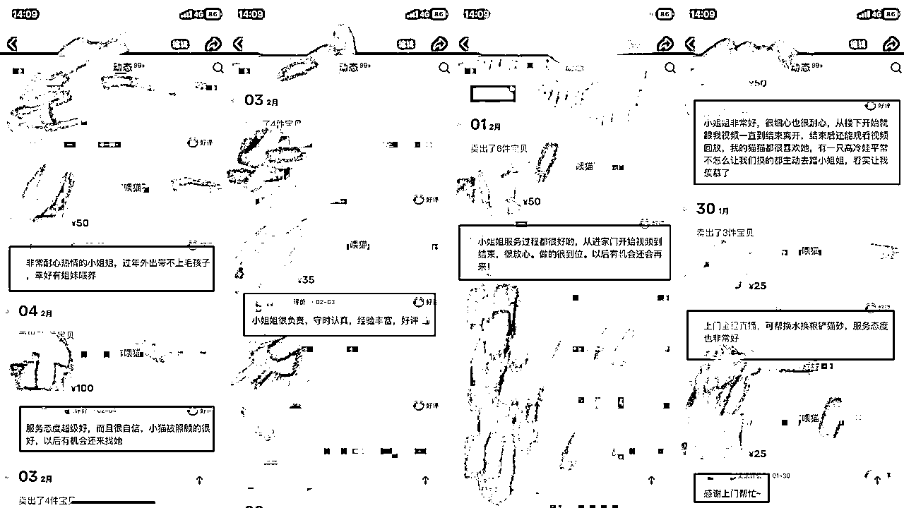

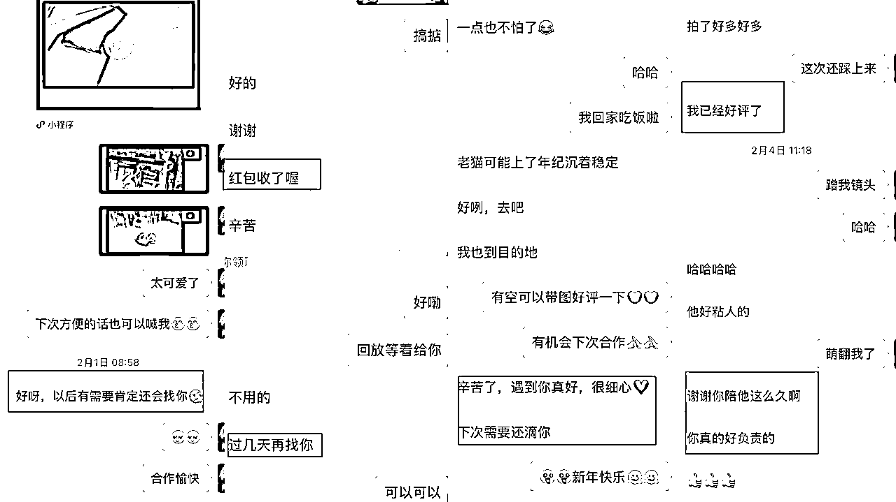

以上就是我第一次独立赚钱的小项目。可能是我运气好，遇上的客户都爽快，往后也许还有不少坑等着踩。没关系，继续进步就是了。期待五一、国庆中秋、春节再战！

# 后续延伸变现

## 适合人群

时间灵活的学生/自由职业者/宝妈：节假日空闲多，扛得住高强度接单。
动物爱好者：有养宠经验，懂宠物习性，能应付应激之类的突发状况。
体力好的：高峰期每天要骑车或步行跑8-10家，还得搬猫粮猫砂。
细心耐心的人：按主人要求清洁、陪玩、反馈细节，避免纠纷。

## 需求高峰期

主要集中在春节、国庆，能占全年订单七成以上，其次五一、中秋等长假。节前一到两个月就要开始接单，春节期间可能连续10天密集上门。非节假日订单很少，不适合当稳定收入。

## 城市选择

一线/新一线城市（北上广深杭蓉等）需求最旺，养宠人群多、消费力强。三四线城市养宠客户居住更稳定，但市场小很多。

## 注意事项

优先选交通便利的区域（如地铁沿线），减少通勤时间。别跨区接单，比如北京朝阳到海淀，体力消耗太大。小城市公交少，我一般骑摩托。

## 长期发展

提高客单价——增加陪玩、梳毛、剪指甲等增值服务，单项加收10-20元。
转型高端——往宠物培训、上门美容这类方向走，或者组团队扩区域。
节假日地推——多宠小区、宠物店/医院周边、高档小区贴海报拉新客。
多平台矩阵——多个平台同步发内容引流。
带货分佣——把直播素材做成IP内容，比如《上门喂猫盲盒日记》《100只猫的性格图鉴》，记录服务中的有趣瞬间，吸引爱宠人群，视频里带上宠物用品链接赚分佣，或谈品牌合作。
私域周边变现——代售定制项圈、宠物写真集，跟宠物医院美容店联名出折扣卡分成。
节假日溢价——推出节日安心包，包含直播回放和每日健康报告，增强信任感和复购。

# 总结

上门喂猫这个项目，是当初在亦仁的超级标里随手捡来练手的。按亦仁说的，完整体验了调研、发帖、引流、转化、交付、被好评的全流程，把闭环跑通了。之前跟着闲鱼虚拟资料航海第一次变现，已经开心得不行，后来航海结束订单变少，正发愁怎么办。刷到有圈友向亦仁提同样的问题，亦仁说：什么帮你赚到钱，就把它放大十倍。这句话点醒了我，更确定要修炼那种不被卡住的能力，于是借着闲鱼，开启了春节上门喂猫。

虽然只赚了不到400块，但正如亦仁所说，我已经“质变”了，内核不再是从前那个只守着死工资的自己。

涛哥说，大部分人买书的爽点在下单那一刻，知识付费的爽点在付款那一刻。生财有术严格来说也算知识付费，交了3000多，平时刷完帖子就没了下文，看完评论一句“牛逼”就没后续了。但这一次，我不是在为知识付费，而是在为改变付费——终于把“我学到了”变成了“我做到了”。

欢迎圈友们多多指教，一起生财有术。