# 30+杭漂，从办公室到自由职业：我把两年多的搞钱经历说给你听

## 一、为什么我放弃了安稳的工作，转头去做自由职业？

这段旅程的开端，其实并不怎么体面——不是因为我雄心勃勃，而是因为我在职场里受了太多憋屈。

2020年疫情结束之后，我从上海到了杭州，进了一家教育公司。别看税前工资从1.2万掉到了0.8万，那时候我天真地觉得教育赛道有无限可能。入职后也确实干得风生水起，业绩越做越好，领导也给了我足够的空间和认可。

但做了两三个月，我就发现问题了——公司越来越不像在做教育，反而像在收割客户。用户体验被抛在脑后，赚钱变成了唯一优先级。这跟我内心信奉的东西完全拧着来。

我跟当时的同事坦诚说：“你们觉得这里不错，但我恰恰相反。”尽管那时候收入已经很不错了，我还是跟自己较劲：这不是我想要的挣钱方式。

于是在2020年12月，我辞职了，和三个想法一致的伙伴一起出来创业，想认认真真把教育做起来。

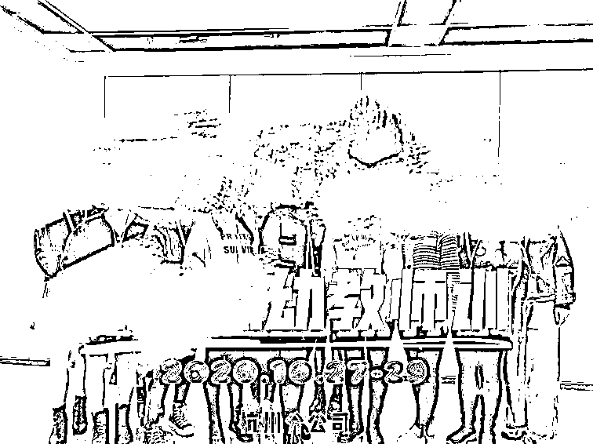

但创业这件事，对几个没太多经验的人来说，哪有那么容易？

一开始还算顺，赚到了一些钱，但2021年7月“双减”政策来了，直接打乱了我们所有的节奏。客户没法继续服务，新客户也没法开发。合伙人之间反复商量之后，决定放弃原来的模式，尝试了几条别的路，但都离预期的目标很远。两个月收入几乎为零，我最终提出结束合伙。

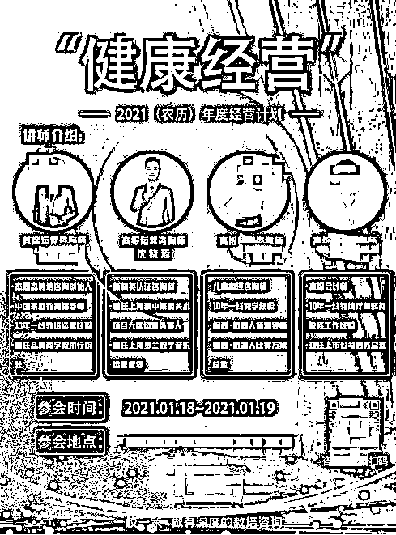
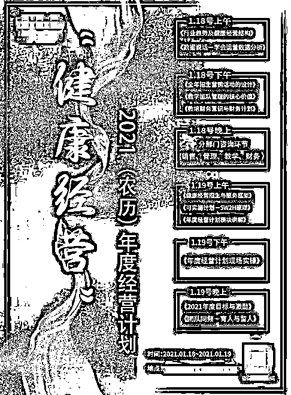
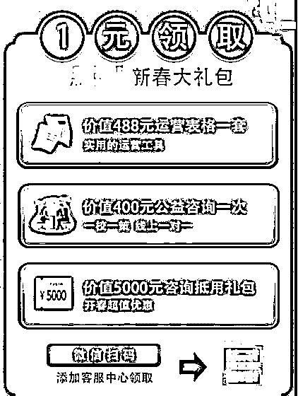
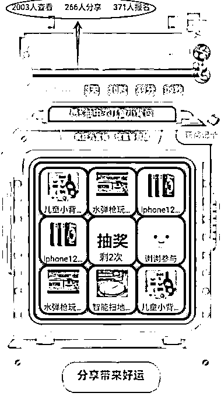
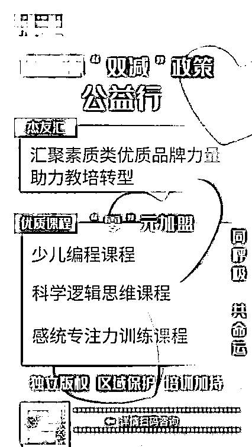

后来我和新的搭档开始做线上流量增长，这半年成绩倒是不错，做了40多场活动，单场最高做到23万收入。但一想到“双减”的大背景，我心里清楚这条路走不长。

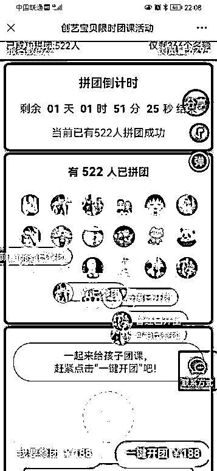
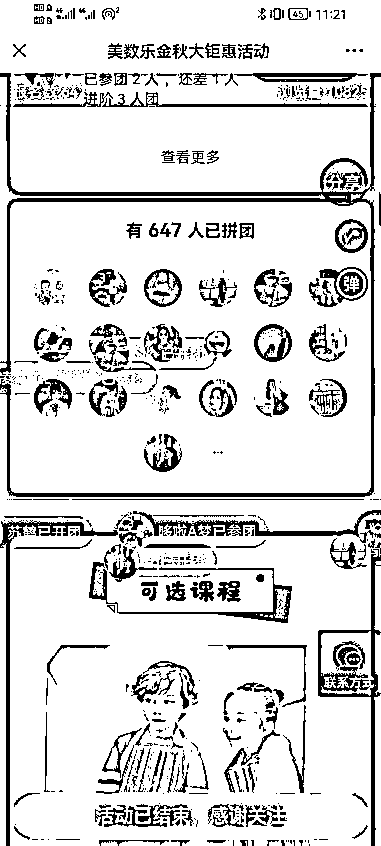

于是我又回到了自己熟悉的领域——加盟商运营。生活恢复了稳定，收入也回到了正轨。

但那种“温水煮青蛙”的感觉始终挥之不去。每天下班走在路上，我反复问自己：这是我愿意做一辈子的事吗？我甘心就这样把热情消磨掉吗？

（年会上代表项目组登台献唱）

心里的声音从未消失：我想超越在上海时的收入水平。越来越强烈地意识到，我必须在工作之外，再开发一条路。

## 二、上班的时候，我是怎么一步步试水副业的？

我在2022年底开始尝试副业，一开始就付费学了两个项目：小红书幼师资料，淘宝虚拟店铺。

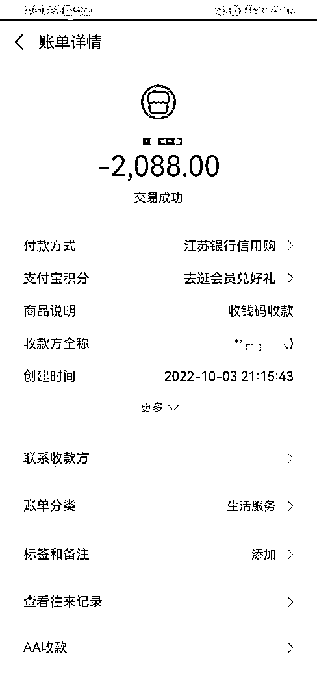

这两件事同步进行，时间全靠下班之后挤出来。幼师资料这个方向反馈很快，不到半个月我就赚到了人生第一笔“巨款”——15块钱。别看少，这给了我极大的动力。我又发内容、引流、做转化，一个月不到，赚了将近300块。

这个方法很笨，但也让我悟出了一个非常重要的道理：小白阶段千万别看不起小钱。小钱代表着你跑通了0到1的闭环，只有稳稳跑通了，才有后面放大的可能。

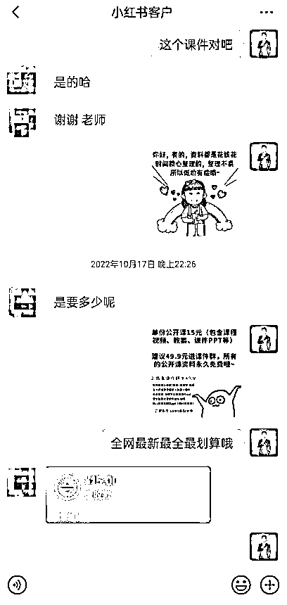
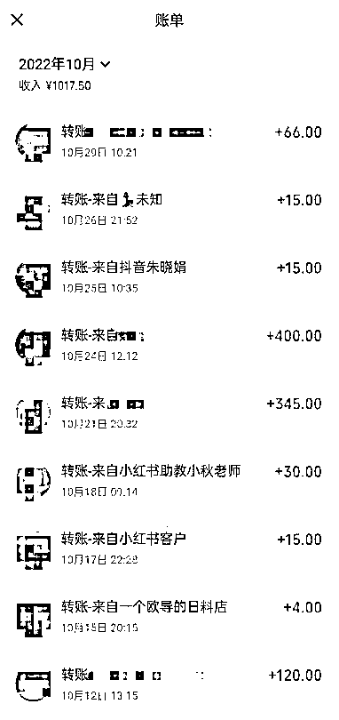
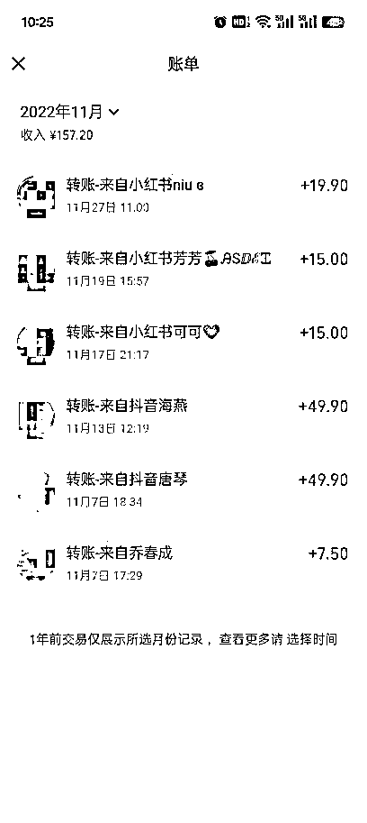

淘宝店铺冷启动就慢多了。我一直坚持选品、上架，差不多一个月后终于开张，两单：7.9+8.6，一共16.5元。除去刷单的，截止当年12月底，一共赚了60.9元。

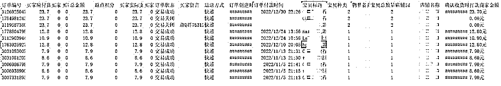

2023年4月初，我付费进了赚钱社群，目的很明确：去赚钱氛围里泡一泡，练商业嗅觉，顺便筛选好项目。那段时间我陆续实操了资料引流、小红书店铺、抖音直播等，每个项目都跑通了闭环，赚到了“第一块钱”。我还真发现，赚钱的路径远比我想象的多。

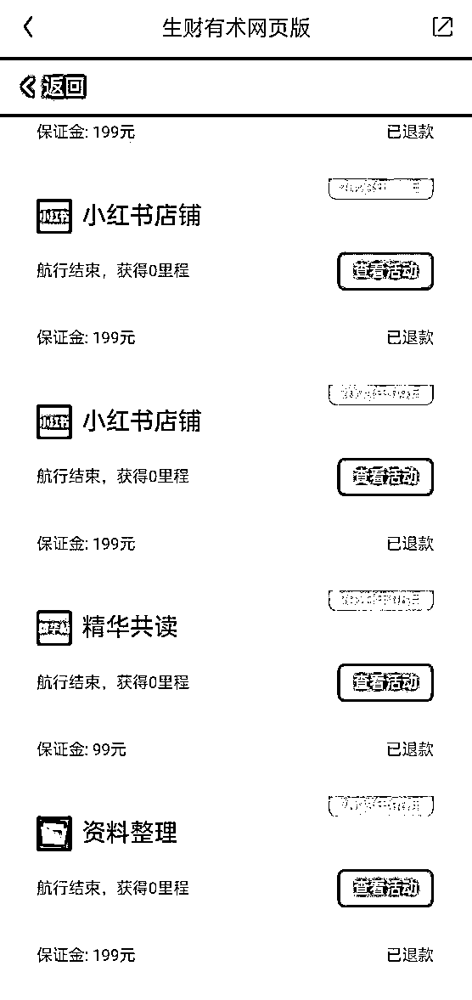
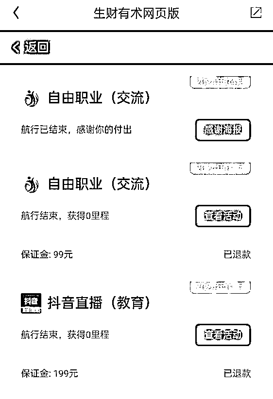

后来工作调动，业余时间变少了。权衡之后，我放弃小红书幼师，把精力集中在新的项目和更有潜力的淘宝店上。

这也是我总结的第二条经验：搞副业，一定要做精做深。你的精力在哪里，钱就会在哪里。

坚持研究让店铺慢慢有了反应，之后半年，月均收入稳定在3000以上。我开始花更多精力去找商品、扩大利润空间。到了10月，店铺加微信私域，销售额达到11254元，利润率80%，加另一家店的1000多，我第一次感觉到——单靠这些项目，是不是也能养活自己？

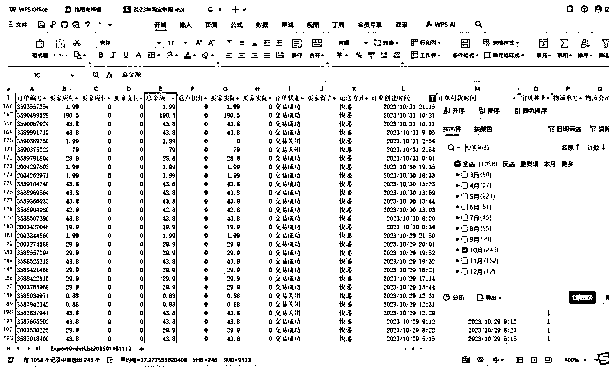
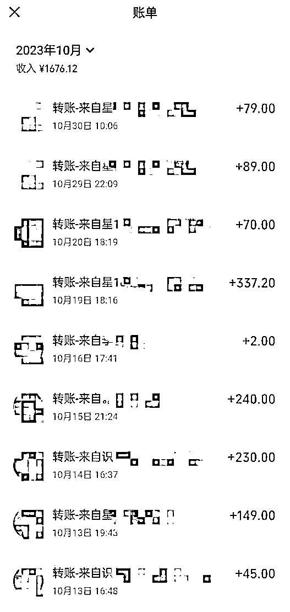
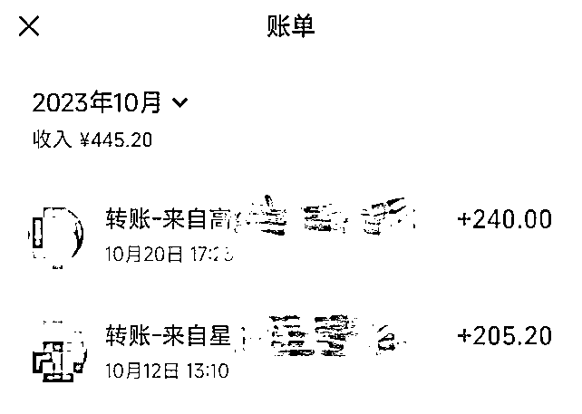

做了更多项目之后，我更加确信：靠赚钱项目养活自己，这条路是行得通的。

2024年春节后，公司又经历了一轮人员和业务调整。虽然位置还在，但工作量暴增，业务增长乏力，我心里清楚，离开只是早晚的问题。

我认真盘了盘自己的处境：一个快满35岁的男人，2020年10月开始背房贷。想留在杭州，工作必须满足三个条件：

1. 收入和稳定都得在线，还要有生活空间——毕竟我还单身；
2. 得有上升的空间，让我的能力能持续变现；
3. 月薪怎么也不能低于1.5万，没道理年纪越大反而越低吧？

可是照现在就业市场的氛围看，我自己当老板都觉得不想雇自己。

所以我最后的解法，就是辞职回家，给自己打工——自由职业。这样工作、生活、恋爱才能放到同一个天平上。

于是，“不破不立”。4月处理完家里的事，我选在工作满一周年这个有仪式感的日子提出了离职。

## 三、四个赚到五位数的项目，我是怎么做到的？

到现在，我已经亲自做过20多个项目，其中破了五位数收入的是：淘宝虚拟店铺、小红书广告（商单）、小程序撸茅台、视频号口播带货。

先说淘宝虚拟店铺。2022年10月开始做，花了半年才有起色。2023年3月到12月，总销售额36857元，这还不包含私域那一万多。除了头几百块的刷单成本，总体利润率约80%（有部分是代理软件有成本），另外还要扣掉固定成本：网盘和自动发货软件每月各15块，一年360块，最后的利润在37000以上。

同年8月和10月又开了二店和三店，赚了些钱，也踩了些坑。这块如果你们感兴趣，我可以找机会再细讲。

2024年我重心放在工作和新项目上，店铺基本是放养状态，但长尾效应还真香：一店全年15226，利润率90%；二店全年4390，基本是纯利润。加起来，我光靠睡后收入就多挣了18093块。

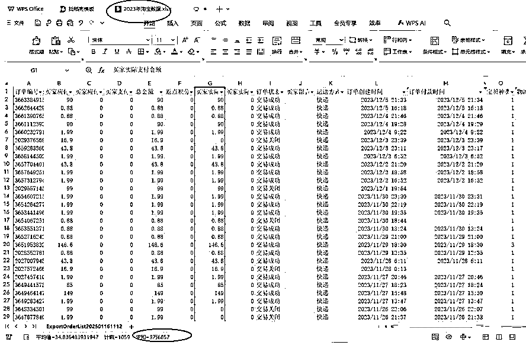
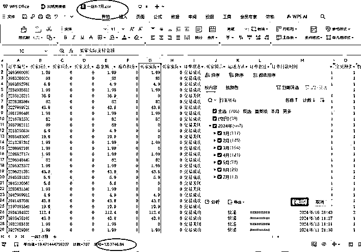
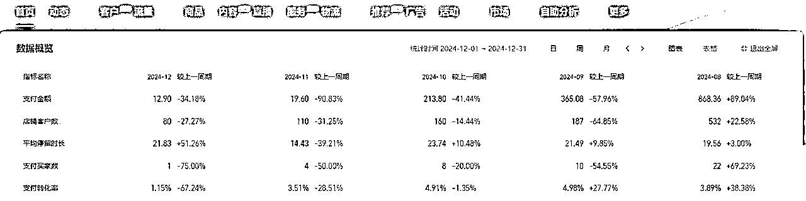
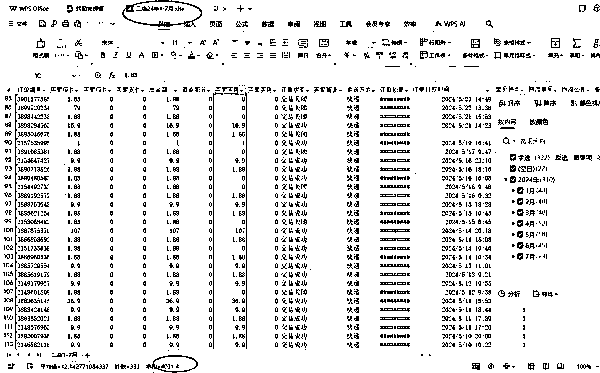
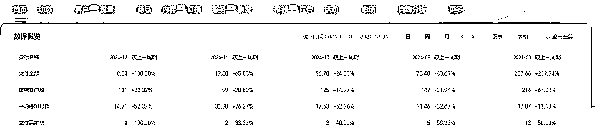

第二个是小红书广告。2023年11月我看到了票务赛道的机会，12月跟同样是赚钱圈友的三位伙伴组了队，想验证这个赛道有没有搞头。我们分工明确，只做小红书引流。一边做账号测试，一边搞起了押金制，带着50个学员一起试。三周时间，卖票加收代理赚了三千多，商单收益几百块。复盘下来，结论是没有找到稳定收益的账号类型和票务资源，就果断停掉了。但我其中一个号还在持续更新，24年5月收到携程合作邀请，7月签了一年合同，金额1万。钱不多，但每天只需几分钟，性价比很高。

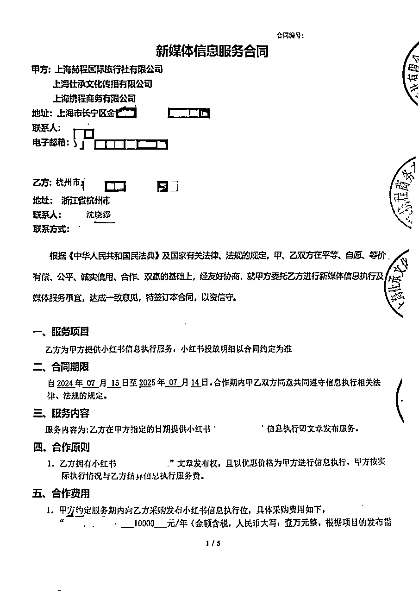

第三个，小程序撸茅台。2023年12月，我发现关注的几个大佬都在集中下场搞这个，我研究了一下，发现没想象中难——反正不赚钱也不亏什么，就干了。谈好收购渠道后，1月9日建群，扣除春节休假，到3月底，我每天维护一个100多人的群，一共约到21单，加上自己那3单，收入是21×400+3×1000=11400元。4月茅台行情走弱，5月项目就停了。

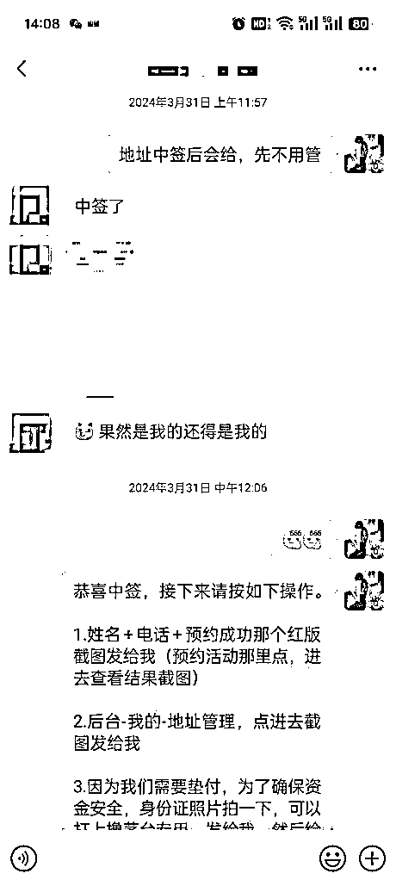
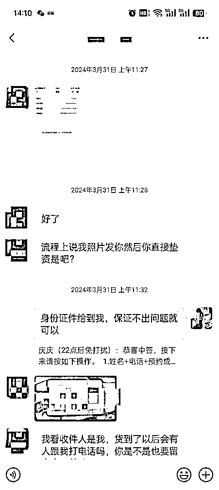

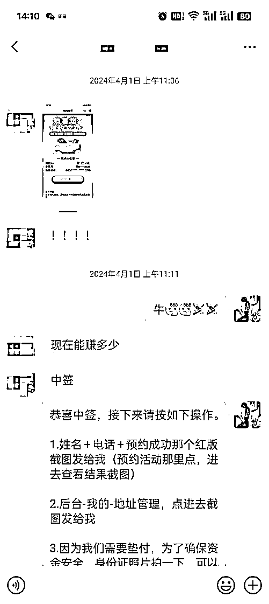

第四个，视频号口播带货。4月底离职之后，我全力扎进这个项目。真人出镜口播，最多同时做12个账号（不含合作号），每天工作10小时以上，除了吃饭睡觉几乎都在干。5月24日赚到第一块钱，我发了条朋友圈，然后一步步冲更高的目标。接下来一个月赚了五千多，尝到了红利的甜头。7月开始扩招合作账号，还试了数字人带货，收入起伏不定，但整体赚了几万块。到10月已经废了5个号，我果断决定转型去做高质量内容。等我跑通新路径了，再来分享。

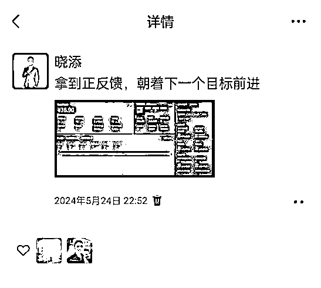
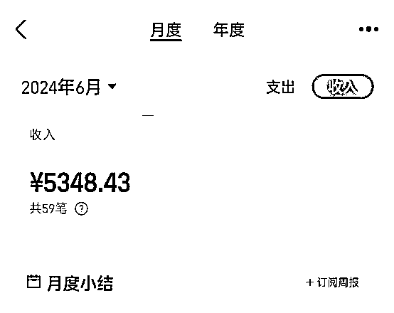
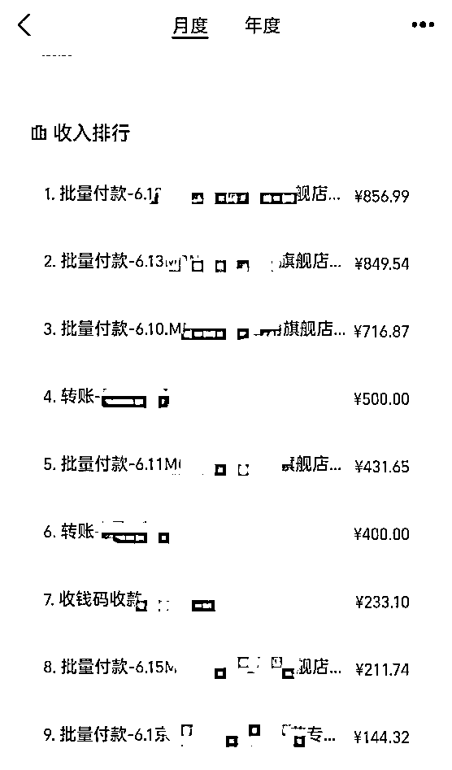
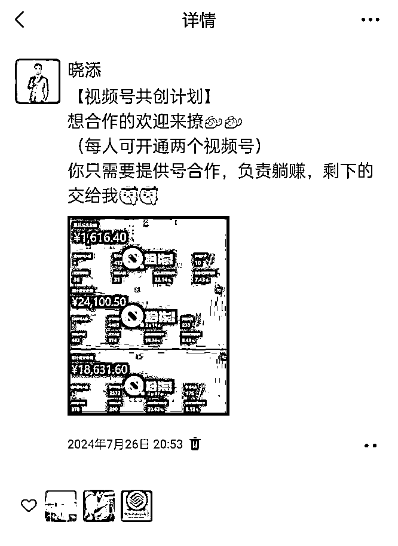

老实说，比赚钱更重要的，是少走弯路、少掉坑。以下四个坑给我的影响最大，写出来给大家避避雷。

**第一个坑：信息源太窄。**

前面提到我付费做过小红书幼师资料引流项目，后来放弃了。事后跟圈友交流才知道，当时我们群里有个学员，每天能稳定赚三千多。一开始我以为他靠的是账号矩阵或者投流，最终发现他只是靠一个99%的人都不知道的信息差——爆款搬运混剪（当然也就那两三个月的时间窗口）。而我们其他人，都在老老实实地做原创。这个教训让我牢记：一定要链接真正拿到结果的人，拿到一手信息并且亲自验证。

**第二个坑：自以为是，不重视平台规则。**

2023年8月，我开了淘宝二店，觉得自己找到了一个垂直赛道，可以做一家专业的垂类店。差不多两个月赚了一万多，正当我沾沾自喜的时候，店铺被官方三振处罚直接关停，还罚了6000块。当时我还想能不能找第三方帮忙重新开店，被一位淘宝大佬劝住：“割韭菜的，没用。”这又帮我省了800块冤枉钱。回头看，问题出在两点：一是官方第一次提醒我没当回事，二是我根本没提前研究平台规则。

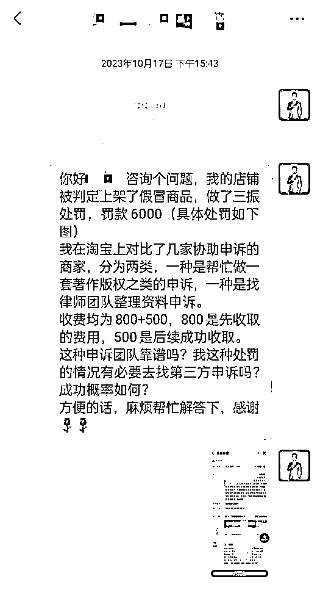
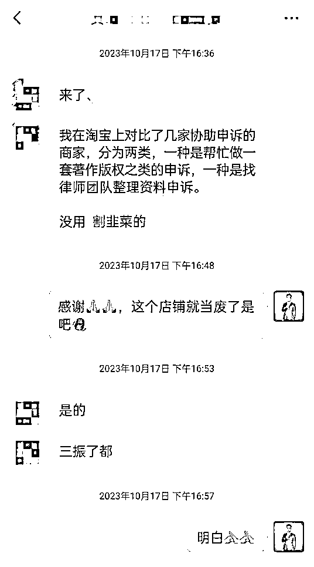

**第三个坑：看到好项目，脑子一热就上。**

2024年9月，我发现了快手数字人直播项目——把视频号正在爆的短视频搬到快手，用免费的数字人直播间承接自然流量和付费流量转化。对标账号一个月能做到3万多，我心动了，付费学完就用5个账号实操，但投放ROI始终打不正。复盘下来发现，能打爆的供应链商品本身就太少，爆品的流量方法也无法复制到其他商品，再加上快手利润率比视频号低20%-30%。这个项目教会我的事：短期好项目，也要先把深层逻辑想明白。

**第四个坑：数据背后的关键信息，你真的掌握了吗？**

11月我和圈友一起搞跨境电商，试了很多内容风格去发带货视频，结果都不达预期。现在回看，跨境项目背后的关键信息真的比想象中多得多。我们都得到了教训：在团队不具备对应资源和真实实力的时候，亮眼的数据不过是空中楼阁。这个项目的具体细节因为涉及圈内保密信息，这里就不展开了。

## 四、2025年，我的搞钱计划

新的一年，我给自己定了几个原则：

1. 只做有长期价值、能给别人带来真实改变的事；
2. 选择和价值观契合的人合作；
3. 把自己的经历和能力的价值放大。

顺着这些原则，我想明白了一个更具体的方向：通过项目合作，深度陪伴300个想赚钱的伙伴。只有他们赚到钱，我才能赚到钱——这样的模式才能持续，大家也才能走得更远。

以上，就是我在过去两年多里，用真金白银换来的血泪经验。第一次在赚钱写长文，如果对你有启发，欢迎点赞，也欢迎来找我交流。