# 备餐不重样！美式效率×日式风味，这套“融合流”做法太省心了

> 提起“准备一周的饭”，你会想到什么？是味同嚼蜡的鸡胸，还是吃到想吐的同款盒饭？
> 
> 先别急着劝退。今天这篇，或许能让你对备餐彻底改观。

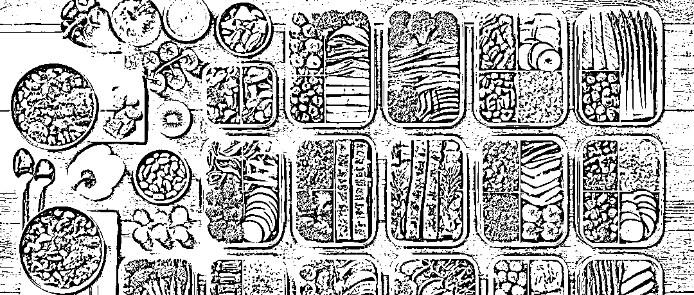

# 一、先搞懂MealPrep：东西方两条路线

MealPrep这个概念，最早是在欧美健身圈流行起来的。核心操作不复杂：找一段空闲时间，一口气做出好几份餐食，分别装进便当盒塞进冰箱，工作日取出来加热就能吃。

美式方案的标准阵容就是三大件：碳水主食、蛋白质肉食、放得住存放的蔬菜（根茎、菌菇类都行）。真正开吃的时候，再顺手补点新鲜绿叶菜或洗干净就能啃的蔬果，图的是省事，营养上也不拖后腿。

不过这种吃法有一个绕不开的短板：口味太固定了。同样的搭配连吃两周，再自律的人也难免腻味。所以它更适合两类人——一类是饮食上有着严格规划的训练爱好者，另一类是刚刚接触备餐、想先把整套流程跑通的新手。

那有没有更不遭罪的选项？日式家庭常备菜就是一个参考答案。

日式路线的思路，接近我们常说的预制菜：不同食材各归各类，处理干净后分装进保鲜盒、密封袋，用冷藏、冷冻、真空、厨房纸吸水等方式延长保鲜期。想吃的时候随取随做，口味随便组合切换，既满足嘴巴的需求，又大幅压缩了每天待在厨房里的时间。

这个流派通常围绕主食、主菜、配菜三块来准备。硬要说缺点，就是动筷前需要自己现搭配，吃完还得多洗几个锅。但比起每天从零开始做饭，省下的时间依然相当可观。

论适用范围，这个流派几乎没有什么门槛——上班族、宝妈、学生党、全职主妇都能直接上手。我自己也更偏爱这条路线，但我真正在执行的做法，是把两种理念合二为一，再做出了一番升级。

具体该怎么操作？怎么按照自己的现实情况来排备餐计划？接下来我就把这些年踩坑换来的经验，一点不藏私地全说出来。

🟢全文的内容提纲见下方导图

* * *

# 二、健身人群备餐手册：美式打法全拆解

先别被“健身专属”四个字劝退。只需要会基础的计算、懂一点搭配原理、掌握基本的存放技巧，你就能立刻跑起来。这一章先讲美式套路，因为它上手最简单，思路捋顺了，后面的进阶玩法自然也就好吸收了。

## 1. 第一课：算出你一天到底该吃多少

第一步，先摸清自己的基础代谢——也就是你整天躺着不动会烧掉多少热量。

但我真心不建议直接照搬网上的通用公式。原因很现实：每个人的代谢底子都差得天差地别。哪怕体重一模一样，常年锻炼的人、体重超标的人、普通人的代谢水平也完全是好几个档位。健身人群如果硬套传统公式，得到的数值会歪得厉害。

更靠谱的路子，是采用健身圈和运动科学界沉淀下来的经验配额——也就是按体重分配三大营养素的克数。三大营养素的比例一旦定死，总热量自然就锁定了：

- 碳水：每克供能4.1kcal
- 蛋白质：每克供能4.1kcal
- 脂肪：每克供能9kcal

**减脂期怎么配？**
- 刚入门的新手：碳水每公斤3.5g，蛋白质每公斤1.5g，脂肪每公斤0.8g
- 有一定训练积累：碳水每公斤3.5g，蛋白质每公斤2g，脂肪每公斤0.8g
- 减重节奏建议控制在每月2-5斤，防止后面反弹

体重降下来之后，还要记得定期调整碳水的量，让身体适应新的代谢状态。

**增肌期怎么配？**
- 刚入门的新手：碳水每公斤3.5g，蛋白质每公斤1.5g，脂肪每公斤1g
- 有一定训练积累：碳水每公斤4g，蛋白质每公斤2g，脂肪每公斤1g
- 增重节奏建议控制在每月1-3斤
- 调整手法很固定：蛋白质和脂肪都别动，只靠碳水来找总量

**来看一个具体例子：**
假设我75kg，有训练基础，目标是增肌。按照上面的系数算下来：
- 碳水：75×4=300g
- 蛋白质：75×2=150g
- 脂肪：75×1=75g

总能量 = 300×4.1 + 150×4.1 + 75×9 = 2520kcal

网上关于配额的说法五花八门，但底层逻辑大同小异：增肌就多拨一些额度给蛋白质，减脂就狠砍碳水，脂肪基本原地不动。

实操中有一个好用的小技巧：先用体重代进去算出一版，再用一周的体重变化来做“对照实验”。体重稳稳不动，说明你正好卡在热量平衡点；数字出现上浮或下跌，就照着上面的思路微调。同时要把每周的运动消耗考虑进去，并且尽量把食物的热量估得准一些，偏差越小，后面的调整就越从容。

单日总量确定后，一周的备餐总量就是拿单日数值乘以准备的天数。

## 2. 食材怎么选、怎么算：新手最容易踩的坑

**先说说“可食用部分”这个坑：**

- 500g苹果，挖掉果核之后，真正能吃的大概只有380g
- 各种蔬菜瓜果还得算上削皮、剥壳、去叶的重量损耗
- 生熟状态差得也很大：生米100g里大约有70g碳水，可一旦煮成熟饭，100g熟米的碳水就只剩20多g

烹饪方式也在悄悄改变热量：蒸煮最低卡，炒制中等，油炸直接拉满。还有包装类零食、糖油混合物这些，新手一开始往往不会算，特别容易吃亏。

**先学会读营养成分表：**

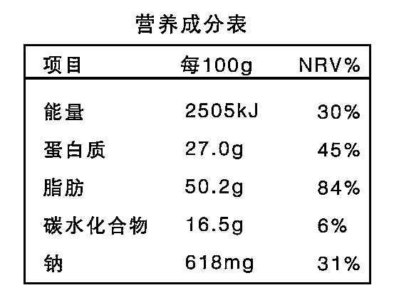

来看这张表：每100g该食品里含有碳水16.5g、脂肪50.2g、蛋白质27g，能量标着2505kJ，换算成常见单位大约是598.7kcal（1kcal=4.184kJ）。

旁边的NRV%，代表这份食物占你全天建议摄入量的百分比。拿大家最常盯着的钠来说，吃掉这100g，就已经用掉了全天推荐量（2g）的31%。

**推荐几个好用的辅助工具：**
- 各类健康减脂与饮食管理App
- 品牌官网公开的产品营养信息页
- 也可以直接请AI帮你查某样食物的营养数据

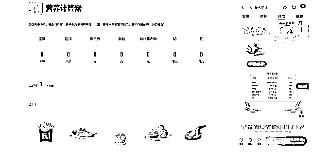

## 3. 实战演示：一天的三餐到底怎么搭

备餐时，我有一套固定的搭配顺序：先把蛋白质填满，再去安排碳水，最后用剩下的份额补足脂肪。

你可能会好奇：为什么蛋白质要排在最前面？没关系，看完下面的演示，你自然就明白了。

继续拿75kg增肌的例子来说：全天需要碳水300g、蛋白质150g、脂肪75g。

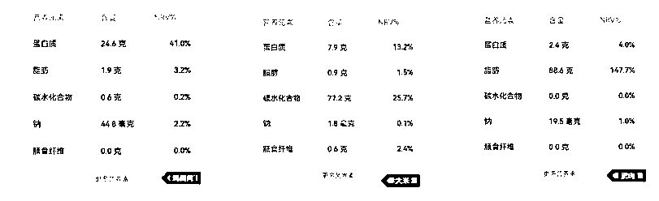

**第一环：搞定蛋白质。**
主力食材选鸡胸。每150g鸡胸含有24.6g蛋白质，要凑齐全天150g的份额，需要吃掉609g鸡胸。
这里有一个特别容易被忽略的细节：609g鸡胸里还带着约11.6g脂肪，这笔账必须记进全天的脂肪总量里。

**第二环：安排碳水。**
300g碳水差不多对应389g生米（每100g生米含碳水77.2g）。同时别忘了，这里面还有3.5g脂肪，同样要计入总账。

**第三环：补足脂肪。**
全天还需要75g脂肪。前面两项已经占掉15g（11.6g+3.5g），剩下60g的额度，换算成肥肉大约是68g。

**第四环：列出采购清单。**
按照备餐5天来算，一次买齐：鸡胸3kg、生米1.945kg、肥肉340g，再搭上新鲜蔬菜水果，备料这一关就算过了。

> 特别说明：拿肥肉打比方纯粹是为了让计算更直观，可别真把它当成日常推荐啊！

平心而论，这套搭配逻辑挑不出什么硬毛病，但美式备餐的老问题也跟着浮出水面：食物花样太少，微量营养素跟不上。要是真让你连续几周只啃鸡胸、吃米饭加肥肉，身体迟早会提出抗议。

所以我自己在排餐时，会刻意预留几份热量余量，分给水果、坚果，偶尔也允许自己来一点糖油混合物。同时根据当天的饮食安排去调整运动强度，比如做上20分钟有氧。

**增肌期的有氧怎么排：**
- 一周安排两次短时有氧（不超过20分钟），或者一次长时有氧（40分钟）
- 有氧的价值在于练心肺、消耗多余热量
- 注意回避长时间高强度有氧，否则容易掉肌肉——当然，前提是蛋白质得给够

**三大营养素在一整天里怎么分？**
蛋白质和脂肪均匀分配到各餐，碳水在训练后的那一顿多放一些。这样安排能显著降低入门难度，帮你在备餐这条路上走得更远。

## 4. 加工环节：多线并行，效率翻倍

真正熟练的备餐者，从来不搞单线程操作。

就说米饭吧，它是所有工序里最耗时的一环。正确的打开方式是：一开始就把饭煮上，等别的菜全部完工，饭也正好熟透。

**煮饭还有几个值得留意的细节：**

01. 白米饭可以掺进糙米、藜麦米、燕麦米等粗粮一起煮，总热量不变，但是精制米面的比例降下来了，维生素和膳食纤维的摄入量却能往上走。蒸煮时加入米体积1.2倍的水，口感会更讨喜。
02. 生米到熟米的换算系数在2.2-2.8之间，我自己实测大约是2.3。也就是说100g生米约等于230g熟饭，但反着推却不一定成立。所以我会在饭煮好之后称一下成品重量，按照“热量不灭”的原理，平均分配到备餐的每一天，每一份的能量都能算得清清楚楚。

**肉类的处理建议：**
- 可以和煮饭同步开工，也可以提前腌好入味
- 优先推荐鸡胸、牛肉、虾仁（海鲜类不太耐放，尽量集中在前面几天先吃掉）
- 要留意生熟重量换算：比如鸡胸肉做熟后重量缩到原来的80%，但热量还是按生肉的克数来算，免得蛋白质摄入过头

**不过，别把“精确”当成执念：**
每个人的吸收效率、运动消耗都处于波动状态，食材本身的差异也是客观存在的。我们能做的只是无限接近，根本做不到百分之百精确。所以算出来的数值，更多是给方向、给感知用的参照物，而不是什么金科玉律。

**适合提前做熟的蔬菜名单：**
莴苣、山药、西兰花、胡萝卜、西芹、芦笋、笋、豆角、香菇、杏鲍菇、彩椒都可以——这类菜纤维足、含水量低，二次加热之后口感依然在线，放进备餐盒里非常省心。

**适合生吃现拌的蔬果名单：**
黄瓜、番茄、生菜、紫甘蓝、芝麻菜、甜椒、洋葱、卷心菜、牛油果、紫苏叶等。每天跟着备餐安排350g左右（按生重算）就行，少一道烹饪工序，营养损少损耗也小。

**担心蔬菜一不小心吃过量？**
真不用慌！绝大多数蔬菜的热量低到可以忽略，100g里通常只有几g碳水。但要注意土豆、玉米、黄豆、豌豆这些淀粉大户，必须划进主食阵营，不能当成蔬菜来算。

## 5. 存放策略：让饭菜多鲜几天

假设你一次备好5天的餐：

- 挑密封性好的餐盒，既能防串味，又能锁住口感
- 备一台厨房秤，把做好的食物均匀拆成5份
- 前两天要吃的放冷藏，加热时转个两分半钟
- 后面几天的放冷冻，吃的前一晚挪到冷藏室解冻，第二天热一下就能开饭

一次性饭盒确实便宜省事，但不太环保，我个人不推荐把它当作首选。

## 6. 高频疑问，一次说清

**Q1：一次性准备这么多天的饭，要花多长时间？**
一般两三个小时就搞定了。

**Q2：肉隔夜没问题，那蔬菜放几天不会不健康吗？**
蔬菜烹饪之后放得越久，营养流失确实越多。但备餐里加的那些蔬菜，主要使命是丰富口感、提升搭配的层次感，真正的蔬菜营养大头还是在生食的部分。至于网上传的隔夜亚硝酸盐，只要冷藏保存到位，距离危险值还差得远，不用自己吓自己。

**Q3：这样备餐，成本会不会很高？**
真心不高。我现在固定每周准备5天的餐食，总开销控制在150元以内，摊到每顿只有10块左右，又卫生又省钱。

* * *

# 三、进阶玩法：日式备餐 × 膳食指南的融合方案

美式打法对健身人群很友好，但对大多数普通人来说还是有点距离。后来我慢慢琢磨明白一个道理：很多人真正的困境不是“不会吃”，而是“不知道该怎么吃”——脑子里只有少油、少盐、清淡这类模糊印象，一到具体的饭菜搭配上，整个人就懵了。

于是我把《中国居民膳食指南》里关于每日推荐摄取量的建议，套进日式常备菜的做法里，整合出了这套改良版方案。

这样融合的好处显而易见：一方面，每种食材的量有了更清晰的参照标准；另一方面，它也更贴合我们中国人长久以来形成的吃饭习惯，执行起来更顺、更快、更容易坚持下去。

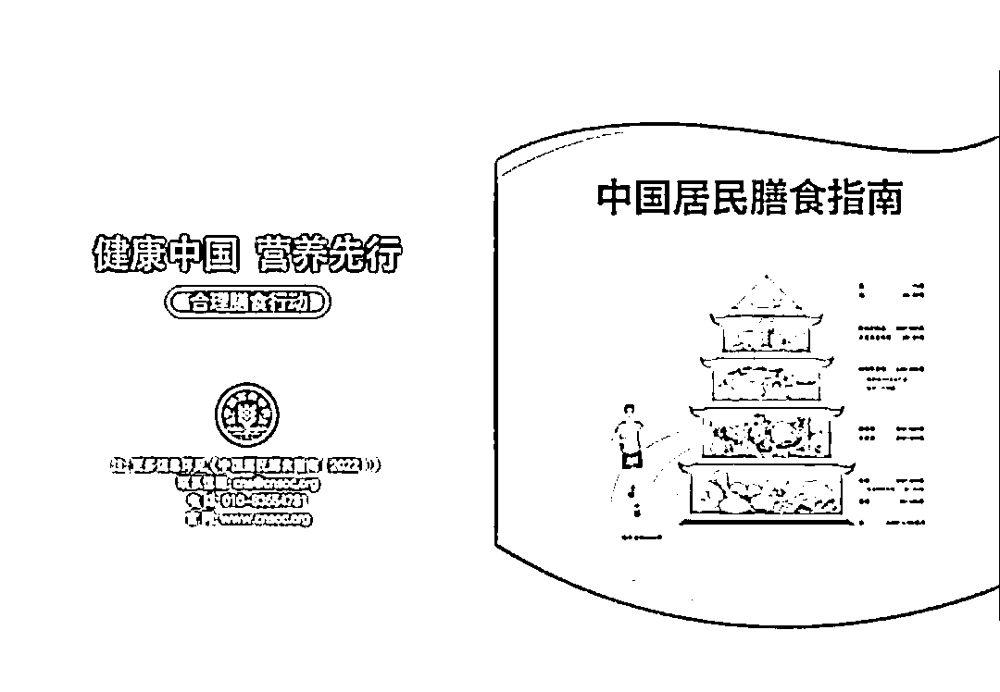

## 1. 先算热量：两套公式交叉验证

和前面的流程一致，动手备菜之前，先把全天热量算明白。这里提供两套公式，建议都算一遍，拿来互相印证。

**第一套：看身高、体重、年龄（最通用）**

```
a.女性基础代谢公式：
661+9.6体重(kg)+1.72身高（cm)-4.7*年龄

b.男性基础代谢公式：
67+13.73*体重(kg)+5身高(cm)-6.9年龄
```

举个例子：一位22岁男性，身高178cm，体重74kg，代入计算：
基础代谢 = 67 + 13.73×74 + 5×178 - 6.9×22 = 1821.22kcal

**第二套：按体脂率来算（更贴近真实水平）**

原因是显而易见的：体重相同的情况下，肌肉量更足的那一位，代谢明显要高出不少。而抬高代谢水平最有效的钥匙，就是抗阻训练。肌肉量可观的朋友，如果硬要用普通公式，误差会相当扎心，这时候按体脂率来算反而更靠谱。

体脂数据最标准的来源，是去医院用体脂分析仪测（不过之后还是会有波动）。当然也有两条自助路径：

**路径一：用腰围、体重代入传统公式**

```
a.女性体脂率计算公式
参数a=腰围（cm）×0.74
参数b=体重（kg）×0.082+34.89
体脂肪重量（kg）=a－b
体脂率=（身体脂肪总重量÷体重）×100%
```

```
b.男性体脂率计算公式
参数a=腰围（cm）×0.74
参数b=体重（kg）×0.082+44.74
体脂肪重量（kg）=a－b
体脂率=（身体脂肪总重量÷体重）×100%
```

**路径二：对照体脂率图片目测（懒人福音）**

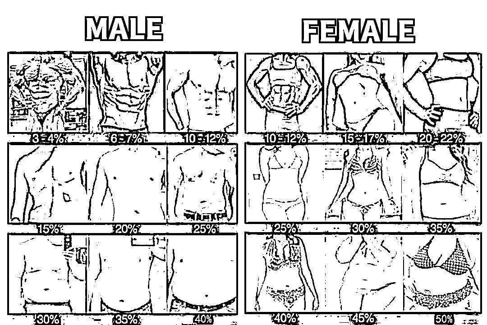

拿到体脂率之后，就可以套用下面这个基于体脂计算代谢水平的公式：

```
基础代谢（千卡/天）=21.6×瘦体重（千克）+370【瘦体重=体重×（100%-体脂含量）】
```

还用上面那位男士举例，假设他的体脂率大约在20%，那么：
基础代谢 = 21.6×(74×0.8) + 370 = 1648.72kcal

可以看到，两套公式算出来的结果并不一致：一边是1821.22kcal，一边是1648.72kcal。这也就帮我们画出了一个大致范围——我的基础代谢应该在1648到1821之间。稳妥的做法，是取两者的折中值大约1730kcal，作为前期排餐的起点参考，后续再根据实际情况不断修正。

## 2. 关于代谢的真相：你也许只看到了七成

写到这儿，可能有人要追问：影响代谢的因素那么多，光靠公式真能算得准吗？那就把代谢这个概念再往深挖一层。

我们每天实际消耗掉的总能量，其实由三块拼成：

**基础代谢**：占比最高，大约在60-70%
**身体活动**：占到15-30%
**食物热效应**：约占5-10%

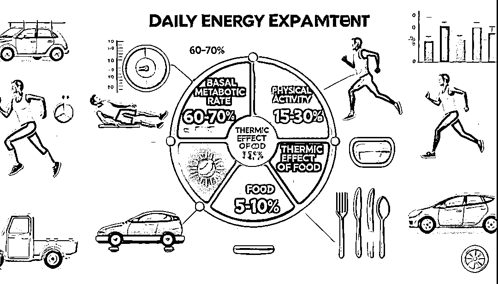

换句话说，用公式估出来的那个数，只对应了全天总消耗的七成左右，还有大约三成是被我们忽略掉的。这也正是我反复强调的那句话：数据只配当参考，不该当主人。真正聪明的做法，是在这套框架里，跟着身体给出的反馈，一点一点微调到最合适的位置。

**备餐的目的，从来不是为了把自己塞进冷冰冰的数字里，而是为了让你在忙得脚不沾地的日子里，依然能踏踏实实吃上一口热乎饭。**[PRE*]

好了，从美式到日式，从精细计算到灵活变通，这套备餐心法就完完整整交到你的手上了。希望你能从中找到属于自己的节奏，把每一天的一日三餐，都安排得明明白白。

你是不是也有过这样的经历：翻开一堆营养学资料，好不容易搞懂了碳水、蛋白质、脂肪的比例，结果一到“今天到底吃多少”就当场卡壳？

其实这件事，卡住你的很可能不是数学不好，而是一个被大多数人忽略的细节。

咱们把时间拉回到计算食物总量的那一步。你会发现，碳蛋脂给出的能量占比，本来就不是单独存在的，它背后还藏着两个容易被绕过去的变量。尤其是对做力量训练的人来说，这个变量更是让人头疼——因为每一次训练消耗的热量差距真的太大了。动作选哪个、重量上多少、组间歇多久、频率怎么排，这些通通会直接影响最终数字。更扎心的是，就算你把训练做得再到位，力量训练这类无氧运动实际消耗的热量，也远比你想象中少得多。它和有氧运动根本不在一个量级。所以别指望光靠撸铁就能减脂，真正的出路只有一个：训练 + 饮食，双管齐下，配合着来。

正因为如此，传统的基础代谢公式往往不够“贴身”。为了弥补这个误差，我们通常会在公式后面再乘一个运动水平系数，也就是身体活动强度的修正值。你只需要根据自己的日常状态，对照下面的系数范围，直接代入就行。

```
少量运动：基础代谢*1.15
轻微活动：基础代谢*1.3
中等活动（周3-4次左右） 基础代谢*1.4
健身活动（周3-4次左右）基础代谢*1.6
```

至于食物热效应，这个词听起来有点学术，但说白了很简单——你吃东西这件事本身，也在消耗能量。从食物进嘴开始，消化、吸收、转运、代谢转化，每一步都得“烧”一点热量。而这个热量的大小，基本由食物的营养成分、你吃进去的总量，以及进食速度来决定。好消息是，这些因素在运动系数里已经被综合考虑进去了，所以日常计算时，咱们完全可以不用再单独操心。

把这些都算明白之后，你就能得出和自己真实情况最贴近的“全日能量”。这一步走稳了，后面的热量盈亏才不会跑偏。

## 从“吃多少”到“怎么吃”

接下来，就是整个备餐流程里最关键的一环——分配。简单说，回答两个问题：吃什么？怎么吃？

我们这套饮食结构的底层框架，主要参考的是《2024中国居民膳食指南》。从谷薯、蔬果、肉蛋奶，到大豆坚果，再到油盐限量，每类食材的用量和范围，都按指南推荐的标准来定，然后再一步步均衡分配到每一餐里。

把书里的核心内容拆开来看，关键的备餐信息长这样：

```
1.平衡膳食模式中碳水化合物供能在膳食总能量的50-65%（谷薯类为主），蛋白质占10-15%（畜禽肉类、鱼类、大豆为主），脂肪占20-30%（植物油、动物油脂为主）
2.推荐的三餐能量，早25-30%，中30-40%，晚30-35%
3.每人每天摄入量建议：（建议每天摄入12种以上食物，每周25种以上）
①谷类：200g-300g；
【 -全谷物&杂豆50-150g；】
薯类:50-100g
②蔬菜：300-500g（深色蔬菜占一半）
③水果：200-350g；
④动物性食物每天平均120-200g-每周平均：鱼300-500g（每周至少两次水产品）蛋300-350g（每天一个蛋）畜禽肉300-500g
⑤奶及奶制品300-500g；
⑥大豆及坚果：25-35g（平均每周50-70g，每天10g左右）
⑦盐：少于5g油：25-30g
⑧水:1500-1700ml
```

有了这些条条框框，基本就能圈定你的食材范围了。再往下走，就出现了两条经典的备餐路线。

第一条，是最“笨”但最不容易出错的办法：照着推荐值，老老实实地往里填食物。按全天时段一比一还原标准食谱，操作起来毫不费力。但它的短处也很明显——能量总量不好拿捏，容易做着做着就超了或者不够。

第二条，则是纯靠能量倒推：先把每顿能吃的能量算出来，再按周、按日、按单餐一层层往下分。这种办法理论上最科学，可实操起来实在磨人。不同食材，哪怕同样克重，热量也千差万别；既要盯紧全天配额，还得兼顾搭配和组合，一周的工程量算下来，光是想想就头皮发麻。如果不是老手，基本很难靠它独立完成一份备餐计划。

看到这儿，你可能想问：那就没辙了吗？

当然不是。我当初研究到这一步，也是一筹莫展，直到后来突然想通了一件事——把两种方式揉在一起，就是最优解。具体怎么揉？咱们分步来看。

先定下一天的总能量。比如你的目标是2400kcal，那第一件事就是按膳食指南的推荐值，初步把全天餐单填充起来。这个环节可以“偏心”一点——优先挑自己爱吃的食物往里放，只要满足单日12种、单周25种食材的下限，就能搭出一份初始备餐计划。

这里顺带展开两个实践层面的心得。一个关于“品类丰富”，另一个关于“营养均衡”。

品类丰富带来的好处很直接：不同食材排列组合，花样变多，备餐不再枯燥；更重要的是，它天然有助于营养均衡——你不需要盯着一顿饭去纠结每种维生素、微量元素的含量是否达标，毕竟再算上吸收率、流失率这些变量，难度只会更失控。

至于营养均衡，我的态度是：别较劲。别纠结于单日、单顿的完美配比，把目光放长到一周、甚至半个月的周期上。今天某种营养吃多了，明天吃少了，真不是什么大事。只要一段周期内大致平衡，就已经符合均衡膳食的核心精神了。

定完结构之后，再回头算一算这版计划的总能量。如果你定了2400kcal计划，结果发现做出来2800kcal，超了——那就优先削减碳水比例高、脂肪偏多的食物，或者单纯减掉部分食材的分量，这样总量下来了，结构也不至于垮。反过来，如果计划2800kcal，做出来只有2400kcal，那就加大碳水和蛋白质的分量，把空缺补上。

接下来，重点来了。

一旦你的单日基础结构稳定下来，就可以开始做“能量等值替换”了。这招非常关键。你可以把每一类食物都看成不同尺寸的原材料，经过加工，统一成同样规格的“标准砖块”，再用这些砖块去搭建整座饮食大厦。这样做的最大优势在于：后面想“翻修”“加盖”都很省力，你能轻轻松松地调整餐单，而不用每次推倒重来。

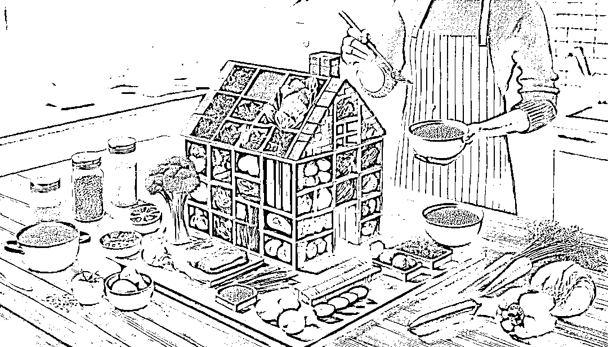

比如最典型的同类替换，米饭那一档，可以换成面包、杂粮、馒头、红薯、土豆；绿叶菜那一档，菜心、菠菜、韭菜、鸡毛菜、空心菜、苋菜，基本都能互相平替。

跨类别替换，就得稍微动点脑筋了。比如蛋白质类，要兼顾植物蛋白和动物蛋白的推荐比例，拿豆制品换一部分肉类，就得按比例调整，而不能想当然地1:1。

在这个阶段，你只需要锁定“等能量”这个准绳，替换之后就不用再反复纠结营养占比了——框架早就帮你把结构定好了，你只要保证每一块“砖”的能量一致就行。

为了方便操作，我们可以把食物量化成“份”。举个例子，50g大米算一份，大约提供180kcal热量。那么这个“一份”，就能等价替换成50g意大利面、80g馒头、200g红薯或土豆、350g玉米。蔬菜类就更省心了，大部分叶菜都可以按1:1直接换，100g热量大概在20kcal上下；但像毛豆、四季豆、豌豆、笋这类带豆属性的蔬菜就得格外留心，只能按同等能量兑换到50g。

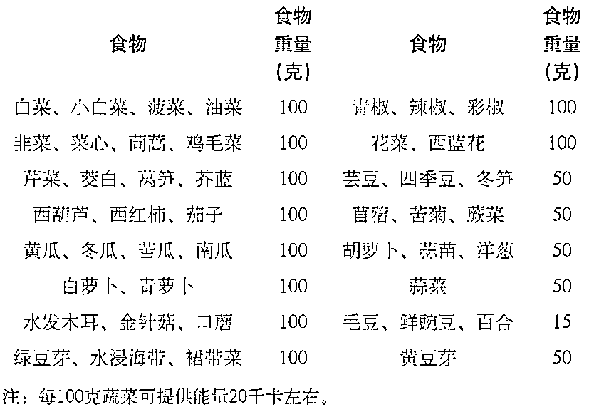

篇幅关系，就不把所有食材一一拆开列举了。水果、肉类、海鲜、奶豆类的替换组合，大家可以直接参考配图（图片内容整理自《享受 21天健康饮食习惯瘦身法》，这本书我私心很推荐，微信读书上就能翻到，里面不少观点都让我挺有收获）。

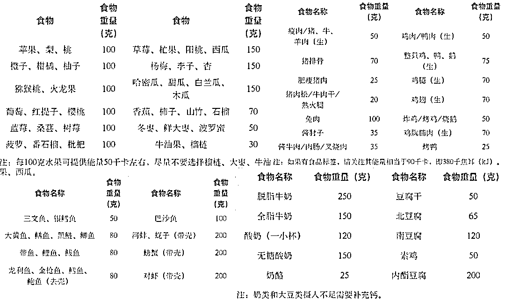

当然，更多的细节，还是得靠你自己上手去试。刚开始可能会觉得麻烦，但当你亲手做出第一份专属食谱时，那个成就感是实打实的。之后越用越顺手，还能慢慢搭建起一个自己的“健康食材库”，备餐效率会越来越高。再配合一次次实际操作、不断微调，你也能一步步从新手变成熟手。到那个时候，你不光能照顾好自己的餐桌，还能把健康饮食的思路分享给身边的人，带大家一起吃得更好。

## 从清单到餐桌

食谱定好之后，一份采购清单也就顺理成章地出炉了。接下来要做的，就是照着清单去周边菜市场、超市挑选新鲜食材。

万一某个食材缺货，或者成色不理想，也别慌，要么直接找同类替换，要么转战线上买菜平台补货。还有一些选货小技巧，能在你挑食材时派上大用场：

```
①选择当地、当季食材，这样营养能够最大化地保留，避免大部分的营养损失，同时在选择上，尽量选择新鲜食材；
②食材加工步骤越简单越好，尽可能选择一些原生态一些的食物；
③食材多样化，尽可能选择多种类的食材，满足自身营养；
④健康营养、新鲜优质（低糖、低卡、低油、低盐、低能量）；
⑤结合个人喜好偏向进行选择，比如说喜欢的口味或者突然想吃的食品，这样有利于培养备餐习惯的建立。
```

食材到位，就进入备餐的下一个阶段——加工处理。

先确定好烹饪方法。中餐的烹调手法有近40种，但备餐环境下，我更推荐蒸、煮、汆、焖，或者用少量油煎，调味上也要克制，油盐适量就好。

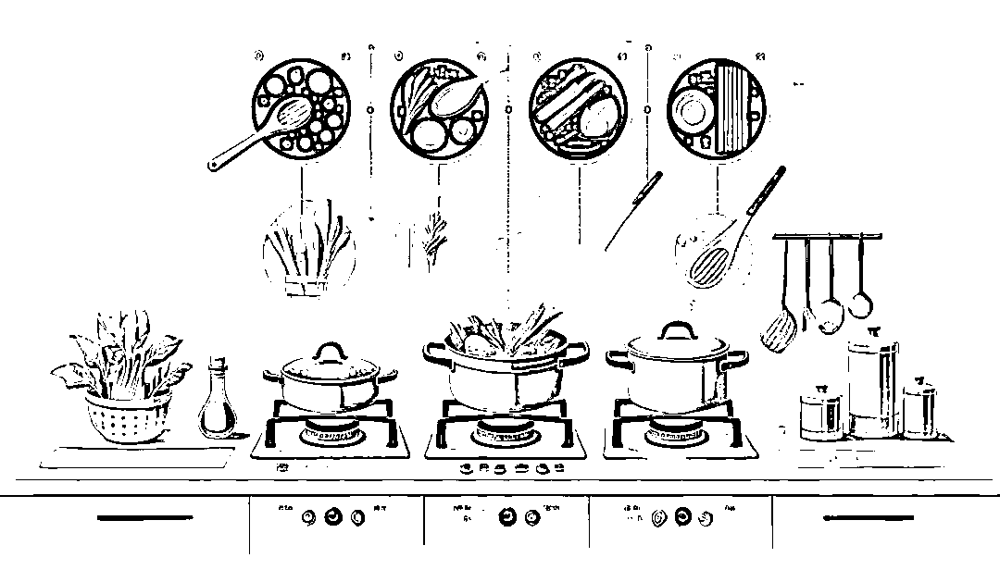

平时刷手机时，遇到喜欢的菜品可以顺手收藏，慢慢累积成一个自己的“菜单库”。不管是关注美食博主，还是逛食谱分享网站，都可以把它们作为研发新菜的灵感来源。

而在具体的食材准备上，根据不同的处理方式，可以分成四种封装思路。

第一种叫半成品分装。把处理好的每种食材单独存放。这样做的好处在于：同一类食材水分一致，存放更稳定；同时还能提前切丝、切块，按自己的习惯加工成需要的形态。

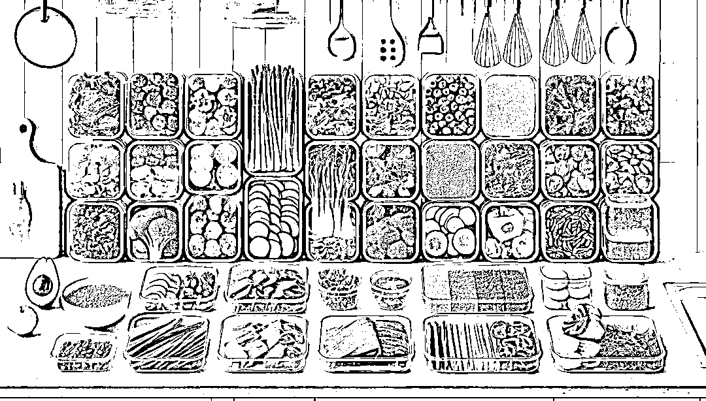

第二种是半成品组装。把预处理好的食材，按食谱提前搭配好，一起装进保鲜盒或保鲜袋，做菜时直接就能下锅。这种模式特别适合汤类和炒菜，组装完一锅出餐，又省事又高效。

第三种是成品组装。也就是提前把几道菜全部做好，再按最终食用需求，直接装进饭盒——这就是美式MealPrep的经典形态。

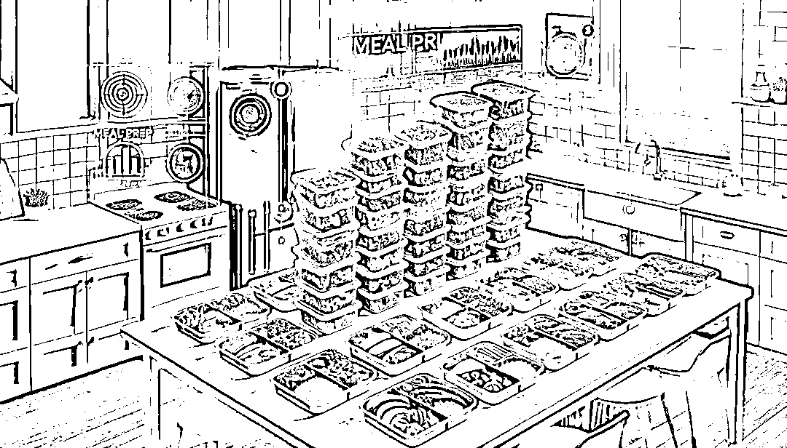

但它的短板也比较明显：菜品相对固定，存放时间也不长。在日式常备餐的体系里，我们更看重新鲜和健康，所以这种方式不太常用。

最后一种是成品分装。把主食、主菜、副菜分别装进不同的保鲜盒，吃的时候再按需组合。像一些不适合生吃的蔬菜，提前汆烫好，吃的时候加点酱醋汁一拌就行，特别方便。

这四种方式没有绝对的好坏，你可以按自己的时间安排和新鲜度偏好灵活组合。

制作流程上，可以按食材属性和烹饪时间排出一个简易“SOP”。比如肉类提前腌制，主食先做，再推进到煎、蒸、煮的环节，每一步都按时间轴来安排，效率会高很多。

最后，再分享几个烹饪小技巧。

做绿叶菜时，记得先洗后切。蔬菜里的维生素大多溶于水，切口越多，损耗越大。所以正确顺序是：先整棵清洗，再切块加工，这样能最大程度锁住营养。另外，烹饪时产生的菜汤里大概含有约50%的维生素，别浪费，能喝掉就喝掉。

还有一个小诀窍：水开了再下菜，急火快炒，缩短烹饪时间。这样既能保持口感，也能减少营养流失。蔬菜最好现做现吃，放得越久，损失越严重——尤其是维生素C，存放之后损耗可以达到73%到75%。

肉类方面，快炒和勾芡都是不错的方案。原理是让表面蛋白质迅速受热凝固，形成一层“保护膜”，锁住内部的脂溶性维生素和微量元素不流失。

## 储存，让美味更长久

最后一步，也是最容易被低估的一步——储存。

上一部分聊到美式MP的成品组装，这一部分我们再进阶一些。想要在常备餐中最大程度保留营养，常见的储存方式有冷藏、冷冻、真空、常温存放，配套工具则包括保鲜膜、保鲜袋、保鲜盒、锡纸、厨房纸这些。

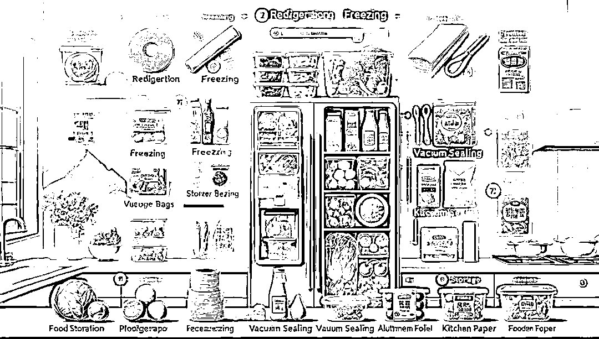

先说一个核心观念：不同食材，储存方式天差地别。选对了，保鲜期大大拉长；选错了，像黄瓜、马铃薯、香蕉这类怕冷的食材放进冰箱，反倒会冻伤变质，得不偿失。

豆类和干果类，放进密封容器，加一片防虫片，搁在阴凉通风处，就能安安稳稳放很久。

蔬菜类就要讲究多了。绿叶菜最怕“湿身”，可以买个甩干器把多余水分甩掉，表面干爽之后，在袋子底部垫几张纸，再把菜根朝下放好——尽量模仿它们在地里生长的姿态，保持正常的呼吸作用，这样保存时间会明显变长。吃的时候现取现用就好。

根茎类、菌菇类这类含水量较低的蔬菜，分装完直接冷冻，或者抽真空后再冷冻，都能让保质期大幅延长。

肉类就更简单了：按计划提前腌好，分装成小份，单份独立冷冻。每次吃之前，提前一天放到冷藏室慢慢解冻就可以了。

遇到不熟悉的食材，直接上网查，或者看看包装上的储存建议。搞定这些，基本上就能覆盖日常大部分备餐储物的需求了。

关于储存，有两个问题经常被问到：真空保存到底有没有用？冷藏后营养到底还剩多少？

真空保存的核心原理就是抽气除氧。氧气没了，微生物失去活动条件，氧化反应也被抑制，自然就能起到抑菌防霉、保持色香味的作用。所以它的延长保存效果是实打实的，尤其适合单次备7天餐的情况。

至于“营养还剩多少”这个问题，答案可能会让你有点意外——肉类和蔬菜在冷冻后解冻，大约能保留90%以上的营养。原理也很好理解：冷冻能保持食材原本的组织结构不被破坏，同时内部的生物化学反应又被低温按下了暂停键，新鲜度因此被锁住。很多不耐光的维生素和抗氧化物，恰恰是在冷冻条件下才保存得最完整。

你可能也发现了，商品类的冷冻蔬菜在国内并不常见，这是因为咱们的食材供应充足，随时能买到新鲜货。倒是在欧美国家，冷冻蔬菜几乎是家庭储备的标配。

再往高阶走，还有航天员级别的冻干技术——食材在冷冻状态下直接脱水，能保留约95%的营养，吃的时候加点水就能复原。感兴趣的可以自己去挖一挖，很有意思。

## 写在最后

希望这一篇，能给你带来一些启发。

备餐这件事，确实需要花点时间上手，但只要迈出第一步，后续的收益就会像滚雪球一样越滚越大。祝你能早日打造出属于自己的健康食谱，让每一天的餐桌，都成为拥抱更好生活的起点。