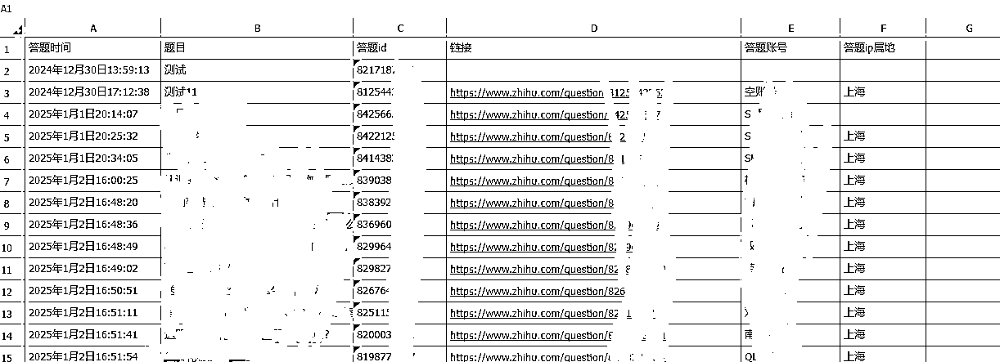
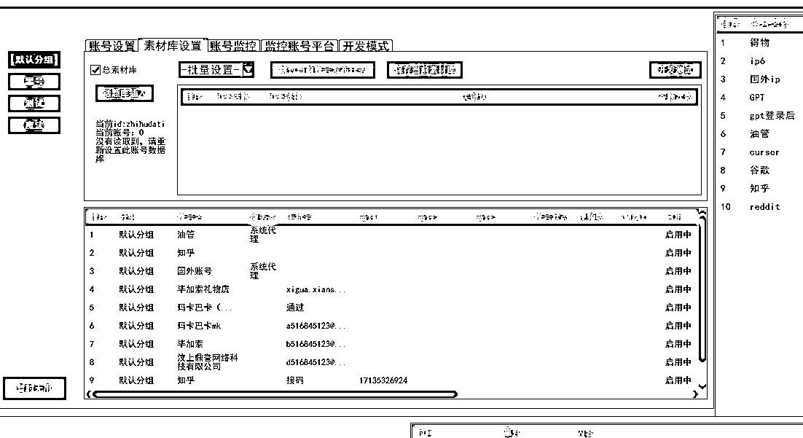

# 利用AI挖掘用户短期内刚需问题。通过AI进行高效答题引流。

> 来源：[https://udxxg5rx5m.feishu.cn/docx/YfsldO9UNoERoKx2Ln6cyPTjnCg](https://udxxg5rx5m.feishu.cn/docx/YfsldO9UNoERoKx2Ln6cyPTjnCg)

作者自述，2019年就为第一个引流项目搭建过一套自动答题工具，目标是把内容分发到该平台。

当时的局限很明显：

没有类似GPT的生成式模型，只能靠问题关键词做粗筛，根本判断不出一个提问是否真的值得回答。回答素材也是提前写好的几套固定模版，系统随机抽段落加配图拼成最终回复。

当时能用的优势是，该平台的话题列表支持按最新时间排序。只要设定好轮询间隔，定时抓取并回复近期出现的问题，就能保证触达的提问具备很强的时效性。越新的提问往往越能体现用户当下的紧迫需求。

现阶段大模型已经普及，我开始把大模型嵌入整个链路，原本的短板因此被补齐。于是重新设计了系统运行逻辑。

系统运行逻辑：

1.获取问题：程序调用平台接口，拉取指定话题下最新的50条提问。这样可以快速捕捉短期需求旺盛的主题，提升引流转化。

2.筛选与回答：把抓取到的提问交给GPT做初筛，符合回答策略的会生成完整回复，不符合的直接返回“不符合”。

3.二次合成：拿到模型输出后，程序会做二次加工，插入配图、调整排版，确保满足平台接口的提交规范，同时让阅读体验更美观。

4.提交与同步：最终通过接口发布答案，同时把本次答题日志同步到飞书文档，便于后续复盘与管理。

把这套流程丢给GPT复盘，得到了两条优化点：如果需要批量操作，要留意每次请求的网络出口，避免被平台风控识别；另外要把不符合标准以及已处理过的提问记录下来，筛选用时就能直接剔除，省去重复劳动。

基于反馈，我重构了流程并补上了飞书同步环节。

# 一、调教→接入GPT进行判断→获取GPT答题内容

先做可行性验证。我先爬取了GPT对话页的DOM结构，做元素定位分析，找到判断模型状态的可行路径。

在向模型投喂问题前，先统计 body > div > div > main > div > div > div > div > div > div > article 的出现次数。因为长对话后页面未必一次性渲染完全，我再根据当前数量取最后一个节点的 data-testid 值临时缓存，该值会随对话轮次递增。

随后把平台的提问文本发送过去，并循环监测 data-testid 是否发生变化。若发生变化，说明投递成功。接着判断模型是已结束还是仍在生成，这一状态可通过 #composer-background > div > div > div > span > div > button > div > div 的数量来推断。

数量为1意味着模型已停止输出；不为1则表示仍在生成中，需继续等待。生成结束时，程序提取页面最后一条回复的内容【【【】】】，并检查长度是否过短，或是否包含“【【【不符合】】】”。出现上述情况就判定该提问无需处理。

测试表明，模型侧的交互流程完全跑通。

接下来是模型调教。我对模型的要求是：你负责运营某款产品的推广，通过在该平台答题实现导流。因为平台对营销内容审核严格，回答时不要刻意植入产品。但要清楚每个回答的最终目的都是导流。若某条提问无法实现导流目的，直接回复【【【不符合】】】即可。

所有需要上站的回答必须用【【【】】】包裹，且包裹内容内部要用 p 标签包裹。日常对话不需要加标记。只有当我发消息时最前面带“题目：”前缀，你才需按平台回答模版输出；无前缀则按普通对话处理。

提取后的结果会交由内容合成模块，按预设位置插入图片。

# 二、分析话题，获取接口参数

对平台接口进行抓包后，发现可通过以下地址拉取指定话题下按时间排序的提问：
https://www.zhihu.com/api/v5.1/topics/话题id/feeds/new_question?offset=0&limit=0

其中话题id取自话题页URL，offset 控制起始位置，limit 控制单次数量。实测单次最多返回50条，已足够覆盖48-72小时内的需求。返回体为JSON，可解析出提问标题与提问ID。标题用于请模型判断与生成，ID用于组装提交请求的 payload。

# 三、合成提交格式

在组装提交请求时，有几个动态参数来源不明，主要是 X-Zse-96、X-Zst-81、X-Zse-93。虽然未找到精确生成规则，但实验发现适当扰动数值仍可正常提交且不触发异常，于是采用随机值填充。x-xsrftoken 则从 cookie 中的 _xsrf 提取。

请求体里的 traceId 由格林威治时间拼接 UUIDv4 组成，格式固定。回答正文中的占位符如“图片1”“图片2”会替换为 p 标签并带上素材库的图片链接，符合接口规范。初版提交成功但排版混乱，后续对结构做了优化，最终呈现整洁美观，测试通过。

# 四、答题环境伪装→代理IP发送

短时间内同一出口IP大量发帖极易被限制，于是引入代理池。但原有请求库不支持代理，经咨询后改用 curl 相关模块实现。首次尝试因编码问题导致内容乱码，后把编码调整为 UTF-8 字节集，问题解决。

# 五、数据同步飞书文档

系统已接入飞书。同步前抓取答题时间、提问标题、提问ID、链接、操作账号。

目前系统功能已闭环：

1. 初始化答题环境 读取配置文件中的图片素材路径、延迟参数等，完成环境准备，同时检测账号在线状态及代理连通性。

1. 接入GPT进行判断 拉取话题列表，按配置决定是否先做关键词过滤，再把提问交给模型判断。不符合策略时模型返回【【【不符合】】】。

1. 接收GPT回答 符合条件的提问会得到【【【回答内容】】】形式的输出，并按预设策略加入引导性语句。

1. 回答合成与图片处理 程序把文本与图片拼接成最终稿，从图片库随机选取素材，按平台格式要求插入，保证排版整洁。

1. 发送回答 合成稿通过接口发布到对应提问页，同时把相关信息写入飞书文档便于管理。

1. 数据同步至飞书文档 按飞书接口规范组装请求并推送。

整个链路跑通后，原本需要人工筛选与手工撰写的环节被模型接管，效率显著提升。希望这套实践对同行有所启发。