# 《抖音年引流1000w用户 我如何搭建一支能打的内容团队》 邓怡然

> 来源：[https://wfj1j8pfk7.feishu.cn/docx/YwADd0KlYocZEYxC9Kic8eZwn4I](https://wfj1j8pfk7.feishu.cn/docx/YwADd0KlYocZEYxC9Kic8eZwn4I)

# 搞钱经历

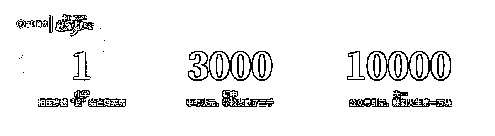

先用三组数字概括我的变现轨迹。

1 小学--把压岁钱"贷"给爸妈买房赚到第1块钱

首个数字是1，挣到的首笔钱来自小学时期将2万压岁钱以银行利率借给父母。2006年两年期定期利率3.06%，这笔资金每日产生1块6的利息。

3000 初中--中考状元，学校奖励了3000块钱

第二个数字是3000。财商尚可智商也过得去，中考斩获状元，校方发放3000元奖励。

10000 大一--公众号引流，赚到人生的第10000块钱

第三个数字是10000。大学期盼经济自主不想向家里伸手，便多方尝试。当时借助公众号导流，一周内实现人生首个万元。

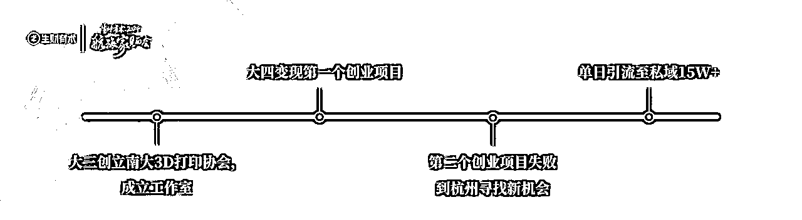

以上属于小打小闹，真正进入创业从大三起步。

大三创建了南大3D打印协会，后续演化为工作室。

大四完成首个创业项目变现，收获人生第一桶金。

随后涉足少儿编程教育，最终以失败收场。历经数年后归零，我与合伙人选择前往更贴近商业的杭州探索新方向。

2022年起在抖音投放导流至私域，到2023年7月实现单日私域进量15w+。

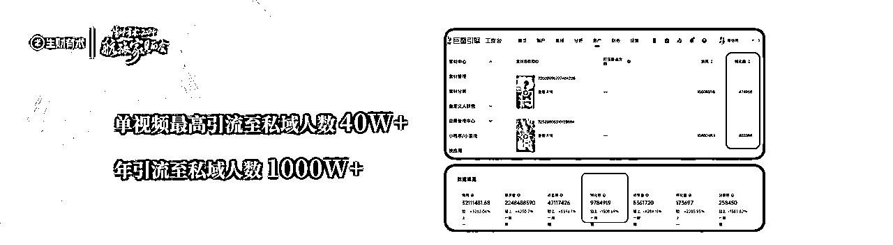

懂投放的人看到这组后台数据便知分量——

巨量引擎素材库中，有条素材最高转化47万，全年累计转化978万。

单条视频最高向私域拉新40w+，年度累计私域进量突破1000w+。

# 素材决定命运，消耗改变人生

圈内流传一句话，素材定生死，投放改结局。

素材如同方向盘，决定行驶路线。

顶级素材即便不投放也能跑量，因其自带筛选机制，已锁定目标人群画像。如何稳定产出具备自定向能力的素材，是内容团队的核心课题。

组建团队如同开宗立派。华山自有剑法，少林自有罗汉拳，内容团队也必须形成自家打法：何为优质内容、如何生产优质内容、如何持续生产优质内容。

## 什么是一个好广告内容的核心要素？

### 顺应人性的主题

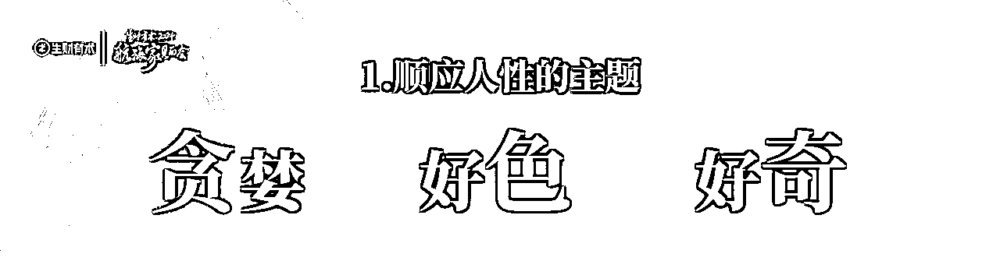

首要条件是内容要搭上人性。刷短视频本身就是人性体现，分神片刻数小时即逝。短视频主题同样要合人性。人性里七宗罪皆可作为抓手，结合案例来看：

①贪婪：《外卖员教你点外卖》：低价套路满足信息差。

②好奇：《采访00后打工人》：拍摄同事满足好奇与八卦窥探欲。

③好色+好奇：《偷拍富二代同事》：桌面美女舞蹈视频+为两位女友点奶茶。

### 持续的情绪刺激

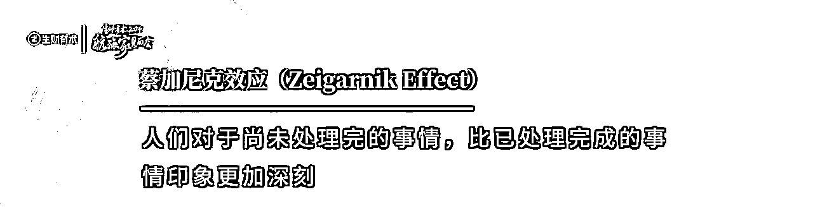

短视频的短不在于时长，而在于信息间隔极短。

做字幕时我们习惯将字幕提前0.2秒出现，就在前一条信息刚要流失、观众手指未滑走的空档，把下一句话强行送入大脑。短视频需要信息密度与痛点密集，以3秒为单位进行情绪轰炸。无论是3秒、30秒还是3分钟，内核都是以3秒一节的节奏持续刺激，每个3秒内均有新钩子承接。

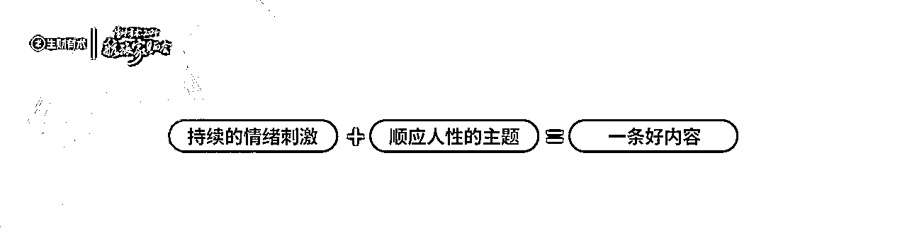

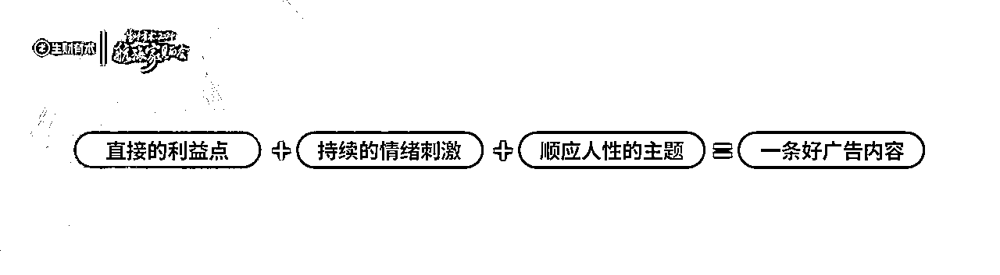

### 直接的利益点

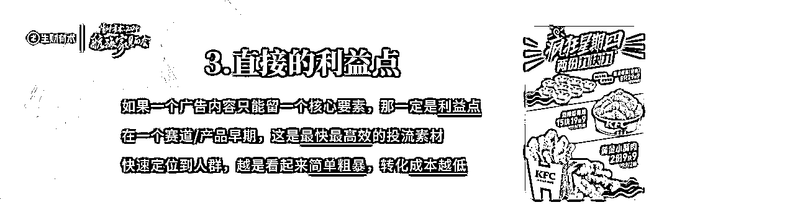

若一条视频讲完，观众仍不知卖什么、多少钱、在哪买，则毫无意义。所以最多保留一个点，便是核心利益点。

案例视频：快递粉

形式：大字报+抖音特效；优点：简短有力/直截了当/人群精准；缺点：标签模型窄，可触达人群受限。

爆款拆解

①顺应人性的主题：偷拍同事上班日常，击中好奇心

②持续的情绪刺激：快节奏事件切换，画面持续情绪化

③直接的利益点：配合点外卖省钱的直接广告利益点

单日引流5w+；单支视频引流35w+

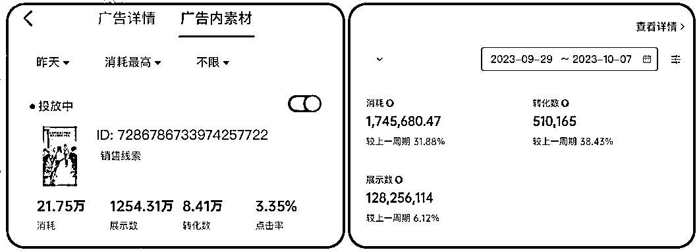

# 如何带团队打造爆款引流内容？

孙子兵法讲：凡战者，以正合，以奇胜。

作战既需要正面硬刚的主力，也需要奇兵出其不意。那么内容素材的正向打法为何？

以足够体量对抗概率，以科学方法迭代素材。

对内容而言，爆款属于概率问题。需以数量对冲概率，再以科学方式持续优化。我大学学物理，高中大学均参加物理竞赛，获全国大学生物理竞赛特等奖。所以我习惯用实验对照思路做内容。

如何获得有效体量——先抄后改。

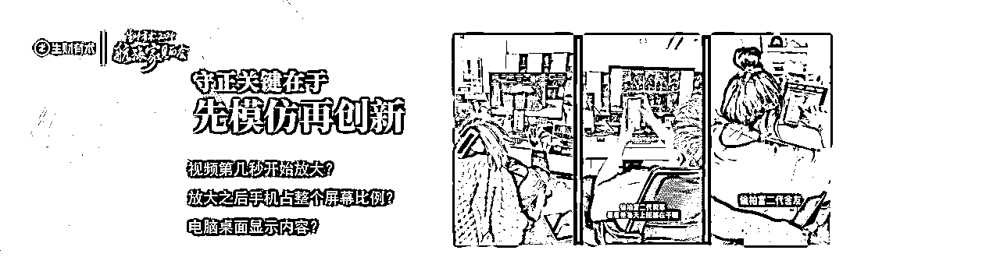

### 先模仿再创新

#### 30分失败模仿案例--偷拍富二代上班

画面放大时点、角色、手机比例均与原片不符。

需复刻细节：视频第几秒起放大？放大后手机占画面比例？电脑桌面呈现何内容？

#### 80分模仿案例--美妆开箱

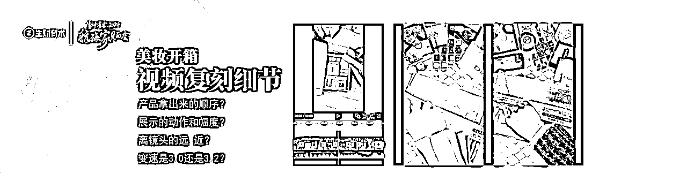

需复刻细节：产品拿出的先后顺序？展示动作幅度？与镜头距离？变速是3.0还是3.2？

弄清一条跑量视频如何复刻后，别急着创新，先做优化。因为手里现有60分的卷子，将它做到80分是可控的；重新起一张卷子，大概率仍是60分。

### 用科学的方法优化内容

优化要讲科学。譬如考试知道选择题错了，再重算重学便可提分；若不知错处就乱改，很可能把对的改错，60分变50分。因此必须先对照数据找答案，再进行内容优化。

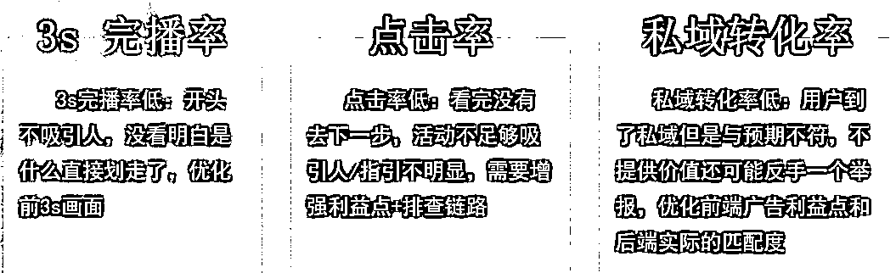

### 给团队创造大脑高速运转的环境

在明确任务目标下做脑暴，我会带团队玩“脑洞填空接龙”。每次5-6人，每轮10分钟，限时激发灵感。

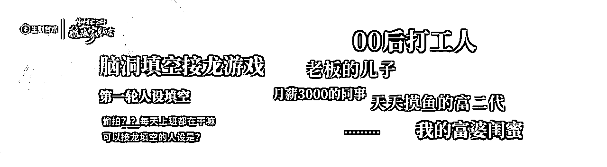

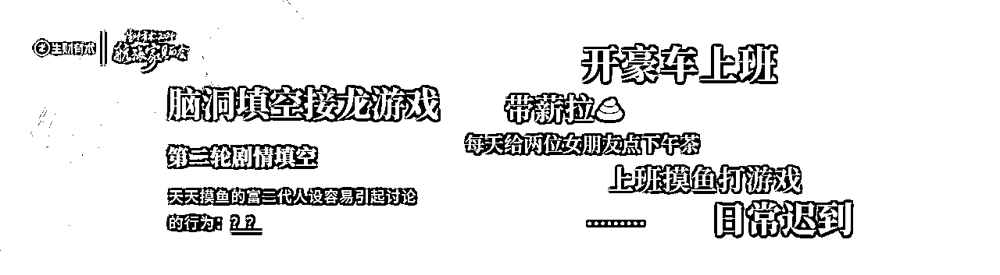

### 总结：先模仿，再优化，再创新

做内容是先模仿再优化再创新，不是模仿＞优化＞创新，而是顺序。先模仿，认清优质内容长什么样，知道正确答案是什么；再优化，找出哪些改动能加分，形成“网感”；最后才可做有效创新。

# 如何带团队持续打造爆款引流内容？

带团队为长期战役，团队能产出一支爆款，如何稳定持续产出？

### 做内容流量的不败之法

不是靠全网爆几条，而是形成模板，形成内容体系，持续生产优质视频。

视频跑量不是终点，引流成交才是终点。

#### 跑量模版

跑量模板即每个成员将自己跑过的脚本类型+视频案例+人设标题+拍摄经验+审核经验全部沉淀下来。

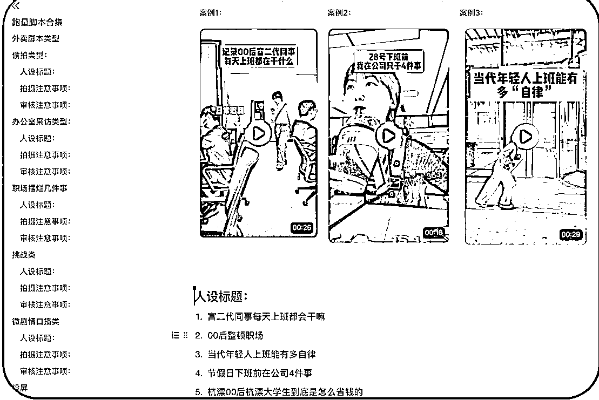

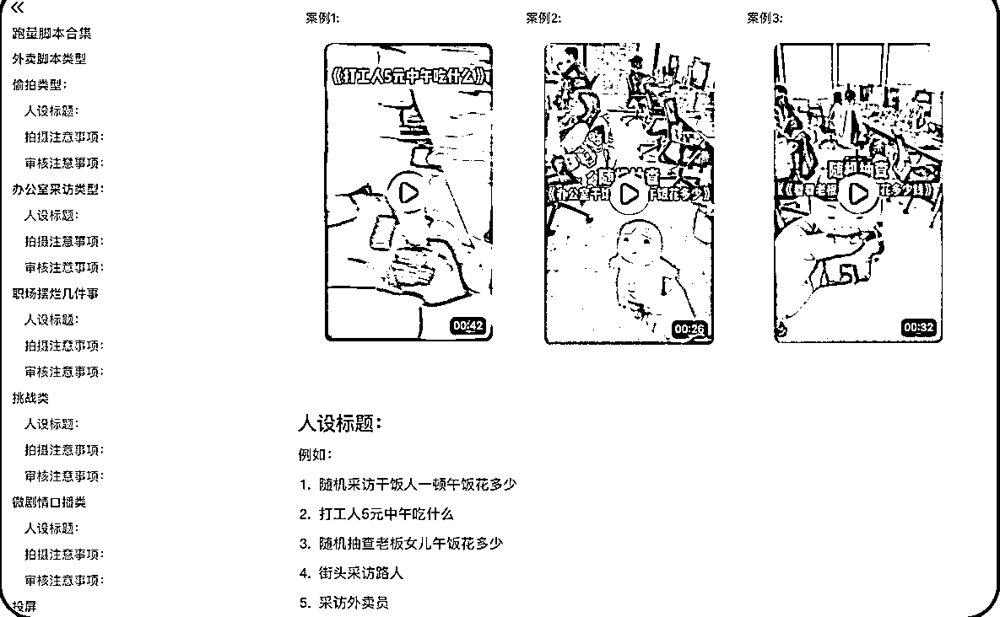

内部我们称之为跑量模板，也叫分手笔记。因为人员流动很正常，关键不是如何培养留住人，而是把过程沉淀下来。

#### 分手笔记

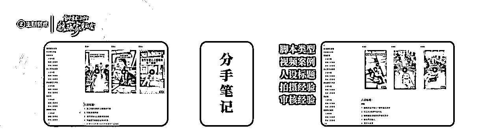

新人加入先拿到前辈的跑量模板，自己做出跑量后补充进去；离职时最后一步是把分手笔记补完整。带团队不只是带出人，更是把内容模板与内容密码沉淀下来。

### 老板思维

### 思维法则一：拒绝学霸思维，不做聪明人

学霸思维会让老板与团队失同步。你一步到位给出答案，别人还在写过程；老板自己冲在前面，团队看不懂你如何过去的，你也看不懂他们卡在哪。做内容要与用户同频，带团队要与成员同频。

### 思维法则二：拒绝侥幸心理，尊重常识

团队早期没有内容体系时，我们也靠蹭热点拍几条赌运气，结果基本无水花。初期靠热点、体系混乱、拍完看数据，全是危险操作。做内容要先建体系，持续系统优化。好内容根本不需要蹭热点，打好地基，尊重常识，尊重数据。

满分内容没有标准答案，爆款原因各不相同，但优秀内容一定有模板，这也是我们能沉淀大量跑量模板的原因。

20年11月首次参加生财有术线下大会，当时惊叹搞钱玩法之多，印象最深的一句话，人永远赚不到认知以外的钱。

转眼四年，我从V2.4升级到V2.8，从实体做到视频号再到抖音，也在生财有术航海家见面会分享。也许多年前读星球文章的那天，命运的齿轮就开始转动，如今依然在转。

以上内容希望能给大家提供一点价值

祝大家都实现财富自由，时间自由，精神自由！

一起生财有术！！

