# ('春节期间制作DeepSeek系列视频:从0到1的AI自媒体成长经验分享', (2, 37))

发文前先自我介绍：我是汤姆CC，04年出生，计算机专业在读。春节期间我发布了一系列DeepSeek主题的视频，全网关注量累计超过18万：抖音14万+，小红薯2万+，视频号2万+，微信好友也加了400多人。目前已经谈下两笔商业合作。这篇文章会把我的经历、方法、指标和给新手的建议，全部公开。

【我的节奏：从盲目到抓住机会】

2024年7月，我判断AI是未来方向，但迟迟不知道如何入场。后来想通：先拍起来，就算不成功，输出也能逼着我掌握更多AI本领。这就是费曼学习法的力量。7月28日，第一条片子发出，当时我连定位、主题、头图都不懂，只会在网上找别人的样子照搬。坚持了七天，没有人看。开学后精力不够，就放下了。

真正的转机出现在10月15日。那天圈子里出现了一个重要信号，我一下子重新燃起信心。入圈刚满一个月，我大量阅读同行经验，学怎样定人群、怎样做封面。关注者一点一点涨，终于破了千。那阵子我也试过学一位博主用手机直拍，但频繁失败。期末临近，我又停了一段时间，不过一直没有停止研究。我把喜欢看的视频下载下来，逐帧分析博主的镜头与节奏，做成笔记。寒假把学到的技巧用进新片子，依旧没什么声响。

没进生财前的作品

10月15日老大超级标上我的评论

进生财之后的各种尝试

快到春节时，我更新了一条DeepSeek视频，当时没有一点反馈。除夕当天，小红薯突然爆了。我瞬间意识到机会到了，马上熬夜剪出一支本地部署教程，初二发出去，很快又成为热门。春节要去亲戚家拜年，我就把电脑背在身边，谎称写作业，实际上一直抽空做片子，保持日更，就这样多了2000名关注者。那时候全网都在分享“让DeepSeek不卡”的技巧，我眼看内容越来越同质化，立刻转去做“具体功能怎么用”的教程。这个方向当时很少人碰，最终我收获了一条千万播放和三条百万播放的作品。

我没有任何背景，依靠半年时间在这个圈子里疯狂吸收知识，才换来了这些成绩。所以我认为，做这一行门槛并不高。如果屏幕前的你也处于瓶颈，别轻易放弃，不要离场，持续修改自己的作品，总有一天会被看见。

【实操方法论】

第一步：定你的位置

先想清楚为谁服务。我常用AI做定位推演，会跟它说：“假设你是一位社群创始人，帮我规划AI类账号的定位。”然后让它给出10个身份标签。这些标签指向未来愿意为你付费的人群，简单说就是“你帮谁解决什么问题，值多少钱”。
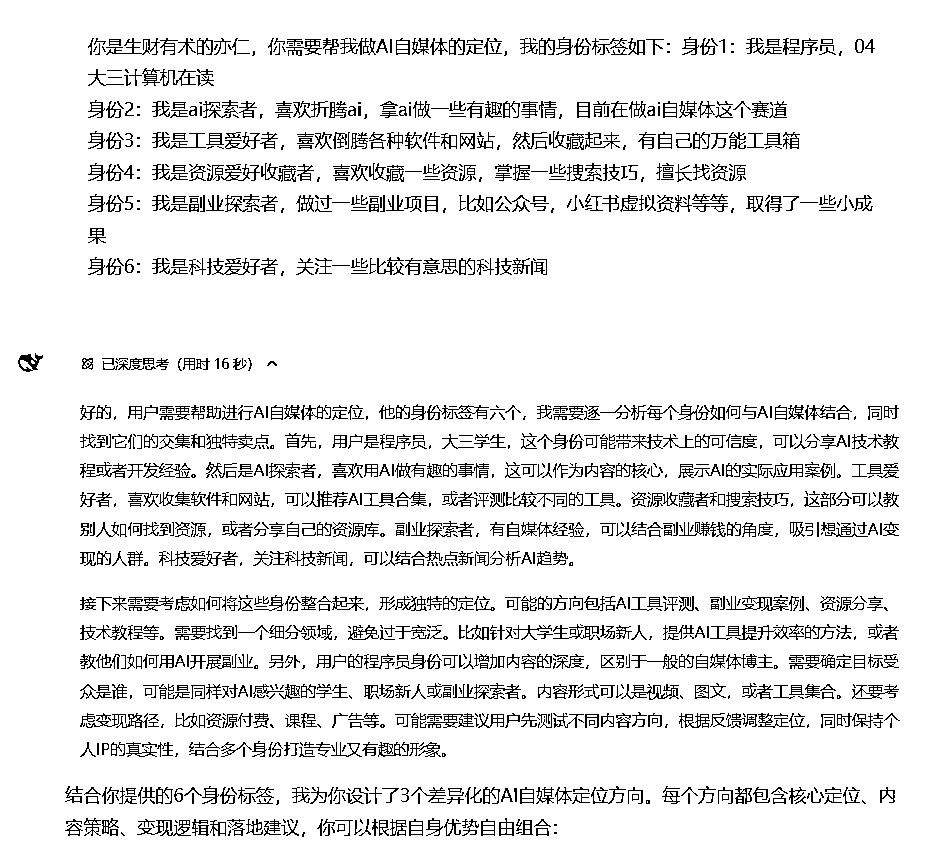
AI的建议要用脑子过滤，不能全信。

第二步：装修个人号和埋钩子

昵称最好让人一眼看出你与AI相关。头像可以到即梦APP的灵感库去挑，改一改提示词，再加入自己的特色，让头像和昵称有呼应。

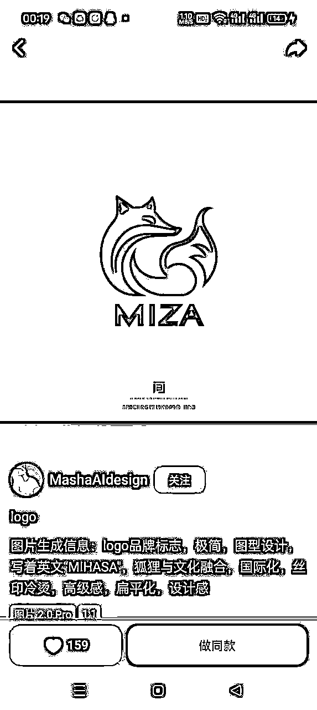

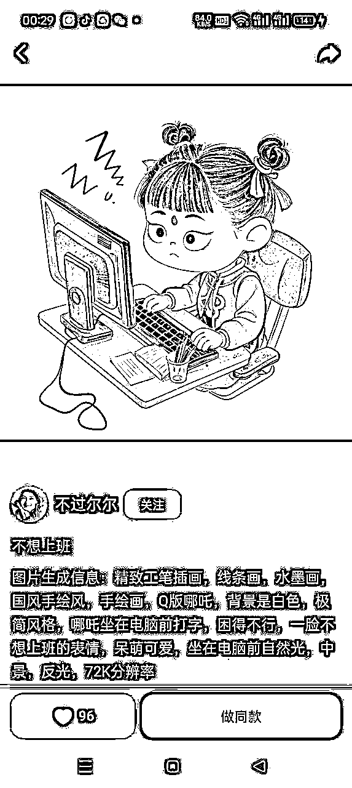
简介参考同类账号，再结合自身情况写，别忘留个钩子，比如“领取资料，请看@小号”。

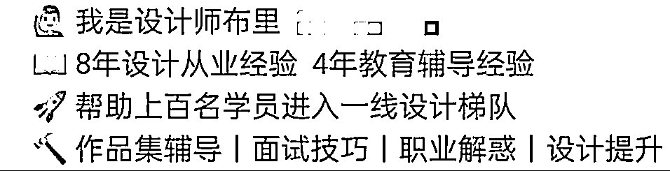
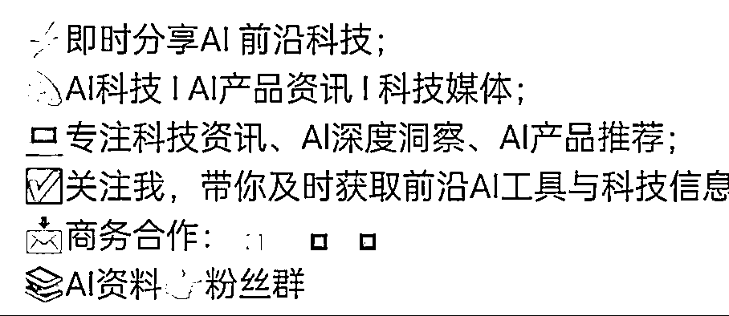
钩子可以是资料包，也可以是你整理过的资源合集。为了不污染主号，把资源放在社群公告里，主页@小号，再由小号导入订阅号。做这一步，是因为订阅号以后能接商业广告分成；而且当加微信的人太多时，好友列表会撑不住，订阅号可以帮你留住这些人。

第三步：选题怎么来

题材选得对，流量才有戏。我的习惯是建一个“参考号库”，不断往里填充新发现。

来源之一是生活网感：多刷各类内容App，用“AI”“AI作图”等词搜索，找出近一周内火过的东西。火过的东西大概率还能再火，但你要加入自己的角度或新观点，原样照抄没有意义。
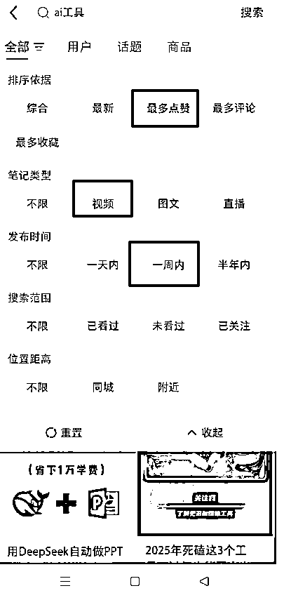
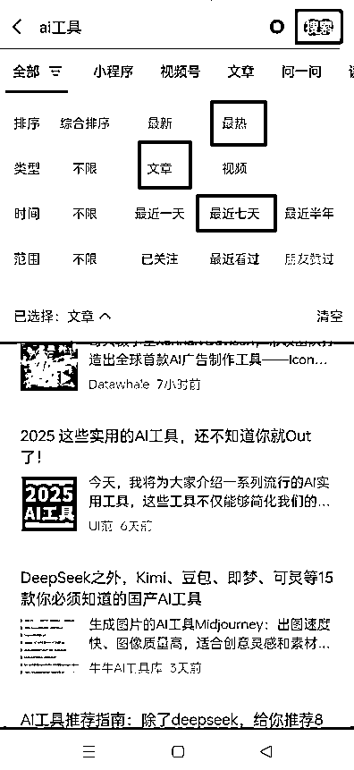
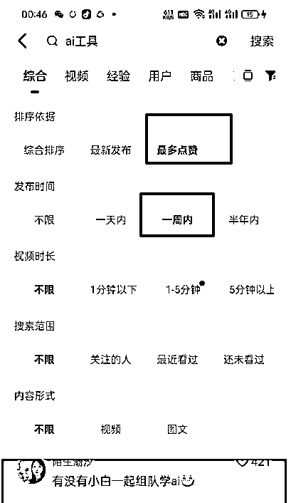

来源之二是数据工具：免费的可以用巨量算数，输入关键词就能找到低粉热门号。
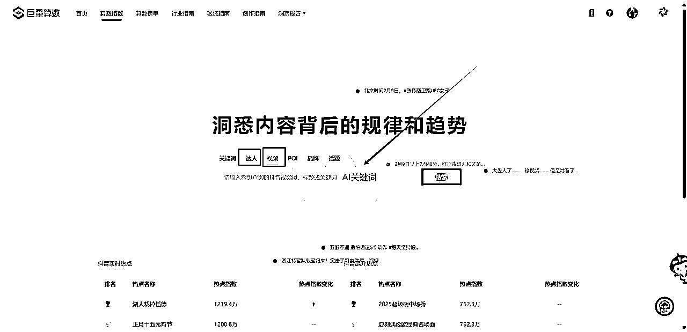
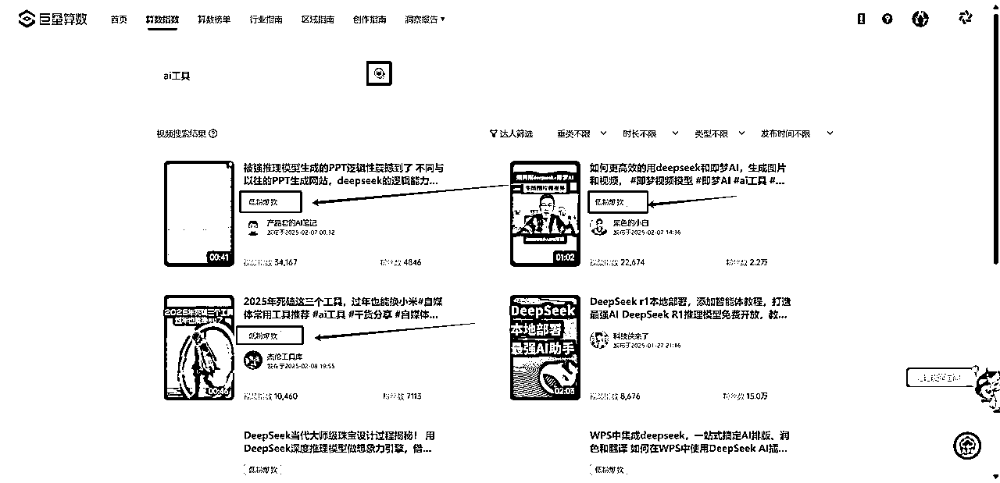
付费工具如蝉妈妈、灰豚会更准，闲鱼上可以买到日卡或周卡，很划算。

来源之三是跨平台嗅觉：X上讨论度高的AI内容，国内往往马上也会热起来，DeepSeek就是这么火的；即刻有一个AI讨论区，里面活跃着很多从X转来的大V；那个知识星球的精选情报里，已经有人帮你筛好了重点信息，特别是标了“中标”的那几条，含金量极高。能进去，你已经领先大多数人。

参考号库可以从基础数据、内容结构、热门规律、变现路径、运营方式、独特优势六个方向来拆解。

还有两个习惯：第一，随时捕捉灵感。我开了一个面对面群当成素材篮，刷到好内容或者冒出好想法就立刻扔进去。第二，定期回顾参考号库，我一般周末定下周的更新方向，然后每天按计划生产内容；遇到合适的热点，就把原计划往后延。

第四步：文字稿怎么打磨

确定方向后，我会让AI参与头脑风暴。把初步构思发给它，让它帮忙补漏洞、提建议，再做润色。

开头的三秒钟没有吸引力，观众就会划走。内容本身要干货足，别人才愿意点赞和转发。

标题可以走这几个模式：
- 技能速成型：“一晚上学会Midjourney，新手必学的三个赚钱招数”
- 效率提升型：“让Cursor替我写代码，效率提高10倍的方法”
- 副业机会型：“靠AI月入十万？我就用了三个工具”
- 问题解决型：“AI训练难题不用怕，小白也能看懂这招”
- 趋势展望型：“未来五年最有前景的AI职位，第一名没想到”

开头也有公式：讲个故事制造悬念；问个问题直击痛点；放组数据增加专业感；说一句反常识的话制造冲击。结尾可以预告下集、总结干货，也可以抛问题收集需求。互动引导的话术也要准备，比如“你更想解锁哪种AI新玩法”放在评论区；“先赞后藏，别走丢”引导收藏；“转给身边的朋友”引导分享；“想要资料，回复AI领取”引导私信。不过部分平台禁止这种引导，B站相对宽容。那些火的片子有个共同点：标题带紧迫感，开头让人共鸣，方法具体能落地，情绪有波动，结尾有明确指令。

第五步：录制和声音

录屏我推荐OBS，清晰度不满意的话，去搜“OBS高清设置教程”就能解决。配音我推荐海螺AI海外版，现在免费，支持克隆自己的声音，也能模仿别人，听起来很自然。前段时间还有一些账号靠克隆别人的声音做出了热门作品。【注意：这个工具需要“科学上网”】上手流程：进入官网，用Google账号登录，在主页选择Audio。
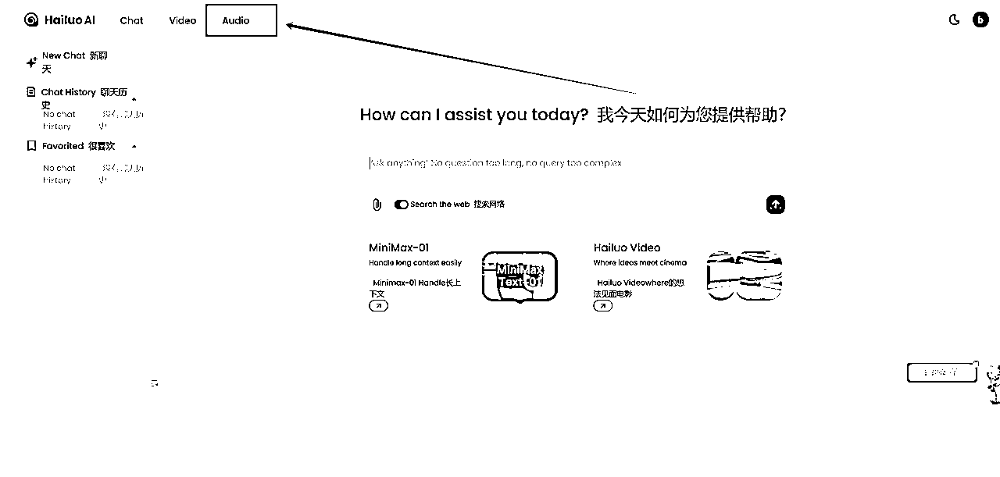
点Voices，再点Create your Voice Clone，上传几秒干净的人声，效果会更好。
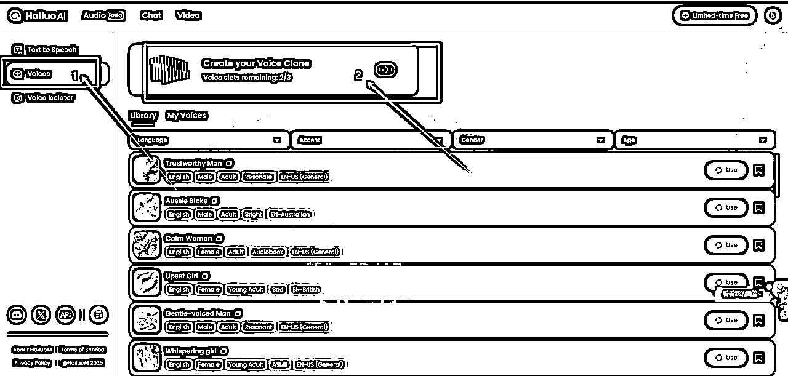
回到Text to Speech，粘贴文稿，选择你克隆好的音色，点Generate Speech，几分钟后就能拿到成品。
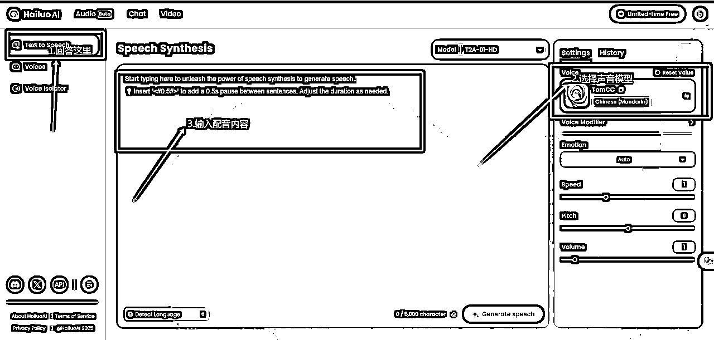

第六步：后期和配乐

后期能力弱没关系，慢慢学。我经常研究参考账号的后期手法，看到一个不明白的效果，就搜教程。比如之前喜欢一个线条滑动的转场，就去B站搜“文字划线效果”，很快就学会了。
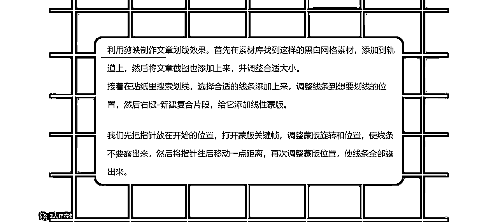
配乐找法：先下载要模仿的视频，用SnapAny即可，再导入剪映拆掉原声，接着用团子AI在线工具箱分离人声，最后打开网易云识曲，基本都能找到。

第七步：头图设计

头图我用可画，几块钱在闲鱼买永久会员，很划算。模版要改成带个人特色的版本，比如放上自己的头像和昵称。

如果头图需要某个App的图标，用Icon Fetcher图标获取器可以抓取网页图标，也能按应用名搜索，下载后放进可画就行。
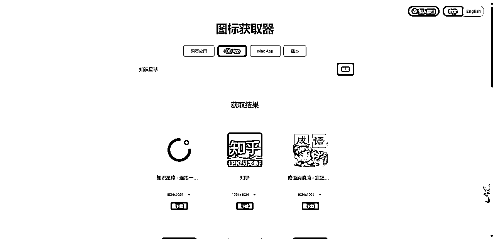

第八步：上传节奏

各渠道用户口味不同，不要一键同步。要研究每个站点什么时候活跃，避开热门创作者的更新时间。我从前经常半夜上传，几乎没人看；后来换到白天，错开大V，流量立刻改善了。上传时标题要紧扣模板，标签也不要堆太多，五六个精准的即可，有热点就跟热点关联。

第九步：收入来源

一是商业合作，前提是账号里有合适的植入位，比如介绍工具时，工具本身就是广告位；实操演示时，用到的软件也是。合作价格通常是关注量的5%到12%，多平台打包还能加返点，总报价更高。
二是自建付费产品，我在前辈指导下做了低客单价的AI+个人IP社群，后面再从中挖掘需求，推出更贵的进阶服务。
三是分销别人的产品，比如卖付费社群。高价产品不好直接卖，最好先让用户成为你的低价会员，等对方认可你之后，再把他引导过去。
四是企业服务，比如给公司做AI培训。
五是软件分销，赚推广佣金。

【关键指标解读】

前两秒流失率：高，意味着开场失败了。要改视觉、改话术、改节奏。第一帧可以用亮色或动效，话术里带疑问或情绪，前3秒就把卖点讲出来，别铺垫。

播完比例：代表视频的留存能力。要注意时长是否适合站点、结构是否紧凑、有无埋钩子，以及画面声音是否专业。

互动量：点赞、评论、转发的总和，体现内容的共鸣度。你要主动设置话题、回复优质评论，甚至“制造”一些情绪点。

变现表现：直接反应商业价值。要让视频方向与变现目标一致，在恰当的节点插入引导，同时建立清晰的用户画像，并根据后台数据不断调优。

【给新鲜人的三句话】

第一，重视作品质量，别总盯着增长数字。低位期是常态，耐心打磨才有后劲。我就是靠日更不断，才等到DeepSeek这股东风。第二，接受冷启动的平淡，把时间用在提高水平上。第三，别因为“我不专业”就迟迟不开始。这个世界本质上就是个巨大的草台班子，想太多不如先做出来。

这篇复盘就到这里。如果你也在AI这条路上摸索，欢迎到评论区和我聊聊。

做AI自媒体，光有热情远远不够，很多人在起步阶段就陷入了一个误区——想一口吃成胖子，结果内容越来越杂，人设越来越模糊。真正跑出成绩的账号，往往是在一个点上深挖到极致，而不是遍地撒网。

找准方向的核心，是先明确自己的受众是谁，再选好一个主阵地深耕细作。等根基稳了，再去扩展其他平台。还有一种情况很容易让人迷失，就是追热点。热点可以追，但不能让热点牵着鼻子走——如果你什么都蹭，最后粉丝根本记不住你是干什么的。

说到内容本身，有几个细节值得留意。比如在小红书上，封面就是门面，一张有质感的封面，往往直接决定用户会不会点进来。同时要留个心眼，像AI的官方logo这类元素尽量避开，除非是平台明确站台的话题，类似近期DeepSeek这种热度极高的方向，可以大胆一点。另外，别端着，真诚分享真实的踩坑经历或使用感受，反而更有共鸣。最重要的还是内容质量——一条真正用心的作品，撬动的流量可能顶得上十条流水线产物。现实中很多账号的粉丝，几乎都来源于屈指可数的几条爆款。

再换个角度来看布局逻辑。

站在广告主那边想，他们花钱不是看谁粉丝多，而是要看粉丝画像是否匹配。很多AI商单并没有落在“科技博主”手里，而是给了医疗、教育、职场等垂直领域的创作者，原因很简单——广告主需要的是精准客户，不是泛泛的围观群众。所以把“某个专业领域+AI”组合起来，才是做商业化的钥匙。另外，作品里要预留广告口，以便自然地承接产品曝光，最终让内容成为流量的引子。

站在平台的角度想，平台真正稀罕的是有价值的优质内容。你给平台创造的价值越大，平台回馈给你的流量就越多，流量来了，商单自然也不会缺。如果只想做私域引流，就老老实实服务好精准受众，不必太在意是不是爆款。

站在用户的角度想，粉丝凭什么相信你？一是你的内容确实能解决他们手头的问题；二是别整太专业的术语，科普感大于技术感，让小白也能轻松看懂；三是尽量有实操感，哪怕只是一个截图流程的演示，也比空口说教更有说服力。

眼下，DeepSeek等国产大模型的崛起，正在悄悄改写内容平台的玩法。AI技术的普及速度肉眼可见，大量品牌急需会讲故事的人去传播他们的产品，个人影响力也在这一波浪潮中被无限放大。可以说，你的账号就是你的行业名片，是你通向更多合作机会的敲门砖。现在这个节点，恰恰是入局AI自媒体的黄金期。市场对AI内容的需求一天比一天旺盛，与其观望，不如直接下场。感兴趣的圈友，不妨关注3月的AI+自媒体航海计划——持续深耕，不断积累，每个人都有机会在AI内容领域开辟出自己的一席之地。期待在航海计划里和你并肩出发，一起走完这段充满惊喜的内容创作旅程！