# 在闲鱼搞泛IP周边生意 | 实战攻略

> 来源：[https://shengcaiyoushu01.feishu.cn/docx/ELrJdUeKFoEPRqxz4KJcCrStnRf](https://shengcaiyoushu01.feishu.cn/docx/ELrJdUeKFoEPRqxz4KJcCrStnRf)

内容出品人：维拉

手册出品方：龙哥盟团队

出品时间：2025 年 1 月 21 日

建议：如果需要快速定位到精确内容，可以使用快捷键 Ctrl + F/command + F 的形式，搜索「关键字/词」，查找你想要的内容

# 一、项目总览

## 1.1 闲鱼卖泛IP周边的模式与市场机会

闲鱼泛IP周边项目，本质是在闲鱼平台上流通动漫、动画、轻小说、游戏等知名虚拟形象衍生的周边商品。

随着内容产业持续升温，各类IP在消费者心中的热度与粉丝体量都在攀升。无论是热门番剧、影视剧、游戏角色还是知名品牌，都催生了庞大的周边需求。

闲鱼凭借海量的用户基础和低门槛的二手属性，为这类泛IP商品提供了极佳的变现路径。很多限量款或已停产的周边在官方渠道买不到或价格虚高，二手市场就成了粉丝的替代选择，这也让闲鱼上的泛IP周边生意有了明确的生存空间。

## 1.2 收益预估与适合人群

收益预估：

项目月入从数百到上千元不等，天花板主要看选品眼光和货源质量。客户群体普遍对IP有基本认知，沟通成本相对较低。

以维拉实测数据为例，每天投入2-3小时，按节奏上架3-5个链接，单账号月收入大约在200-300元左右。时间与货源充足的话，多开账号叠加，收益自然放大。

适配人群：

1、IP爱好者：本身沉迷于各类IP，对爆款周边了如指掌，能精准捕捉粉丝偏好。利用自己的收藏知识和热情，既能满足收集欲，又能把兴趣变现。

2、有闲置要处理的人：手头囤着因冲动消费、活动赠品等原因闲置的泛IP周边，通过闲鱼快速出清，回笼资金，盘活闲置价值，基本零成本操作。

3、时间灵活的副业者：学生、自由职业者或在职人士，可利用碎片时间做上架、回复、发货等动作，不影响主业的同时赚取额外收入，还能锻炼电商运营与沟通能力。

## 1.3 操作路径

先注册一个闲鱼账号，前期不必急着开鱼小铺。商品品源可以从拼多多、1688、品牌官方店及授权代理商等多渠道搜集，选定后上架、成交、发货、售后闭环完成。核心是货源和选品。

也可走无货源代发路线，成交后再去拼多多/1688下单直发。具体流程在第三章详细拆解。

（注：鱼小铺只能由系统邀请开通，无法主动申请。一般发布50条以上内容并结合店铺评价等综合表现后，官方才会推送开通入口。）

## 1.4 实战案例

圈友维拉的分享：

起初只是被一些可爱的周边治愈到，从消费者视角出发，我发现大家愿意为情绪价值买单，哪怕价格不高。生活中不止女生，男生包上挂毛绒挂件、动漫挂件、明星周边、MBTI挂件的现象很普遍，线条小狗、Loopy的快闪店也常年排队，市场信号很明显，于是开始在闲鱼试水。

对比小红书等内容平台，闲鱼门槛更低、限制更少。观察后发现品类繁多，需求稳定，便正式投入。恰逢KITTY 50周年，热度持续拉升。短短两个月销售额约500元，维护时间投入很少，主要是选品、上架、发货，客户决策快，直拍为主，操作很省心。

# 二、店铺搭建

## 2.1 基础准备

*   准备一台手机，做到一卡一机一号

*   安装闲鱼APP并完成账号注册

*   绑定一个正常使用的支付宝账号注册闲鱼，注册完成后默认为个人商家，可直接售卖

*   注册方式：打开闲鱼APP，使用支付宝/淘宝账号一键登录即可开始买卖

## 2.2 闲鱼APP权限设置

以下示例以安卓手机为准，iOS可参照操作。

1\. 关闭关注与粉丝列表公开

进入闲鱼APP-我的-右上角设置-下滑至隐私设置。建议将该项设为灰色状态，保护客户资料不外泄。

2\. 关闭动态范围可见

同样在隐私设置中，建议选择不可见。这样客户查不到你的上新动态，销售状态也对他人隐藏，同时避免同行盯上你的爆款。

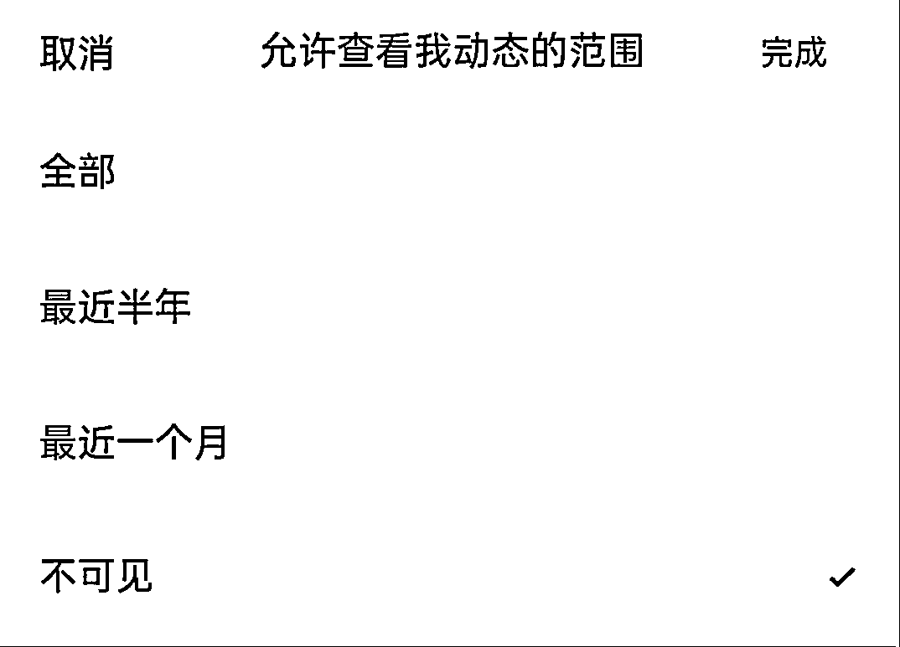

3\. 开启闲鱼消息提醒

务必打开。前期回复速度直接影响成交率。

路径：我的 -> 设置 -> 消息通知 -> 开启闲鱼消息通知

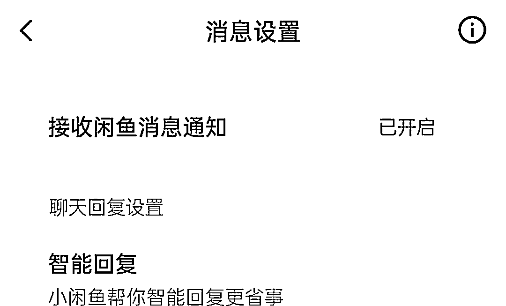

4\. 为闲鱼消息设置专属系统提醒

手机设置 -> 通知与状态栏 -> 应用通知设置 -> 选择闲鱼图标 -> 允许通知。可为闲鱼单独设置铃声，并在免打扰时仍允许提醒，确保不错过客户咨询。

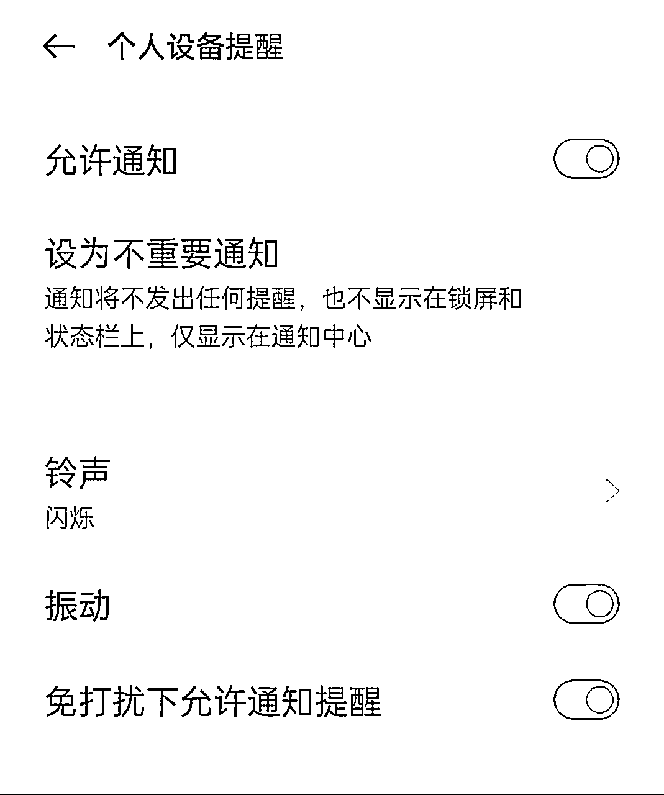

## 2.3 账号信息完善

路径：我的 -> 设置 -> 个人资料

信息完整度尽量提升到八九成以上，能填的都填。

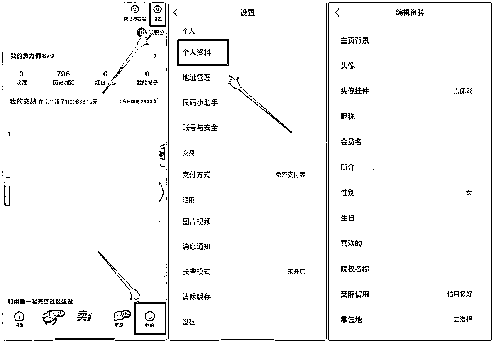

1.主页封面

杂货类店铺对封面要求不高，可保持默认或上传积极正能量的图片即可。

2.头像

建议使用女性头像，实测更容易提高出单率。

3.昵称

可选用女性化昵称，或结合店铺定位命名，如某某小铺、某某厂家等。注意闲鱼昵称30天内只能修改一次，若赛道未定，先不急着改名。

4.个人介绍

可写经营理念或店铺定位。

例如：

怀旧动漫收藏家|玩具满xx包~售出概不退换

重度Kitty/XXX控，祝宝宝们天天开心天天发财 等等

下方为参考示例：

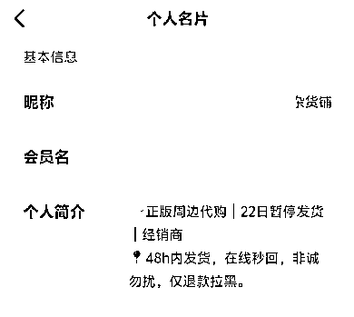

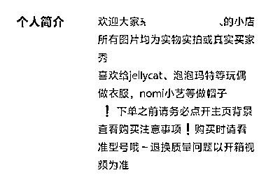

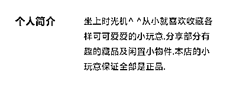

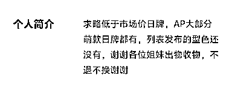

店铺准备内容来源：

【闲鱼蓝海】航海手册——项目准备工作章节

# 三、选品与货源获取核心篇

## 3.1 推荐品类

1. 模玩手办类（适合懂行玩家+有独家渠道）

- 热门动漫模玩：人物模型、景品手办、黏土人等
- 特摄英雄模玩：奥特曼、假面骑士可动人偶、变身道具、怪兽模型等
- 机甲模型：高达系模型、国产摩动核等机甲品牌周边

1.  卡牌类（适合专业玩家，重在稀有与限量）

- 宝可梦卡牌：如宝可梦与梵高联名卡等，闲鱼曾出现抢购潮，简中集换卡人气也高
- 航海王卡牌：收藏卡、二创卡等凭借美术与角色吸引粉丝
- 小马宝莉卡牌：卡位自助、趣影包、收藏卡等均有稳定销量

1.  玩偶毛绒类（需求大、门槛低）

- 热门游戏玩偶：《蛋仔派对》咸鱼棒公仔、蛋仔毛绒等
- 动漫角色毛绒：线条小狗、小刘鸭、HelloKitty、三丽鸥系等
- BJD及棉花娃娃：三万院长swdoll、DollZone等BJD品牌，MINIDOLL、棉花星球等棉花娃娃均有稳定交易

可结合自身兴趣与货源情况挑选主攻方向。

## 3.2 选品方法与货源渠道

### 3.2.1 选品思路

*   兴趣驱动：做自己熟悉的IP。如漫威重度粉丝可推漫威手办、海报；常玩《阴阳师》的可推式神玩偶、符咒类周边。
*   借势热度：紧跟当下文化潮流。如《天官赐福》热播期，可上架剧中相关挂件、徽章、立牌等。
*   挖掘稀缺：找小众但粉丝忠诚的IP，如独立游戏限量原声碟；或寻找绝版/限量款，如某年迪士尼限量徽章、三丽鸥绝版公仔，收藏价值高更易成交。

选品关注点：

1. 优先热门IP

参考动漫、影视、游戏热度榜。如《咒术回战》可推主角团徽章、玩偶；《王者荣耀》英雄手办、皮肤周边持续走俏。ChinaJoy、Comiket等展会限定周边因稀缺性更具市场。

HelloKitty 50周年带动公仔、挂件、中古周边热潮。

2. 兼顾价格带

低价引流款：钥匙扣、贴纸等，适合价格敏感用户。中高价款：限量手办、签名海报等，面向追求品质与收藏的用户。

3. 以用户需求为导向

观察微博、小红书等平台的讨论焦点，若粉丝持续呼吁某个角色的特定周边，就值得尝试上架。节假日也可做主题化选品，如情人节推迪士尼情侣玩偶。

4. 重视品质

优先选做工精细、材质扎实的产品。如手办涂装均匀、玩偶面料舒适等。品牌正品如万代高达模型更易减少售后。

示例：

迪士尼IP持续火热，除官方周边外，自制周边也有空间。若有手作技能，可做钩织手机壳、手表周边定制，有店家靠此技能10个月售出300余件，日均约一件，产能受手工限制但利润可观。

同理可延伸AI壁纸、手绘、定制化商品等。泛周边的定义更广，不局限于官方授权，创作空间很大。

### 3.2.2 货源渠道

1、二手交易平台

闲鱼内部收购：平台上不少个人卖家因重复购买、退坑等原因低价出货，可低价拿货后整理再售。考验对品相与市场的判断，也可采用先询单后下单的模式，避免压货和运费成本。

转转等平台：商品形态与闲鱼互补，可作为补充渠道，挑选品相好、潜力大的商品。

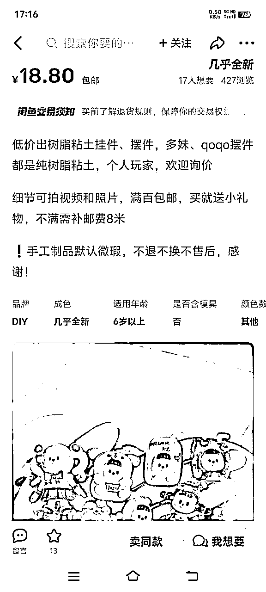

2、批发网站

1688：大量商家提供动漫手办、卡牌、玩偶等批发。优先筛选诚信通商家、查看评价，选择质量稳定价格合理的供应商。需注意版权风险，迪士尼等高风险IP需谨慎。

拼多多：不少无版权实用周边在此售卖，如在日常用品上印制IP图案，部分为授权合作款，价格有优势，可直接挂闲鱼并代发。

代发时优先选1688实力商家、严选店铺，辨别真厂家。拼多多看销量、近评、差评原因。

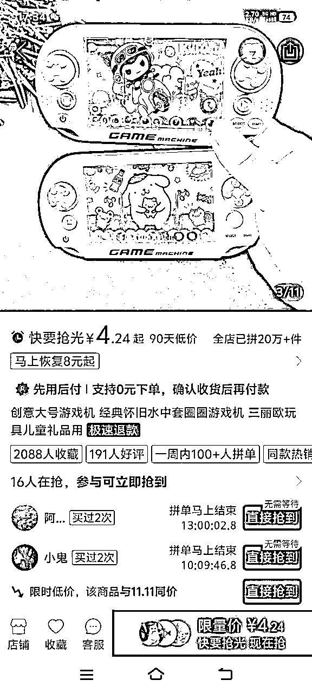

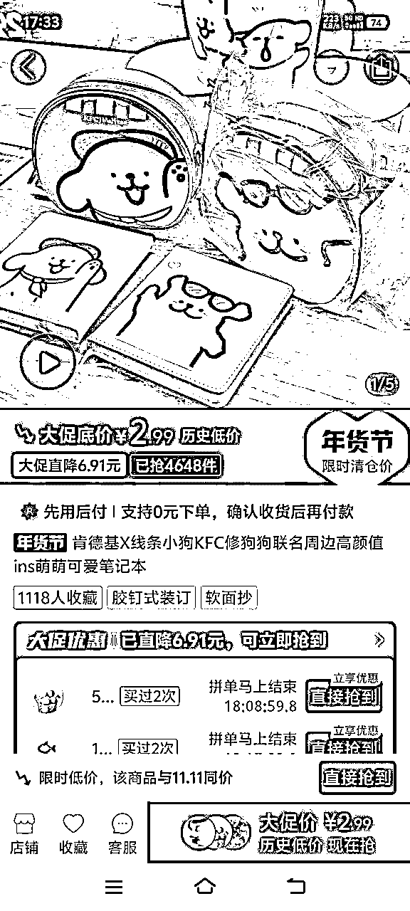

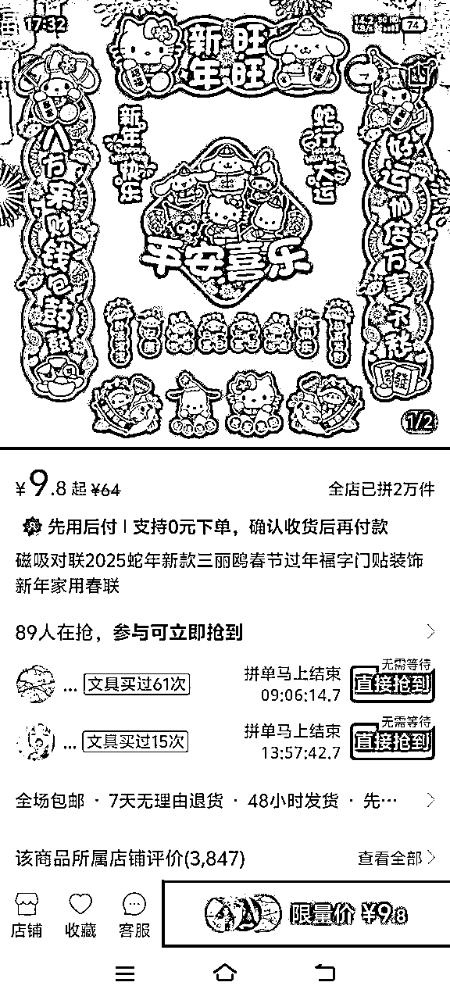

3、品牌官方与代理商

官方旗舰店与官网：从官方渠道拿货可保证正品。如迪士尼官方旗舰店的玩偶徽章、万代官方店的高达模型等，可做代购模式，加收代购费销售。

品牌代理商：部分品牌有授权代理商，可拿到批发价且保证版权合规。1688上也能找到部分品牌代理。

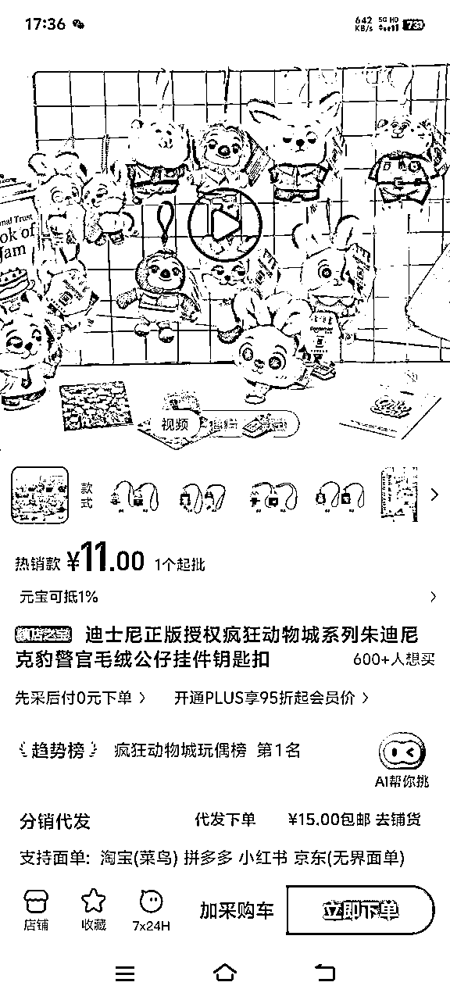

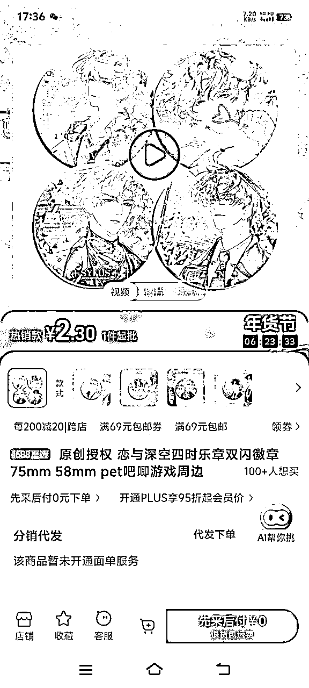

4、线下渠道

动漫展会：现场摊位多售卖限定与独家周边，可与摊主谈批发价拿货。

实体店清仓：动漫周边店、玩具店因转行、换季清仓时，可低价收购库存回流闲鱼销售。

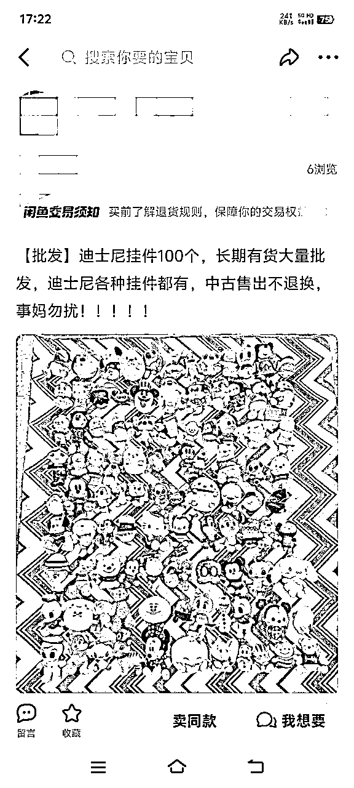

此渠道获取难度较大，需关注时机，且基本需要垫资囤货，需谨慎评估需求再出手。

例如某些打着批发名义的账号，要多看评论与账号表现，判断其库存是否能快速周转。

没有明确需求支撑时，不要囤货！不要囤货！不要囤货！

囤货积压易影响心态与现金流。

## 3.3 上架流程

1、无货源代发：从拼多多评论区找清晰实拍图，尽量凑齐9张图后正常发布，关键词与引流词写进标题。
2、有实物囤货：实拍后直接上架。
3、未开通鱼小铺前，商品售出需手动重新发布。开通后可设置库存，售出不下架。

上架主图与标题制作方法可参考【闲鱼蓝海】航海手册上架章节

# 四、成交发货与售后

## 4.1 销售沟通话术

*   客户提问要热情耐心回答，不确定的问题可先复制咨询商家，拿到准确回复后再反馈给客户。
*   若客户对价格有异议，着重突出产品价值感，尤其是正版商品单价偏高，通过闲鱼成交价已是优惠。

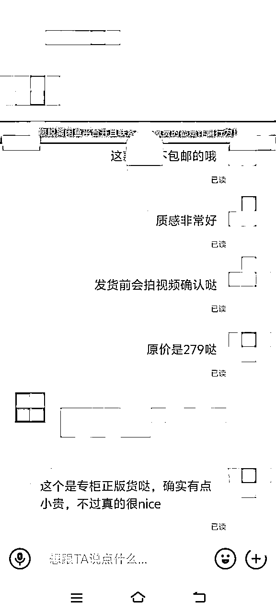

## 4.2 发货流程

客户下单后操作步骤：

1、复制闲鱼买家收货地址，到拼多多或1688下单，将收货地址改为买家地址，付款人电话改为自己的，并备注无痕发货、不放好评返现卡等需求。找货源时可先确认商家是否支持无痕发货。
2、在闲鱼立即重新上架该商品，提升推流机会。
3、供应商发货后，将快递单号复制到闲鱼订单中。买家即可查看物流与取件码。若闲鱼未显示取件码，可去拼多多商家物流处查看后主动告知客户，并提醒及时取件，增加服务好感。

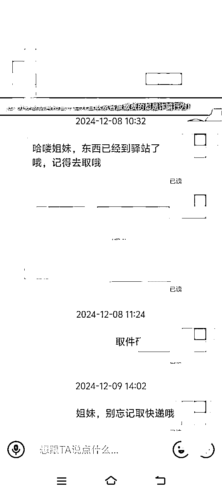

## 4.3 售后处理

可参考【闲鱼蓝海】航海手册-售后内容

售后情况多样，具体问题具体处理。整体定位是中间人角色，将客户反馈转达给上游商家处理即可。

如遇物流异常，先去供应商处核实发货状态，同时安抚客户。若客户态度强硬且问题复杂，可直接协商退货，避免后续纠纷。

案例：

有客户下单后催单非常急，需提前沟通发货时效，无法立马上手的订单可婉拒，避免超时引发差评。后续物流停滞2天，及时核实是平台延迟还是真实停运，并给出合理解释，如爆仓、天气原因等，大部分客户可以理解并接受。

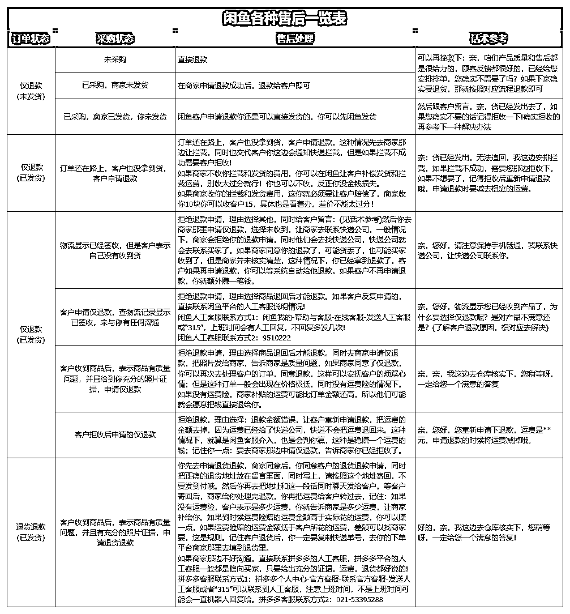

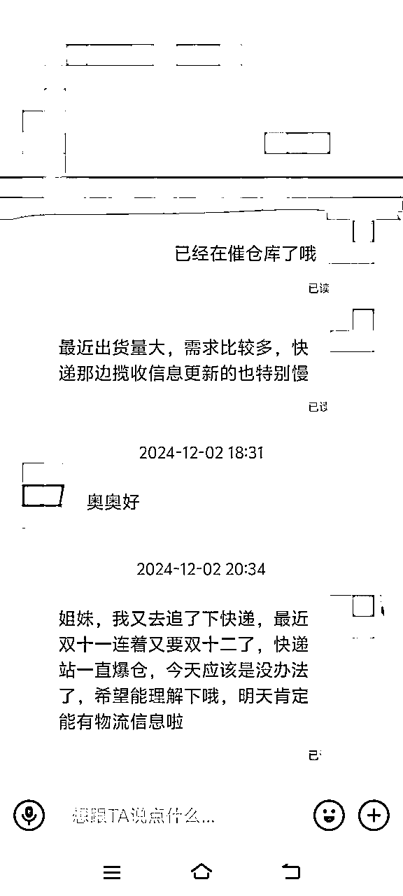

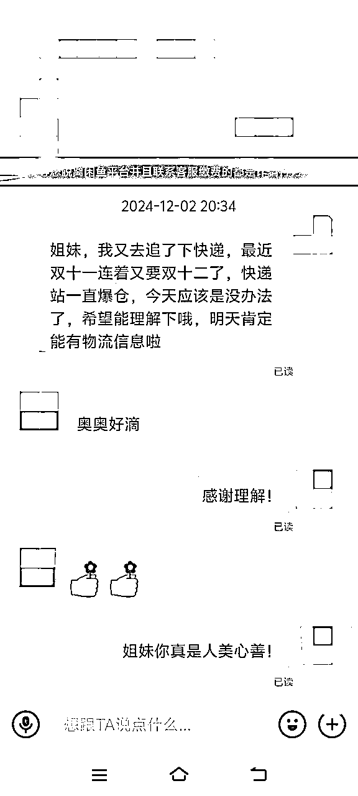

# 五、日常运营与上新节奏

做闲鱼变现，节奏感比堆数量更重要。先把账号的“新品心跳”打起来，个人号每天至少保持3个新链接上线，等鱼小铺权限下来后，承载量能扩到500个sku。上架触顶的时候别硬撑，把数据拉一下，曝光持续拉胛、咨询为零的老链接果断下架腾位，马上补上新品去测试。

活跃度是免费流量的入口。每天抽点碎片时间把闲鱼的日常任务做完，闲鱼币就是核心筹码。平台现在推流基本不收钱，主要靠闲鱼币里的急速卖来冲曝光；商品详情里挂上闲鱼币抵扣，相当于给买家一个小福利，也能换来额外的系统推荐，和淘金币的逻辑类似，能带来少量的自然加权。

选品不能靠感觉。利用零碎时间在拼夕夕和闲鱼两边交叉刷品，按“低价+颜值+复购意愿”的筛选思路去找同款、找差价、找空白，再把合格的品快速上架。 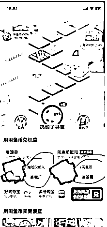

# 六、项目常见问题分析/复盘

## 6.1 常见类问题：

1、是否是正品：别自己给自己挖坑。没有授权就别硬标正品，差评和售后一来就全亏了。先判断买家要的是什么：要的是便宜好看的，价格和颜值就是卖点；上来就追问真假的，说明他锚定的是正品属性，这类客户不要用话术糊弄，沟通中摸清需求，错配直接放弃。

2、什么时候发货：发货时间一定要提前跟上家对齐，客户问了就如实报。着急送人、急用的客户容错率很低，隐瞒或虚报会导致后续一堆麻烦。

3、能不能便宜点：看成本和库存压力。手里有囤货，就以走量为主，利润可以适当压缩甚至保本出。遇到一上来就大幅砍价、还问个不停的，通常成交率极低，不是目标人群，礼貌放过比硬聊更省时间。

4、有没有瑕疵：全新品建议在详情里前置声明不包官方瑕疵，工厂品控不是100%完美，大问题极少。二手或自囤货，尽量在发货前拍一段实物视频给买家确认，能大幅减少售后纠纷。 

## 6.2 复盘

1、多潜水看闲鱼上潮玩、手办品类的爆款链接，拆解标题、首图、定价和话术，学会举一反三迁移到自己品类。

2、真想在这个赛道长期做下去，就要持续拓货源。不断开新的渠道、谈新的合作，有独家货源或成本明显有优势的货源，就是你最核心的护城河。 

整体门槛不高，适合对泛IP内容感兴趣、愿意做精细化运营的人入场尝试，先跑通方法再放大规模。 