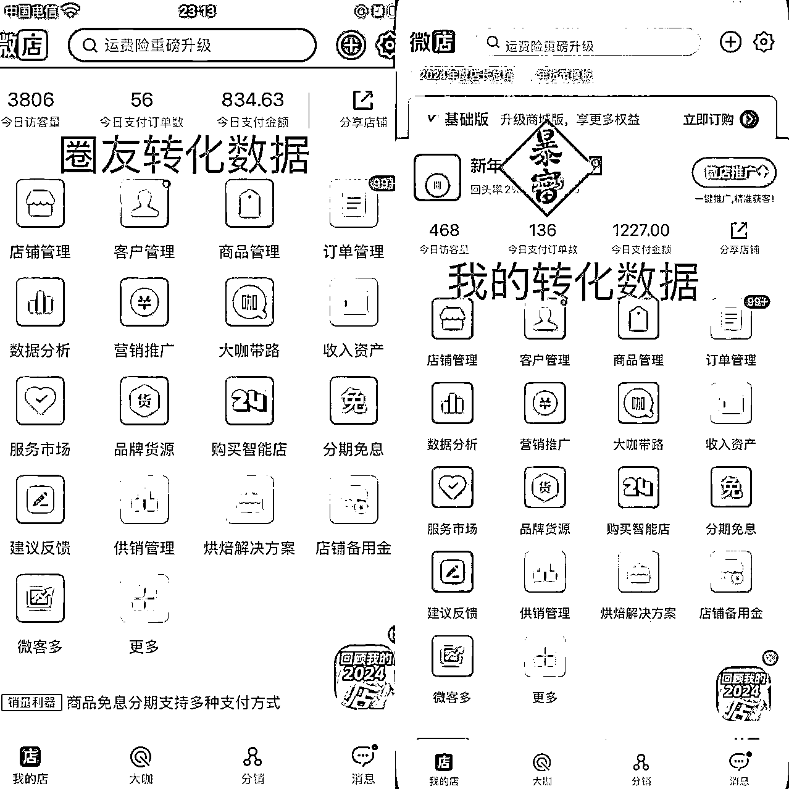
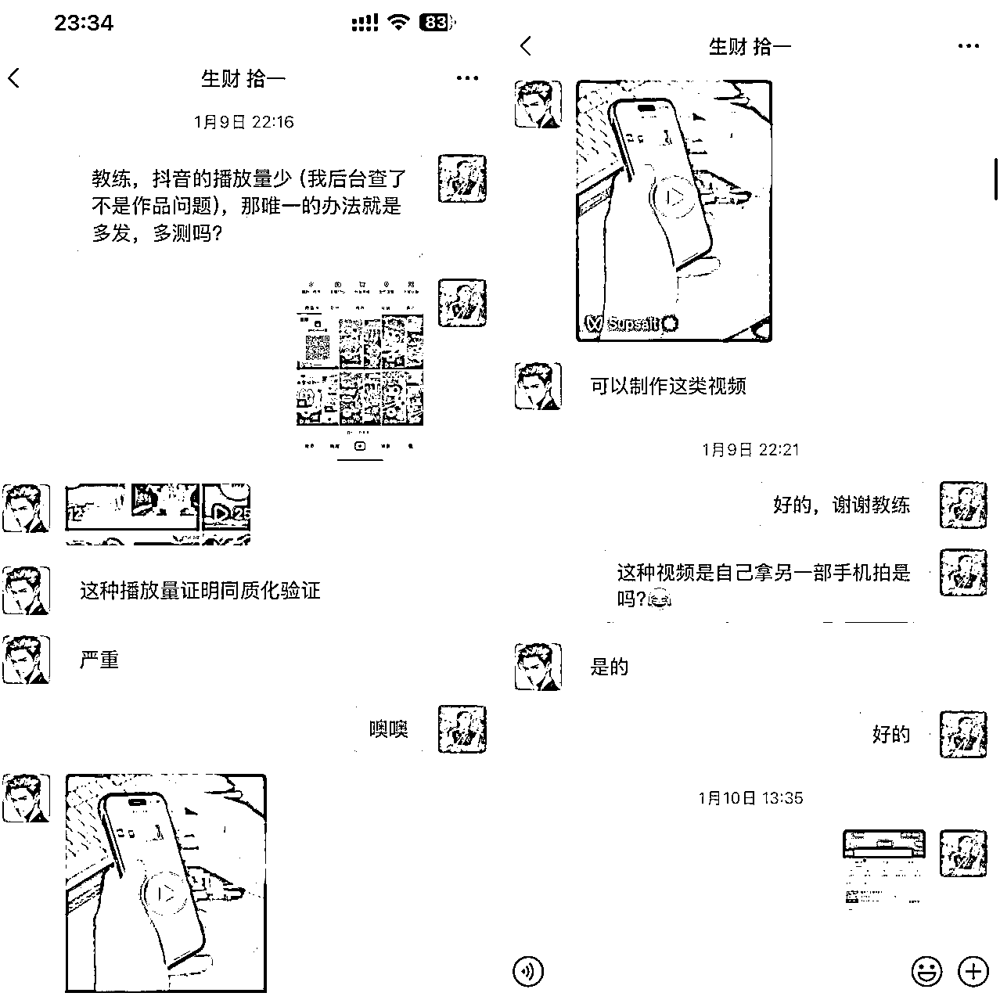
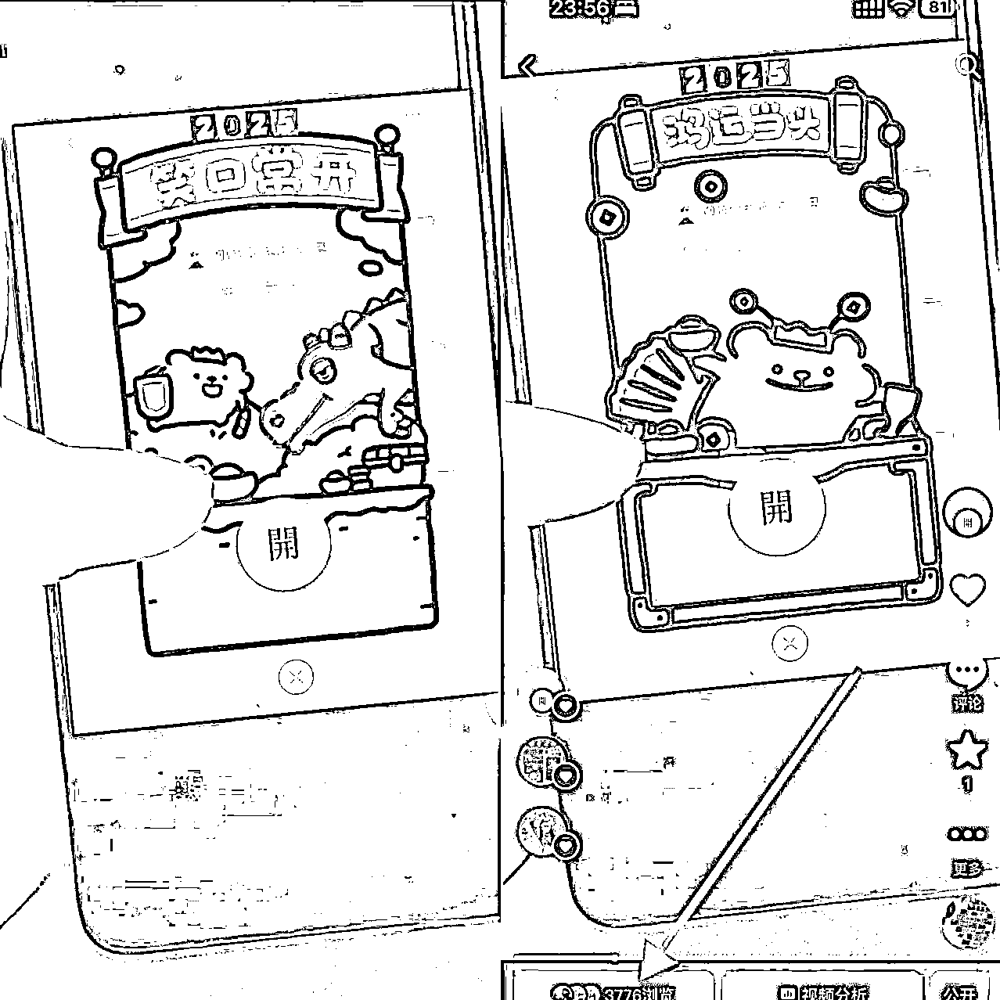
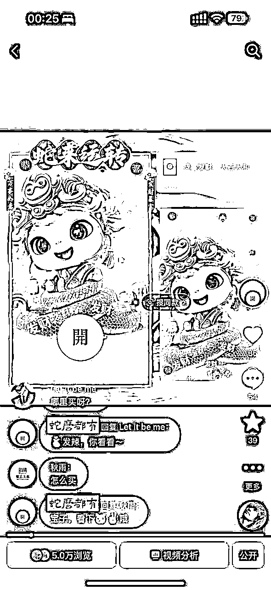
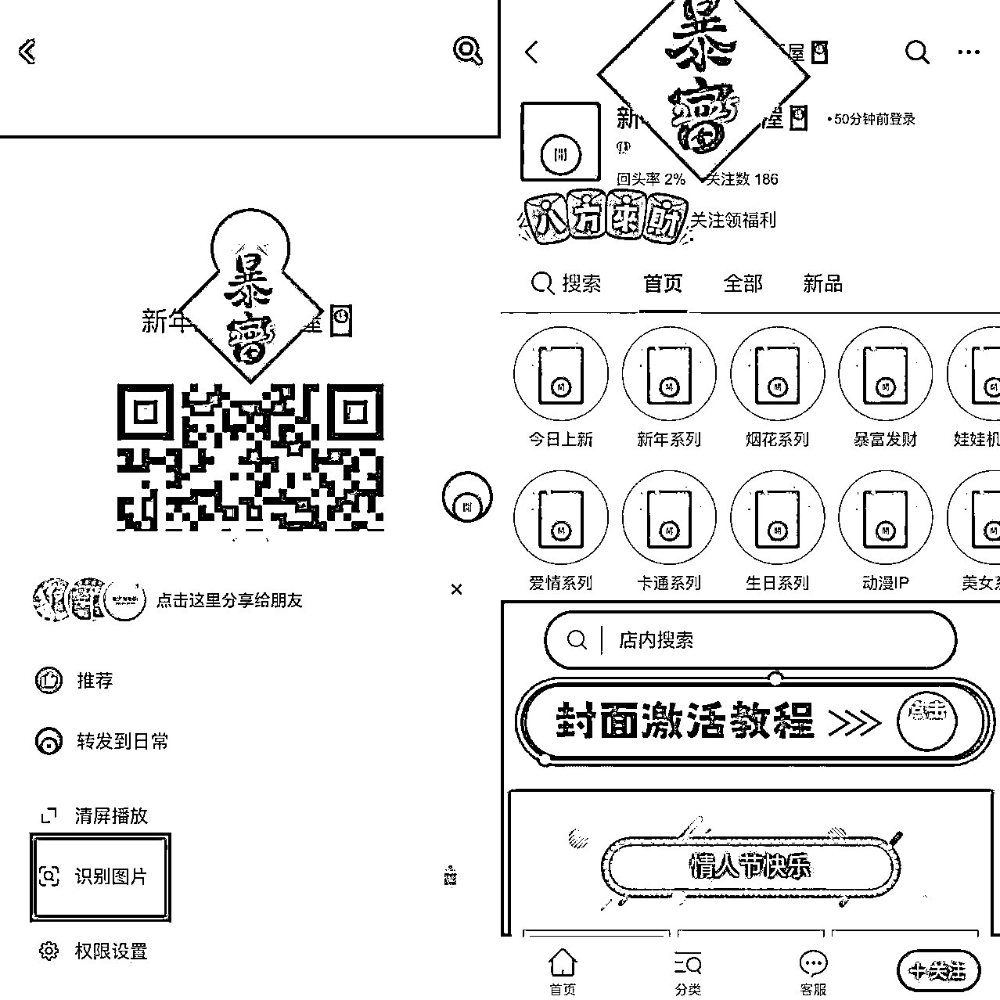
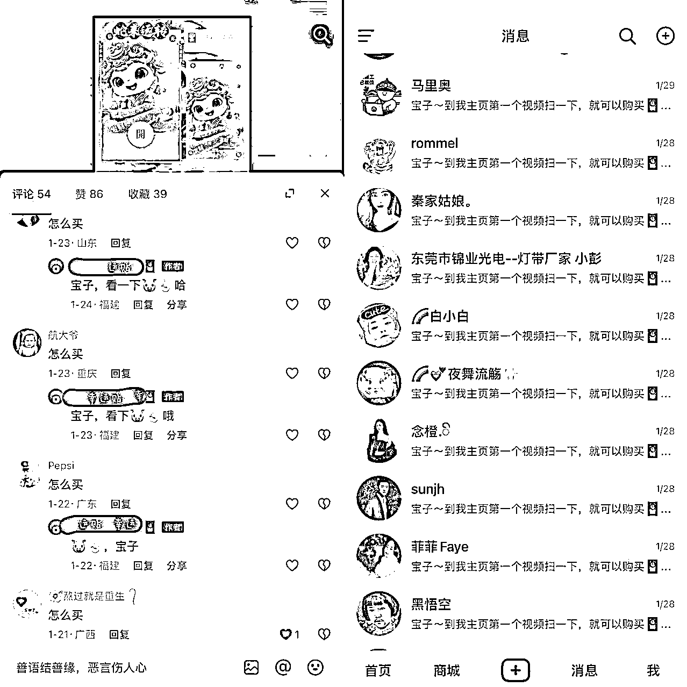
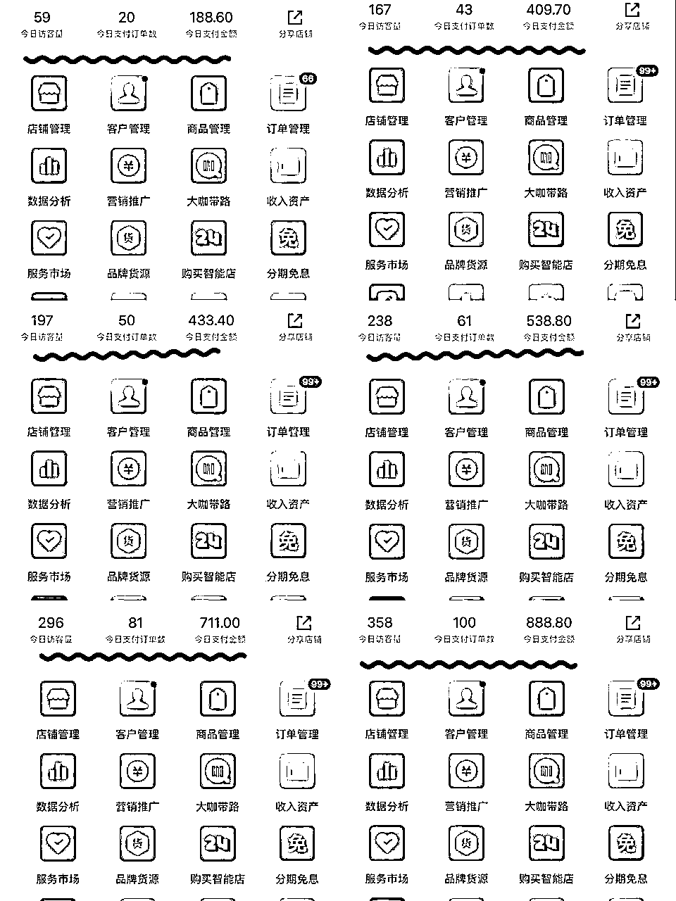

# ('新人加入赚钱1个月，首战红包封面Mini航海，从0到2600的经验分享', (2, 37))

新年刚过，赚钱圈里就传来一个让人眼前一亮的故事：一位入圈仅40多天的新人，靠着一场“红包封面Mini航海”，从零起步，最终拿下2600元收益。今天，我想把这个普通人的实战经历完整讲给你听。

先说说这位主人公——林先生，福建人。去年下半年才开始摸索副业，在抖音做过短视频和直播带货，月GMV能到2W+，虽然没赚到什么大钱，但积累了不少拍视频的底子。去年12月，他偶然通过抖音认识了一个叫“知识星球”的软件，在“副业赚钱”栏目里，发现“龙哥盟”长期霸占第一，而且已经有6万多人加入。抱着试试的态度，他报了3天体验课。结果课还没上完，他就发现自己对赚钱的认知，比过去三年提升得还要快。于是第三天直播还没结束，他果断付费加入了。到今天，正式加入赚钱也不过40多天。

刚进圈子，正好撞上年末最火的红包封面Mini航海。林先生跟着报名，幸运的是，还真让他赚到了钱。他晒出的收益截图显示，这笔钱他到现在都舍不得提现，因为对他来说，这不仅是第一笔航海收入，更是一份独特的纪念。

他说，自己作为新人分享这些，谈不上经验，只是把走过的路复盘一遍。圈里老前辈常说“输出倒逼输入”，他深以为然——分享的过程，本身就是一次深度思考。

回到项目初期。那时候航海还没正式开始，他就提前把教练在精华帖里发布的预习内容翻了个遍，搞清楚需要准备什么：微店、公众号、自媒体账号，能提前弄的绝不拖。他自己称之为“笨鸟先飞”。事实证明，这个动作帮他节省了大把时间。很多人开船后还在折腾微店支付、公众号设置的时候，他已经把3个备用抖音号、小红书、视频号、朋友圈全部布置到位，然后专心研究内容、流量和成交。

关于多平台运营，他是这样做的：红包封面的引流渠道很多，抖音、公众号、小红书、视频号、朋友圈都能做。但他实际测下来，抖音效果最猛。因为他有抖音功底，一开始就主攻抖音。第三天，他把小红书和视频号的账号也全线改成红包封面定位，三个平台同步发同一支视频——跨平台发布同一条内容，平台不会判同质化。

数据会说话。视频号流量并不差，但转化很惨。原因很现实：视频号用户年龄偏大，对这类新潮玩意儿兴趣不大，而且封面风格偏年轻化，叔叔阿姨们既不知道去哪买，也不知道怎么兑换。况且视频号上很多人都想白嫖免费封面，一看到付费扭头就走。尽管这样，他还是每天坚持同步发。

小红书就成了他流量最差的地方。核心原因不是平台不行，而是他自己没摸对路子：小红书用户爱看精美的图片笔记，他却只发短视频。他承认自己有“完美主义”倾向，做一张图总想做到极致，结果一小时才憋一篇，效率太低，所以索性还是发视频。没有认真对待平台，结果每条视频只有几十个小眼睛。

真正的主力还是抖音。用户基数大、年龄段广，只要视频有流量，就不愁卖不出去。拾一教练也在航海群里反复强调：重心放在抖音。他听话照做，哪怕一直到航海结束，公众号一篇文章都没发，转化率和GMV照样高于那些写出小爆文的圈友。

他还有个习惯：遇到问题第一时间找教练。教练实战经验丰富，能帮你避开无数坑。有一次视频播放量上不去，他去私聊教练，那一番对话成了他后来改变视频形式的重要转折点。他特别感谢拾一教练。

再看视频内容的进化。一开始他想着自己买封面、想文案、写脚本、再拍，但很快意识到：自己琢磨出来的内容，既烧脑又不一定讨喜。他记住了教练说的“爆款是会重复的”，于是换了个思路——直接去抖音搜同类爆款有趣的短视频，下载去水印，然后用另一台手机架着拍自己播放这些素材的过程。这个操作让他不必再为创意发愁，播放量从100多一下子涨到3000多。

然而播放量虽然上来了，下单的人却寥寥无几，评论更是零。他开始换位思考：如果我是刷抖音的人，会怎么看这条视频？视频内容可爱、有趣，能留住用户，所以播放量不低；但问题在于，快过年了，视频和音乐却没什么年味，用户只当娱乐看看，根本看不出这是个卖红包封面的账号，自然没人点进主页，也就没有成交。

既然直接下素材会撞脸，直接照着拍有流量没转化，那就再变。他开始把官网微店的素材下载下来，调整亮度、加贴纸、换滤镜、改音乐、二次剪辑，而且紧盯着微店上新，一有新款立刻处理。其中一条蛇年主题、配上喜庆背景音乐的视频，卡在过年节点发布，不仅没被判同质化，还直接冲到5万播放，评论区全是问“怎么买”。2600元收益里，一半以上都来自这一条。

他总结了一个心法：方法永远比困难多。只要用心，总会有回报。

再讲转化率高的三个关键动作。

第一，置顶跳转二维码。早期他只在简介里留公众号，用户要复制、再搜索、再关注、再选封面，步骤绕到没几个人愿意走。后来他直接把微店二维码做成图片，发布后置顶。抖音有个功能，长按图片能秒跳转，用户一步就能进店。他也担心过会被限流、判违规，但他的思路很通透：置顶这条不求流量，只求让进主页的人第一眼看到，省去繁琐流程。就算这条被限流，只要其他视频火了，用户点进主页照样能看到二维码，照样能买。而且普通导流第三方作品，平台通常只限流当前作品，不会封号。结果显示，那条置顶视频也没被限流。

第二，评论区疯狂互动。从小年夜开始，红包封面热度暴涨。他打开抖音通知，只要有评论或私信，第一秒回复，然后反手关注用户，私信发祝福，顺便教对方怎么买、怎么兑换。这个细节能明显抬高下单率，还会带来复购。

第三，去别人的直播间和短视频评论区引流。除夕前，各种热闹喜庆的直播间和短视频全是人。他提前编好祝福语：“祝博主和评论区的家人们2025年新年快乐、身体健康、财源滚滚！领个红包封面过大年吧～”，然后大范围发布。配合他专业的头像昵称，很多人真的好奇点进他主页，就这样源源不断往微店导流。

三个技巧叠加，一直到除夕夜，他的转化率始终保持在25%以上。

作为第一次参加航海就拿结果的新人，他复盘自己的三个关键点：

一是提前预习。航海没正式开始，就翻完教练的精华帖，把准备工作做到位，开船自然上手快。

二是及时沟通。问题来了不闷头焦虑，直接问教练。通过几次调整视频形式，还真做出了几个爆款。

三是心态放松。因为新人预期低，反而没压力，轻松上手，反而更容易成事。

最后他还说了一些感悟。这次航海带给他的，不只是2600元，而是做事心态的彻底变化。遇到问题，他本能反应是“有没有别的办法”“换一个角度试试”“去找人帮忙”，而不再是干着急或者给自己找借口。这种成长，比钱更值钱。他也表示以后会继续参加赚钱的航海项目，多认识更多优秀的圈友。

至于给新人的建议，他引用了一句很经典的话：躬身入局，把手弄脏。想都是问题，做才有答案。新人最需要的不是空想，而是大量实战，哪怕暂时赚不到钱，积累下来都是未来的底气。就像红包封面这个项目，几乎零成本，顶多花点时间和精力，只要敢尝试，就一定有收获。

最后，也祝你新年事业红火，一起龙哥盟！