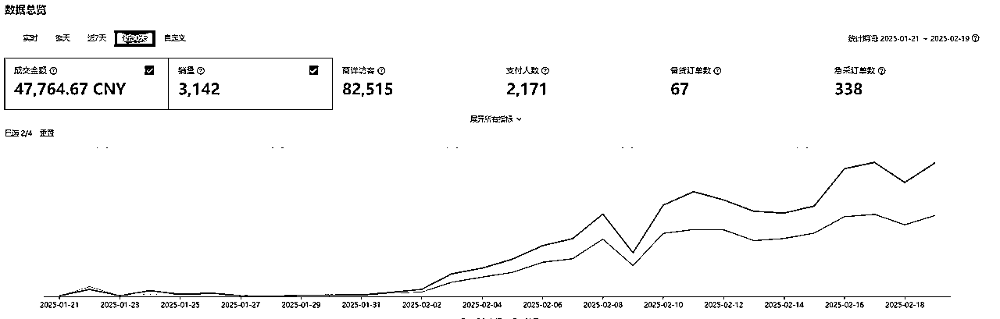
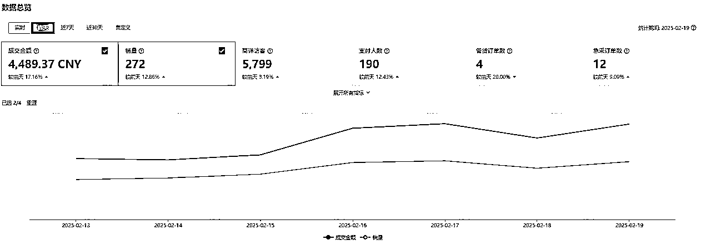
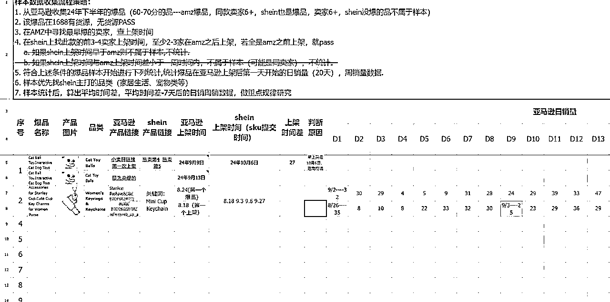
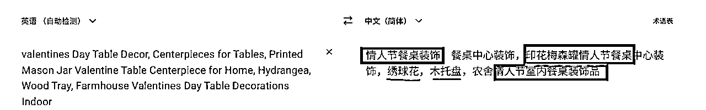
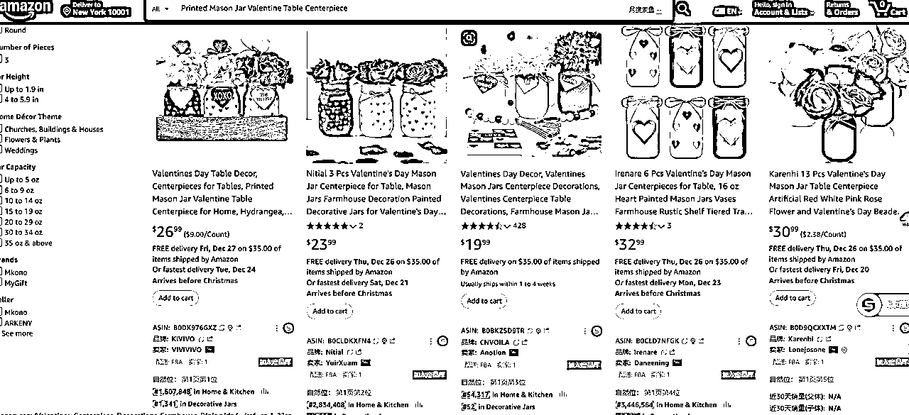
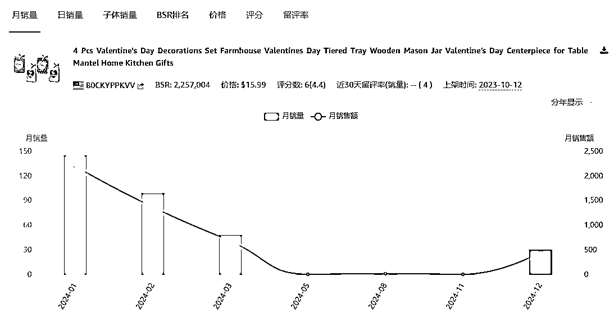
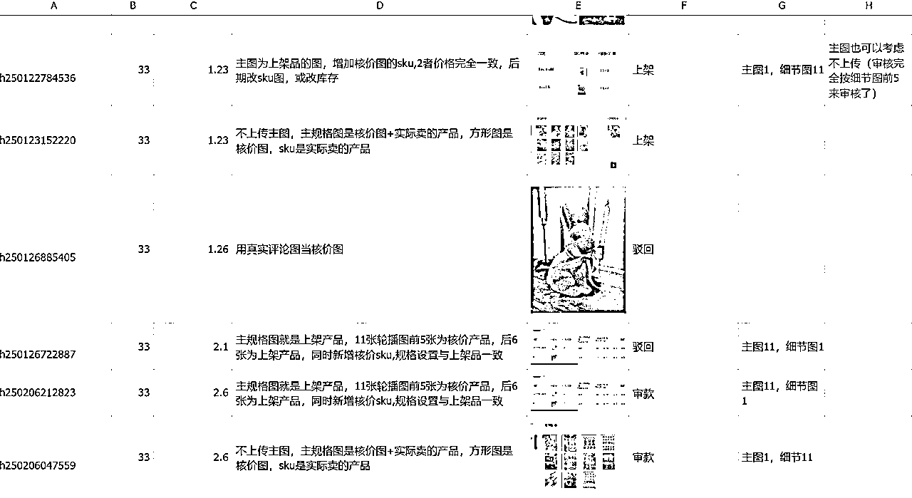

# 【航海复盘】两个月Shein实战：从跟船员到组长，我带队拿下月GMV 4.5万+，正在向星辰大海进发

> 来源：[https://las1d27yuu.feishu.cn/docx/NcSJd1HH8oy9nixfTboc8S9Anve](https://las1d27yuu.feishu.cn/docx/NcSJd1HH8oy9nixfTboc8S9Anve)

大家好，我是老横。这次来和大家分享一下Shein大航海的完整复盘。过往我主要深耕跨境营销，在这一块积累了一些经验，这次很荣幸能参与到航海项目里来。

先报一下结果。在Shein长期航海已经进行2个月后，我升任了组长，带了3名组员，并独立运营起自己的店铺，月GMV做到45000+。

近1个月的GMV

日GMV

12月的生产航海，这条Shein船的舱位一度非常火爆。经过一轮又一轮的筛选，最终能上船的学员都是团队精挑细选、更适配跨境电商的同学。非常感谢@沈小善给我们这个机会和挑战。

## 登船出发

船长小善在开航宣讲时，给我们详细介绍了Shein项目以及后续整个跨境的规划。Shein仅仅是第一阶段要攻下的目标，之后还会涉及到Temu、TK等更多平台，甚至是自研改品去冲击海外红海市场。大家都满怀信心开启了在Shein的探索。

## 第一站：选品与上架

星辰大海之前，得先脚踏实地。

上船后的首个任务点很明确，在规定时间内完成选品并完成上架。

1. 选品
2. 上架

选品思路我们主要沿用的是“搬运”玩法，这也是当下跨境的主流打法。核心是从Temu、亚马逊等平台寻找符合要求的商品，搬运到Shein店铺上线。

筛选标准大致有：
1. 该商品是否已被搬运到Shein，已有几家在做
2. 该商品在亚马逊和Temu是否已爆，但Shein尚未爆发
3. 是否为往年季节性爆款
4. 该商品在其他平台是否有爆品潜力
等等

上架环节主要是对图片进行PS美化，以及复制爆款标题。

团队老师会根据选品进行打分，达标即可上架。看似简单，实则选一个品往往要花1个多小时，因为起步时根本无从下手。也正因如此，航海前才要求每天至少预留4小时以上空闲时间，否则作业根本完成不了。

## 第二站：进阶与分流

第一阶段大约持续一周，我用不到3天就完成了目标，进入了第二阶段。

此时整个队伍被分成了两条航线：
一条是未完成节点目标的同学，继续进行选品上架；
另一条是开始进阶选品和精品上架。因为我们不做铺货，所以每件上架的商品都必须具备爆发的可能性，并尽量优化细节，提升搜索排名。这部分同学开始了进阶学习。

与此同时，船长发布了一则通知：为提高效率并扩大团队规模，希望船员们在选品过程中尝试总结可复用的规律，只要逻辑自洽、船长认可，就能获得特殊任务。验证成功后就可以担任组长，带领组员执行。

## 特殊航线探索

特殊任务公布后，我立刻投入研究。

在研究多款商品后，我发现一个现象：监控亚马逊新品成长为爆品的历史曲线，当销量累积达到某个特定阈值均值时，就可以在Shein提前上架，也就是比同行搬运更早一步。

经过小善的逻辑拆解后，认为这个规律值得测试。随后我、小善以及志愿者李煊三人开始了高强度验证，连续4、5天除了吃饭睡觉都在研究。

最终结论是：规律具备可行性，但监控数据量庞大，可操作上架的品类较少。

我没有止步，开始研究第二条规律，即更适合个人执行、不依赖重度监控的玩法，方向聚焦在季节性商品上。

上图是一个品的标题，包含很多细分的子标题。

情人节 + 装饰 + 桌面/窗台/餐桌/卧室... 顺序可随意组合。

我们将其称之为细分关键词词组标题，下面提取其中一个词组：

Printed Mason Jar Valentine Table Centerpiece

印花梅森罐情人节餐桌中心装饰

确认该词所属品类为情人节季节性商品后，从首页找出去年或前年的老品，且标题中不要出现圣诞，查看其历史销售曲线。若符合季节性产品曲线，我们再开始找品。

新品筛选逻辑：

B. 在关键词搜索结果首页寻找新品，判断是否为老款新上。若是老款新上，则核查老款历史销量，高峰月销量>1000则纳入筛选库
C. 在关键词搜索结果首页寻找新品，若为纯新品且已有日销量并呈逐步上升趋势，则纳入筛选库

第二条规律验证通过后，我们开始招募组员进行小组化批量上品工作。就在这个时候，我有了自己的小组，也拥有了独立店铺。

顺带说一下常规航线的进展。因为我大部分时间都投入在找规律上，除了直播课外很少参与航海日常任务。

团队为学员提供了几个共享店铺供上架使用。从整体数据看问题不少，也让部分学员产生了落差：

| 预期 | 现实 |
| 上架就能卖 | 很多品上架后零出单 |
| 选品、上架很简单 | 实际耗时精力很大 |
| 商品能卖高价 | 核价后利润常低于30% |
| 回款周期快 | 回款周期偏长 |

问题归因总结：
1. 部分学员学习不够扎实，频繁出现低级错误导致审核被拒
2. 共享店铺动销率差，整体权重和流量下降
3. 当时临近年底，海外逐渐进入圣诞假期，需求量大幅减少，处于淡季
4. 跨境电商回款周期本就较长，正反馈来得较慢

## 小组成立与放量

回到研究小组，整个大团队下共形成了6个小组，开始招募第二批成员。3位时间充裕、航海积分达标的同学加入我的小组。

原本计划沿着第二条规律持续选品上品，但年底工厂陆续放假，自选品需囤货，而Shein急采单不发货、迟发货、罚款风险很高。

小善和团队老师安排我们的小组统一上斋月节的品，这些品会在斋月节前完成备货。春节前最后两周多的时间，我们一直在高强度上品、上品、重复上品。

同时，我和组员张张同学开始在核价环节做深度研究。日常航线的核价可视为1.0版本，我们小组已经测试并验证到了3.0、4.0版本。

因为是新店，开局几周销量只有零星几单。对比淘宝发布后1秒可见，Shein平均需要6-10天才能发布成功并被消费者看到，这是平台最大的壁垒之一。时间成本极高，谁能扛得住一个动作做了10天后才知道是否有效呢？

平台反馈慢，加上上架品数不足，又逢国内春节放假，真正放量是在初五初六。随后随着斋月需求到来，以及复活节款陆续上新，销量逐渐稳定在日GMV 4000左右并持续攀升。

按我现在的体感，团队在人数不变、三人兼职的前提下，两个月内冲击日销破10000是可行的。

下面是我做Shein前后认知上的几个反差：
1. 上架即出单并非错，前提是你选对了品
2. 新店起步就爆单难度较大，权重和流量需要逐步运营积累
3. 选品、上架只是前期基础，更重要的是店铺整体运营管理
4. 选品、核价等细节会随政策不断变化，并非一成不变

## 结语

昨天我们在星辰大海合伙人群内投票确定了团队价值观，用于在前行疲惫时互相提振士气。

这句话以100%投票率成为我们的提示词，团队约定累的时候就说这句暗号互相打气。

我很喜欢，分享给大家~

纵有疾风起，日行三公里

最后再次感谢赚钱组织的这次大航海，也感谢所有踊跃报名的同学，找到属于自己的那个项目！