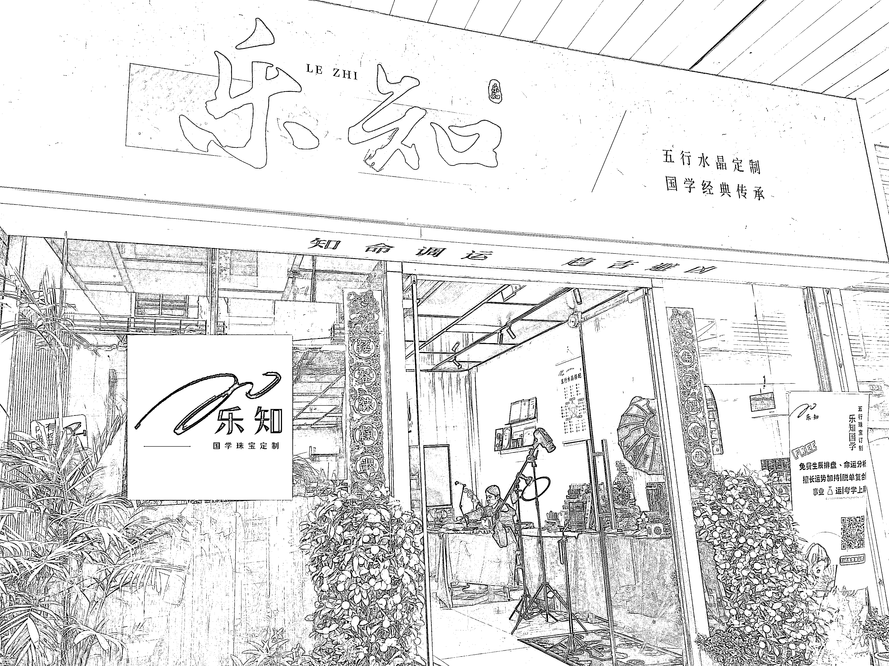
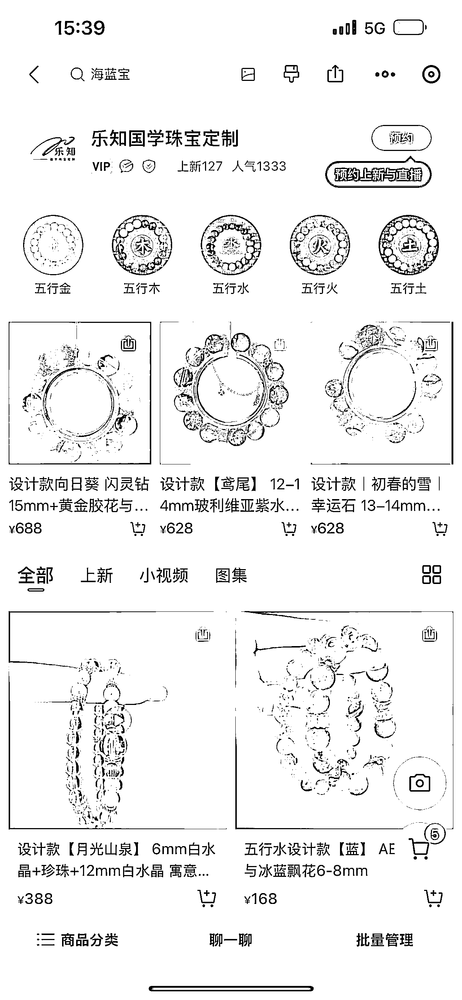
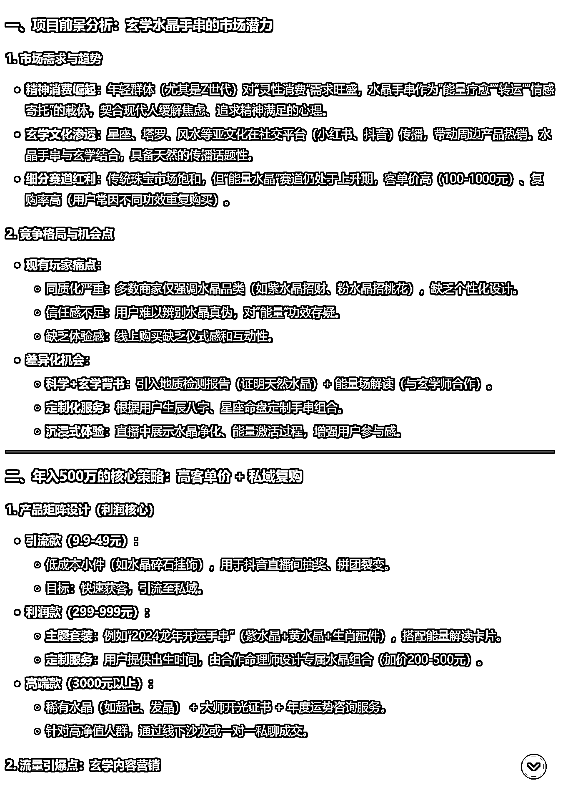
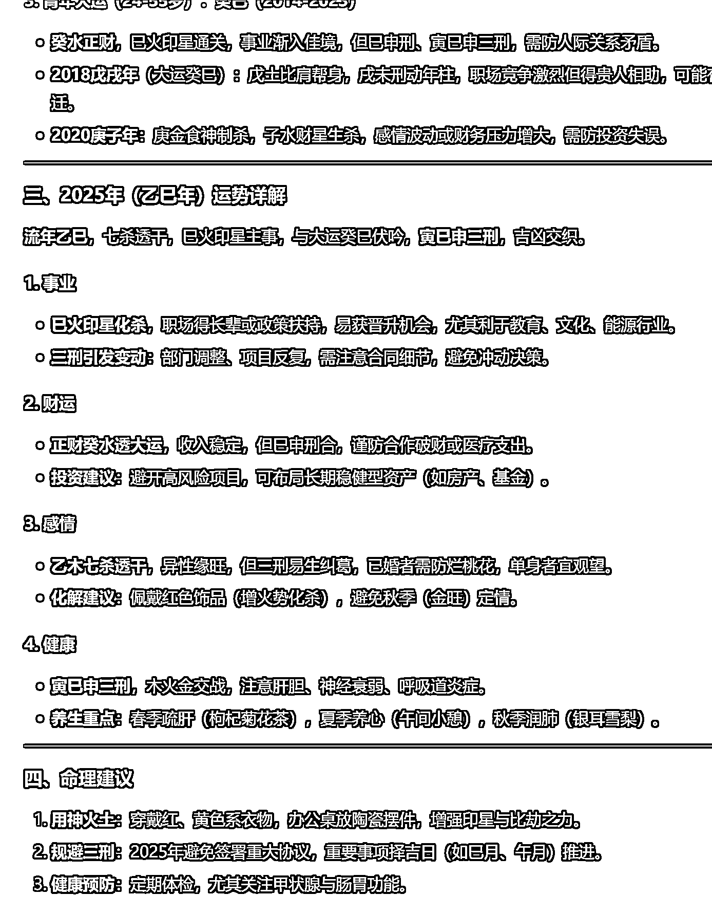

# 用 AI 辅助做玄学水晶生意：一年营收超 200 万，我是这样跑通闭环的

玄学、水晶、国学珠宝，这几年一直有不少关注度。很多人看到赛道火，却不知道该从哪里切入。

我是在去年 3 月正式开始尝试的。经过一年的摸索，目前从获客、转化到交付的整体流程已经基本稳定，也开出了两家线下门店。今天把自己的经历整理出来，和同样对这个方向感兴趣的朋友交流一下。

## 一、从品牌搭建开始，先把商业链路跑通

去年 3 月，我注册了一个新的品牌——乐知国学珠宝。

项目采用的模式比较清晰：

- 通过📕、抖音等平台获取关注；
- 将有兴趣的用户引导至🛰️私域；
- 使用两个新🛰️号负责日常咨询与客户维护；
- 通过水晶、珠宝及相关服务完成成交。

从最初试水，到现在完整运营满一年，累计营收已经超过 200 万元，利润约 80 万元。

珠宝类产品本身拥有较好的利润空间，但真正重要的是，不能只盯着产品销售，还要把内容获客、私域运营、客户信任与复购环节全部串起来。

目前，项目已经从线上拓展到线下，实体店也开了两家。

 images.zsxq.com/FmVaWTDZUsZDcW4AfAea9vp9k-sZ) images.zsxq.com/FofA9M1GmTQPqM56KN7PnyT0eXKz)

## 二、借助 DeepSeek，给创业增加一个“智能助手”

现在，我也在尝试让 DeepSeek 参与到项目中，把它当作创业顾问和命理方向的辅助工具。

一方面，可以借助 AI 梳理商业模式、分析用户需求、优化内容选题；另一方面，也能辅助整理命理相关资料，提高日常沟通和运营效率。

接下来，希望在现有基础上继续扩大规模，争取今年实现千万级营收。

如果你想进一步了解项目的具体做法，可以查看飞书文档：

对玄学水晶、国学珠宝或相关创业方向感兴趣，也可以私信交流。

需要特别注意的是，产品宣传应当遵守平台规则和相关法律法规，不要夸大水晶的功效，更不能把商品包装成确定性的“治病”或“转运”工具。合规表达、真实服务，才是项目能够长期经营的基础。

* * *

评论区：

贾璐 luca：对玄学水晶感兴趣的朋友，可以私信我，或者找鱼丸也能联系到我😊

牛高随笔：这个方向在宣传上可能有合规风险。如果直接声称水晶手链具备转运效果，还是需要谨慎。

FF_23531：我今天选品时正好也注意到了这个赛道[强]

拾一：我在汕尾，距离可塘水晶市场比较近，一直想做这个项目，但还没有找到切入点，方便认识一下姐姐吗[害羞]

贾璐 luca：并不是灰色项目，售卖水晶本身不代表灰黑产，只是做推广时需要避开一些违规词汇。

Gavin：这份素材是我们团队制作的，可以删除吗？

贾璐 luca：好的，抱歉，这张图片已经删除了。之后我们也会尝试自行设计，谢谢你的提醒和灵感🙏

牛高随笔：关键还是要看具体的宣传方式。