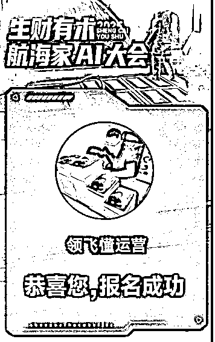

标题：别再埋头“啃”项目了：真正会赚钱的人，都在“卖高手”

你有没有发现一个奇怪的现象？

有人在网上教AI写作，项目小得好像掉地上都没人捡，可偏偏靠它一年赚到上百万。你问他是不是技术特别牛？不一定。他可能连一套像样的Prompt都写不出来，但他依然赚得盆满钵满。

为什么？

因为他玩的是“人性”，不是“技术”。你把人搞懂了，流量、成交、钱，都会跟着来。

我见过太多人，每天像牛马一样死磕项目：学剪辑、学文案、研究算法、养账号……累得半死，最后赚了个零零碎碎。而那些真正赚大钱的人，反而不怎么动手。他们做的事，归纳起来就三个维度——复制、实操、借势。理解透了，你可能就不再想当项目的“牛马”了。

第一个维度：复制，但要复制灵魂

互联网上所有的赚钱方式，本质上都是复制。复制爆款项目、复制热门选题、复制别人的成功路径。但大多数人理解的复制，是照搬照抄，这很low，也突破不了自己。

真正的复制，是隔着一层皮，把别人的“灵魂”拿过来，再注入你自己的东西。我认识一个做AI赚钱的老兄，他干的事很简单：读100篇相关文章，上100套相关课程，加100个相关老师。然后挑一个他觉得最值得学的，模仿、拆解、再升级。复制一个成功后，再复制下一个，慢慢就成了别人眼里的高手。

所以，别总想着从零开始摸石头过河，那是傻，不是努力。找到你信任的平台或大佬，看他反复推荐什么，复制一个，先干起来，比什么都强。

第二个维度：实操，但一定要选“轻”项目

实操一个项目，痛苦吗？非常痛苦。从0到1的阶段，引流、内容、账号、对话、成交、私域、朋友圈……每一个环节都是坑。多数人放弃，不是能力不行，是决心不够，被繁琐磨掉了心气。

但你要注意，不同的项目，环节数量完全不同。有些项目天生就简单：比如短视频切片、短剧推广，核心就两个环节——剪片子、发账号。你需要的只是数量堆起来。而像卖虚拟资料这种，要选题、写内容、运营账号、引流私域、话术成交、还要搞复购，环节多到怀疑人生。

我的判断标准很简单：环节越少，越容易放大；环节越多，越依赖个人能力。如果你想快速赚钱，就选环节少的项目去实操；如果你想打磨长期竞争力，那就接受环节多的挑战。但无论如何，你必须有至少一次从0到1跑通的经验，否则永远纸上谈兵。

第三个维度：借势，让自己更值钱

实操一个项目，终究是拿时间换辛苦钱。你一天写100篇文章，操作50个账号，也不过日入千元。这时候很多人说：学项目不如卖项目。卖一个1980的训练营，成交两单就顶你一个月的苦力。这个觉悟是对的，但还是不够高级。

真正高级的是什么？是“卖高手”。

你要明白一个道理：你为什么要蹭流量？为什么想进高端圈子？为什么想跟名人合影？无非是让自己更值钱。你值钱了，你卖的东西才有溢价。而那些年入百万的项目操盘手，他们的培训成熟、交付成熟、影响力成熟——他们越成功，你越应该高兴，因为你可以直接去“卖他们”。

不用自己交付，不用自己研发，你只需要借他们的势，把他们的课程、服务、项目分销出去。环节少、路径短、见效快。这，就是中介思维的极致——卖人。

有人会问：我不用自己实操吗？当然不是。你至少要实操一遍，才知道交付方的水平和坑在哪。但你的目标不是成为专家，而是成为“连接者”。你通过实操验证了项目靠谱，然后去卖它、卖它的创始人。学项目是为了懂项目，懂项目是为了卖项目，卖项目是为了卖人。一通百通。

最后记住这句话：卖人，也是项目。

感谢你看到这里。我是你的同行者，希望这篇内容能让你从“啃项目”的牛马思维里跳出来，换个角度看待赚钱这件事。我们未必需要亲自做所有事，但一定要懂得让价值流动起来。众人拾柴火焰高，咱们一起。