# 让AI代笔写设计需求，公号封面一次生成两个尺寸
作者：龙哥

先放个成品图，这是AI拿到一篇短文后自动生成的封面：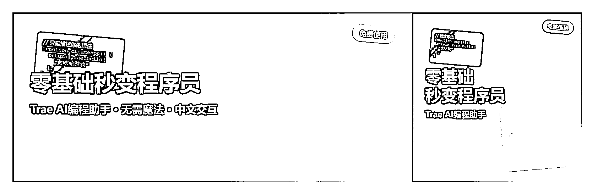

公号更新一年，正文交给AI早就不是事，唯独封面每次发布前都让我头大。AI生图总感觉差点意思，以前犯懒，直接拿文章里的截图凑数，回头看真是拉低档次。

平台对封面很不友好，一个位置要2.35:1的横幅，另一个要1:1的方块。不同入口适配不同比例，硬套一张图，总有一边看着别扭，于是每篇都得做两版。

试过几条路，都不顺：

1. 模板生成网站：要会员，还得自己改字换风格。我又懒又想白嫖，不伺候。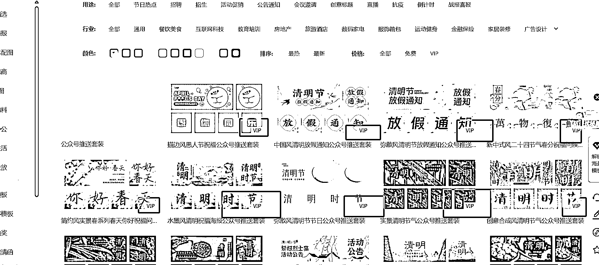

2. 即梦2.1：中文标题能出来，但字偶尔变形或乱码。横幅还好，方图构图总是怪。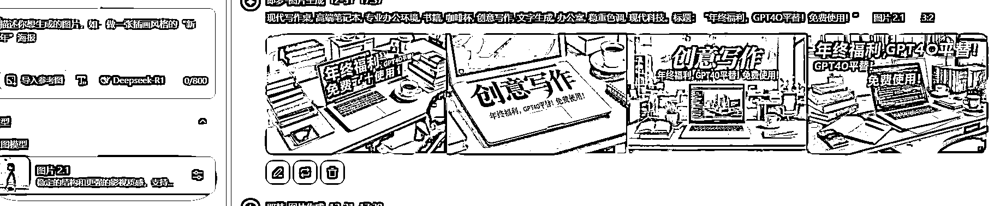

3. 让AI画SVG：能画，但观感太旧，像上世纪网页，审美不符。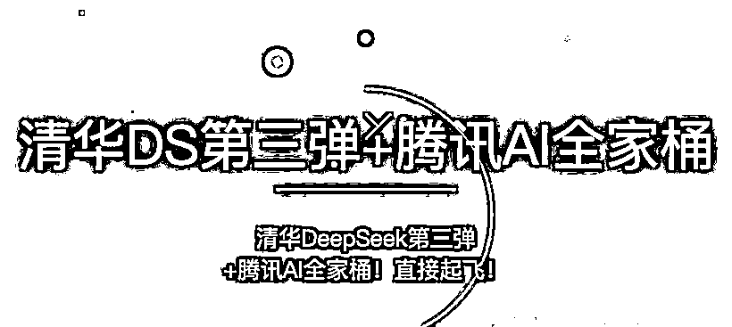

直到Claude 3.7出来，看到很多人玩卡片式海报，我忽然想到：能不能让AI把自己要的设计方案也写出来？于是选了海外版Trae，免费虽然香，但确实比Cursor笨，高峰还得排队。好处是能直接产出HTML页面，省去复制建文件的步骤。

操作很简单，我把一篇文章扔给Claude 3.7，跟它说：请按这段文字生成HTML海报，左边横幅2.35:1，右边方图1:1。它立刻给了一套设计描述。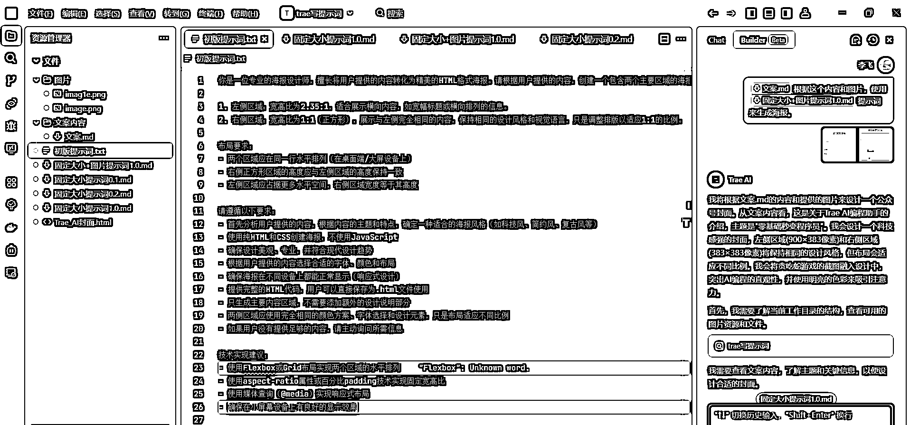

拿那套描述跑出来的图，没法看，我秒删。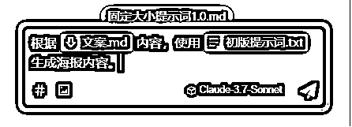

接下来的优化，全靠四步循环：出描述→验效果→清记录→提意见。其中最要紧的是清记录，因为Trae这类工具特别爱翻旧账，可写设计描述时，联想太多反而容易偏。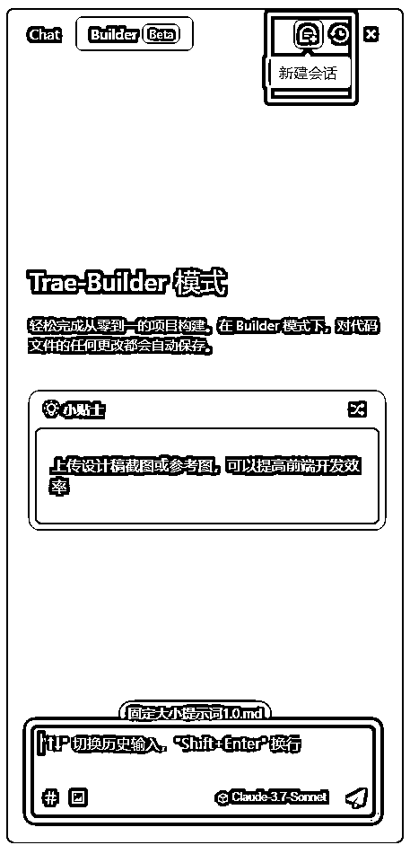

第一次的主要问题，是左右两块没对齐，宽高比也不对。我让它把宽和高都写死，并且存成新文件，免得越改越差，把能用的版本覆盖了。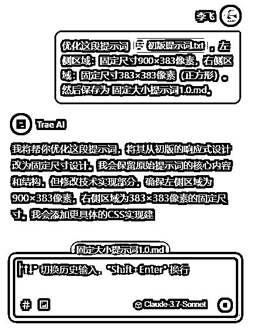

循环几遍后，成品终于能见人：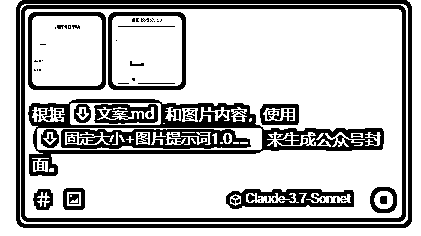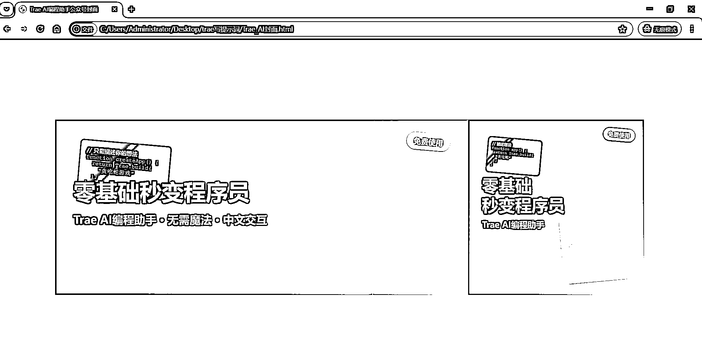

为什么非要把两张图放在同一张大画布上？因为上传封面时，左边裁出横幅，右边裁出方图，一次搞定两个规格。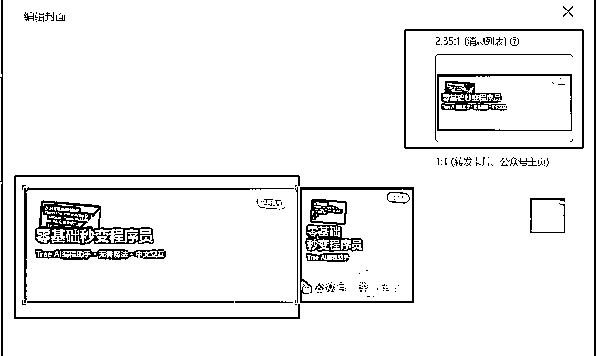 方图的位置在右侧。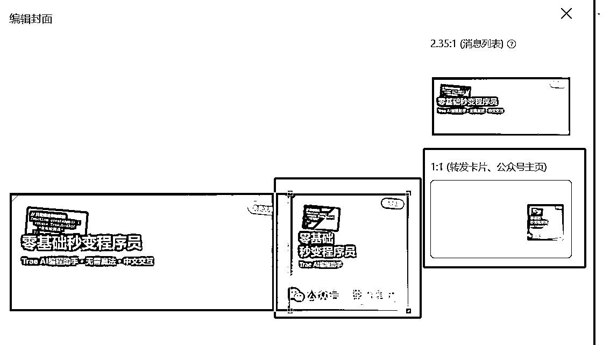

最后是这个跑通的设计描述，我整理成了可复用的文本：

---
请你担任公号封面视觉设计。把用户发来的文字变成HTML格式的封面页。页面分左右两个模块：左侧900×383横版，右侧383×383正方区域。两个模块必须在一条水平线上，外部盒子用flex row，不许换行，总宽至少1283px。左右模块的配色、字体维持统一，排版按比例微调。内容只放大标题、小标题和一张配图，不要段落文字。配图可以适当旋转、添阴影效果、描边、层叠、蒙版渐变，但别影响清晰度。代码仅限HTML+CSS，禁用脚本，不用响应式断点，不依赖aspect-ratio或比例数值。所有宽度和高度都用具体数值。动手之前，先讲一下你的设计想法，再贴完整代码。
---

这个版本用了两天，又有朋友想要一键存图。我加了一段补充需求：在页面底部放一个下载按钮，点击后把左右两个模块合并成一张PNG。实现时可以用现成的canvas截图工具，留意按钮本身不进入导出画面，脚本放在HTML末尾，导出名称用“公号封面”。 下载后的文件长这样：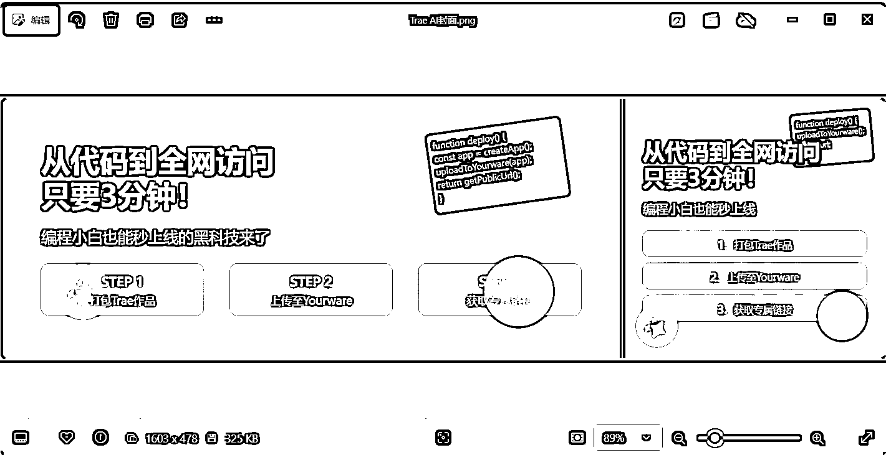

说到底，这段代码本身不是重点，重点是怎么让AI自行生成可用的设计描述。能把需求和问题说清楚，工具就会越用越顺手。哪里写得不够明白，欢迎随时留言。

—— 分享人：李飞 | 2025-03-20