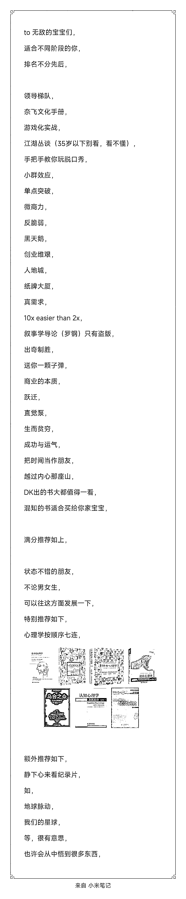

# （播客文字稿）对话涛哥：300 家实体店店主分享，如何在📕有效获客

上个月，我请了赚钱大师兄涛哥录了一期播客，话题是“2025年📕流量与趋势”。涛哥手里握着300多家实体店店主的实战经验，聊完之后我觉得信息量太大，决定把精华整理成文字，分享给同样在📕上找机会的朋友。

### 粉丝数不是护城河，内容匹配度才是

涛哥开篇就抛出一个反常识的判断：📕分发的核心不是粉丝量，而是内容匹配度。哪怕你是一个千粉小号，只要内容精准戳中25-50岁高知女性的痛点，转化完全可能碾压大V。平台甚至更偏爱真实素人的种草笔记，给的权重比技术流账号还高。

这跟抖音完全是两码事。抖音是泛流量逻辑，先把人圈进来再筛选；📕是精准钓鱼，内容直接命中目标人群。随手看一组数据：家居行业在📕的后台画像里，70%是25-50岁女性，而抖音的主力是30-60岁男性。人群不对，视频发再多都白搭。

所以现在入场📕依然划算：成本低、流量准，涛哥判断红利期还有至少半年到9个月。普通人发对比图都能日入四位数，这在抖音没有百万粉根本玩不转。趁着平台还在扶持新号，赶紧布局。

### 📕和抖音，到底该选哪个

如果还在纠结平台，先看你的客群在哪。📕更适合“离钱近”的赛道：美妆、珠宝、家居、本地生活。上面聚集了大量高消费力女性，你写什么内容，刷到的人就是潜在的付费用户。

内容形式上，📕比抖音丰富得多：图文、Live图、短视频都能用。尤其是新手，视频搞不定就老老实实做图文，一个人就能搞定，不需要像抖音那样配主播、编导、剪辑。我的团队带过几千个博主，图文起号的概率是最高的。

涛哥补了一个关键洞察：搜索入口贡献了📕约七成的流量。与其和大号抢推荐位，不如找一个精准的长尾词，比如“广州海琴湾自习室”这类下拉词，竞争小、转化高。甚至“飞机盒”这种冷门词，算法还没覆盖，谁先占住谁就赢。

### 谁适合来📕赚钱，能赚哪些钱

适合的人群很广：大学生、职场人、创业者、本地商家、品牌方都能玩。特别推荐两类：一类是线下服务商，比如推拿馆、中医馆、自习室；另一类是高客单价玩家，比如珠宝、房产。广州有个读书会，单链接在📕卖了6个亿；二线城市的本地生活市场更是空荡荡，成都、武汉、长沙全是机会。

具体变现有四条路径：

- 博主/买手：擅长写笔记拍图就走博主路线，但变现单一；如果能出镜、会表达，升级成买手，笔记、直播、探店都能接，平台还给流量扶持。去年买手大会官方砸下500亿流量，现在入局还是红利期。重点是要会选货盘，家居、美妆、母婴都是主流。

- 电商玩家：品牌型慢慢养号，稳扎稳打；卖货型快速测款，靠自然流+付费跑量。供应链是生死线，80%做不起来的人都是死在这。深圳做珍珠的要跑源头产地，义乌小商品找老板一件代发，把价格和合规都拿下，才算站稳。

- 线索获客：适合高客单价商家、本地服务商、敏感赛道玩家。有个医美机构用素人号种草，导流到🛰️直播，一个月新增客户300多个。线索型业务的命脉是销售跟进，团队跟不上，再多线索都白搭。

- 人设IP：把自己当成品牌来做，吸精准用户主动咨询。需要有真实经历和稳定更新，每周3-5次，数据好起来后，品牌合作自然会来。

### 引流也有门派之分

关于具体引流，我和涛哥聊到了三种打法。第一种是付费投流，这是目前平台主推的方向。单靠自然流想稳定变现越来越难，十篇笔记可能才爆一篇，但自然流和付费流组合起来，每天的收益都能提前算出来。投放成本会随平台商业化不断走高，趁早算清ROI，敢投才有回报。第二种是人设IP，刚才在变现路径里提过，属于长期主义的打法。第三种是低成本引流，个人号直接导流，前期流量不错，但账号很容易被平台风控，生命周期太短，只能当做一个过渡，不是长久之计。

### 新手老板的团队模型：“1+1”就够了

很多实体店老板一想做📕就发怵，怕养不起人。其实一个运营+一个兼职，就能搭起4-8个号的矩阵：运营全职或兼职都可以，一个人带2-3个号，每周更新4篇笔记，每篇耗时2小时；老板每天抽半小时出内容，再有个兼职补位，基本就转起来了。

成本也低：北上广深全职运营底薪6-8k，兼职2-5k就能找到不错的人。关键是流程要SOP化，新人先自己找选题，每周集中过一遍方向，不用天天盯稿。这样1-2天就能摸透一个新赛道。

### 流量的本质：精准获客 + 私域复利

流量这个词，很多人理解成“流动”。涛哥重新定义了一下：流量是“留住”的留。他举个例子：他和朋友同时直播成交1000单，客单价都是298，他卖减肥产品，朋友卖零食日化。朋友卖完就结束了，他却能在私域里反复“洗”用户：减肥客户永远在找解决方案，持续推普拉提、瑜伽、美妆、医美，每一笔都是新增量。这就是客户终身价值（LTV）。

另一个关键词是长尾复利。抖音的流量是脉冲式，发完24小时就衰减；📕的笔记像一家小商铺，几个月后还会被人翻到。钢琴培训的一条线索值五六百，一篇笔记能加10个🛰️，等于白赚五六千。笔记发得越多，关键词占得越密，入口就越齐全。

### 爆款有爆率，也有公式

涛哥说，爆款确实是概率事件，他以自己为例，发80篇笔记才可能出一篇爆款，高手能做到50篇一篇。但爆率可以被选题优化：热点来了就快速跟进，潘展乐火的时候写“潘展乐190”；健身内容别讲专业动作，瞄准“晨跑VS夜跑哪个好”这种新手痛点，封面放对比，正文给30天食谱，流量自然来。

平台喜欢的是稳定输出的创作者。别一开始就纠结赛道，先把量怼上去，日更3-5篇，从2篇慢慢加到5篇。量足够大，平台就会给你流量。标题和正文也要匹配用户心智，“练肩六个黄金动作”不如“林黛玉也能练出直角肩”更吸引小白。

内容生产效率一样重要。现在很多团队开始用AI工具做选题、写脚本，时间成本直接砍掉70%。有了AI的辅助，别人一周发几十篇，你还在吭哧吭哧憋几篇，差距一下就拉开了。学会把一篇内容拆成多种形态：长文、图文、短视频、问答、知识点卡片，一套素材打遍多个场景，这才是高效的做法。

### 品牌投放的新趋势

关于品牌营销，涛哥观察到的一个变化是：大品牌开始分散投放小博主，追求品效合一。但有些品牌内部流程太长，只能继续砸头部，问题是能匹配的头部博主其实不多，钱未必花得值。

更健康的思路是“品牌与用户一起成长”：不要急着直接卖货，先用小样、赠品把用户请进私域，慢慢养熟。用户信任建立之后，复购和转介绍都是水到渠成。种草的价值大于立刻转化，比如减肥和护肤用户，今天买了你的产品，以后还会买普拉提课、健身器材，甚至拉着全家一起买单——这就是长期复利。

### 实体店老板的三个月节奏

如果你经营着线下实体店，可以试试这个节奏：

首月跑通自然流单号模型，靠免费流量先赚到第一笔钱，同时摸清付费流的潜力；次月把自然流和付费流结合起来，上信息流广告，仔细算清每个客户的获客成本；第三个月进入矩阵期，多账号铺开，把行业关键词全部锁死。记住，平台刚开放投放的时候成本最低，越往后越贵，窗口期一定要抓紧。

### 2025年，我押注这四个方向

- 本地生活：二线城市是最好的洼地，成都、武汉、长沙竞争小，广州“酒鬼地图”随便一个下拉词流量就爆棚。想锁住同城流量，账号得上量，至少10个号起步，笔记就是你的海报。

- 高客单价服务：高定珠宝、房产、高端教育，在📕无法直接成交，但线索获客极其精准。一条线索成本五六百，十个咨询就能覆盖成本还有富余。

- 垂直电商：供应链决定成败。没有供应链就先别碰电商，去产地跑两三趟，找到愿意一件代发的源头老板，再挂上店管家自动发货，把直播和源头货结合起来，爆款才有基础。

- IP私域化：美妆和健康赛道客户终身价值最高。第一次卖她减肥药，以后可以推瑜伽、器械、护肤，私域里的资产才是穿越周期的资本。

最后，借用涛哥的一句话：“普通人想穿透圈层，读书几乎是唯一的路；人和人之间的差距，说白了就是信息量的差距。”

今天就聊到这。希望这篇整理稿能帮你在2025年的📕里，找到属于自己的位置。有想法欢迎评论区聊。