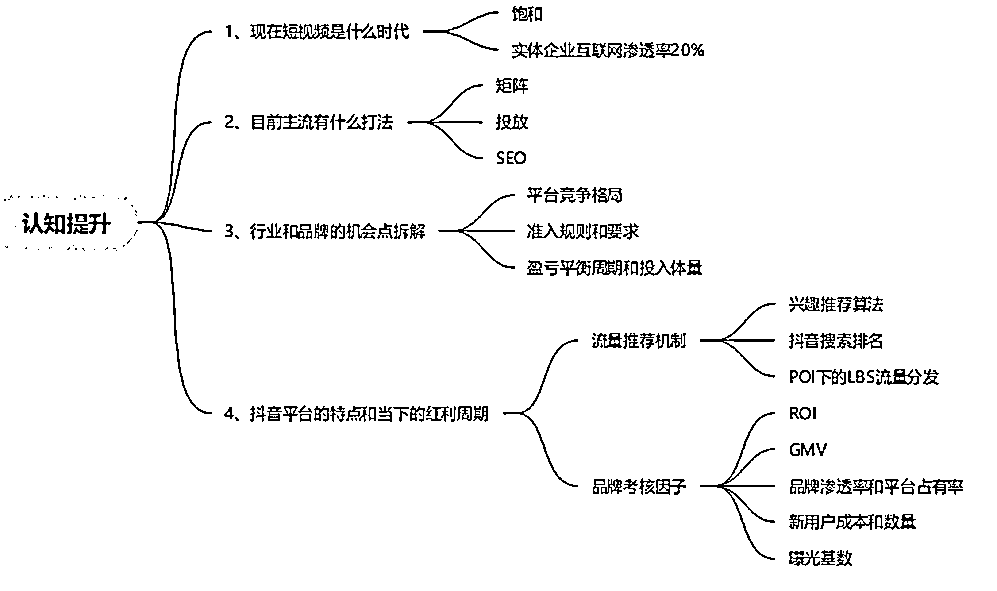
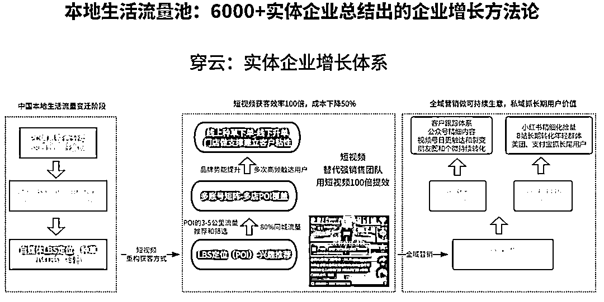

# 实体老板这张自检表，照出来的是你玩不转抖音的真相

实体老板必看的一张图｜搞不定抖音的根源：思维方式的转变

作者： 楚川
日期：2025-03-22

2024 年我画过一张内部沟通图，用来和线下老板对齐认知。想在短视频里做起来，先要把脑子里的几套旧逻辑换掉，否则怎么投钱都是亏。

图里想说透的核心就一句：**短视频已经不是早期捡漏的增量市场了，现在是存量厮杀，必须按平台算法的规则做精细化运营，而不是拿做生意的老经验去套流量。**

**一、先认清赛道：从增量红利到存量博弈**

**市场已经不空了。** 抖音、📕打下来后，实体行业触网比例从 10% 跨过 20%，后期天花板大概在 30%-50% 之间。也就是说，增量玩家越来越少，谁能吃下存量就是谁能活。

**流量口子在变。** 电商流量基本见顶，平台格局锁死。即便看似稳的电商模型，3-6 个月内获客成本必然抬升。所以必须找一条能走 3 年以上的新通道。抖音做本地生活的先发优势在这里：流量被区域化了。你的生意只要有城市属性，就能用 POI+LBS 的分发机制找到差异化切口，效率是原来模式的百倍以上。

**获客越来越贵。** 用户成本只涨不跌，老板们第一反应是“先试试水”。产品、服务、承接没准备好，最后留存直接掉链子。转化后的第一层留存好不好，直接决定公司要不要继续玩短视频，这个坑踩一次就是致命的。

**二、平台脾气要读懂：算法说了算**

平台流量就两条路：推荐和搜索，必须两手抓。

**推荐逻辑变了。** 核心是兴趣推荐大于粉丝订阅。别再盯着账号历史权重，一条内容的完播、互动、分发质量才是王道。考核的是发片量、累计播放、参与分发的账号数，而不是拼一条爆款。

**搜索正在崛起。** 抖音搜索排名已经在重塑用户习惯。短视频 SEO 是新战场，关键词要同时兼顾热点词和行业长尾词的布局。参考拆解：[抖音本地生活搜索流量（SEO）深度运营完整策略：重构商家增长的第二曲线—从算法逻辑到商业闭环](https://articles.zsxq.com/id_r17xnnwmen0o.html)。

**三、做长期生意，别想一夜爆红**

**周期要拉长。** 接受 6-12 个月的盈亏平衡期。品牌渗透和平台占有率是累积来的，不是靠一场直播或一条视频就能带火。GMV 增长要配合 ROI 动态调优，没有固定公式，是一个区间管理，按月、按周复盘，结合品牌战略不断微调。

**矩阵是标配。** 单账号扛不住算法波动。多账号布局，用不同的人群标签覆盖核心关键词，抢占心智。内容形态也要跟平台红利走，比如现在直播权重回升，年中节点宣发，品牌力与内容节奏的匹配，都需要系统思考，不是靠一招鲜。

**四、算账方式要升级：看有效转化，不看虚荣指标**

从看播放量，到看能变现的价值。

我一直强调：**“单一爆品立得住，短视频矩阵铺得开”**。老板更该盯的是 UV 的价值，而不是播放数字。我说过“10 个播放也能成交”，这才符合生意本质。

更要把线下收益算进去。考核不能只看内容质量、投放量这么浅。核心是短视频带来的品牌心智提升、门店自然客流增长、老客复购变化。

举两个真实样本：一个客户抖音直接线索成交增加 200 多万，但因为看了视频主动找上门的成交是这个数字的 7 倍；我投的餐饮店，抖音直接成交占比很难超过 30%，但美团和自然客流在持续上涨，产值是复合增长，无法用单一维度衡量。

归根结底，传统老板要达成一个共识：**短视频是一套算法驱动的系统工程。** 放弃“短期爆量”的幻想，建立内容生产、数据运营、矩阵布局的完整作战体系。对应的组织也要升级：建内容中台，重构 KPI，弱化单一 GMV，强化互动、留存、复购等指标，培养平台化运营思维，才能在存量里持续拿增长。

我是楚川，一线实战派，只讲真话的生意人，做实体行业的增长保姆。