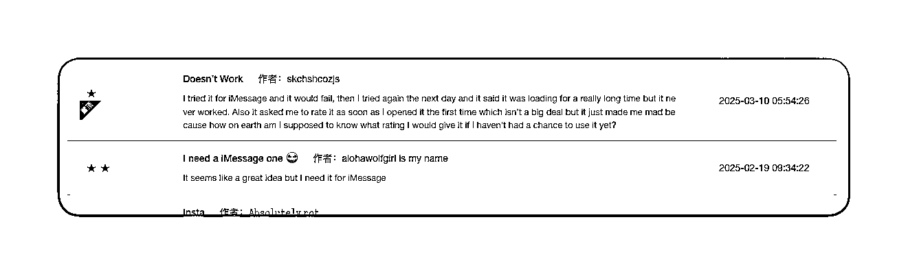
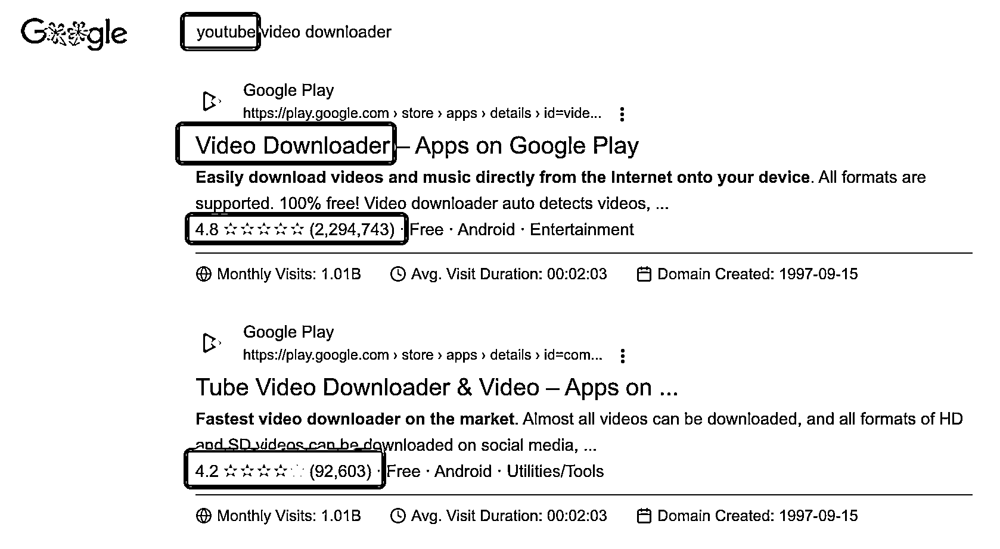
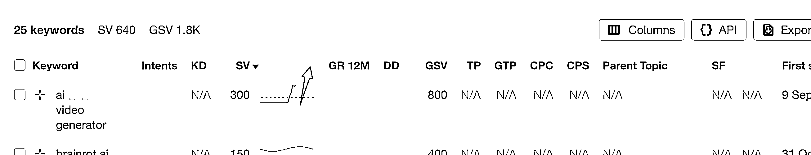

# 别只埋头写代码了！独立开发者想月入万刀，核心就这五步

很多技术人都有个误区：以为产品做出来，钱就会自己跑来。但现实是，能赚钱的软件从来不靠技术多炫，而是靠“用户+营销”玩得明白。这篇文章源自和一位资深出海开发者的深度对谈，全程干货，专门聊怎么用小产品实现稳定月入1万美金。不鸡汤，不吹牛，直接拆解。

## 先问自己：你要的是“产品梦”还是“现金流”？

太多人一开口就是“我有个绝妙想法”。可想法不等于生意。在写第一行代码之前，先逼自己回答三个问题：

- 谁会真金白银为它买单？
- 用户现在用什么东西替代？凭什么换成你的？
- 市场够不够大？是刚需吗？使用频率高吗？

别做那种自己感动自己、却没人掏钱的冷门玩意。想不清楚这些，代码写得再漂亮也是自嗨。

## 选品：别硬刚，找软柿子捏

选品的关键不是凭空发明，而是找到“有人喊疼、但没人好好治”的机会。说白了，优秀同行早就验证过需求，你要做的不是超越他们，而是找到他们的短板。

这里有三条实操路径，大家可以照着抄作业：

### 1. 去评论区听用户骂什么

App Store、Google Play、Product Hunt、Reddit、Toolify 这些平台，全是用户的真实心声。翻竞品的差评，看看大家吐槽最凶的点是什么——那就是你的切入点。另外，重点盯住 Toolify 收入榜上排名 200-500 的 AI 工具，这类产品增长快、竞争还没那么卷，相当适合小团队跟进。榜单地址在这里：[`www.toolify.ai/Best-AI-Tools-revenue`](https://www.toolify.ai/Best-AI-Tools-revenue)

### 2. 抱住大平台的大腿

思路很简单：找到 Top 200 的大平台，看看它们“想做但顾不上做”的需求，你只要补位就行。🛰️不做多开，就有人做多开工具；Notion 不够顺手，就有人做插件；ChatGPT 不自动整理摘要，就有人做摘要助手。顺着平台生态做周边，需求海了去了，而且能长期吃红利。

### 3. 抢新趋势的“SEO 新词”

谷歌上有 70% 的搜索需求，目前还没有好答案。用 Google Trends、Google Ads 关键词规划师、Ahrefs 这类工具，去发现新词、监控趋势。重点看这些词是否对应非通用场景，以及曲线是不是在往上走。AI 换脸一火，就有人做视频换脸工具；GPT 语音克隆需求起来，就有人做克隆 SaaS。提前占坑，就是捡钱。

## 成本：别贪大，先做个能收钱的 MVP

方向定了，别一上来就铺大摊子。最小可行产品（MVP）先上线，能让人掏钱就算胜利。控制好三样成本：服务器、API 费用、你的时间。开发周期尽量压到 1 周到 1 个月。功能只留最核心的，那些用户根本不用的锦上添花，别做。

## 营销：卖出去比做出来更重要

产品上线，只是开始。怎么让目标用户看见你？核心原则是“用户在哪你就去哪”，别守株待兔。

- **冷启动测试**：去 Facebook 群组、Reddit 相关板块、Telegram、Discord 群，找目标用户聊天，先别急着推销，把自己当用户，用干货和教程混脸熟，拿到真实反馈。
- **SEO + 内容**：写用户会搜的问题答案、做 How-To 教程，顺带植入自己的产品；在 Quora、Reddit、知乎上回答相关问题，把流量引回官网。见效慢，但是越早做，越爽。
- **红人合作**：找粉丝 1-5 万的垂直小网红，性价比最高。免费赠送、销售分成、付费推广都行。记住要垂直，别找那种流量大但不精准的，效果好就继续加码。
- **付费广告**：有预算后可以用 Google Ads、Facebook Ads 小成本试水。先投个 <card type="inline" name="math" value="data:%7B%22code%22%3A%2210~%22%2C%22id%22%3A%22toLbC%22%7D">50 美元</card> 看转化，跑通了再加钱。

## 策略：用数据决定要不要梭哈

推出去之后，别凭感觉做决策，盯紧三个数：

- 注册转化率：来了一百个人，几个注册了？超过 5% 就算健康。
- 付费转化率：注册的人里，几个真掏钱了？超过 2% 就值得加码。
- 用户反馈：有没有人主动分享？有没有人骂哪里不好用？

数据OK，就加大推广；不行，就先优化产品，再谈放量。

## 写在最后

别一个人闷头写代码，先验证需求再动手。找软柿子捏，别跟大厂硬碰硬，围绕大平台做周边。快速上线MVP，卖得动是真本事。低成本启动，靠社群、SEO、红人、广告的组合拳。最后看数据说话，卖得动就加注，卖不动就迭代。

记住，世界上最赚钱的软件，不是技术最牛的，而是最懂用户和营销的。独立开发者的出路，不在代码里，在市场和人心之间。月入1万美金没那么遥远，选好品、跑对路、持续干，你也能起飞。🚀