# 跨境出海，第一步迈对才算真的出发

## 跨境电商出海迈对第一步很关键

作者： 跨境杨少

日期：2025-03-18

**近期受邀在央视《开拓者》栏目做分享，围绕中小企业如何出海展开阐述，以下是文字整理版。**

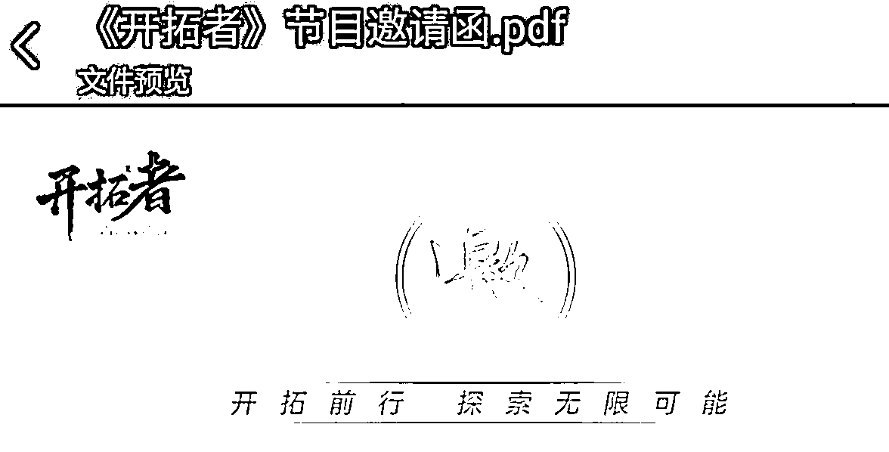

眼下出海的路子看着很多。市场维度有东南亚、欧美、中东、日韩、拉美、俄罗斯等；渠道维度有 TIKTOK、亚马逊、虾皮、temu、mercado、国际站/速卖通、etsy、coupon、乐天、沃尔玛，以及独立站、私聊成交等。面对如此繁多的选项，中小企业和个体卖家该优先押注哪一个、哪个成功概率更高？业内鲜少给出清晰答案，因为**真正靠谱的答案永远是因企业而异、因产品而异**。

现实中常常是，服务商擅长哪一块就推哪一块。做 TIKTOK 的会说这是风口、流量池最大、不做就被淘汰。事实并非如此，并非所有企业和产品都适合从 TIKTOK 起手，很多会陷入事倍功半甚至白忙一场。根源在于没有站在企业本身和产品特性的角度去判断，所以结果参差不齐。

我自己是技术出身，15 年跨境实操背景，曾任全球 TOP3 机器人公司研发工程师，现在也是亚马逊官方领航计划王牌导师。接触过几乎全部主流市场和平台。今年我提出“有效出海”概念，就是希望帮助企业和个体在复杂的市场与平台迷雾中，**先迈出最适合自己的、有效的一步。**

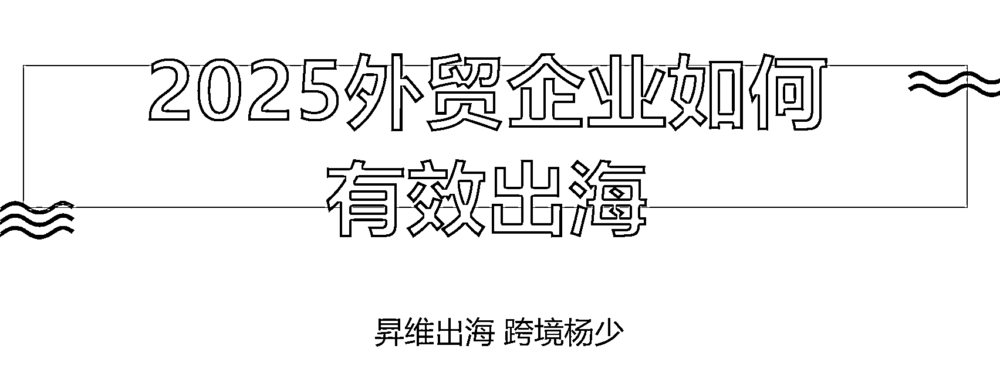

这两年我聊过不少服务商，发现大量企业在做无效出海。拿某巴巴国际站举例，花上几万块大部分人收效甚微。某巴巴也在推独立站出海服务，他们曾拿一份 PDF 方案来请教我，我直接点明这是典型的无效出海：建个站、上几百个 SKU、装几个模块，全是标准化交付。对外贸企业而言，标准化服务大概率等于无效出海。

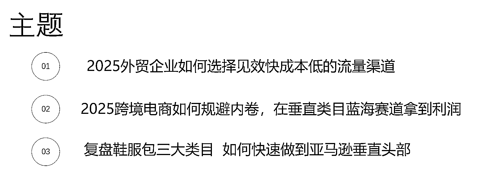

并不存在一套标准方案能打通所有人。出海的第一步之前，其实还有第 0 步被忽略了，就是先做内功：**拆解你的产品和选品逻辑，梳理目标人群画像，研究竞品及其站点或店铺，找出可落地的差异点，如何抬升客单价、避开正面厮杀、提高出单确定性** 。把基础功练扎实，再结合接下来的判断，你自然会明白第一步该选哪个市场、切入哪个品、做何种定位、走多高客单。第一步要找的是对这个产品最容易突破的流量，而不是上来就一窝蜂去做 TikTok 或亚马逊独立站。

流量选定后，下一个问题是如何让产品适应这股流量。接下来我会讲三个实操案例，都是我们团队辅导过的成功案例。

先从流量说起。外贸中小微个体该怎么选流量？有人让你做亚马逊，有人让你做 TikTok，到底听谁的？听自己的。搞懂底层逻辑，自己当家。看完这部分你就能做主。

流量的底层分两类：搜索类和展示类。搜索类就是电商平台/搜索引擎投放，对应的是人找品，客户带着明确需求来找你。

另一种是展示型、推送型广告，比如 TIKTOK、FACEBOOK，可概括为品找人。

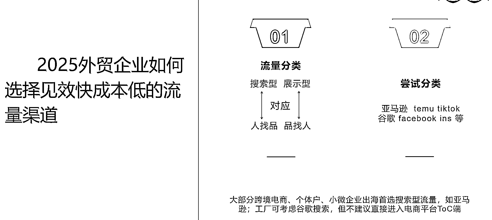

人找品和品找人，哪个转化率更高？转化率就是能立刻下单的概率。毫无疑问，搜索型更高，而且通常更便宜。**所以大部分企业出海的第一步，应优先考虑目标市场的电商平台** 。电商平台里的人本身就是来买东西的，和国内的某宝、某猫逻辑一样，进来就自带购买意图，有天然的转化潜力。做生意最核心的就是确定性，我文章反复讲的也是确定性。

搜索流量有个短板：量就是这么大，想靠投放无限制放大很难。比如做高客单细分垂直，搜索量天生有限，天花板明显，很难做爆款。但对应的利润很高。我们做过很多项目，进价百元级别，利润可达 300 元左右。有人做东南亚小商品，一单赚几块十几块，我一单赚 300，效率更高。

TikTok 这类展示型流量则相反：流量巨大但不精准，像坐电梯时看到的电梯广告，强行推送给你，看不看、买不买由不得你。优点是天花板高，只要预算够就能推给全世界。缺点是不精准，想靠自然流出圈，需要创造世界级的营销事件，比中彩票还难。所以真正把 TikTok 做好的多是付费玩家。通过付费打标签，比如最近 7 天看过鞋相关视频的人群定向，精准度才上来。

简单归类：亚马逊是搜索型，TEMU 是搜索型，TikTok 是展示型。谷歌搜索是搜索型，谷歌 display 是展示型，Facebook、ins 等社交媒体基本都是展示型。现在氛围被带偏了，觉得 TikTok 不做就落后，其实出海第一步未必就该冲 TikTok。

**我相信讲到这里大家能get到核心：出海第一步是企业主动选择流量，而不是被流量选择。**

不管是 ToB 还是 ToC，第一步拿到的应该是搜索型流量。这个结论我认为没人会反对。出海第一步的关键是选流量切入方式，答案是搜索型。

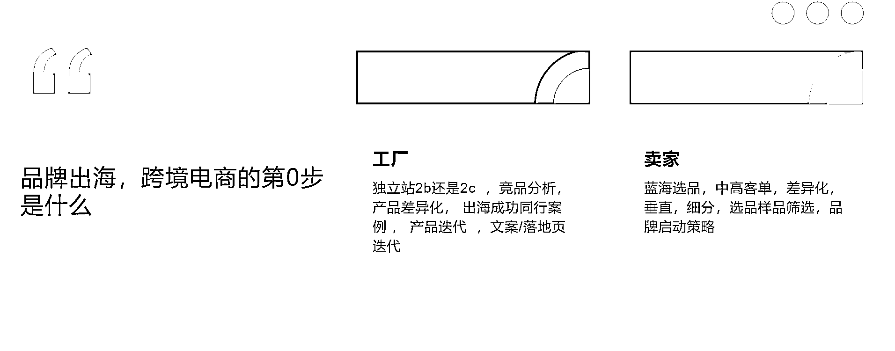

第 0 步是什么？当你决定搜索流量优先时，先回头检视内功。不要急着上架卖货，花 2-3 个月研究选品、竞品、人群、差异化都值得。第一天就追热点铺货的人，90% 三个月后会亏完收场。

ToB 工厂，我们认为最优解是独立站配合谷歌搜索，逐步做 SEO，后期再考虑。ToB 工厂不要去电商平台。电商平台是 ToC 逻辑，ToB 跑去 ToC 卖货是逻辑错位。我见过做小商品的厂家几块钱的东西上亚马逊，一天十单也是白忙，做工业品的跑去亚马逊上架，结果零单。

**第一步走错，就是无效出海。**

当然，部分工厂的高客单产品可以直接面向 ToC，可以做亚马逊/TEMU。如果做独立站，要先明确是 ToB 还是 ToC，两种模式的站结构完全不同，不能套用服务商的标准化建站。

建议这类工厂先把独立站定位为 ToB，暂不考虑 ToC。因为 ToC 独立站目前难度极高，高客单 ToC 完全可以先上亚马逊。

工厂的第 0 步永远是先做产品与竞品分析。如果产品有差异化空间，要思考如何打出特色。同行里一定有出海成功的案例，先拿来拆解。负责任的独立站服务商会和你一起分析，然后做产品迭代、营销策略迭代。无论搜索还是 SEO，有差异化点后，文案、关键词、落地页、详情页、图片等都会更容易做，更容易被搜到、产生询盘。所以**出海的第 0 步一定是内功。先准备一个团队有信心的产品，文末我会分享 3 个成功案例。**

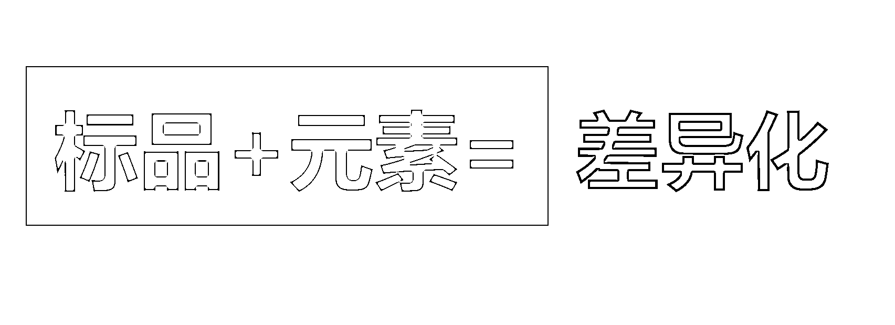

对于个人卖家/纯 ToC 卖家，如果第一步就冲东南亚、冲 TikTok，去卷杂货、爆款、新奇特、几美元到二十美元的带货，第一步就偏了。不是不出单，而是你进入了一个短期被淘汰概率极高的赛道。

运气好踩中爆款，也许能赚第一桶金，但利润薄。迅速布局差异化长线打法，或继续卷下一个爆款，这条路可以走，但很累，红利期短，确定性低，企业规模上去后可能迅速崩盘。这就是我常说的彩票式创业，产品和业务逻辑缺乏长期确定性。

另一种打法是长线、蓝海、垂直、高客单、差异化。公司四五个人，一年营收可能几千万且稳定。两种创业策略各有利弊。年轻人想快速证明自己、赚快钱，可以先卷爆款，但失败概率高，甚至可能倒亏几十万上百万。想要确定性更高、成本可控、节奏不那么焦虑，我更建议走差异化高客单蓝海打法。

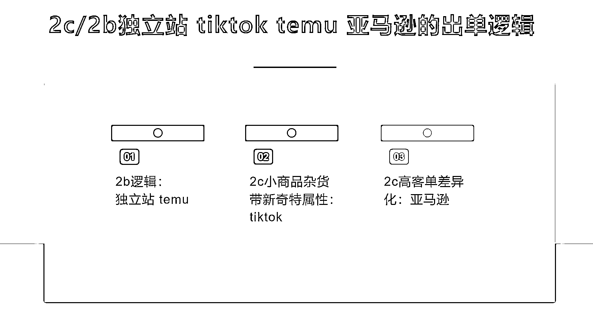

中小微个体做 ToC 跨境，因为不是工厂，选品相对自由。我建议一定要挑差异化产品，客单最好从 100 美元起跳，低于七八十美金不建议做。

每个渠道的出单逻辑不同。独立站过去三年被不发货、不对版的卖家搞坏了，ToC 门槛极高，运营细节极多，我之后会专门展开。目前给一个结论：ToC 独立站先别碰，把它当 ToB 询盘站来做更现实。

TEMU 我认为本质是 ToB 逻辑，**TEMU 完全是 B2B 的变种** ，定价权在平台手上，广告费不用你出，流量多少平台说了算，你几乎无法干预。相当于平台不花钱去采购你的产品，能卖掉给点钱，卖不掉你亏。卖掉了给多少也是平台说了算。

新奇特小商品自带内容属性，TikTok 是合适的。这类杂货不要去亚马逊了，已经卷透没利润，TEMU 也一样，直接上 TikTok，**TikTok 上不比价，看上就买，利润空间有保障** 。

亚马逊现在的出单逻辑是高客单差异化产品特别好卖，这类产品放到 TikTok 未必好卖。泛娱乐人群低客单决策门槛低，高客单需要决策过程，TikTok 上难度较大。而高客单产品在亚马逊被搜索时，往往决策已经完成。

TikTok 适合一二十美金的新奇玩意，在亚马逊竞争激烈，反而在 TikTok 竞争不那么强。火了之后用户不会去比价，当场就买。而平台内用户一定会比价，对低客单产品而言不明智。

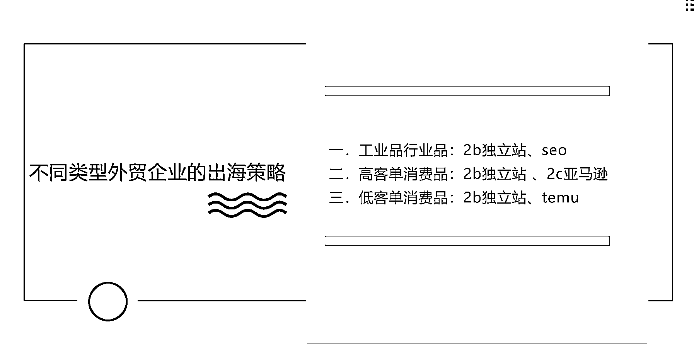

由此，不同类型企业的出海策略可以总结：

**工业品、行业品、大企业，就是 ToB 独立站** ，其他不用考虑，国际站建议 pass。国际站现在要 4 万起步，4 万块建独立站，其中 3.7 万都能用来投放谷歌搜索，一个站几千块就能搭起来，三万多的预算烧给谷歌，不会一个询盘都没有。而 4 万给国际站，询盘未必有，还要额外投广告。国际站流量萎缩，部分市场市占率极低，询盘质量也参差不齐，有人甚至怀疑有机器人询盘。

第二类**高客单消费品工厂**。第 0 步做好后，**首选是 ToC 发达市场亚马逊先卖，人力充足的情况下可同步做 ToB 独立站，甚至 ToC 独立站** 。因为客单足够高，ToC 独立站的营销成本可以承受。

**第三类低客单小商品工厂**，建议老老实实做 ToB，不要做 ToC。想玩 ToC 就玩玩 TikTok。首选 ToB 独立站做全球批发，同时可联系 TEMU 入驻。**TEMU 全托管本质是 B to B** ，不需要你懂运营，工厂在这方面普遍薄弱。但要控制回款风险，很多卖家销量不错，结算时被扣费导致亏损。罚款规则、结算规则都由平台定。TEMU 对小客单低客单消费品是条出海路径，**但要配好看账单的会计和看合同的律师**。

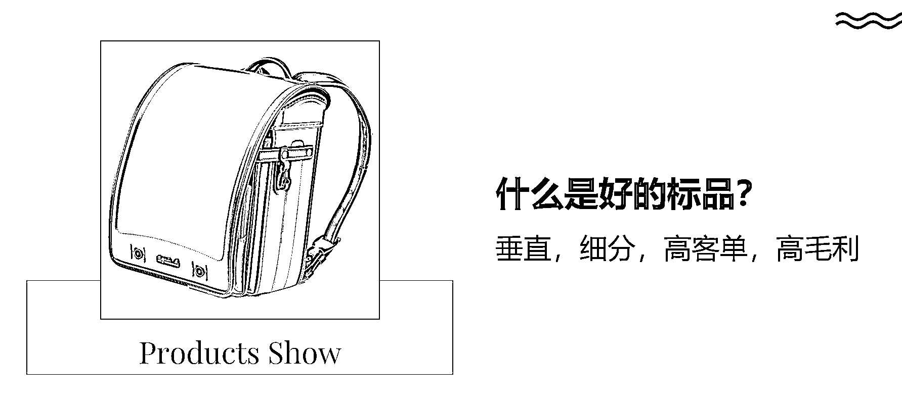

下面讲具体案例，还记得差异化公式吗？

**标品+元素=差异化**

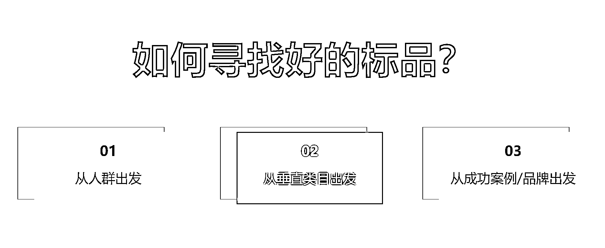

**什么是好标品？很简单，就是要贵。**

上面这个书包在日本卖 1000 多人民币。有学员听课很久了，来找我分析选品，拿出来的还是便宜货。每次都很无奈，你不是工厂没得选，只能卖一种产品吗？干嘛还守在便宜货上？

如何找到贵的标品？分三拨方向。

第一，不要着急上亚马逊铺货跟卖，先花一个月构思产品。90% 的玩法都是教你追热点跟卖铺货，红利期 1-3 个月就被价格战干掉。你作为创业者，可能只是凑了个热闹然后被淘汰。

我们负责任的说法是做高客单差异化选品上亚马逊。上架后一旦赚钱，门槛很高，其他人看不到这个点，**他不是不想跟你竞争，是根本看不到**，他们只爱卷低端货。

我选品时常看到某个细分类目，有几个老鼠屎卖二三十美金，而主流卖百美金以上。基本都是中国卖家。这种客单是中高端产品，发达国家客户不会选二三十美金的，选了差评率也高。

怎么找这类细分类目？**第一个从人群出发** ，你先从自己了解的人群范畴出发，看哪些细分人群买的东西比较贵，便宜的一律 pass。

第二个打开电商平台，平台已给划分好垂直类目，一个个看，挑贵的。

第三个观察市场上已经成功的品牌、独立站、垂类、单品。看到爆单不是去跟卖，而是拆解它基于什么贵的标品，叠加了什么热门元素。差异化公式大家还记得吗？标品加元素等于差异化，要看到它的载体，这也是找标品的好方法。

很多人做跨境电商，第一步就踩进了坑里。追热点、跟卖、铺货，看着热闹，实际上和中彩票没什么区别——你只是碰运气，不是在做生意。

真正值得投入的，是那些有确定性的产品。怎么找？记住一个核心思路：去找高价的标准品，然后给它“嫁接”一个自带流量的元素。

什么叫自带流量的元素？就是那些正在火、已经在热卖榜上证明过自己的东西。把这个元素“拆”下来，装到你的标品上，两个确定性叠加，哪怕这是个全新组合，没人卖过，你去测品的成功率也超过一半，利润能翻三倍起，还没人跟你抢。这种产品，才是真正能带来“睡后收入”的。

如果你一上来就走跟卖、追热点那套，三个月内成为炮灰的概率是九成。因为那是玩票，不是创业。想做企业家，第一步就得走对。

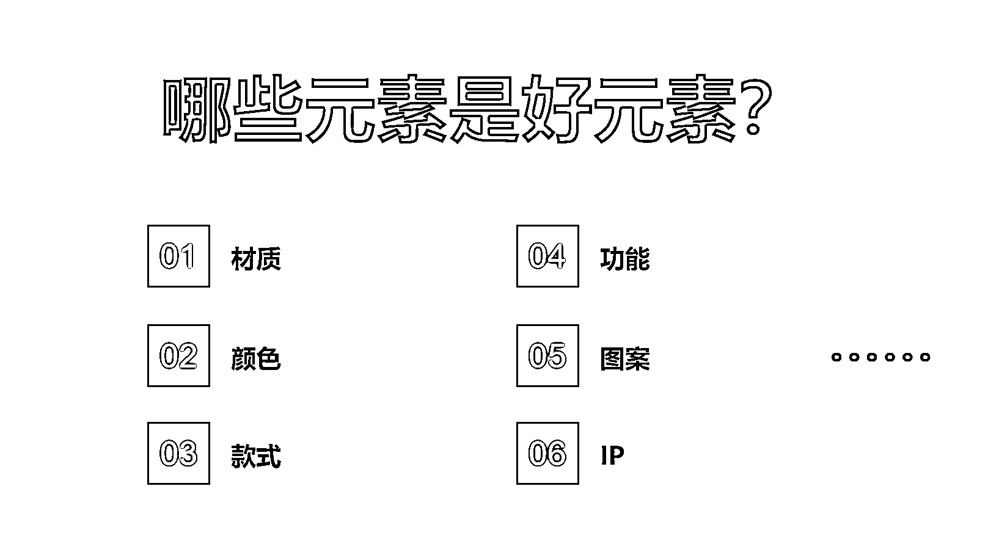

具体来说，哪些元素可以嫁接？

**第一，材质。** 很多标品换个材质，价格就上去了。比如真皮、真丝、皮毛一体，或者高科技户外面料。做日本市场，第一个想到的就是材质差异化。

**第二，颜色。** 你看苹果手机，外观年年差不多，换几个新颜色，就有人买单。3C类目很卷，但有的老板靠“爆款换色”，产品又能再爆一轮。颜色本身就是一种差异化。

**第三，款式微创新。** 这个需要一点小改动，但不用从头设计。

**第四，功能。** 这个我不建议新手碰。功能迭代需要市场调研、研发开模、供应链配合，适合有实力的中大型卖家，属于“痛点迭代”的玩法。

**第五，图案。** 这是人人都能上手的。很多爆款，爆的本质是它身上的图案。把小图案“抠”下来，贴到另一个产品上，大概率也能火。有的团队专门靠这个玩法，几十上百号人天天研究什么图案热度高，然后到处嫁接，一年下来销售额和利润都相当可观。

**第六，IP。** 前提是你得有合法的授权。做得最好的是迪士尼，把自家IP往各种不贵的标品上一放，产品立刻值钱了。

抓住其中任何一个点，做到极致，都是确定性逻辑，不是碰运气。

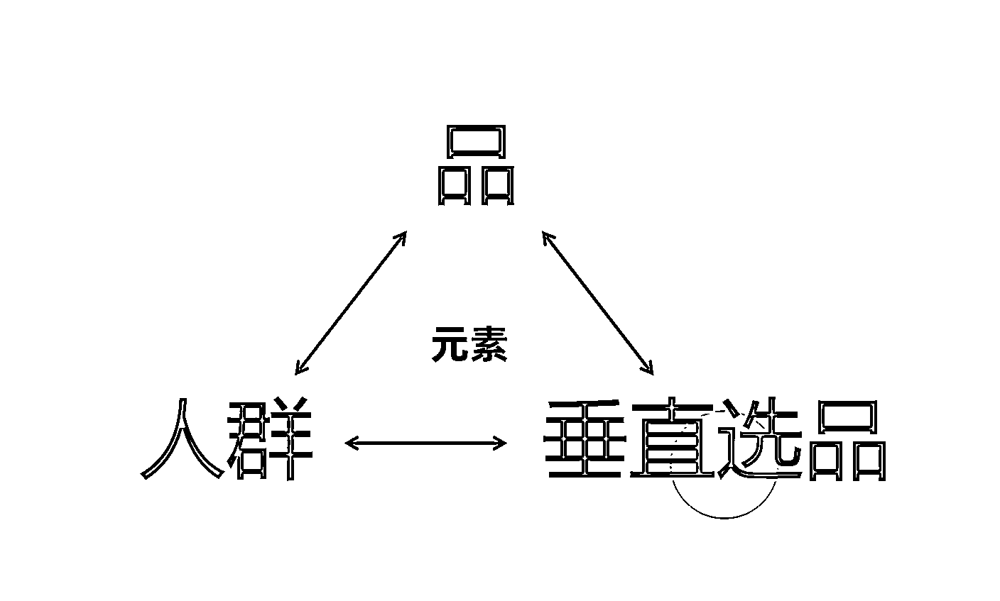

再往深一层，有个“三角形选品模型”。一个单品对应一个人群，这个人群不止需要这一个产品。比如你通过一双鞋切入到“钓鱼佬”这个人群——他们要的东西可多了，衣服、装备、配件…… 顺着这个细分人群，你能找到新品类。发现一件钓鱼服，它也能登山穿，于是你又接触到“登山人群”，他们需要登山杖，一个新的垂直赛道又出现了。这就是选品的三角形迭代，从一个点，撑开一个面。

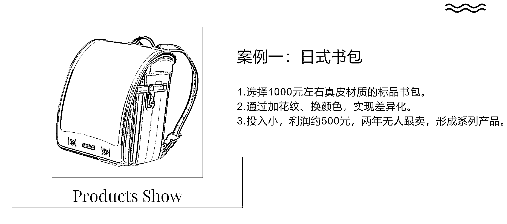

说个我帮工厂操盘的真实案例。这款产品，是他前年做的。

他选了一个1000块钱的标品，真皮材质，单品选得没问题。问题是——怎么快速成为这个类目的头部？跟所有人打价格战？那肯定不行。

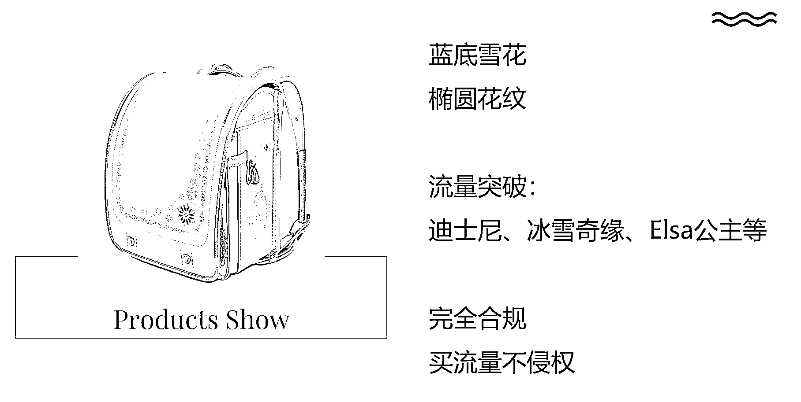

我给他出了个主意：加花纹，换颜色。他执行力也强，两个月就落地了，找了设计师，做了模具。其实不算开模，就是加个花纹而已。我一直建议，控制成本，别乱花钱，尽量做现成的货，别去“创造”货。这只是微创新。

他总投入也就万把块钱，现在这个产品，单件利润能到500左右。两年了，亚马逊上至今没人跟卖。一个小SKU，一年几十个W。后来他用同样的思路，做了好几个不侵权的新主题花纹和配色，基本都成功了。这产品就像一台小印钞机，红利期长得吓人。就算现在公开，别人也模仿不来——市场上根本没有这款货，想做就得自己开模，这本身就是门槛。

它的成功秘密在于：蓝底花纹、椭圆花纹，这个元素自带流量，蹭的是迪士尼《冰雪奇缘》艾莎的流量。但完全合规——没有品牌logo，没有侵权元素，颜色不侵权，雪花也不侵权。投放的时候，还能买竞品品牌词，比如搜“迪士尼书包”，他这产品能打到首页第一位，出单概率自然就高。运营两年，零问题。

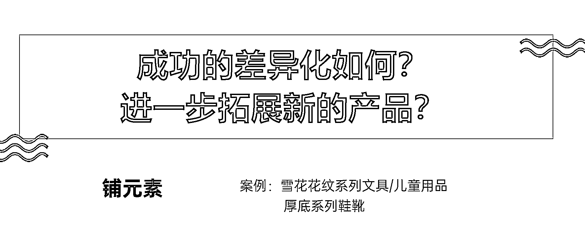

一个爆款做出来之后，不能守着一个吃老本。这个idea可以继续铺到其他高价值的标品上去，不一定只做包，别的类目一样可以复制。

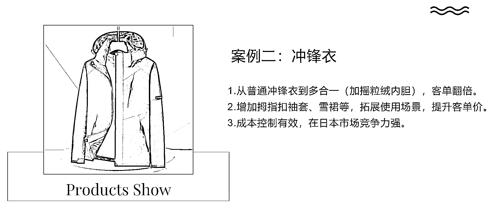

再讲一个服装案例。

冲锋衣是服装出海里的一个大品类，也很卷。亚马逊上有点质感的能卖到30到50美金，20美金的一大堆，TEMU上甚至有9.9美金的烂货。

如果冲锋衣工厂想出海，是不是因为自己是工厂、成本低，就一定能卷赢？这个思路，一开始就错了。

出海第0步，是先做内功。怎么练？我给那家工厂提了两个差异化方案。

第一个方案：不做单件冲锋衣，改做“三合一”——加个摇粒绒内胆。内胆成本20块（人民币），冲锋衣本身的成本100块，防水值透气值都达标，款式也有立体剪裁。原来大家卷的是30美金区间，你加了20块钱成本，就能去卷70美金区间。客单价直接翻倍。

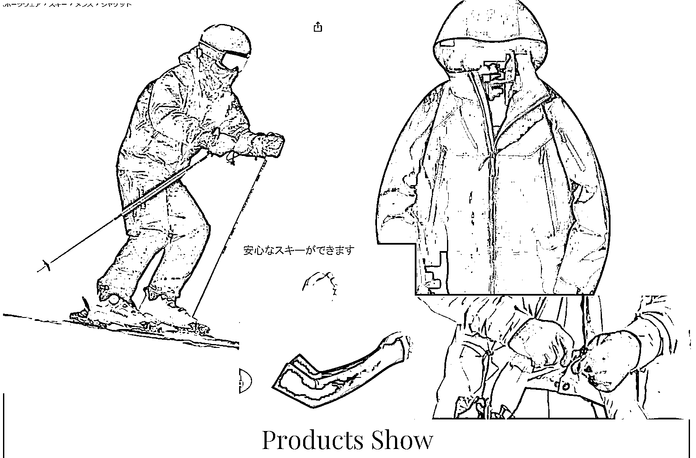

到了70美金，已经接近赢了。接着再做更细分的差异化——把它改造成滑雪服。不用重新开模，在1688采购带拇指扣的袖套，两块钱一副，完美解决滑雪时袖口灌风灌雪的问题。就这么个两块钱的小东西，让产品的使用场景从“户外徒步”扩展到“滑雪”，客单价一下又涨到90美金。正常的雪服出厂成本是它的2.5到3倍，你用三分之一的成本，90美金的价格去卷130美金的细分市场，赢面有多大？

再往下，还可以加个雪裙，缝两块布，加两个扣子，成本几块钱，客单又加10到20美金。

这个产品靠“雪服”这个细分类目快速出单，积累了权重，等雪季过了，再回头卷“三合一冲锋衣”类目，一样有优势。

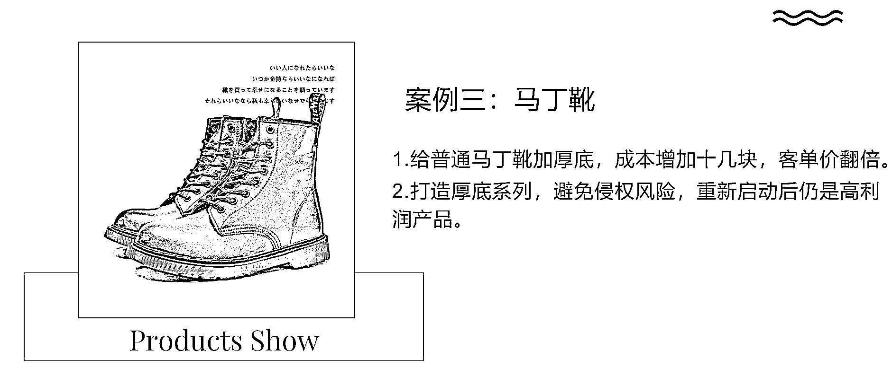

还有个鞋类案例。马丁靴在亚马逊上已经卷到三四千日元了，怎么办？加个厚底，成本就多十几块人民币，客单价直接翻到8000日元。

常规基本款，一律不做。要做的，是7000、8000日元起步的，最好是1万到100美金以上的。工厂可以衍生出一个“厚底系列”——厚底雪地靴、厚底工装靴、厚底大黄靴、厚底登山鞋…… 一个工厂，就能成为一个“厚底垂直品牌”的出海故事。

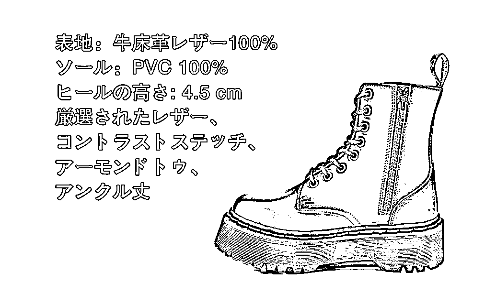

以上所有方法，都源于我自己总结的《选品四层方法论》，一共4层7个点。把这些全部吃透，你做选品和差异化的水平，已经是专业级别。带着这套方法论再去做跨境电商，基本上是无往不利。

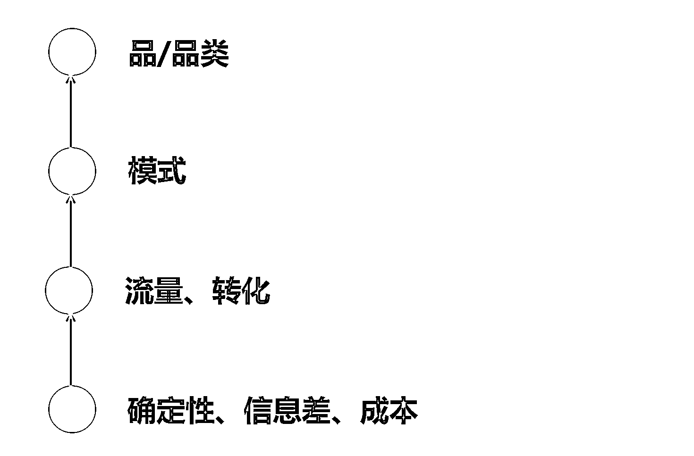

最后再说一遍：跨境电商，不管是工厂还是中小微卖家，出海第0步一定是先思考、先调研、先学习。你要找到真正有逻辑、有闭环、有利润的方向。你要自己确信这个逻辑是对的，而不是因为别人说哪个平台火，就一头扎进去。

赢的确定性，来自你自己的判断。谢谢大家。

* * *

评论区：

Rrrrrrr : 哇这长文真的太有用了，很受教。我还属于想做跨境电商的准备阶段，在看各式各样的跨境心得文，感受到了作者的真诚分享和昂贵经验，太厉害了[强][强][强]

跨境杨少 : 我喜欢唱反调哈哈，给赚钱也唱过，我说赚钱的项目大多强于流量，而弱于产品；强于短线生意，而弱于长线生意，流量是一个人的第一桶金，而差异化产品是一个人的人生复利。没有对错好坏之分，只有个人选择。任何有复利的东西，包括学习，运动，都符合二八法则，甚至一九。

哲学工作室 : 优秀

龙哥 : 写的很好，底层认知，多写。