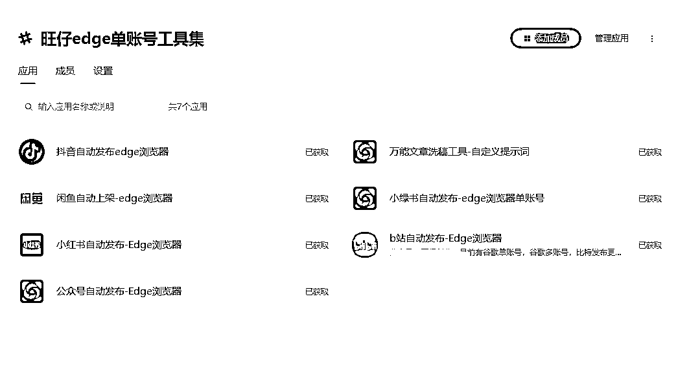
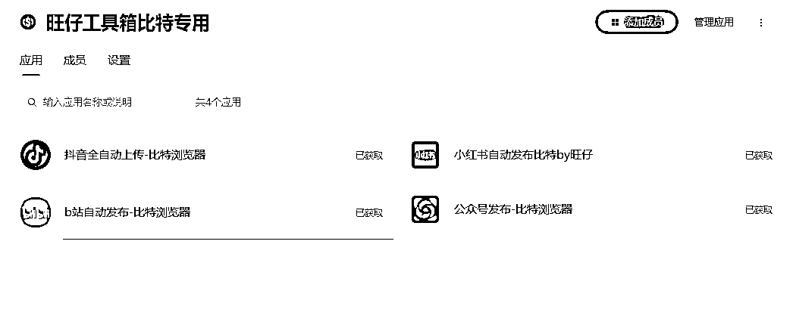
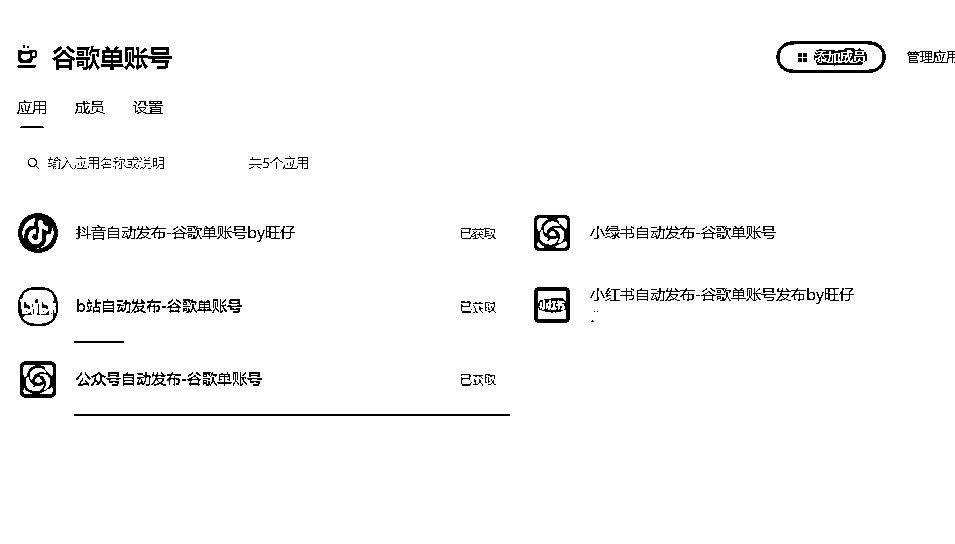
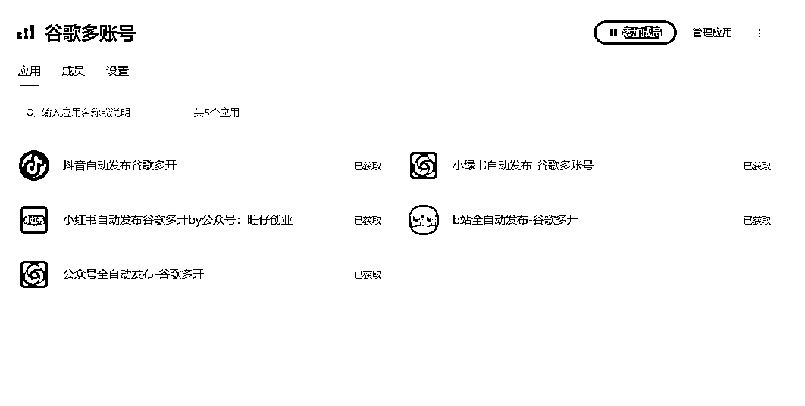

# 我利用影刀制作了一批自动发布工具，在解决了拖延的同时还提高了效率，方法和工具奉上

拖延症有多折磨人，只有同病相怜的人才懂。以前为了改掉这个毛病，我翻过不少文章和资料，但总觉得没找到真正的病根。

直到某天早晨喝茶时，我把手上在跑的项目和每天固定要做的事全部写在纸上理了一遍，突然想到了大学时学过的“泰勒科学管理法”。那一刻，拖延的原因变得清晰起来，我也顺着这个思路配好了解药——用影刀做了一批自动化发布工具。不仅把拖延症解决了，还让工作效率明显提升。

这批工具覆盖了📕、抖音、👸号、B站、小绿书等主流内容平台，闲鱼自动上架也包含在内，同时还准备了一个“万能文章洗稿工具”。针对账号数量不同，我做了四种浏览器适配方案：Edge 用于 1-2 个账号，谷歌浏览器也适配好了，谷歌多账号模式对应 3-5 个账号，比特浏览器模式则面向 5 个账号以上的场景。

整个思考过程、实操方法和工具清单，我都整理进了飞书文档，有需要可以直接看：
https://y9j12wbinr.feishu.cn/docx/Wv4ed7f7XocSlPxWFKccUXFenzb?from=from_copylink

希望这份分享，能帮到和我一样被拖延困扰的朋友。

