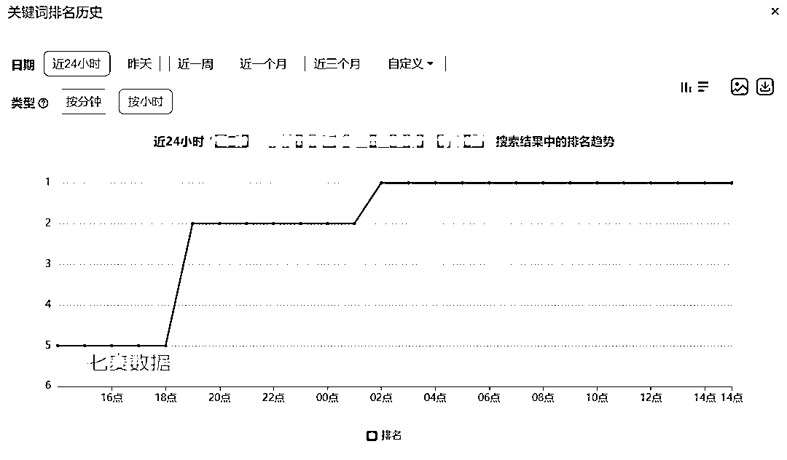
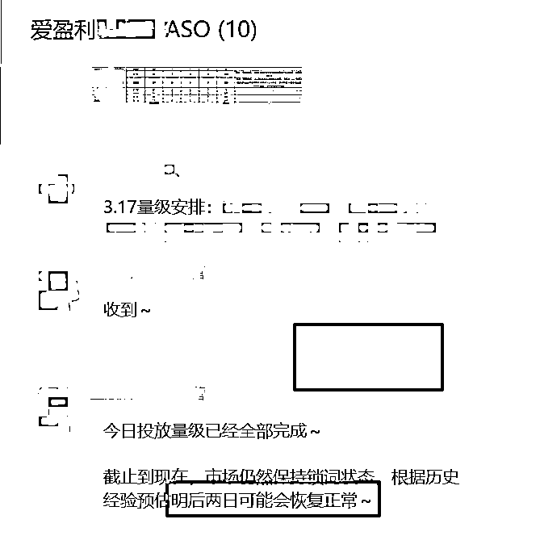
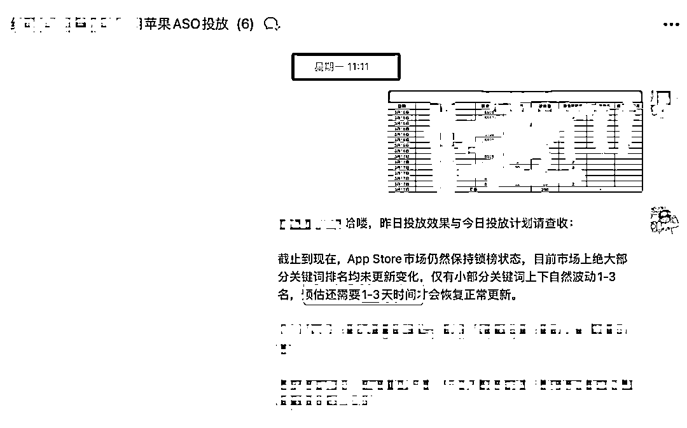
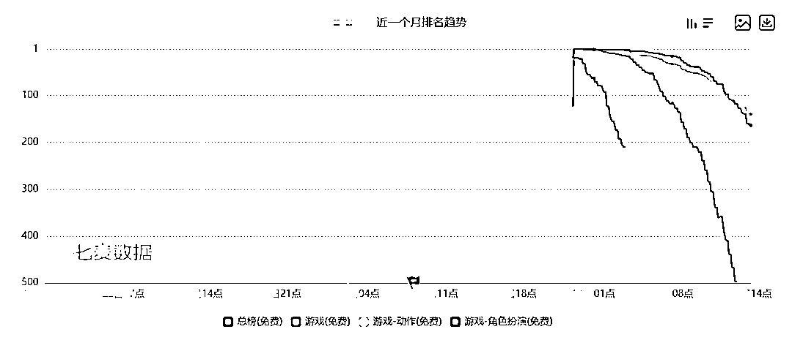

# App Store 关键词锁死，昨天才终于松口

> 原文：[`www.yuque.com/for_lazy/zhoubao/fcxrnezdlvngf2hr`](https://www.yuque.com/for_lazy/zhoubao/fcxrnezdlvngf2hr)

App Store 锁词，指苹果在部分特殊节点，比如新品发布、假期停更等时间段内，让关键词搜索结果进入冻结状态。这一阶段里，榜单和搜索排名基本不刷新，ASO 投放做了也很难立刻看到位次变化，只会在个别 App 下架或更新时出现轻微抖动。

锁词按范围可分为全站冻结和局部冻结，业内普遍判断这与苹果在后台调优搜索排序逻辑有关。

年后接连两次超长锁定期，直接把不少团队的 ASO 节奏打乱，投入产出比明显偏低。时间点集中在两段：

首轮从 **2 月 18 日持续到 2 月 27 日**，整整 10 天；

第二轮从 **3 月 14 日到 3 月 19 日**，长达 6 天。

更麻烦的是，这段时间苹果对账号的反作弊审核明显收紧，很多投放量根本没体现在后台。连续的异常波动，让人嗅到苹果要动大操作。不少关键词操作效果几乎归零，也与账号质量集体下滑脱不开干系。

**直到昨天傍晚开始陆续解封，** 排期好的词才重新有了上升动向。

实战上我们提前研判出解锁窗口，提前布局优化排期，抢先卡位核心词。专业度与耐心在此得到验证。^_

即便处在这种剧烈震荡期，我们仍为多款产品稳住高位，靠的就是对规则的吃透。^_

**连续锁词加严审核，到底在暗示什么？**

是苹果后台上线了 AI 式的反作弊模型？

还是近期冲榜行为太集中，导致大量账号被关联封禁？

无论哪种，行业格局已在悄然变化。

当无效账号批量被剔除后，同样的投放规模，起效账号可能从 200 掉到 20，排名提升自然变得困难。积分墙用户整体依然稳健，但由于市面上大量产品转向低价竞争，需求被稀释，生态承压。所以当下头部的优质真墙，少量就能打出不错的效果。

**接下来怎么打 ASO：** 锁词期间排名不实时，但解锁后效果会集中释放。所以锁榜时段不要停手，保持稳定投放是关键。若后台已具备行为分析能力，数据断层和剧烈波动很容易被标记为异常操作。建议无论是榜单还是关键词，都让曲线更接近自然增长，避免忽高忽低，为后续埋雷。

锁解后可以小范围试探那些平时热度高但少有人做的词。需注意，算法可能已在锁定期内调整，旧打量的数据权重或已被舍弃，投放存在浪费风险。

底盘最好用高质量积分墙用户来托住，真正风浪来时才能扛得住。否则等退潮了才发现裸泳，就晚了。T_T

文末，ASO 问题欢迎交流^_

* * *

评论区：

杰昆豆🦅 : 波波老师，请问最近七麦的关键词指数准不准？有没有滞后？还能否作为 ASO 的关键指标拿来参考？ 另外：sense tower 的关键词还有个

受欢迎度与难度这两个指标， 它们和七麦的搜索指数哪一个更有参考性？ 感谢大佬，期待回复！🌚🌚