# 风口一换就换：从卖 ChatGPT 账号到卖 Manus 账号，流量套利的底层逻辑没变

> 原文：[`www.yuque.com/for_lazy/zhoubao/solwhtcnvugaitbc`](https://www.yuque.com/for_lazy/zhoubao/solwhtcnvugaitbc)

## 白杨 SEO：卖 ChatGPT 账号那批又在卖 Manus 了，简单说说风口需求流量搞钱

作者： 白杨 SEO

日期：2025-03-20

大家好，我是白杨 SEO，一个常年做 SEO 流量实操、全网在研究 AI 搜索优化的人。

最近刷朋友圈，又有人在卖 Manus 账号了。想起两年前 ChatGPT 爆火的时候，朋友圈和群里也是同样的场景：一拨人卖账号、一拨人收邀请码。套路换了个壳，本质还在那儿。所以今天就跟大家聊聊，为什么风口一来总有人能从需求和流量里赚钱。

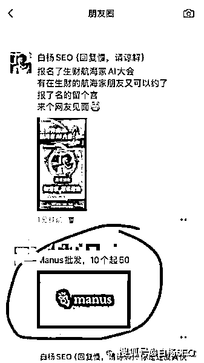

大概聊这几个点：

1、Manus 到底是什么？和 ChatGPT、DeepSeek 有什么联系？
2、Manus 能算风口需求吗？
3、为什么 Manus 账号多在朋友圈、群里这种私域卖？
4、公域流量是什么？怎么把公域流量往私域导？举个例子
5、风口流量凭什么能变现？对我们有什么参考？怎么选？

**Manus 是什么？跟 ChatGPT、DeepSeek 是啥关系？**

Manus 是由国内 AI 初创公司蝴蝶效应在 2025 年 3 月推出的 AI 智能体产品，外宣称是“全球首款通用型智能体”。

它主打的差异化是能自己跑完任务，不用用户一步步盯着，比如简历筛选、数据整理、房产调研这类复合型工作，直接给结果。

我把“Manus 是什么”这个问题也抛给了 DeepSeek、Kimi、百度 AI、豆包，得到的描述各不相同，如图。

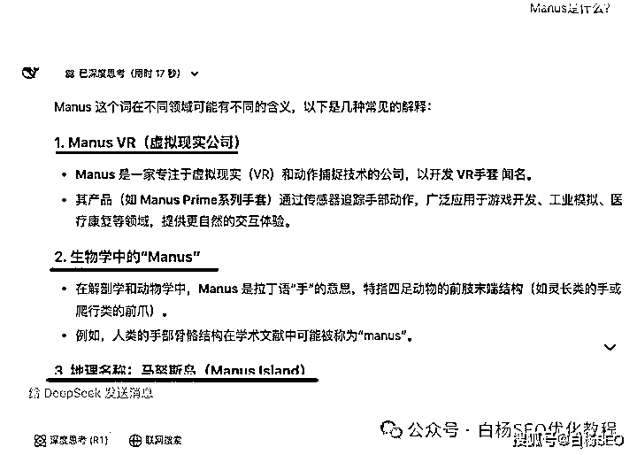

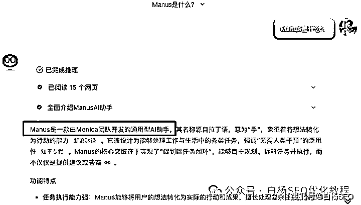

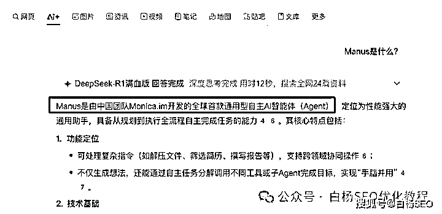

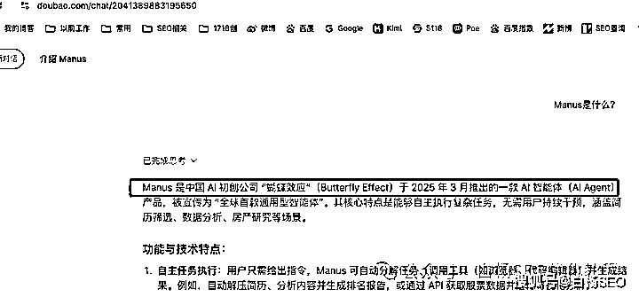

看完你可能会问：为啥 DeepSeek 的回答跟其他家差别这么大？为啥百度用了 DeepSeek R1 还是不一样？我只能说 DeepSeek 和早期的 ChatGPT 一样，会犯错，而且在 Manus 问世之前它的认知边界就是那样。

像百度 AI、腾讯元宝这类平台接入的是 DeepSeek R1 模型，但会和自家模型做融合，所以信息会更实时、速度也更快。见仁见智，有不同看法欢迎补充。

严格来说，Manus 和 ChatGPT、DeepSeek 没有从属关系。前者是 AI Agent 智能体这一类应用，后两者是底层大模型。如果硬要找联系，它们都归到人工智能这个大盘子里。

另外一个现实是，Manus 的实际运行离不开 ChatGPT、DeepSeek 这类大模型的支撑，圈子里常说的“套壳”就是这个意思。

套壳有没有机会？生财的刘小排老师说得很直接：现在套壳赛道机会很大！

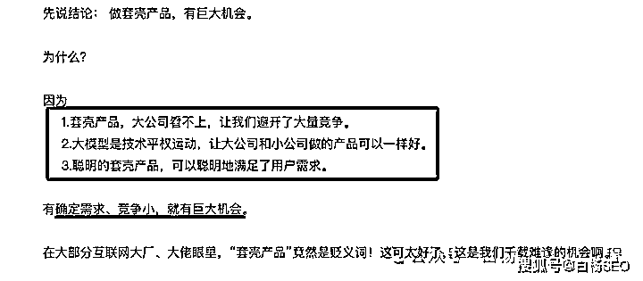

**Manus 算风口需求吗？**

算不算真正的风口我不敢打包票，但 AI 智能体、通用人工智能这个方向的需求肯定是存在的，人类天生就懒。

Manus 被媒体刷屏，核心原因是它第一个高调宣称实现了通用人工智能的能力，跟传统大模型要你一步步提问、只给参考答案不同，它宣传的是直接把活干了、给你结果。

于是就有了邀请码一码难求、被炒到数万的行情。

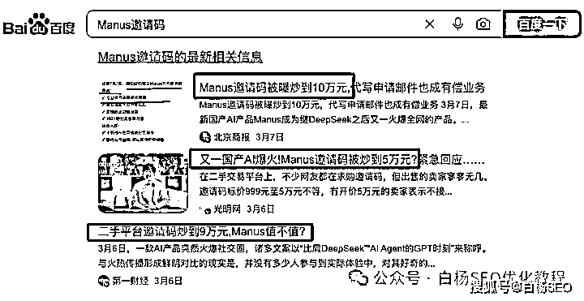

但十来天过去，现在朋友圈里已经有人一百来块一个卖 Manus 账号了。价格断崖式下跌，让人忍不住怀疑：这个需求到底是刚需还是短期尝鲜？你觉得呢？

**为什么 Manus 账号偏爱在朋友圈和群里这种私域卖？**

我看到的只是朋友圈和 AI 相关群在卖，不代表公域没有。实际上公域和电商平台上也在卖，只是更隐蔽，低价同样是用来导流到私域的手段。

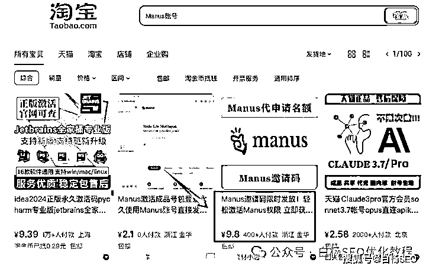

私域成交更好用，主要靠两点：信任感和信息差，有人还会加上售后服务。懂搜索、会对比的人自然会去各平台查一查。

打个比方，你在抖音或视频号直播间看到个心动商品，第一反应是去淘宝、拼多多甚至阿里巴巴比价。而在私域场景里，你通常不会去比价了。这也是现在私域直播的变现效率往往高于公域直播的原因。

至于售后，私域确实能做得更细，但这背后依然取决于客单价和复购。顾客是上帝的前提是他持续掏钱，而不是每次只花 9.9 元。

**公域流量是什么？怎么导到私域？举例说明**

公域流量就是谁都能搜到的流量，比如微信搜一搜、百度搜索、知乎、小红书的公开内容流量，我在公众号里写过很多次了。

把公域流量转到私域无非两条路：

一种是输出干货、建立专业信任，让感兴趣的人主动加你，我属于这种玩法；
另一种是用直播或低价引流品把人先拉进来，比如 9.9 元的课程、资料包。

举个例子，ChatGPT、AI 绘画爆发时，学会的人很多都用一个超低价甚至公益的名义做培训，把公域里的人沉淀到自己的微信群、私域里，这就是典型的公域转私域。

沉淀到私域有什么用？比如现在公众号流量主、别的平台的变现项目都可以结合 AI。如果你之前已经用低价建立了信任，后面只要朋友圈发一条“我靠 AI 在某平台赚到钱了”，就会有人主动来报名。对公域转私域的详细拆解，我之前写过：《白杨 SEO：公域如何引到私域？让流量变客户！》

**风口流量为什么能赚钱？对我们有什么启发？怎么选？**

因为风口本身就是流量，而流量不管是精准还是泛流量，不管是公域还是私域，都能变现。

比如泛流量，公众号的推荐流量、短视频的热点流量，都能靠流量主分成赚钱。

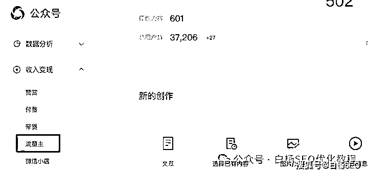

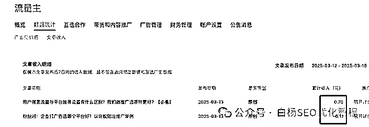

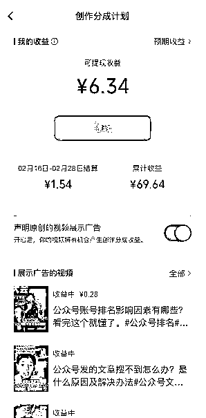

我公众号和视频号偶尔蹭热点分析，推荐流量不算多，广告收入也有限。白杨 SEO 能坚持周更原创七年，主要靠企业流量顾问和朋友项目分成，而不是单纯靠广告。

泛流量只要体量够大，单篇文章收入几百上千很正常，账号矩阵起来后收益更可观。

再说精准搜索流量。如果你做 AIGC 相关，并且懂 SEO、新媒体 SEO，来的用户天然对 AI 有需求，就像来我这儿的人都是对搜索流量感兴趣一样，你完全可以提供对应的服务和产品收费。

对我们有什么启发？

我觉得短期可以借风口，长期必须靠自己的赛道深耕，两者不矛盾。风口可以赚快钱，但风口是暂时的，坚持自己擅长的领域才是长期的事。

比如 AI 搜索优化 AIO，现在看起来像风口，我却觉得它会是继传统 SEO 之后的又一个能做很久的方向，所以我才愿意花时间系统研究它在不同行业的落地。

最后给一个务实的建议：如果手上暂时没有自己的产品或服务，资金也不多，但你有获取流量的能力，可以先做代卖别人的产品服务，等自己攒够经验和资源，再推出自己的产品，这条路更稳。

看完有什么想法，欢迎留言聊聊。

**作者介绍：**

白杨 SEO，专注 SEO 研究十年+，全网 SEO 流量实战派，ai 搜索优化研究者。前某公司市场总监，现自由职业，企业营销顾问。

* * *

评论区：

暂无评论