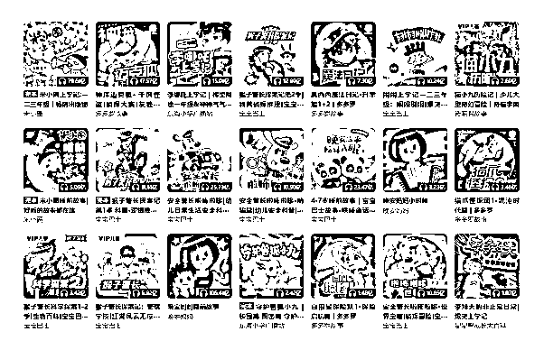
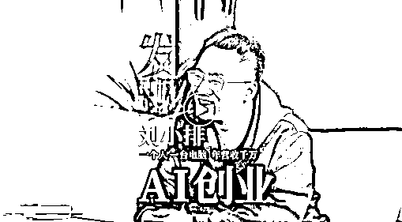
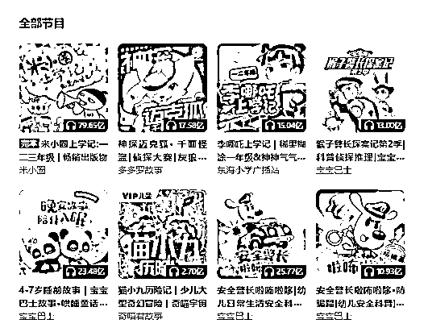

# 只需一套 Ai 创作技能，即可做家躺平（我用一年时间找 AI 方向的过程）

一年试错后，我发现一条靠人工智能宅家谋生的路

各位朋友，我是龙哥，一个总爱琢磨新玩意的老互联网人。过去十二个月，我把大部分精力都放在寻找“人工智能到底怎么搞钱”这件事上。现在把亲身体会整理出来，也许能帮你节省一些时间。

先讲三个让我彻底改变心态的片段。

第一个跟电影有关。《哪吒之魔童闹海》的导演饺子，原本是个无名小卒，靠脑洞和不懈死磕，硬生生让动画电影冲进全球票房前十。为什么动画能做到？因为它不依赖明星和实景，想法有多大，画面就能飞多远。这件事让我明白，平凡人最强的筹码是自己的想象力。

第二个是深度求索的创始人梁文锋。他出身寻常，把技术和对市场的理解结合在一起，做出了令许多巨头侧目的产品。别人不是没钱，而是没把力气往对的方向使。

第三个是王兴兴。他让一群四足机械在春晚开场亮相。他曾被看作“怪学生”，内向、英语差、严重偏科，甚至想过辍学。能有今天，靠的是一头扎进技术的狠劲。他还说，要不了几年，四足机械和人形机械就会像汽车一样走进千家万户。

这三个人的共同点：没家世，没靠山，一个靠想象力，一个靠智能技术，另一个把研发做到极致。他们让大众尝到甜头，大众也把他们推上了高位。

以前我在职场里常觉得憋屈。身边拼的是资源、关系、背景，没背景的人再使劲也容易被压住。为了好学校挤破头、报不完的班、比不完的家长群，像一座座山。后来我想通了，真正让孩子走远的，不是死记硬背，而是三样东西：会想、会处、会干。这三点，比一叠证书更能决定人生走向。

我有个表妹，学习拔尖，后来做了医生，嫁到几百公里外。每次我去看姨父姨母，两人守着空荡荡的屋子。我学历一般，但现在每周都能带孩子回爸妈家吃饭。哪种人生更划算，没法算清楚，但我不再因为没“鸡娃”而焦虑了。

有个道理，年纪大了才体会深：规则更多是给没有资本的人设的。你想享受规则外的从容，就得在一个领域磨到顶尖。怎么磨？对平凡人来说，把创造力和某项硬技能练到极致，是少数可行的路。

下面说回人工智能。

这一年，我看到无数“人工智能带你赚钱”的广告，大多数只是在制造紧张感。我也花钱约过几位“大咖”，聊完发现，他们真正在做的其实是卖课。每一轮风口起来，最先吃饱的是卖工具和卖课的人。

要我说，人工智能跟当年的抖音有点像，但底子不同。抖音是把信息传出去，是放大器；人工智能是把活儿干得更快，是加速器。如果你用加速器去做放大器该做的事，也就是用人工智能产出内容、再用抖音传播出去，那就等于同时踩上两股风。

顺着这个思路，赛道能分成两派。

一派主打提效：日常办公、市场推广、内容产出、客户答复、标准流程，都能靠它提速。
另一派主打智能：软件、硬件、家电、科技新品，甚至日常工具都开始自我迭代。

现在市面上的课程，八成以上教的是提效。而智能派掌握底层技术，提效派负责把这些技术送到寻常百姓手里。论头部价值，智能派显然是上游。前阵子股市里凡是沾智能概念的公司都涨得厉害，一只四足机械背后，有多少零件厂一起分蛋糕。可以预见，三五年内，智能硬件会像家用车一样普及。

不过我不想挤智能派。我更愿意看热闹，看各路人马打价格战，受益的是我们这些普通消费者。真想参与，可以用行情软件搜一搜对应的概念股。

我真正押上全部精力的，是提效派里的内容创作。

给你看个实例。

人工智能把内容生产的门槛砸得很低。这个效果够惊人吧？如果你能让人工智能帮你批量造出给孩子讲的小故事，会怎样？我家有两个娃，光听故事软件就充了好几次值。很多父母都乐意给孩子的内容掏钱。

但我要说的不是写爆文赚打赏，而是两个字：产权。产权，产权。写👸号、发头条、接代写，都是“做一单收一单”的即时钱；手里握着作品的著作权，却能源源不断带来授权费和改编可能。这才是内容赛道最值钱的地方。

具体做法不难：让AI当你的写作助手，大批量产出系列小故事；再用绘图模型、语音合成、动画生成和剪辑工具，把这些故事做成图画册、有声书、短视频。到这一步，一个草根就可以长期运转的闭环就出现了。

这套玩法的上限很高，例子就是那位动画导演。他靠一支笔改写了自己的命运。我们未必能到那个高度，但至少能让AI帮我们把脑中的故事变成作品。就算只先做一批音频故事，只要你握着著作权，平台和买家就有可能主动找过来。

关于这行怎么赚钱，我还想提一个人。

上面那段内容我看了很多遍。不少头部博主喜欢把简单事讲复杂，绕来绕去还是卖课。这位老师不一样，他会指明一个具体方向，比如用人工智能写代码。有了方向，你就可以自己往下挖信息。先相信一个切入口，再顺着它读上几百篇相关内容，路自然就清楚了。要是还卡着，花上万把块买一次高手的咨询，也比一个人瞎试强。

写代码这件事，核心还是想法。会写程序的人多得很，人工智能只是提速，真正的价值在于看出别人的麻烦并帮他们消除。对多数素人，人工智能最有用的地方，不是学底层算法，而是把心里的念头快速变成作品。一个遥远的梦，以前只能想想，现在可以让人工智能帮你写成书、画成画、剪成片。其中最容易上手的，就是文字创作。文字创作的上游，是产权。

起步阶段可以先玩“仿写”。你给AI一句指令：“参照某本图画书的语感，编一个情节完全不同的故事。”多玩几次，就会练出三类能力：写指令的能力、把文字转成图的能力、把图文拼成视频的能力。一天攒出好几本图画册，并不夸张。

这会冲击传统写作者，但也让没资源的人能用几乎为零的成本，做出一本真正属于自己的书。我甚至冒出个念头：把我和AI合作完成的作品全部登记署名，挂满书房一面墙。孩子看见爸爸的想象力变成实物，那种带头示范的作用，比很多说教都有效。

再往前走，我还能把仿写图画书的整套指令打包成一套公开出售的小工具。做短视频副业的人，也就多了一个能变现的组件。

这些当然都是小把戏。小把戏能解决吃饭问题，值得认真对待；但真正的大事业，是在无数遍仿写中找到自己的手感，最后原创出一批长篇IP，成为一代人的童年记忆。

说到底，内容创作遇见人工智能之后，最该追的不是流量，是产权。写下你真心想写的那个故事吧，哪怕它荒诞不经。人工智能会帮它落地，变成一本有模有样的书。地球上总有人喜欢你笔下的世界，只要有读者，你的创作就活了。

当一件想象中的事真的成了作品，你会越走越有底气，粉丝、收益、成就感都会慢慢聚过来。

我的这一路，是从迷茫、压抑、不知所措，到终于找到方向。如果你也正在人工智能的岔路口犹豫，希望这篇文章能当一块铺路石。

以上是本篇全部内容。