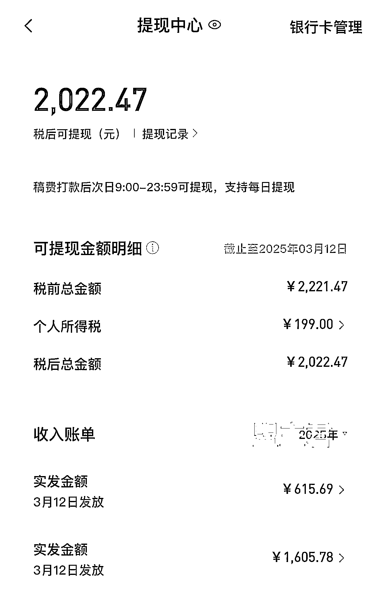
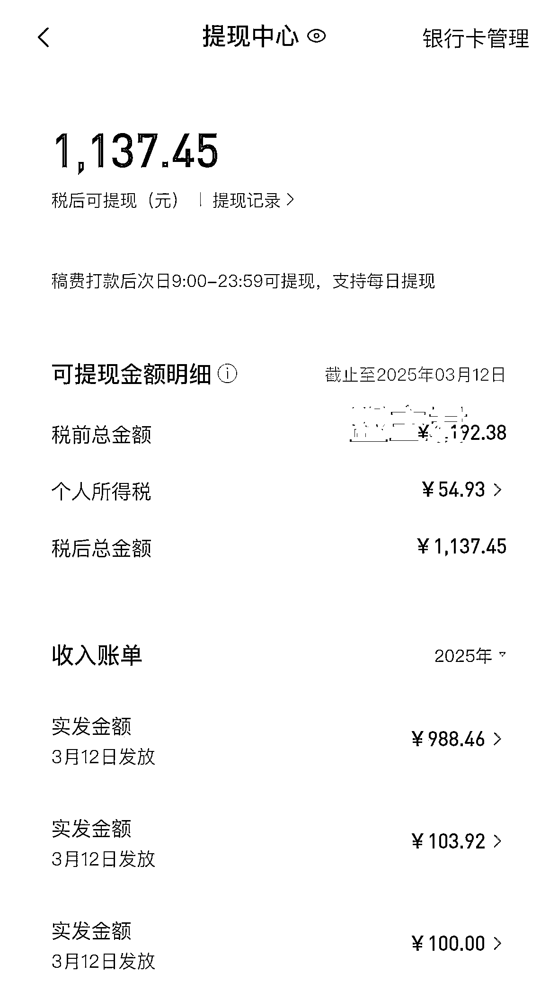

# 用 AI 慢慢积累财富，学会 AI 文案写作就能占据上风

## 与我一起用 AI  quietly 致富，掌握 AI 写作的你就是第一梯队

作者：盟主君

日期：2025-03-13

哈喽各位，我是盟主君，一名 90 后创业者，靠 AI 变现已经突破 100 万+。

今天又来跟大家同步一个好消息。

手上运营的三个号，目前收益都已进入平稳期。受 2 月开年事务繁忙影响，这个月的内容更新量大概只有平时的三分之一。但长尾效应的表现非常可观，上个月拿到的大部分稿费，竟然都来自几个月前发布的小说类稿件。

市面上不少人都提到，我在用 AI 学习写作、剪辑视频、做自媒体。可学到最后却难见回报，让人容易怀疑。

明明都在同一起跑线，为什么你始终起不来，真的只是缺一份坚持吗？

下面这期内容就带你看看差距到底在哪。

[`rcn71rsvb3w5.feishu.cn/wiki/Pu37wH4TMiCJ21kJgSFcFXeXnnd?from=from_copylink`](https://rcn71rsvb3w5.feishu.cn/wiki/Pu37wH4TMiCJ21kJgSFcFXeXnnd?from=from_copylink)

* * *

评论区：

testcase : 最后那个链接没打开权限看不了哦

十二 : 大佬，这是什么软件后台