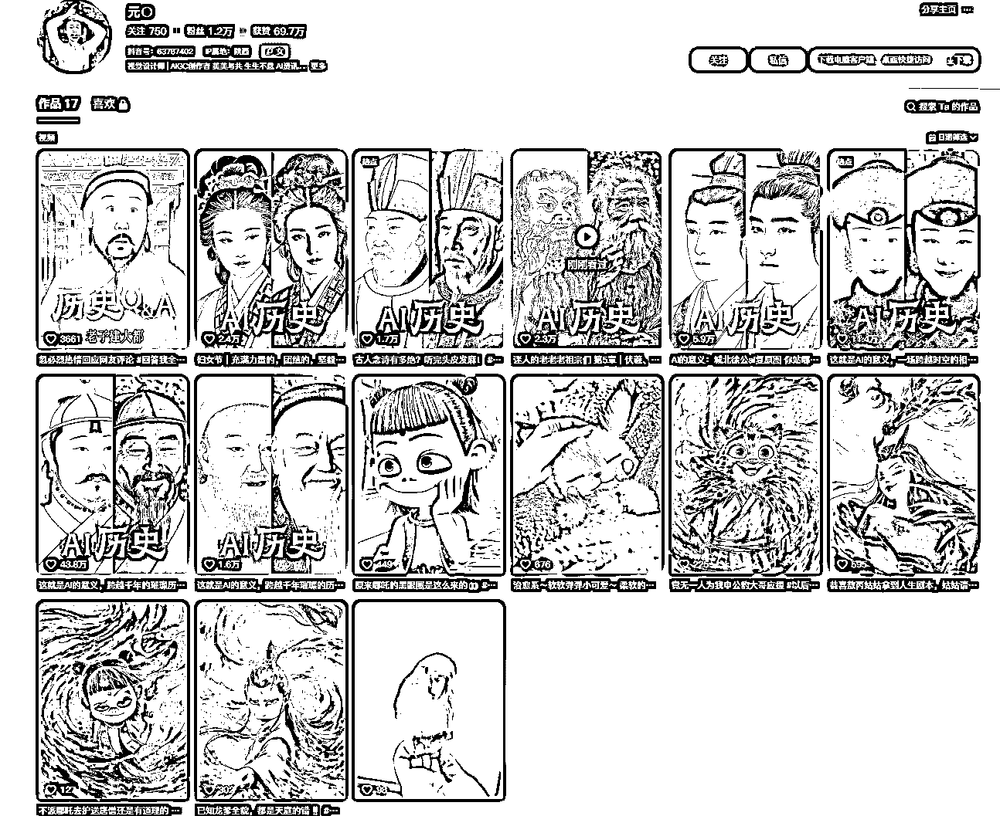
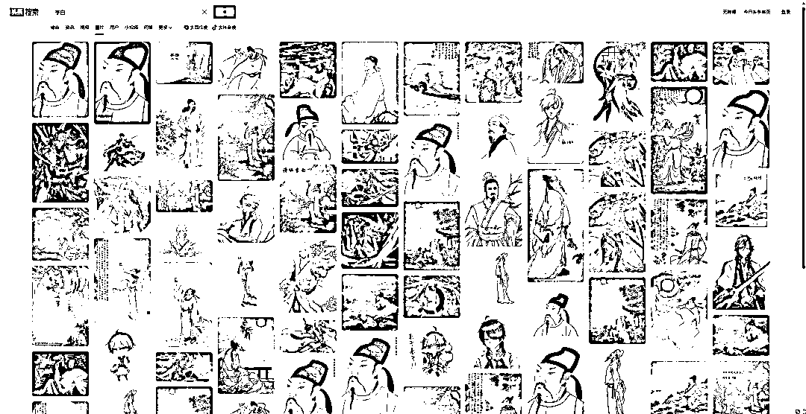
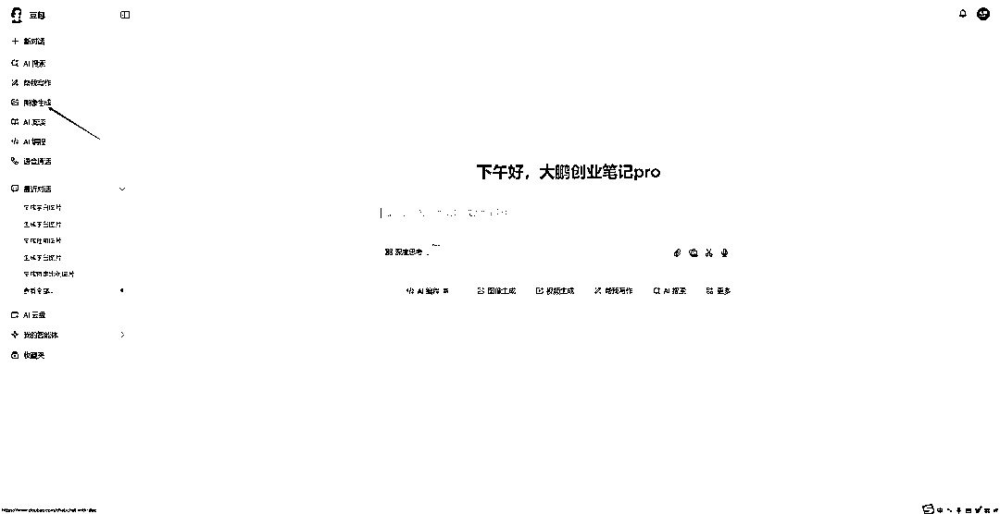
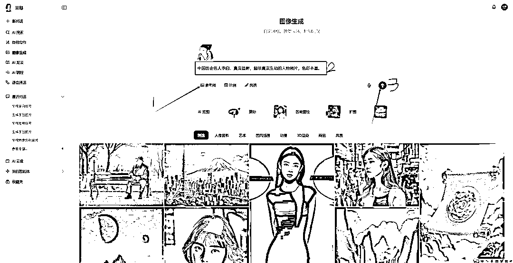
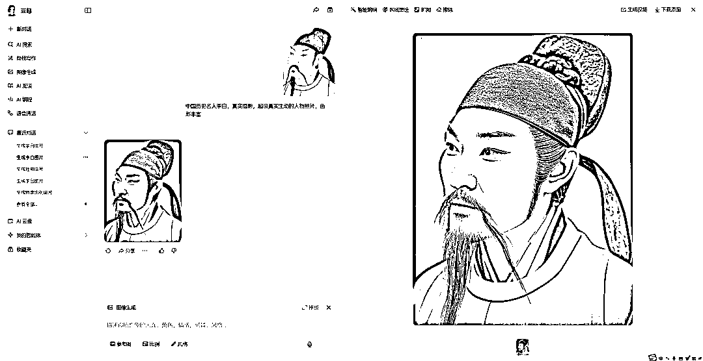
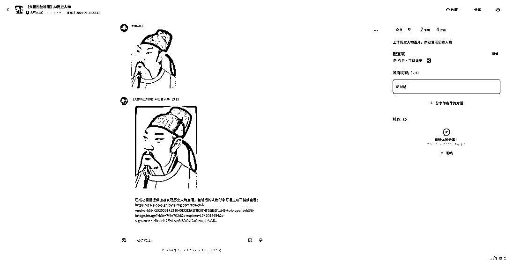
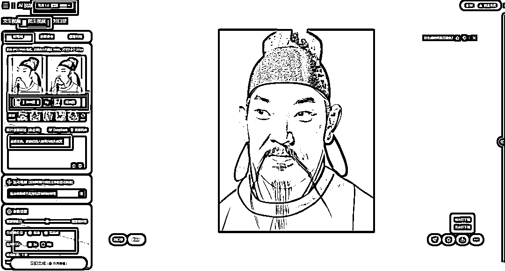

# 8 条作品涨粉破万，单条视频点赞 40W+，AI 历史人物复活视频制作全流程拆解

最近刷短视频时，我偶然发现一个账号，数据表现相当炸裂——近8条作品清一色上万点赞，其中一条更是直接冲上40W+赞，保守估计播放量已经突破千万级别。这种表现，说是当下新的流量密码也不为过吧？

但我翻看这位博主的早期内容，发现他之前发的东西也挺杂，小动物、哪吒之类都发过，数据普普通通。直到有一天，他开始发AI历史人物“复活”的视频，画风突然就变了，流量也跟着一路狂飙……

其实这类视频的玩法并不复杂，简单说就是把古画里的名人肖像，通过AI技术转成动态真人影像。常做AI视频的朋友可能一眼就能看穿背后的逻辑，不过对大多数人来说，这一套还是值得好好研究一下的。今天我就手把手带大家走一遍完整的制作流程。

**废话不多说，直接上干货：**

**一、搞定人物素材**

第一步很简单，先准备一张历史人物的画像。直接去网页上搜也行，不过我实测下来，今日头条里搜到的图片资源会更多更全。打开今日头条（网页版或App都行），直接输入你想做的历史人物名字，比方说我搜的是李白。挑一张清晰度够高的图片存下来，顺手裁成合适的画面比例待用。

**二、让画像“活”起来**

素材准备好之后，核心操作就是把静止的画像变成逼真的人像照片。

这一步很多人推荐用即梦，但我实际测了一圈，效果不太满意。反复对比下来，我更推荐用豆包——生成效果好，关键是还能免费蹭着用。

在豆包AI里选择图像生成功能：

点击“导入参考图”，把刚才准备好的李白画像传上去。图片比例不必手动调，系统会自动匹配原图比例。接着简单写上提示词就行，比如我写的是：“中国历史名人李白，真实摄影，超级真实生动的人物照片，色彩丰富。”

完成后点一下生成按钮，等上片刻，一张效果很不错的“复活版”李白照片就出来了，直接保存就行。

**小贴士：**

如果觉得这些步骤麻烦，也可以去扣子商单搜索我提前做好的智能体。这个工具更省心，只要上传图片，就能一键生成复活后的历史人物照片，点链接就能下载。生成出来的图片清晰无水印，效率拉满，一步到位。

**三、照片转动态视频**

图片搞定之后，接着就是把静态照片变成动态视频，这一步一样非常容易上手。

打开可灵AI，选择“图生视频”里的“首尾帧”功能。把原始画像放到首帧，上面生成的复活版照片放到尾帧。视频提示词可以参考这句：“丝滑变换，变换后的人物看向镜头微笑”。生成质量选“高质量”模式，时长调到5秒就行。

然后点生成，等上几分钟，一条动态视频就自动输出了。按同样的方法，把其他历史人物也批量做一遍。

**四、剪辑合成**

所有视频片段都生成好之后，统一导入剪映，配上合适的背景音乐和一些转场特效，一条完整的作品就出炉了。这部分太简单了，就不单独演示了。

以上，就是AI历史人物复活视频玩法的全部教程，你学会了嘛？

我是大鹏，一直在AI视频变现这条赛道上折腾，如果对这个方向也感兴趣，欢迎随时来交流探讨～