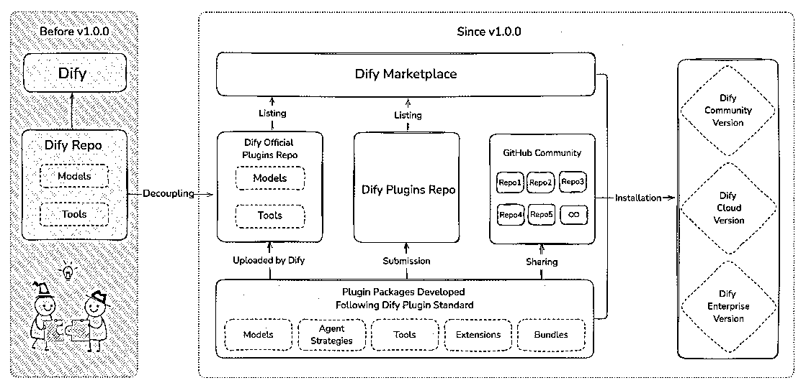
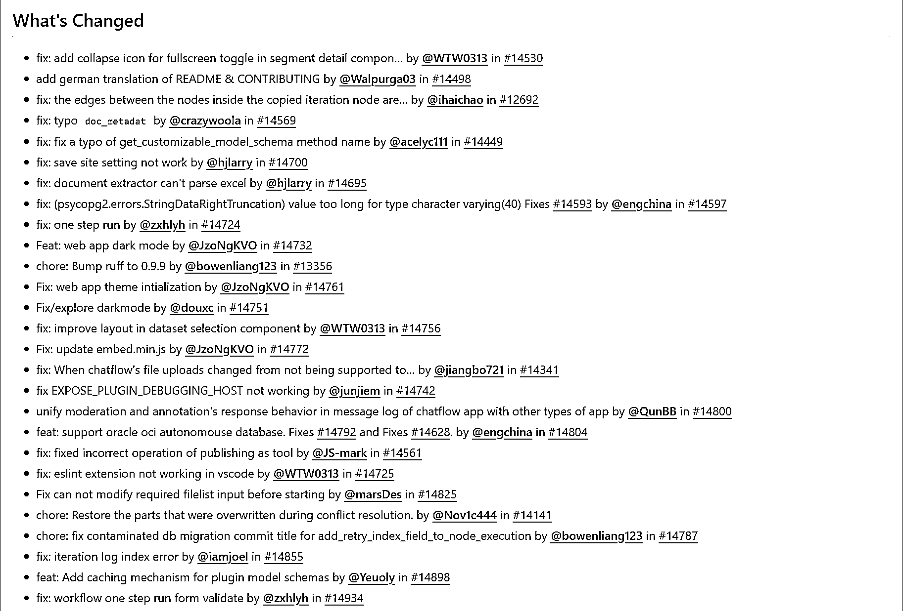
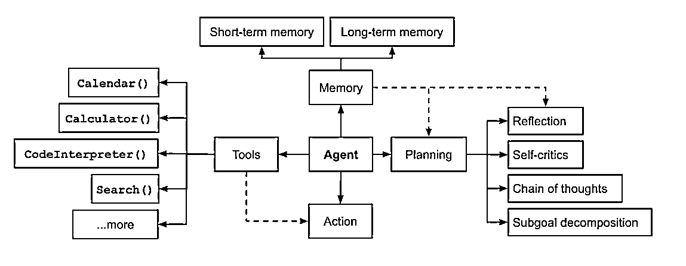
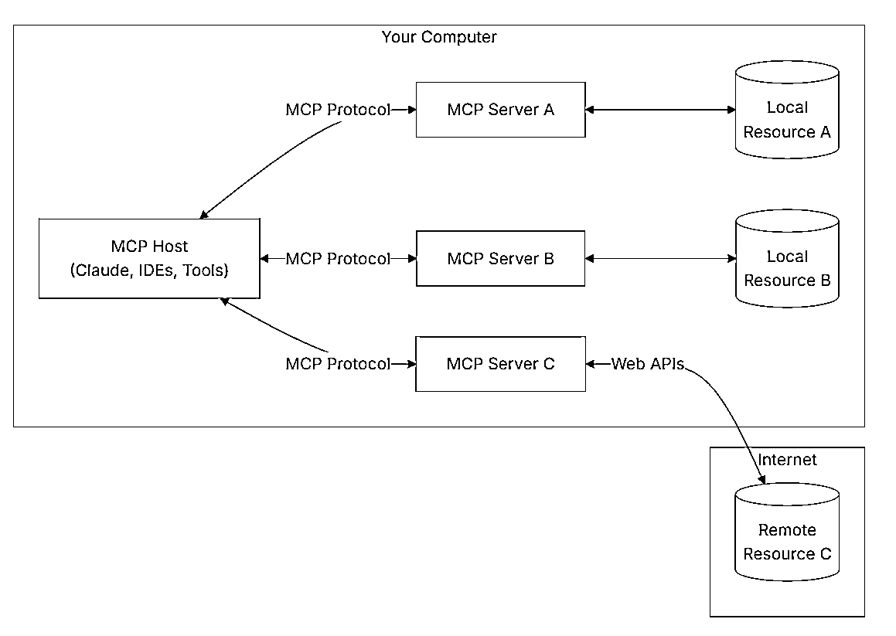
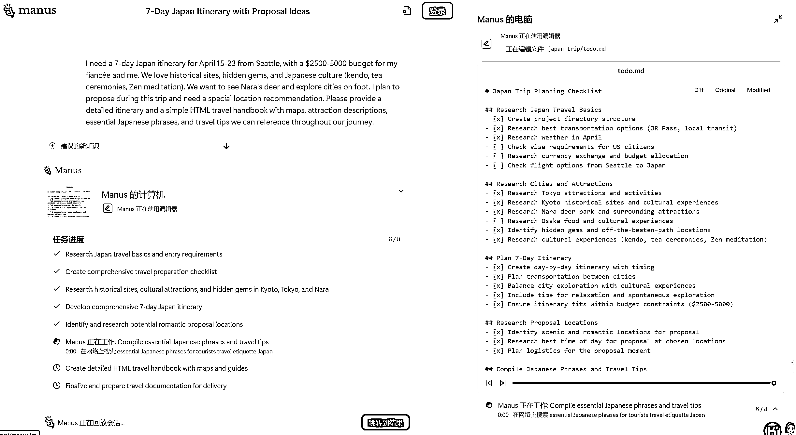

# 从 Dify 1.0 的翻车到 Manus 爆火，AI Agent 这波演进到底在变什么

## 从 Dify 到 Manus，这次 AI Agent 的变革给我们带来了哪些启发

作者：雨飞

日期：2025-03-12

大家好，我是雨飞，主要在做 AI 编程和 AI 应用相关的研究。

最近圈子里有两个信号特别扎眼。3 月初，开源 Agent 开发平台 Dify 发布了 1.0 版本，大改插件机制和 Agent 策略，结果一上线就炸了，忙到连发 1.0.1 紧急修复。而几乎同一时间，多智能体配合云环境的产品 Manus 横空出世，被全网热议。把这两个事件放在一起看，能明显读出 Agent 赛道正在发生的转向。

## 一、Dify 1.0 的 Bug 里藏着的思路

如果做过 Coze 航海的同学，理解 Dify 会很快。它本质上是一个开源版的 Coze，同样能搭建工作流、编排流程、开发智能体。官方定位是开源的 LLM 应用开发平台。

这次 1.0 的大动作是上线了自家的插件市场。Perplexity 搜索、Firecrawl 爬虫、ComfyUI 等一众常见工具都进了市场，插件可以热插拔，服务不用停机就能更新。这个设计思路和后面要说的 MCP 协议很像。另外还新增了独立的 Agent 节点，配合 Agent 策略插件来支撑更复杂的工作流。

更多细节可以看 Dify 官方 blog：<[`dify.ai/blog/dify-v1-0-building-a-vibrant-`](https://dify.ai/blog/dify-v1-0-building-a-vibrant-) plugin-ecosystem>

升级带来的代价也很直接，1.0 上线后 Bug 齐飞，1.0.1 的修复清单直接破 80 条。

放到互联网公司的标准里，这相当于发版后 App 无法登录，严重程度拉满。但从迭代思路上，还是能提炼出两点关键。

第一是**工具、插件与模型解耦**。开发者可以自由组合任意插件完成功能，不被底层厂商绑死。

第二是**Agent 的地位被正式抬高**。Dify 用专属节点和策略插件来做资源调度、状态管理、推理过程记录和工具调用。

可惜的是，Agent 的流程设计依然延续了老套路，记忆-规划-执行-工具的经典四件套，并没有带来突破性的创新。

那为什么 Agent 在去年沉寂，今年又重新被炒热？

我觉得是两个条件凑齐了。其一是大模型本身变强了。上下文窗口拉长，理解和任务拆解能力提升，提示词更容易被执行。去年用智谱、Kimi、千问搭 Agent，大多卡在模型读不懂提示词上。今年模型性价比上来，成本和难度都降下来了。

其二是国产力量尤其是 DeepSeek 的崛起，让大家把 Agent 视作继 RAG 之后的主流方向。AI 普及度提高，讨论热度自然跟着上去。

当然 Agent 范式也有痛点。不同家的工具接口不统一，开发者要反复兼容；上游一升级依赖，下游就可能崩。解决方向指向了 MCP。

## 二、Claude 和 MCP 协议在干什么

Claude 对 MCP 的定义很简洁：让大模型应用和外部数据源、工具无缝连接的开放协议。只要按 MCP 规范做的服务器，就能用同一套代码被调用。

这样就省掉了为每个厂商单独适配 API 的重复劳动。

一个标准 MCP 架构包含服务器和客户端。一个客户端可以同时连多个 MCP 服务器，实现读取本地文件、写库、推代码到 GitHub 这类复合操作。

现在能用 MCP 的客户端不少，Claude Desktop、Cursor、Windsurf、Cline 插件、Roo Code 插件都能接入。

热度不够高也有原因。Windows 环境兼容性差，配置门槛高，体验远不如 Mac。更关键是选择困难，用户根本不知道该用哪个 MCP，面对一堆工具名无从下手。

## 三、Manus 究竟聪明在哪

Monica 团队推出 Manus 后爆火。抛开套壳的争议，更值得看的是产品层面的减负设计。

从拆解来看，Manus 内部自带云电脑，把本地数据搬到云端处理，避免污染本地环境。任务层面用 Claude 3.7 做顶层规划，再按任务类型派发给不同 Agent，各自调用专属工具，最后把全流程报告沉淀成文件返回用户。

这套做法直接绕开了 MCP 的选择焦虑。按逆向测试结果，Manus 内置了 29 种工具，覆盖网页部署、浏览器操作、命令行、文件操作、消息通知等。**用户不用自己装环境、配插件，只要对话就行，结果直接交付**。

这其实回应了 Coze 的现实困境。Coze 能自定义工作流，但普通用户不会为此学习。大家要的是开箱即用的软件，越简单功能越强越好。Coze 的变现主要靠商单定制，开发者很难靠模板盈利。

Manus 的宣传就很直白：不用学技术、不用装环境、不用高配电脑，一句话就把事办了。现在还不完全现实，但方向很清晰。

类似思路也可以看到影刀在做 AI 自动生成工作流，Coze 未来也可能走向“用户描述需求，系统自动生成工作流和智能体”的路径。

## 四、我的观察总结

结合自己开发和使用的经验，Agent 产品要跑通，大概有这几条。

1、能用最好模型，清楚技术边界和成本。
2、给用户少做选择，开箱即用。复杂逻辑交给服务端和开发者。
3、长期记忆是核心，现在多靠上下文+向量库，有突破就能拉开差距。
4、MCP 在 25 年很值得押注，基于它做垂直领域封装的变现机会很多。
5、直观的演示和 UI 设计能带来传播，Manus 的界面交互就是例子。
6、需要一套统一的 Agent 性能评估体系和数据集，方便迭代对照。
7、用 AI 编程工具如 Cursor，也能快速孵化类似 Agent 产品，市场空间不小。

* * *

评论区：

暂无评论