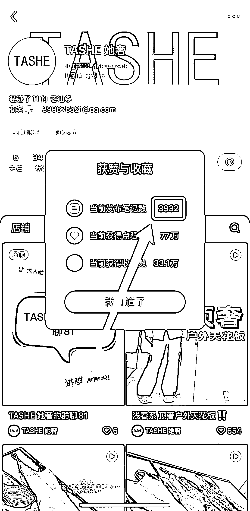
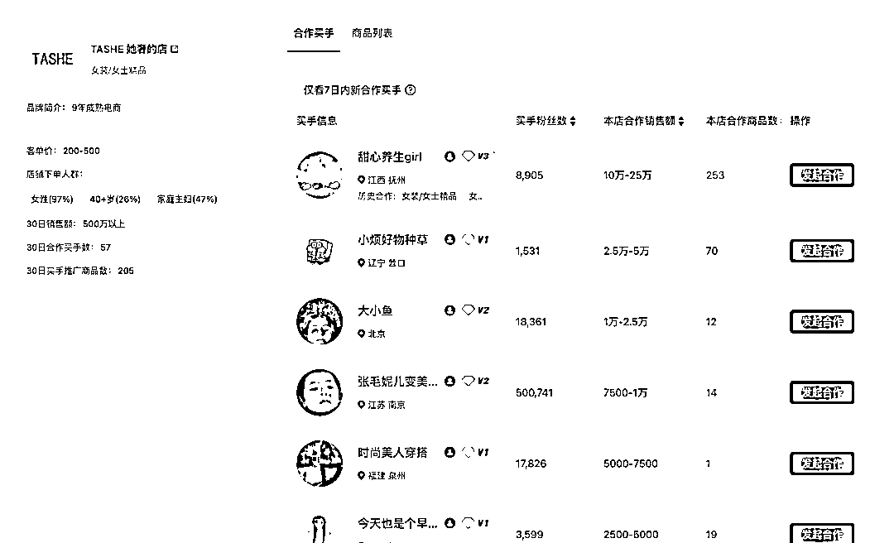
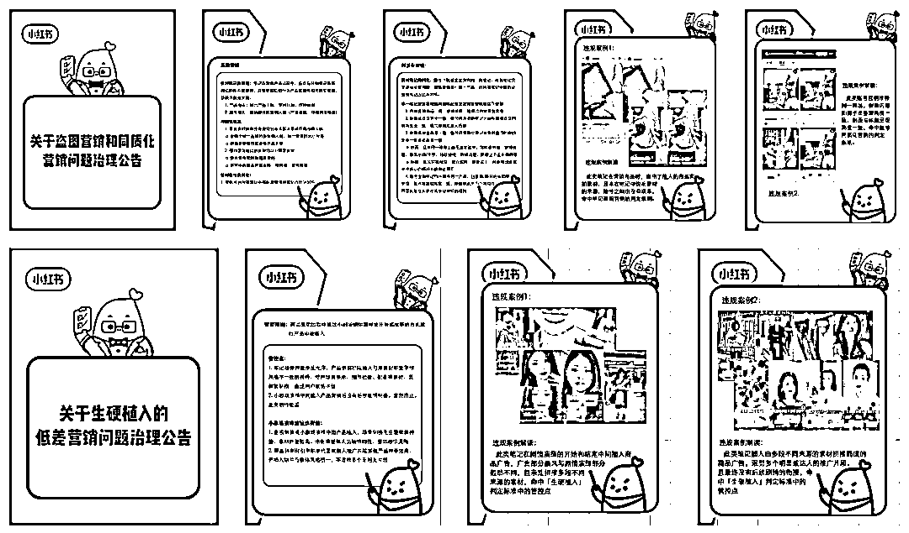

# 别再等爆款啦！先发 100 篇商品笔记再谈📕电商
作者：龙哥

你是不是也有这样的执念：精心打磨一篇文章，满心期待它成为爆款，结果数据平平，然后陷入“再等等，下一篇一定爆”的循环？

最近我复盘了一批在📕做闭环电商的头部商家，发现一个惊人的共性：他们根本不在“赌爆文”这件事上花太多心思。卖货这件事，在他们那里被拆解成了一道朴素的算术题。

[TASHE她奢]这个账号就是典型样本。他们用一个📕账号，近30天更新了672篇笔记，日均发布22篇，其中商品笔记456篇。纯商品笔记带来的月GMV接近900万，单篇最高卖了30多万，日常每日GMV稳定在20-50万。什么概念？很多品牌全店吆喝一个月，可能还不及他们一天的产出。

有意思的是，他们也有买手直播，但GMV占比并不高。真正撑起销量大盘的，就是那些看起来不那么“精致”、甚至有些“工业化复制”痕迹的商品笔记。

所以，这套玩法的底层公式其实很朴素：**GMV = 商品笔记数量 × 商品笔记质量 × 精细化运营**。

换句话说，你纠结的爆文率根本不是核心变量。真正起决定作用的，是你有没有把“有效卖货内容”的基础覆盖量给铺开。别总想着三天憋出一篇神作，那玩意儿连内容模型的A/B测试数据都跑不出来。想做📕电商，先别废话，一个月发够100篇商品笔记再说。

这里说的“发”，不是让你闭着眼睛瞎发。打磨内容手感之前，先学会模仿。在还没有跑通自己的爆款内容模型之前，最聪明的做法是像素级对标同品类、同类目的优秀爆款笔记，大量模仿、快速测试、边发边调。

罗辑思维有句话说得很好，叫“小步快跑”。但很多人只记住了“小步”，忘了“快跑”才是前提。你步频慢，蜗牛速度挪，跑一年也看不到反馈数据，哪来的手感？

当然，质量不是完全不重要。只是在早期，请记住一个原则：**狼性更新、佛系爆款**。用海量铺量去对冲算法的不确定性。过度追求爆款、依赖爆款带来的爆发式增长，对于供应链不够硬、售后跟不上的一些商家来说，反而可能是毒药。冲动消费带来的高退货率、产能不足导致的赔付问题，都会让你心力交瘁。我们需要的是持续稳定地出货，而不是过山车式的心跳。

为了帮你少走弯路，我梳理了一套纯粹的“卖货型笔记”实操路径，照做就行。

**01. 动手卖货前，先做好功课**
方向错了，越努力越尴尬。先花时间想清楚下面这些：
- **洞察用户**：你的用户是谁？他们是什么画像？他们的决策链路和周期有多长？他们买这个东西，追求的是功能价值、附加价值还是情绪价值？
- **盘清产品**：最核心的卖点是什么？跟竞品比，优势在哪？
- **构建场景**：产品出现在什么使用场景里？和什么样的生活方式绑定？

**02. 拿着放大镜拆解对标**
别自己闭门造车。把同品类、类似品类的爆款内容全部扒一遍，建立一个“爆款素材库”。创作配比，建议遵循 **721法则**：
*70%像素级模仿跑得通的爆款*
*20%基于洞察做微创新（换场景、换角度、换人货场组合）*
*10%大胆尝试完全原创的内容*

**03. 构建赛马机制**
内容发出去不是终点，是起点。时刻监测不同内容模型的数据反馈，跑出哪个有苗头，就立刻放大产出比例，把有效模型怼到极致。

**04. 把内容生产做成流水线**
跑通MVP模型后，就把它沉淀成SOP。推荐“创意中台+复制分发”的组合：中台团队（1个策划+1个摄影师）负责持续挖掘新模型；复制分发团队（N个运营/实习生）负责把已验证的爆款模板高效复制铺量。这块的大量文字工作完全可以交给AI辅助，甚至爆款分析、选题挖掘也能让AI帮忙干活。

**05. 实操避坑指南**
- 怼量的时候注意同质化问题。平台现在对重复内容管控严格，多去看看官方公告的边界规则。
- 建议做矩阵号。特别是风险较高的品类，初期可以拿非店铺账号去激进测试，测试出有效模型后再让店铺账号跟上。说白了就是：核心账号精耕细作，外围账号火力全开。
- 别太在意点赞评，那些都是虚的。你要盯紧的是**交易数据**。赛马的标准只有一个：谁能卖货。
- 别花三天打磨一篇文章。三天时间足够你发10篇不同模型的笔记测试了。用数据找方向，再集中火力打磨那个“赢家”。
- 当大家都在拼内容同质化，你的内容密度和产出效率就是最大的护城河。
- 最后说句扎心的：大多数品牌根本不缺策略，缺的是老老实实照做、吭哧吭哧怼量的执行力。

所以，若想验证这条路是否走得通，一个月100篇笔记的最低测试门槛，你愿不愿意先迈过去？别再当“思想上的巨人，行动上的小矮人”了，干起来再说。