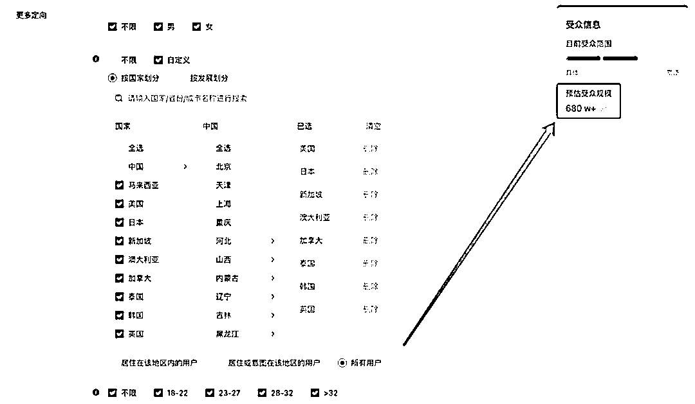

# 给📕品牌商家的一盆冷水，请自便

## 给所有📕品牌商家泼盆冷水

作者： 林卿 LinQ

日期：2025-03-14

刚和一位📕官方的小伙伴吃完饭聊了会儿，把几个关键判断整理出来，望各位商家能听进去。

**01. 当下📕的头号KPI是社区日活，不是赚钱。**

1.1. 现阶段📕的月活大概在3.6亿到4亿区间，具体数字没对外。聚光平台给出的用户预估口径是3.7亿以上。

1.2. 社区生态才是平台的护城河和命脉，这也是商业化一直被掣肘的原因。商业化与社区内容长期在博弈，而让步的一方往往是商业化。

1.3. 上波“TK难民”潮的留存远低于预期，很正常。TikTok并未被封，多数人最终还是回流了，即便没卸载，活跃度也明显回落，属于典型的僵尸存量。

1.4. 为了冲DAU，未来对各板块的治理会更频繁、更严。管得是只会更狠。

1.5. 春晚加地推带来的下沉用户比预期多，但水土不服也更严重。📕的社区基因偏精英，推荐机制对新用户是慢热型，很难快速留住。某种程度上，这波拉新也在稀释用户整体价值，评价两难。

1.6. 我个人判断，社区DAU的天花板大约在5亿左右。

**02. 📕电商出海大概率是泡沫，更多像个讲给资本听的故事。**

2.1. 📕电商出海领航计划介绍

📕电商出海领航计划介绍及 FAQ（持续更新中）

链接🔗[`doc.weixin.qq.com/doc/w3_AKUAlgbDAO05kbGbVjIR7aIRMMgQA?scode=ANAAyQcbAAgxS1IFl6z-iMCi7cAL0`](https://doc.weixin.qq.com/doc/w3_AKUAlgbDAO05kbGbVjIR7aIRMMgQA?scode=ANAAyQcbAAgxS1IFl6z-iMCi7cAL0)

2.2. 说它是泡沫，原因很直白。按聚光平台推算，📕的海外用户体量仅约680万+，且分散在全球，分散在各种性别年龄，还包含大量海外华人华侨。基数如此，谈电商出海并不现实。

再者，中外审美、消费习惯差异大。国内爆款到了海外未必能卖，横看亚马逊的爆款榜就明白了。内容出海适配成本也高。常规消费品出海基本走不通。

真正有机会的，大概率是高客单、非标品或服务，比如设计师配饰、手作、非遗文创、留学咨询、海内外置业、移民服务等。

2.3. 在📕做“出海”的正确姿势

a. 做海外用户的生意
这里的海外用户不等于外国人，海外华人华侨就是一座金矿。身边就有朋友做海外房产，客群精准锁定华人华侨，客单价高，投放效率惊人，淡季获客成本10-20元，旺季也能压在50元左右，ROI极高。

更有意思的是，我甚至看到有人在推特上教海外华人怎么玩📕，需求还不少。这说明被低估的人群很多，市场远未被挖完。准海外人群也算，比如准备留学、旅游、出国工作的用户。

b. 出口转内销
TikTok难民事件刚发生时我就开玩笑说这是个好机会。做法就是去海外拿个品牌背书，绕一圈再卖回国内。平台对海外品牌的内容容忍度明显更高，尤其在保健、护肤等功效宣称上，国货受限，海外品牌相对宽松，所以很多商家乐意借此操作。

另外，部分品类国人天然信任海外货，这也是策略成立的原因。

2.4. 宏观来看，这次电商出海更像是对冲国内增长焦虑、讲述海外增长叙事的工具，是一个精心包装的资本故事。

**03. 📕直播的灰色地带依然不少。**

多平台同播目前基本是睁一只眼闭一只眼的状态，只要不出现话术违规被算法抓到，或者体量没做大，一般不会被干预。

录播的管控虽严，但也有漏洞。判定标准主要是内容是否重复，一重复就被判定。所以现在的做法是录屏拼接做零重复，或到点下播后复播。

无人直播、AI数字人直播也在跑。

灰色就是灰色，有风险。说到底，是因为直播供给还不饱满，平台只能选择性失明。

**04. 📕闭环电商，可能是未来1-2年除视频号之外，唯一有红利的电商赛道。**

天花板低是事实，年GMV过亿的商家屈指可数，但百万、千万级的很多，且不少靠📕做全域辐射，间接GMV能接近过亿。

更关键的是，这里的生意是真的有利润。

4.1. 价格战没那么凶，价格敏感用户比例偏低。
4.2. 溢价能力是全网最高，同款产品在📕的价格大概率是全平台最贵的。
4.3. 定价逻辑正在从成本定价转向心理定价。以前是算成本加倍率，现在是“用户觉得值就值”。用户觉得好，贵一点也愿意。

心理定价的本质是品牌溢价，是用情绪、场景、故事重塑产品价值，再重新定价。

比如一套普通键帽市面上50元135颗，平均0.4元一颗。📕上“功德键帽”一颗卖9.9元甚至19.9元，比一线品牌顶配还贵，用户却觉得物超所值。

能玩转心理定价的，需要捕捉超越功能本身的价值，并有一套完整的叙事体系或共识来支撑，比如故事、概念、仪式感。

4.4. 虽然已进入商业化流量时代，但投放成本相对其他平台仍低。

说白了，📕闭环电商就是典型的“小而美”生意。