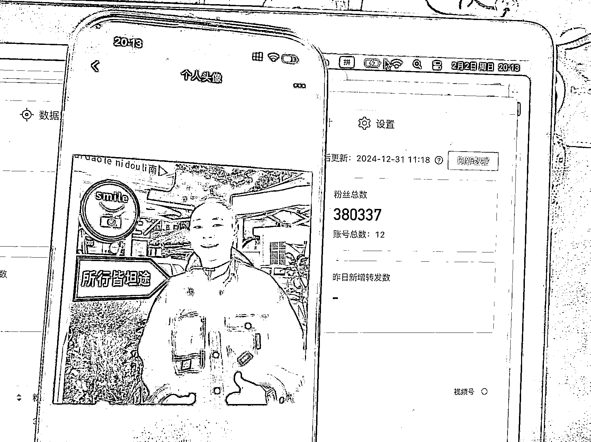
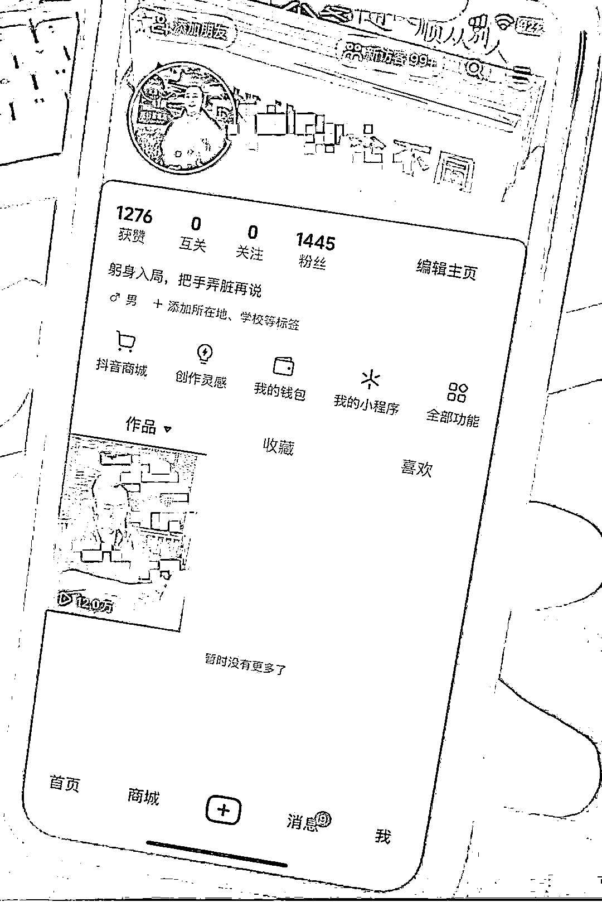
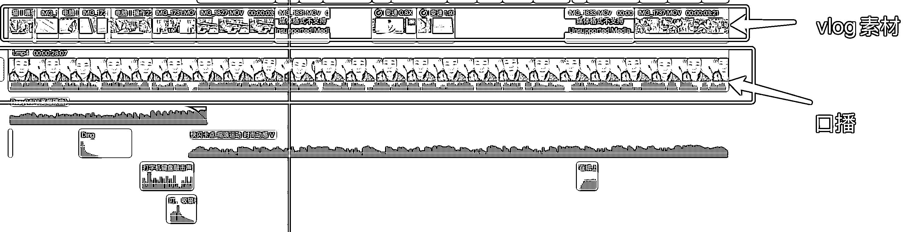
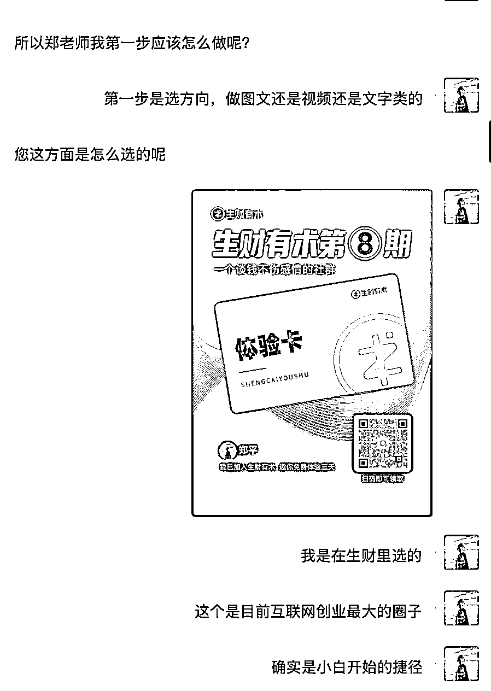

# 抖音新号一条视频破10万播放，广告主主动找上门：普通人的IP玩法，其实挺简单

刷到一条视频，十几万播放，涨粉2000多，广告主顺着网线就找过来了。

这不是什么大V的案例，而是一个刚起步的抖音新号。

发这条视频的人叫郑平，是龙哥盟的一位圈友。他自己说，在赚钱潜水了一年，算不上什么大佬，之前在视频号跟着航海计划做到了38万粉丝，仅此而已。

后来通过赚钱的线下聚会，也认识了不少同频的伙伴。

为什么突然想做抖音IP？他说自己去年做了一年流量，心态经常崩。流量好就开心，流量差就焦虑，整个人处于一种反复拉扯的状态。他意识到，长期靠流量吃饭，迟早会被流量反噬。

所以今年想换个思路，做点能沉淀下来的事。

翻了好几天赚钱的帖子，琢磨出一个方向：做IP。具体来说，就是**把自己从0到1做项目的全过程，真实地记录下来**。

没想到，第一条视频就爆了，直接十几万播放。

后台涌进来不少想创业的人，还有广告主来问合作。

他把自己的做法拆成了三个部分，分享出来。

**第一，账号定位：做陪伴者，别做教导者。**

很多人做IP，习惯把自己摆在老师的位置上，教别人怎么做项目。但郑平选的路线相反——他记录自己做项目的过程，而不是告诉别人该怎么做事。

这么做的好处很明显：陪伴者没有攻击性，粉丝更愿意跟你互动。就像上学时候，大家更愿意跟同学聊天，而不是跟老师汇报。但坏处也客观存在——后期如果想做知识付费，难度会比较大，毕竟谁愿意找同学买课呢？

**第二，内容形式：选对选题，把视频做得不沉闷。**

选题上，他用了一个挺巧的办法：**挑战100天赚多少钱**。

这个选题天生带话题感，涨粉快，粉丝粘性高，因为大家都好奇你最后到底能赚多少。但也要承认它的短板——如果粉丝不是从第一条跟过来的，中途刷到可能一脸懵，不知道你在干嘛，后期播放量容易掉。

内容上，因为拍的就是自己日常真实的操作过程，写文案基本不怎么卡壳，先自己写初稿，再用GPT润色一下就行，效率很高。

至于形式，他在口播和vlog之间选了个折中方案：**口播加vlog混合**。纯vlog太麻烦，得满世界找素材；纯口播又太干，一张脸对着镜头说半天，观众看着也累。

**第三，变现路径：没设计链路，反而发现了更大的机会。**

说实话，他这次压根没规划什么转化路径，因为谁也没想到第一条视频就火了。没有产品，没有承接方案，粉丝加了🛰️也只能先留个联系方式，随意聊聊。

但聊着聊着，他发现了有意思的事：因为内容是“记录自己怎么做项目”，而不是“教你怎么做项目”，所以粉丝感兴趣的点变成了——**你在哪儿学的？我也想去学。**

这不就是天然的变现入口吗？

答案很自然：分销龙哥盟。理由也足够硬：

**第一真实，** 自己确实是在赚钱学到的这些；**第二靠谱，** 推荐的东西经得起推敲，不会有割韭菜的负罪感；**第三素材充足，** 自己深度参与了一年线下聚会，聊起来有料；**第四省心，** 只做推荐和引荐，不用自己搞交付、带团队。

一条完整的商业闭环，就这样跑通了。

总结一下整条路径，其实很清晰：

**建立陪伴型人设→记录项目推进过程→持续输出结果与思考→粉丝加🛰️→被问“在哪学的”→分销赚钱实现变现。**

郑平说，赚钱里每一个正在做项目的人，其实都可以复制这套玩法。接下来他打算长期在赚钱记录自己的进展，等做出新成绩了，再来跟大伙儿汇报。

评论区有人问他，新号第一条视频就爆，是不是专门养过号？

他的回答也很实在：没养号，没养粉，注册了半个月，发之前把实名认证做了。能爆的关键，是选题自带话题度，再加上画面节奏快、内容抓人，留得住观众才走得远。

这个世界从来不缺方法，缺的是有人愿意把自己的过程摊开给你看。而把“真实”当成内容本身，或许才是这个时代最稀缺的流量密码。