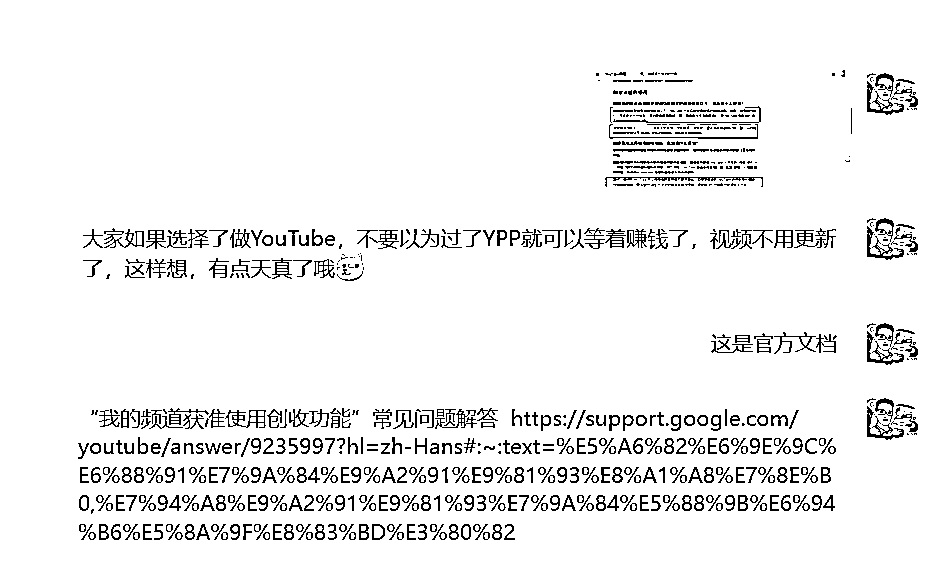
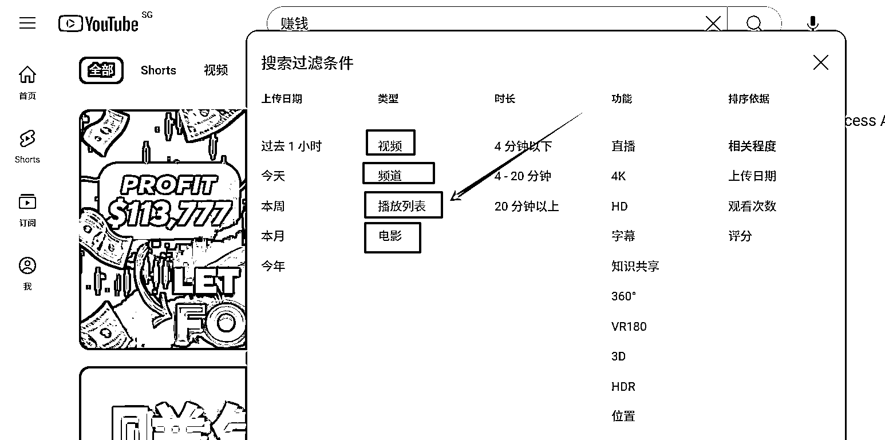
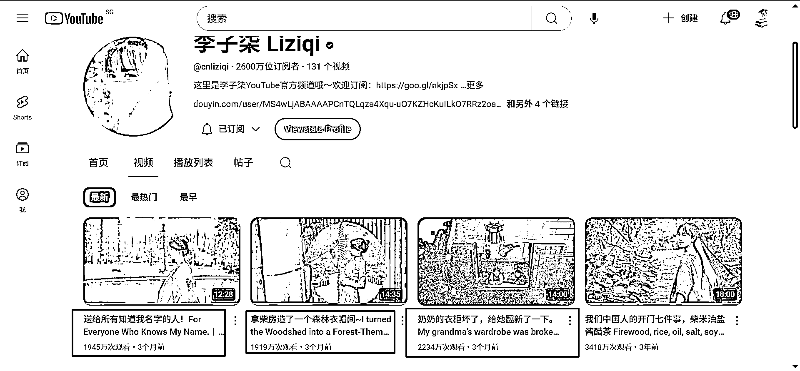

# 开通 YPP 后，别大意，没注意这个细节，YouTube 官方将取消你频道的获利资格
作者：龙哥

标题：拿到YouTube变现权限就飘了？小心半年不更新，官方直接收回

很多人以为，频道过了YPP审核，就等于捧上了铁饭碗，从此躺着赚钱。但真相是，YouTube官方在后台设置了一条“隐形红线”，稍不留神踩中，到手的收益资格也会被没收。

根据官方文档“获准使用创收功能”的常见问题解答，哪怕你的频道数据已经跌破最低门槛，官方也不会立刻切断你的变现权限。然而，有一条特殊情况：假如你连续6个月以上不发布任何视频或帖子（也就是说频道进入“僵尸状态”），官方就有权自行决定停用你的创收功能。而且，只要违反了《YouTube频道创收政策》中的任何一条，不管你有多少订阅、多少播放量，都会瞬间失去变现资格，毫无商量余地。

那么，“最低门槛”到底是多少？YouTube合作伙伴计划概览与资格说明写得很清楚：要么在过去12个月内做到1000个订阅+4000小时有效公开视频观看时长；要么在过去90天内做到1000个订阅+1000万次有效公开Shorts观看量，两条路满足任一即可。注意，Shorts带来的公开观看时长并不计入那个4000小时，别想着靠短视频刷长视频指标。你还可以在YouTube工作室的“创收”页面打开“当我符合条件时通知我”，一旦达标，官方会发邮件提醒你。

官方眼里的“活跃”，除了上传视频、发布帖子，还包括创建播放列表。顺带一提，创建播放列表是很多老玩家用来“蹭流量”的小技巧，这个细节我之前的文章也聊到过。

像李子柒这样的顶流，就算断更两三年，也不用慌。她的粉丝量和观看时长早已远超标准线，哪怕自己不更新，老作品也一直在被观看，续命能力不是普通账号能比的。

这里再给各位补两个“避坑”知识。

第一，如果你的频道刚刚过审，之后粉丝掉到1000以下，或者因为私密、删除了某个视频导致观看时长不足4000小时，会不会被拒？答案是不会。审核流程在你提交申请时就已启动，后面的小幅波动影响不了结果，官方不会因为这一点点时长或粉丝数波动就把你拒之门外。如果真被拒绝了，大概率是内容踩了平台政策红线，而不是数据的小起伏。想在别人平台赚钱，就得先读懂别人的规矩。

第二，有人觉得过了YPP之后，原赛道没前途，想换个领域，干脆买一个已经获利的账号，再把老视频全删光，直接发新内容。这种操作极其危险。我身边就有个朋友，收到过一个一万粉丝的账号，但那个账号原本就没过YPP，所以删视频没出问题。可如果换作已经过审的账号，一上来就把全部视频清空，播放时长会从原来达标的4000小时直接归零。这不是开玩笑，真实案例里，YPP就是这么被官方收回的。虽然不敢说必定发生，但放着变现资格去赌，实在没必要。

真想换赛道，正确做法是：先持续发布新领域内容，让账号平滑过渡。旧视频怎么处理，就看你能否接受“人设反差”。能接受，放着不管也行；接受不了，担心观众觉得内容不垂直，那就在更新新视频的同时，把老视频逐步设为私享，或者分批删除。这样能保证播放数据不会断崖式下跌，避免因为跌破标准而被清退。

最后还是那句：YouTube是长期项目，玩法众多，值得好好深耕。如果本来就在国内平台发视频，顺手同步到YouTube根本不费事，长期不更新真的说不过去。