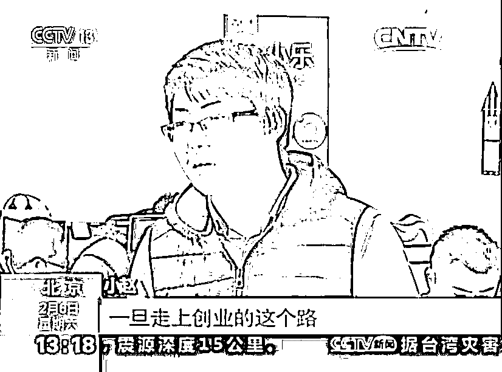
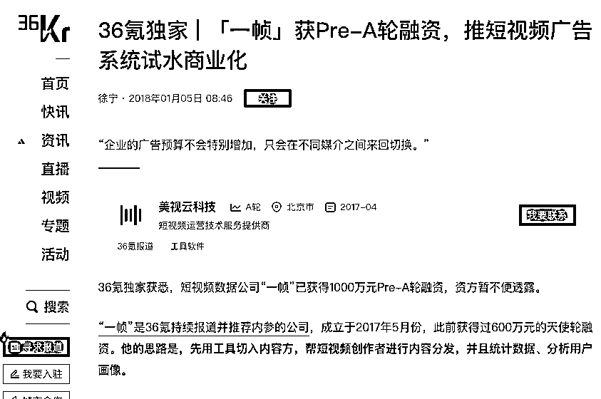

# 3000 万买来的教训：三次创业三次归零，我才明白坚持比换赛道更重要

这不是噱头，是我这十年的真实履历。大学毕业到现在整十年，三段创业经历，三次清零。

**第一次创业：500 万到手，最后还是选择卖掉。**

刚毕业带着一腔热血，用校园招聘的方向拿到了姚劲波的 500 万，项目叫伯小乐。那段时间很猛，用户冲到 30 万，被央视点名报道，还拿到了 36 氪 WISE 最年轻新锐 CEO 的名号。

结果我却觉得招聘太传统，是个典型的 B 端生意，自己又不擅长去谈大客户，索性把公司卖了，去了 58 同城当上最年轻的总监。回头看，那是我第一次主动下桌。当时如果再扛几年，结果或许完全不同。

**第二次创业：短视频数据，1600 万融资后再次套现。**

在 58 待了一年负责校园招聘产品和运营，心里还是想自己干。17 年短视频正爆，我就做了短视频数据产品一帧。蔡文胜 600 万天使，美图 1000 万 Pre-A，一共 1600 万进账。

起步很顺，腾讯、爱奇艺、快手都在用我们的产品，产品反馈也不错。但销售这块我又掉进了老坑，团队没有销售基因，也没去搭建真正的销售体系。17 年直播电商还没起来，达人变现艰难，数据只能卖给广告公司和头部品牌。团队是产研背景，又没能预判到直播电商的爆发。我判断天花板低，估值尚可就卖了。这次又早早下桌，赚了点小钱。

**第三次创业：做达人电商，亏掉百万直接关门。**

我以为在快手做过创作者生态总监，对达人变现门儿清，第三次拿了 500 万启动达人电商。原计划是深度赋能 100 个达人，开 100 家店。

现实给了三记耳光：达人成本远超预期，签约难度极大；孵化达人几乎失败，我们没有内容基因带不动；团队扩张太快太急功近利，业务根本跑不通，最后严重亏损。

前两次还能卖公司回点本，这次直接清算关门。

三次创业，赛道完全不同，犯的错却惊人一致：低估行业门槛，高估自己的跨界能力；没有在一个赛道深耕，次次推倒重来；一遇到阻力就换方向，而不是在原地死磕。

如果五年前我选定一个赛道扎下去，今天的版图可能已不一样。

**为什么复利比重启重要**

我曾以为高手靠天赋，现在才懂他们靠的是时间复利。饺子、宇树王兴兴、DeepSeek 梁文锋，没有人是靠换赛道换来的。他们的每一步都在为下一步铺路。

饺子跨界后关在家里 3 年 8 个月死磕《打，打个大西瓜》，再到《哪吒》系列，这就是十年的积累。

从 0 到 1 的痛苦远大于从 1 到 10 的放大。每次重启都要重新承受从零开始的阵痛，而持续深耕，1 会变成 10，10 会变成 100。这也是老炮能碾压频繁换赛道的聪明的根本原因。

**积累不是瞎熬，要避开无效积累**

积累需要方法，不然就是浪费时间。

假积累：只学不做。知识只停留在笔记里。解法是做输入-实践-反馈的闭环，学完立刻用。

低效积累：到处试水，永远入门。解法是找到行业壁垒与个人优势的交集，选一个细分领域死磕。

过度积累：囤书囤课囤资源，最后只会拖延。解法是减少输入，聚焦 20% 关键知识，快速落地。

很多人输给时间，因为看不到复利的价值。高手把时间当朋友，愿意在一个赛道里坚持十年。

**怎么判断换赛道是转型还是逃避**

换赛道不一定错，但逃避就危险了。

该换的时候：行业在衰退，未来 5-10 年看不到空间；个人核心能力与市场需求严重错配；你在行业里五年毫无成长，成长被封死。

是逃避的时候：碰到困难就想跑；觉得新赛道更容易；被短期热点诱惑。任何行业都有高手，换赛道并不会让竞争变简单。

**想高效积累，可以做这四件事**

选对长期赛道：这个行业五年后还在吗？你愿意每天投入吗？你有持续优势吗？标准是天花板高、兴趣足、可长期投入。

系统学习成闭环：不要碎片化，要建知识框架。学完就讲，用费曼法逼自己讲清楚。定期复盘写作，把学习变成资产。

打造个人品牌让积累变现：持续输出内容，积累社交资产，建立认知锚点。纳瓦尔就是靠持续输出形成长期影响力。

我曾觉得自己聪明，毕业就能拿融资。但时间最公平，它把所有投机都洗掉了。回头看，这些年在同一个层级打转。把这条弯路分享出来，希望能少有人再交一遍学费。长期积累，才是真正的王道。