# 用AI把App做出来之后，怎样在苹果商店零成本蹭到前排露脸位？

（生财周报精选 · 54人认可）

分享人：刺猬｜发布于二〇二五年三月

各位好，在下刺猬。游戏这行我待了十多年，主要是做手机游戏的研发与发行，带过流水不错的大项目，也砸过大笔真金白银做推广。这两年我把兴趣转向了AI与游戏玩法的结合，一直想试些新鲜的东西。

眼下“出海+AI生成应用”是明显的机会窗口，主讲老师也正筹备一门用AI做App的课程。对正准备跟着上车的圈友来说，这是个很难得的时间节点。按课程的节奏走完，你多半会拥有属于自己的第一款作品。

其实生财圈里对AI写代码这件事已经很熟悉了，那位老师做的猫咪补光工具就是很好的证明。在这个节点，做出一款iOS App对很多人已经不再是什么难事。难的是另一件事：做完了，给谁用？**没有访客就没有声音，你既不知道它哪里不行，也不知道它能不能换成钱，很容易一个人在角落里自娱自乐。** 主讲老师反复强调过，做东西的次序应该是先找到使用场景，再上最小可行版去验证——这是正路，但在新手手里并不好执行，每一次试错都会消耗耐心。

拉人进来有很多惯用办法：买量、经营自己的账号、靠老玩家邀请、做分享裂变……今天我想聊一个取巧的野路子，尤其适合不爱社交的i人，花不了什么钱，却可能带来意想不到的展示机会。

这个法子一句话：**找出那些有人会查、但匹配项稀少的检索词，让它们帮你把App送到最前排。**

原因是苹果商店的排序机制对“冷门词”非常友好：只要搜索结果显示不满一屏，你的App很容易就被看到。比如下面这个界面里，匹配项只有孤零零一条——这时候我们排第二，是不是就等于白拿了一次被人看到的机会？

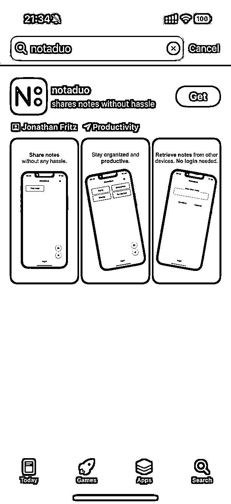

原理说通了，接下来就是四步操作。

## 第一步：用工具挖出候选检索词

圈里早前有不少人推荐过点点、七麦、Sensor Tower这类站点，做移动端的朋友基本都会用它们看市场。大家平时习惯盯头部榜单，但我觉得更值得逛的是那些“没人抢”的角落，投入小，反馈还来得快。今天用点点的免费档位来演示，打开站点后，在左侧菜单里找到热度排行：

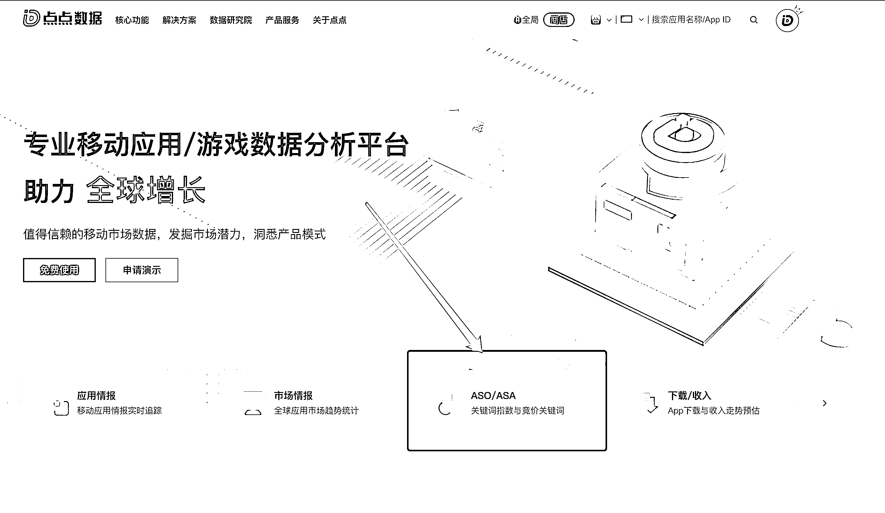

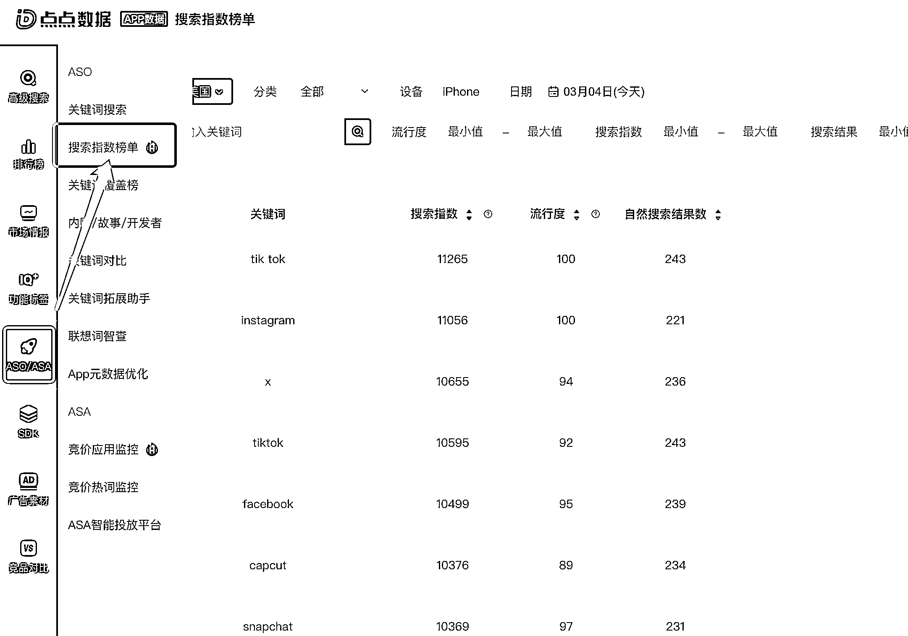

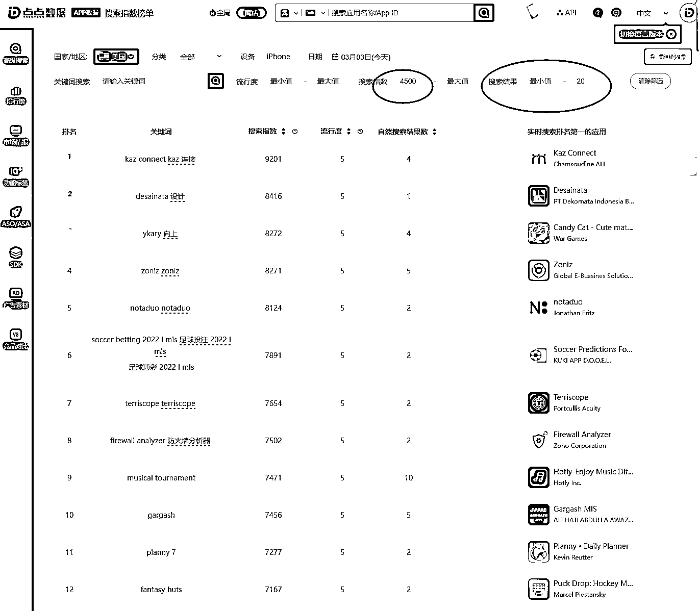

1. 先定一个目标国家和地区。海外商店是分地区的，虽多数App会在全世界范围内发行，但每个地方的政策和用户口味都不一样，这里我们选美国区。
2. 接着加两个筛选条件：热度得分大于4500（约4605），匹配项数量少于20。结果数阈值可以按自己的需要调。

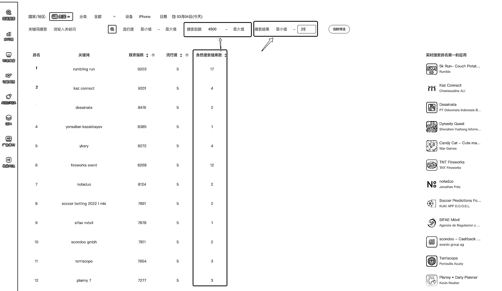

筛选逻辑很直接：我们要找的，是此刻有人在查、但列出来没几个匹配项的词。

## 第二步：逐个判断合不合适自己

这是整套操作的重头戏，每个App的情况不一样，判断标准也不同。有些词看似热门，比如play、xx game、notes这种大而泛的门类词，我基本不看——搜的人自己也说不清要什么，我们掺和进去没有胜算。我更留意的是那些转译工具都读不出含义的词，它们很可能是某个竞品的名称，若是和自己的方向沾边，那几乎是天上掉馅饼。建议装一个鼠标指上去就能翻译的插件，看完还没头绪的词，就值得打开详情页瞧一瞧。比如下面框起来的这一批：

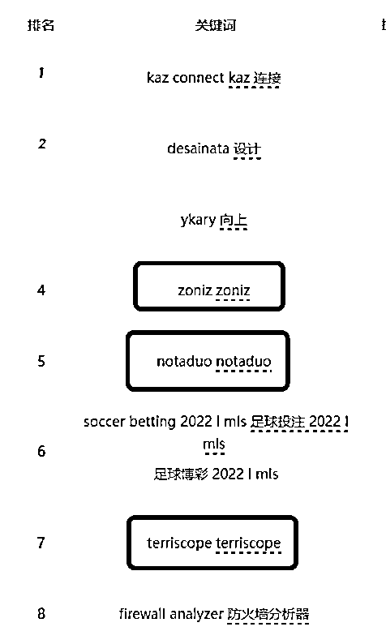

就拿第五个notaduo来说。看不懂，没听说过，但热度值高达8124，已经非常高（注：自2020年2月6号起，苹果官方不再公布检索词的指数。此前的数据由苹果官方渠道发出，之后的数据是点点根据网络访问量、下载次数、联想词等信息推算的，仅供参考），匹配项却只有2条，我在国内商店里甚至只翻到1条。**如果查这个词的人，想要的正好是我们做的功能，这波需求不就顺理成章地流过来了吗？**

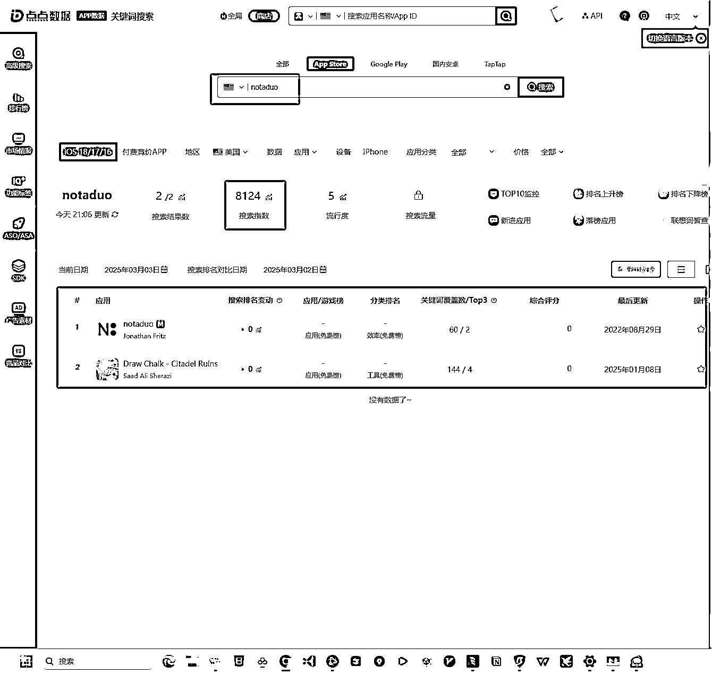

美区榜单上，这个词确实只显示2条匹配项，另一条看起来与他并不相干。更意外的是，那款App最后一次更新停在2022年8月底，这波热度像是凭空冒出来的。

接着看它是做什么的：

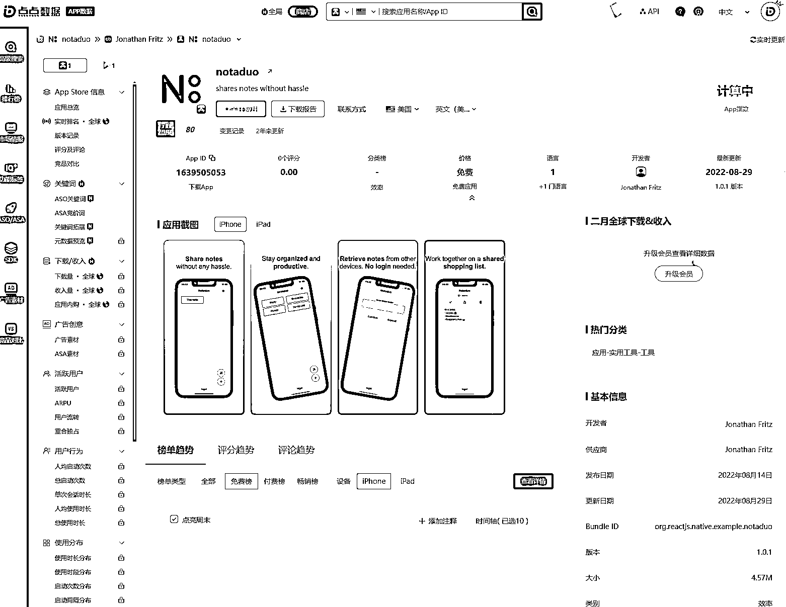

截图会告诉你，它是款靠PIN码分享笔记的小工具，主打免注册、免登录。假设我们的AI作品正好有记笔记的本事，那把这个词填进自己的资料里，让查它的人看到我们，是不是很划算？

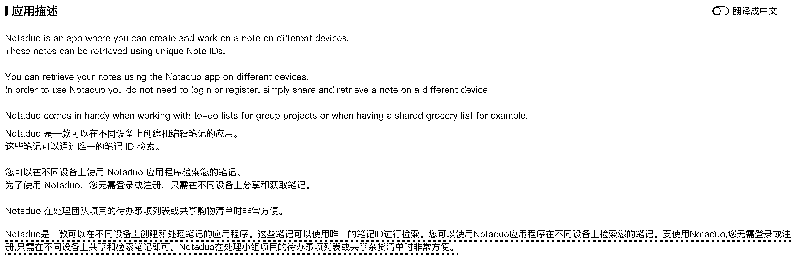

## 第三步：把选中的词填进App档案

接下来就是常规的上架资料调整。提交审核时，苹果会要求你填写一份“背景档案”，用来判断App的类型。其中有一栏叫keywords，通常做App的人会在里面写notes、tools这类常规词。如今我们要把头上有热度、脚下没人的词也塞进去：

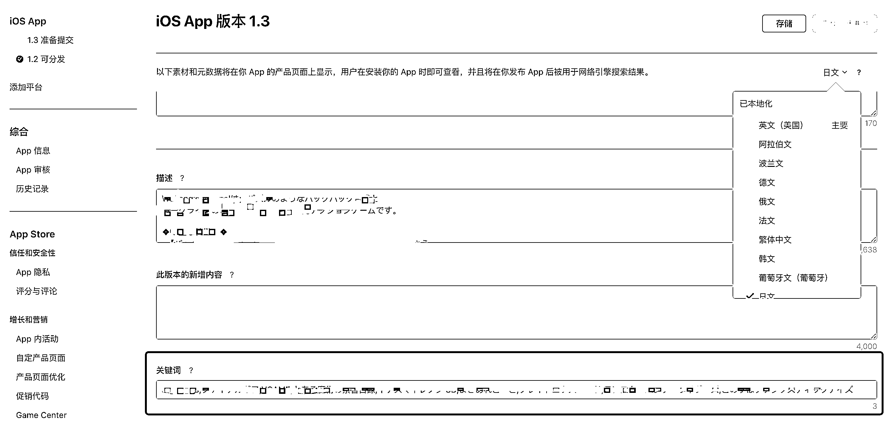

keywords栏最多装100个字符。名字、副标题、简介、推广文案都可以用来安插这些检索词，只要排布得当，用户一查词，我们就能出现在前排。

## 第四步：把覆盖面扩到更多语言市场

*等一下——注意到截图里那行****日文****了吗？*

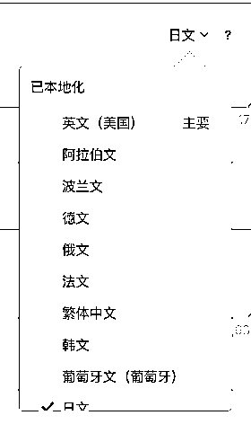

能察觉这一点的人，眼光相当敏锐。AI不仅让做App变得容易，也让“说人话的翻译”成为可能，我们再也不用拿谷歌式的机翻腔去服务海外用户。尤其是小众市场，费效比才是命门：你愿意为当地人做量身定制的内容，对方也自然更愿意选你。

我在休闲游戏上的体会是，法国、澳大利亚这些地方更容易躲开大厂的火力，拉新成本完全不是一个段位。同样的思路放到“借词占位”上也成立：App内部要适配当地语言，商店端的资料也要为一个市场准备一套说法。

于是就有了下面这张表：

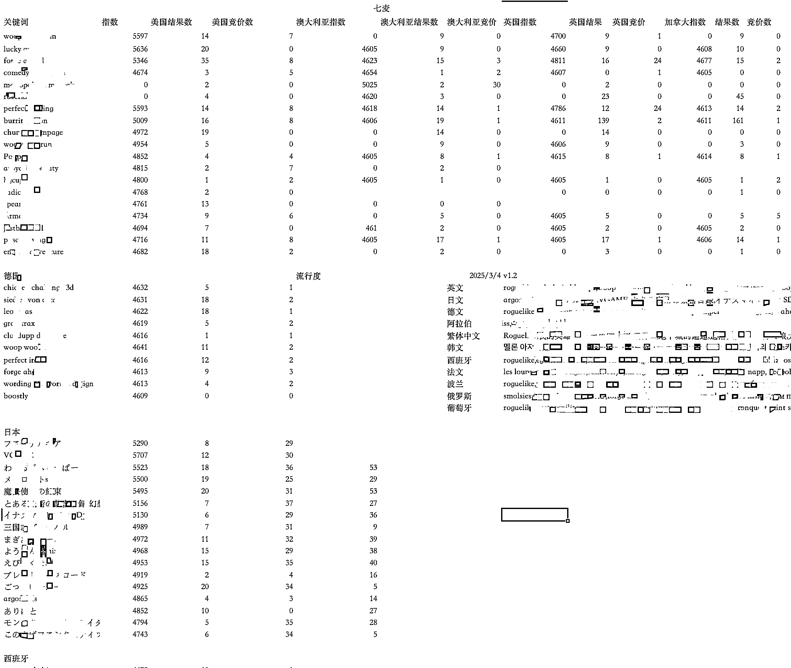

这版表是我用七麦做游戏检索词时留下的，不算什么标准模板，大家随意调整。思路参考了@子木，我自己加了定向筛选的规则，实际跑下来确实有效。有一点提醒：调研时别急着用脚本一次性抓取，也别把内容丢给AI代写，先亲手玩一阵子，积累体感很重要——各区域的用户体量、查找习惯、投放热度，差异比想象中更大。

多个国家、多组冷门热搜词叠在一起，理论上就能罩住一大片检索量。

==============================

以上就是完整的操作步骤，希望给即将上路的圈友们一点帮助，祝愿大家的App都能成为爆款。

## 延伸的几个疑问

1. 档案里的名字、简介、推广文案，是否和keywords一样有排序效果？权重如何？我的体感是：名字 > 副标题 > keywords栏 > 描述。不过借词也要讲究语句通顺，不能硬凑。
2. 星级和评价的影响有多大？操作难度和开销如何？我确实知道有人在做，花费不高，早年自己也试过，只是后来重心都在Facebook和Google的广告上，没来得及算清楚实际收益。
3. 调整keywords要随版本重新提交审核，这意味着不是即时生效，快则半天，慢则两三天，所以选词时要把时效性算进去。
4. 可以多看那些覆盖了某个词的同行，特别是独立做App的人，他们的嗅觉往往很好，同时也要防着点内卷。
5. 更进一步想：这种突然热起来的词，本身是不是就代表一个有价值的缺口，可以拿来直接孵化一款App？
6. 做横向对比时，尽量多开几个工具：七麦、点点、Sensor Tower、Google Trends都值得看。每个工具算法不同，数据天然有误差，所谓指数、热度、流行度，都只是参考值，没人能给出真正的精确值。借词靠的是长期积累的敏感，多数热词都是突然冒头的，统计口径常常跟不上，比如similarweb就看不到近期词汇。这时候可以去社交平台搜搜最近大家在聊什么，判断一下关注点，能明显提升命中率。

## 附：Deepseek给商店优化划的重点

（以下为用Deepseek整理的一份系统说明）

**一、检索词的选取与排布**
- 先摸清目标市场用什么语言、怎么说话。同一组字在不同地区意思可能完全不同，需要小心里面的坑。
- 借助SensorTower、AppAnnie等工具，找出热度还不错但没多少人抢的词，优先选择带定语的长词组，兼顾被看到的机会和访客质量。
- 研究竞品的词表，找出他们没占的缝隙，不和大厂正面硬碰。
- 结合App最独特的卖点做选择，比如主打“AI修图”就把它摆在最显眼的位置。
- 定期复盘每个词的表现，把没作用的换掉，有时把几个词拼成一句反而效果更好。
- 名字是权重最高的位置，苹果只取前26个字符显示，核心词务必放这里，副标题和简介再自然带上别的词。

**二、档案与画面怎么提升点击**
- 名字保持在30字以内，把功能和卖点讲清爽；简介开头两行放主要吸引点，多用列表符号让人一眼看完。
- 图标、截图、视频都要满足好看、风格统一、不违规。截图最好展示实际使用过程和行动按钮。

**三、换地区卖时要做的适配**
- 别拿机翻硬顶，尽量找人校准。阿拉伯语要从右往左读，数字写法也要跟着当地人习惯来。
- 同一种语言还要再细分：英语分美式英式，西班牙语分西班牙和拉美，针对每个版本单独做词表。
- 注意文化差异，避开可能冒犯当地人的手势、表情等元素，节日营销素材也要贴合当地氛围。

**四、用数据持续喂养**
- 持续看词的排位、下载次数和访客留存，随时留意苹果排序规则的变动。
- 可以把付费广告作为补充，让自然名单和商业投放相互配合。
- 多鼓励访客打分，差评要正面回应，这些都是信任的积累。

**五、合规与长期主义**
- 不要堆词，也不要写和实际不符的描述，小心被下架。
- 商店优化是细水长流的活儿，词库最好按季度更新，也可以让AI来帮忙搭建框架。

按这套思路执行下去，App在商店里的能见度和下载成功率会逐步变好。不过请记得：效果通常要等几周甚至几个月才显出来，稳住力气持续调优就好。

---

留言区的几段对谈：

圈友A：延伸问题里的那几条，可以再拿去压榨一下Deepseek的大脑袋。

刺猬：哈哈，有道理。

圈友B：刺猬老师的思路很棒，说白了就是借词，找没人抢的词。但这么一来，会不会把那些搜索量大的词错过？我们该先把长尾词的头部做出来，还是去追热度高但排位靠后的词？哪种更划算？

刺猬：我觉得得看阶段。对刚上线的App来说，借助低内卷的冷门词能快速拿到第一批访客和真实反馈，这是最值钱的东西。比如刚才说的笔记类工具，如果你的功能真的能顶上，再在访客进来后的使用路径上花点心思，建立起反馈通道，产品的问题会更快暴露。冷门词往往访客目的更明确，没什么对手，成交率更高，适合先把底子打牢。

大词确实量很大，但抢的人也极其多。产品还没打磨成熟、预算又有限时，硬挤大词很不划算——既要有完整的排位方案，又要有持续买量或广告的支持，还得攒口碑、攒下载。这些底子没到位，就只能排在老后面，访客看了也极少点进来，等于钱花了还办不成事。真要预算充足，不如直接投广告。按我的理解，大词是给那些已验证方向和营收模式的产品准备的，在长期积累信任的阶段里，作为广告以外的补充。

圈友B：我昨天试着跑了一下这个法子，发现两个情况，不知道刺猬老师注意到没有：

1、点点和七麦给出的热度值都很不准，两边能差出一大截。我猜里面有些词是用户打错字、苹果也没纠正的词，热度其实是靠另一个词贴过来的，实际并没有人查，就算排到第一位也没意义。
2、如果辅以流行度做筛查，倒是能起些作用，但筛出来的几乎都是别人家App的名字。借这些名字有被清词的风险，用之前得掂量。

刺猬：你说到点子上了，精度确实是个问题，所以要多看些门道，比如它有没有出现在别人的评价里。至于别人的名字，关键看拿它怎么用：只是对照着讲没毛病，拿去照抄顶替就会出事。对下载你App的人时刻保持坦诚是第一位的。另外你可以看到，很多这种词都有人在投苹果的竞价广告，直接拿别人的名字做竞价再正常不过，这没什么不能说的。

圈友C：这篇文章的切入角度真不错！

刺猬：日常多几千次被看见不算难，具体要看后台记录。