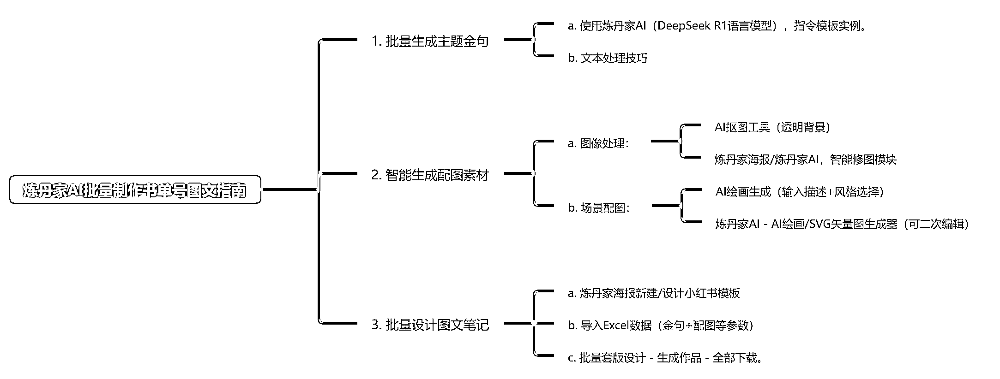

# DeepSeek+批量海报！分分钟生成 100 张爆款海报（案例+保姆级教程+工具）

最近DeepSeek真的太火了，不少朋友都说它生成的内容质量远超预期，甚至有点“超出想象”的感觉。今天我就来聊聊，怎么把DeepSeek和炼丹家海报神器结合起来，一次性批量产出上百张风格完全不同的海报。

实际案例很简单：像📕里那些爆款书单号、资料号，只要内容结构是固定的，这套方法就能直接套用。效率怎么说呢，比手工做快了不止一百倍，轻松就能支撑起一个新媒体账号的日常更新。

具体操作其实不复杂，核心就三步，学会了之后还能举一反三，应用到其他场景。

顺便说一句，已经有朋友来反馈过，说这个工具确实做得给力，值得上手试试。好东西不藏着，大家可以直接拿去用。