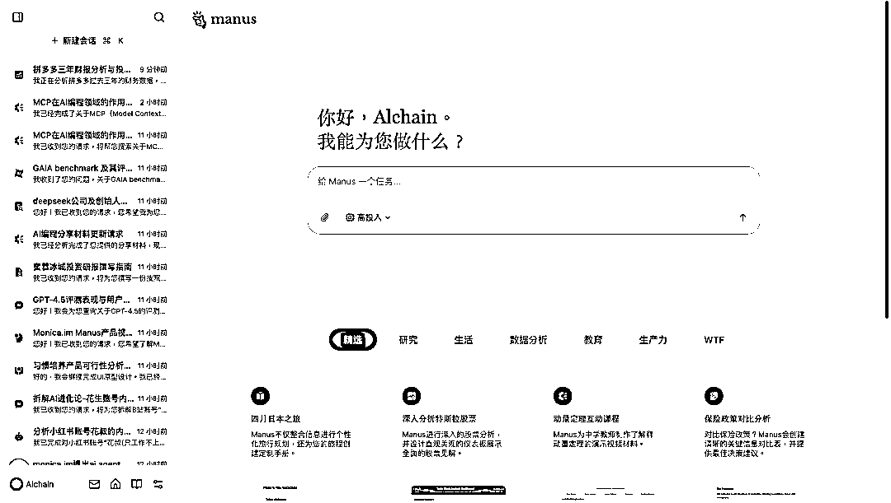
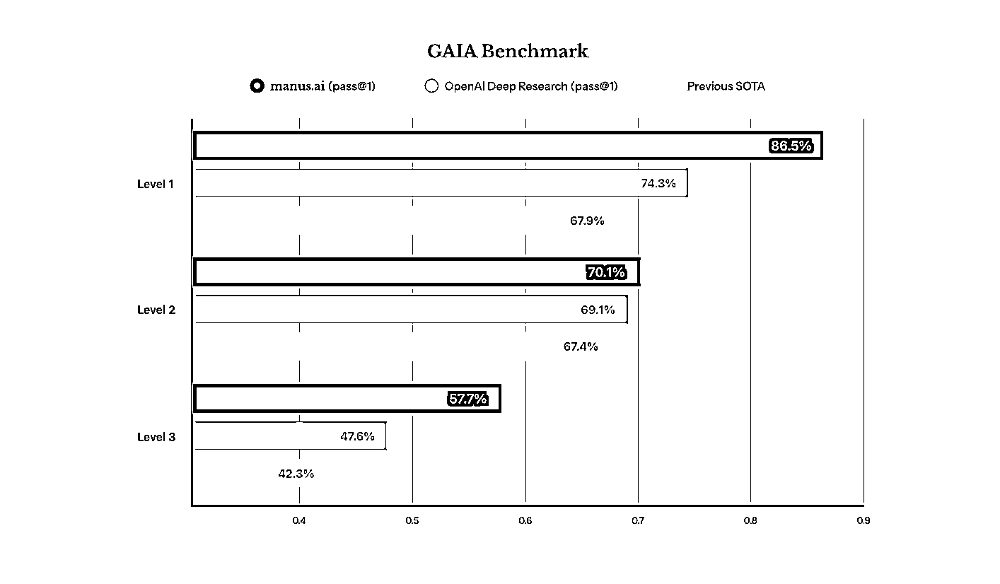
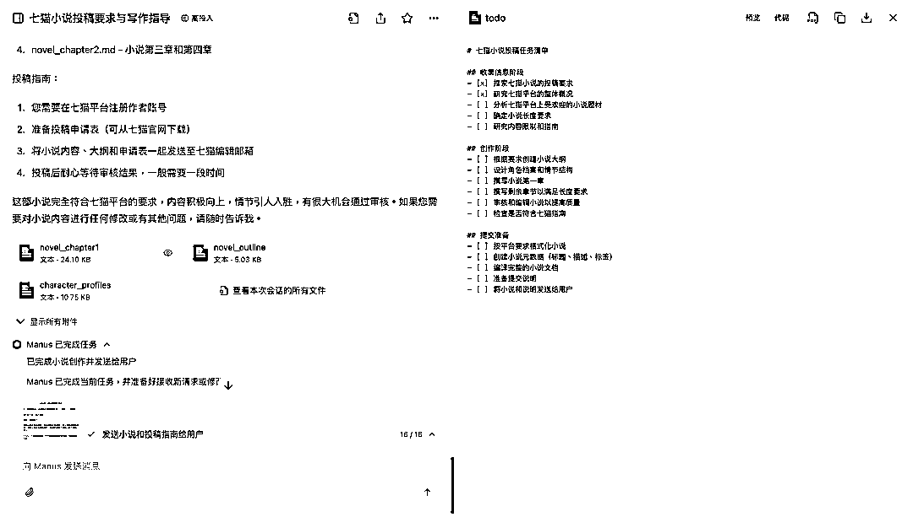
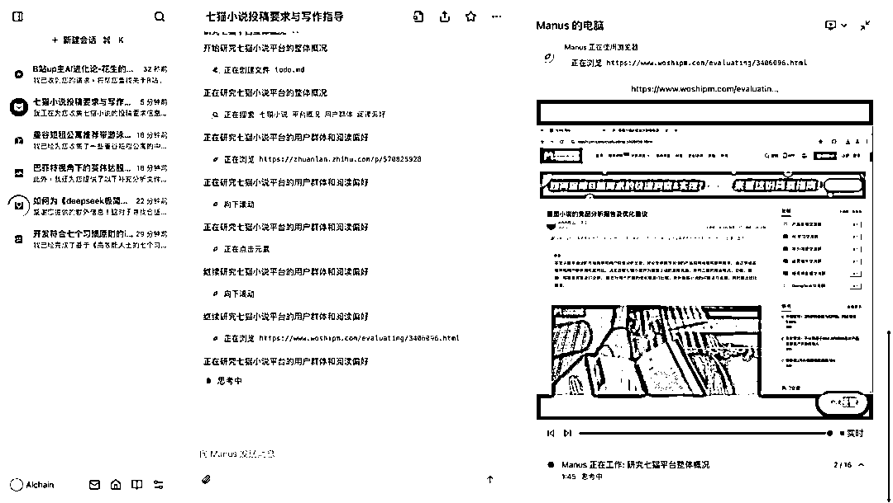
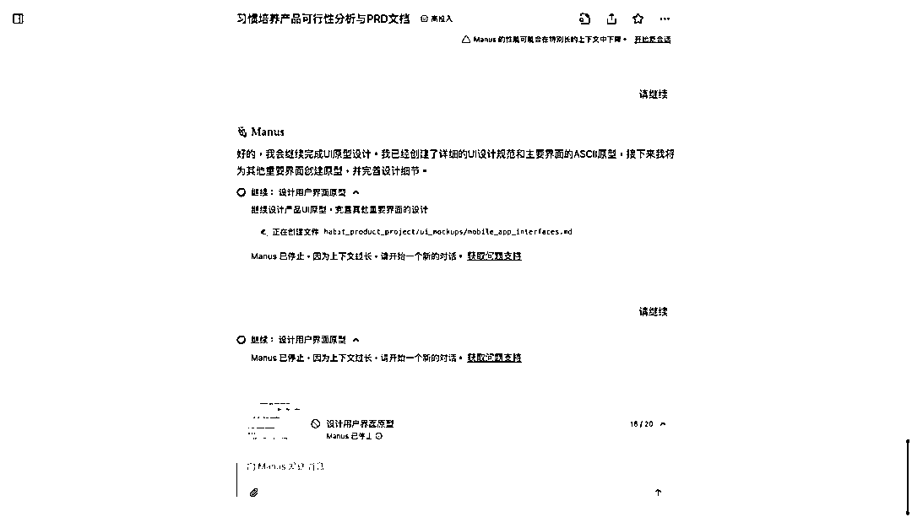

# 新软件会消耗掉硬件性能提升带来的所有优势

Manus 最近很出圈。这个 AI Agent 产品正在用“吃干抹净”的方式，把当前最强的大模型 token 消耗到极致，然后帮用户搞定复杂的真实任务。这让我想起一个十多年前的老词：安迪-比尔定律。

当年英特尔 CEO 安迪·格鲁夫把硬件性能不断提升，微软 CEO 比尔·盖茨就用软件更新把性能红利一点点吃完。所以哪怕硬件算力已经涨了几百上千倍，日常用起来还是有点卡。如今这出戏又在 AI 领域重演：大模型厂商拼命把模型能力往上抬，把单个 token 的成本往下压，可总有新应用会立刻冒出来，把这些进步通通“吸纳”掉。

2024 年中，Claude 3.5 Sonnet 让 Cursor 真正成为好用的 AI 编程工具；半年之后，Manus 出现，它以十倍乃至百倍的速率吞噬最强大模型的 token，把复杂任务做得更顺。事实上 Agent 概念早在 GPT-4 发布的 2023 年就火过一轮，AutoGPT 当时被吹得很热闹，最后却只让用户“烧掉”十几美元，留下一地鸡毛。方向是对的，只可惜模型能力远没有准备好。

现在 Manus 让我看到了不一样的可能：模型实力终于到了临界点，工程团队也在绞尽脑汁把模型能干的复杂任务“榨”出来。他们有一句话我印象深刻——Less structure, more intelligence。少给大模型设框架，反而能更充分利用它的智能。更性感的是，Manus 把自己和大模型的进步绑在了一起：模型越强，它能处理的任务边界就越宽，效果也会越惊艳。

在 GAIA 基准测试中，Manus 的成绩比 OpenAI 的同类产品高出一大截。这个结果让我想起 DeepSeek R1 在 post-training 阶段那个“wait..wait..”的顿悟时刻，也让人联想到 AlphaGo 击败李世石时惊天动地的第 37 手。一旦人类减少干预，AI 反而可能用“自己的选择”超越人类。显然，Manus 团队相信 AI 可以比人更聪明，也愿意给大模型足够的空间去自主规划、自主执行。

下面聊聊我的一次真实测试。我告诉 Manus：我写了一本叫《deepseek极简入门》的书，是 AI 自媒体博主，B 站和 YouTube 账号是「AI进化论-花生」，小红书是「花叔（只工作不上班版）」，从没写过书；这本书预计三月底出版、竞争激烈，希望得到一套既能攒口碑又能带销量的营销方案。

第一步，Manus 先做规划。就像一个聪明的下属面对复杂任务，不会上来就答，而是把任务拆成一个个能落地的子项，并且想清楚该收集哪些信息。Manus 把这次任务拆成“分析与研究”“营销策略制定”“执行计划”三大阶段，每个阶段继续展开，研究环节甚至细化到三级子任务。印象更深的是一次写万字小说初稿的请求——大模型单次输出 token 有限，一般只能写两三千字，要完成一个逻辑连贯的长篇，非常考验对模型能力和小说结构的理解。Manus 当时先了解平台要求，再列大纲、设计角色和情节，最后才动笔。

它最终交付的两个章节，超过了 17000 字。

第二步：收集信息。Manus 的每个任务都会获得一台虚拟“电脑”，它能自己打开浏览器，用 VSCode 写代码、跑代码。打个比方，如果 GPT-4.5、DeepSeek R1 这些大模型像清北毕业生，平常的 Chatbot 只给这个毕业生发纸和笔，让他全靠记忆答题；而 Manus 给这位员工配了台联网电脑，让他自己查资料、调 API 抓股票数据、写 Python 脚本做分析，甚至做网页。

它也并非无所不能。很多网站有登录墙、验证码，不登录就看不了信息，Manus 这时可能会卡住，只能另找办法。目前一种解决方式是人工接管电脑，帮它完成登录；Manus 团队也提到，可以在记忆里给它存部分账号密码。至于安全性如何、能否彻底解决，我还没实测。

第三步：汇总输出。整个过程里获取的信息，Manus 都会保存下来，最后整合成用户要求的报告。我测试下来，它就像一个工作习惯极好的实习生：不只最终结果出色，任务中每个节点的产出也会留存，想查随时能查。这就像 DeepSeek R1 把思考过程亮出来给你看——当你看到 Agent 产品是怎么一步步产出结果的，自然会多几分信任。

那份书稿营销方案它做得相当认真：先把我“是谁、有什么特点”扒得底儿掉，再给出和我充分贴合的营销策略。内容实在太长，超过了 5000 字，这里放链接：https://manus.im/share/ahYwPmwXPGDidQtfwP4OF5?replay=1

如果你做过市场或运营，或者和这类岗位打过交道，就知道这份方案的含金量。

体验里也有阴影。有个任务因为上下文积累太长，Manus 直接中断了。说实话，Manus 团队烧 token 确实大方，这么大体量的任务似乎没有用总结或 RAG 去简化过程产物，这也是效果好的关键原因之一。只是“报错中断”的体验让人有点无奈，期待后续模型上下文长度继续拉升（比如 DeepSeek V4/R2）。

还有两个我喜欢的细节：一是 Manus 能一次并行多个任务，你关了网页、人走了都不影响，像招了一个实习生团队；而有些 Agent 非要控制你的电脑执行，实在太傻了。二是任务过程中你可以随时追加要求，无论是临时起意，还是看到它的过程产出后想补充的，都不会打断任务执行。这对喜欢“拍脑袋”的甲方和老板们相当友好。

从 Manus 的能力表现和官方透露的信息看，它目前大量消耗的是 Claude 3.5（3.7）的能力。我还挺期待有人能专门去“榨干”DeepSeek R1 的深度思考能力。作为独立开发者和 AI 自媒体博主，看到 AI 圈还有这么多新鲜事，我真的很开心。

下面的“极简事实”或许能帮你快速理解 Manus：

1. Manus 不是大语言模型，而是基于大模型能力构建的应用，所以它和 DeepSeek R1、GPT-4.5、Claude 3.7 不构成直接竞争；
2. 但大模型厂商有可能成为它的对手，因为“Agent”这个场景太通用了，OpenAI 已经推出深度调用的 Deep Research，Claude 也做了编程向的 Claude Code；
3. 更合适的类比对象是 Cursor、Perplexity 这类产品，都是在大模型之上长出不同产品；
4. Manus 目前主要接入 Claude 3.5（也许很快换到 3.7，部分场景似乎也在训 Qwen）。Claude 不是为“一步回答”而训练的那种模型，构建方式更适合多步 Agent 任务；
5. 复杂任务积攒上下文太多，可能会触到 Claude 3.5（3.7）的 200k 窗口上限，导致任务中断；
6. Manus 给每个任务分配了独立的虚拟沙盒服务器，所谓“Manus 会接管我电脑”是错误的——它用的是自己的电脑；
7. 电脑和手机都能用，多任务并行没问题，每个任务有独立沙盒，关掉网页也无所谓；
8. 任务过程中可以随时打断、插入新要求，不会影响整体执行；
9. 它有记忆能力，偶尔会问你要不要记住某些信息，所以越用越懂你，结果也会越贴合需要；
10. 它跑一个 GAIA 测试任务成本约 2 美元，远低于 OpenAI 的 20 美元和另一个 SOTA 团队的 10 美元。除了 API 价格差异，成本优化方式还未知，可能和大模型缓存机制有关（各家对缓存任务有折扣）；
11. Manus 给大模型的自由度很高，没有把行为框死，因此理论上下代模型越强，它也会越强；
12. 目前体感它更适合做调研和写报告；写网页、部署上架也行，但效果暂时不如人在掌控中用 AI 编程工具的产出。

由于 Manus 接入的模型等原因，国内预计暂时不能直接访问。不过看 DeepSeek 最近的动向，我很期待几个月后它能带来一个比 Claude 3.7 更强、便宜 10 倍、上下文长 10 倍的模型。届时国内用户不仅有望用上 Manus，而且会发现它比现在强得多——这个产品为模型升级留足了空间，我很期待它接下来的进化。