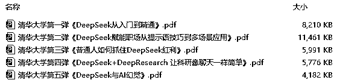
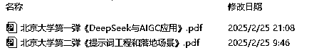

# 清华和北大同时放出了 DeepSeek 实战笔记，到底谁更值得深读？

## AI 评测：清华 VS 北大 DeepSeek 干货，谁更硬核？（附资料下载）

作者：乔帮主

日期：2025-03-05

DeepSeek 一旦走红，清华就抢先拿出了 5 份围绕该模型的落地型学习包，这类内容在公开渠道几乎找不到，含金量远超市面上常见的付费培训。

打包资源放到了文末，直接拿走即可。

随后北京大学也迅速跟上，近期对外公开了 2 套同主题的实操合集，每份都配了约 100 页的 PPT，气势上很像一场暗中较量。

同样也可以在文末获取整包。

两所高校给的材料都相当扎实，但加在一起几百页的 PPT，文字估计十几二十万，配图上百张，人手去梳理会非常吃力。所以我让模型先代为通读、提炼要点，再做横向打分，看看清华的资料是否更厚重，北大的是否更易用。

一共 7 个文件、515 页内容，信息量极大。对模型来说既要完整消化，又要输出对比结论，对长文本理解和综合判断能力是极大的考验。

于是我找来了 DeepSeek、ChatGPT、Claude、Kimi、豆包、海螺、跃问、智谱清言、文心一言这 9 款工具一起上场，看谁能扛住这个硬任务。

最终的结果有点出人意料，里面藏了个小彩蛋。先剧透一下，汇总这份结论的并非 DeepSeek，也不是 ChatGPT。

> 清华大学和北京大学的 DeepSeek 实践资料各有侧重。清华更偏向多场景的应用探索、提示词的设计思路以及大模型幻觉等深层话题，在整体含金量上略占上风。它对技术机理的细致拆解，以及在工作、学习、生活等多方面的展开，给读者提供了很有深度也非常实用的参考，能真正解决实际困扰。
> 
> 北京大学的强项在于对 DeepSeek 的条理化讲解和创意性用法。逻辑上从基础概念逐步过渡到实操技巧，脉络清晰，容易上手。在创新层面，提出了不少新颖的提问方法，并对不同行业的未来应用做了前瞻性思考，为拓展使用边界提供了新思路。
> 
> 两者互补，清华的深度剖析搭配北大的清晰框架与创新视角，共同搭建起一个全面、系统且可用的 DeepSeek 知识与应用体系。无论想钻研底层原理，还是寻找落地方案，都能在两校的材料里找到有价值的启发。

**完整评测内容已搬到飞书：**

* * *

评论区：

Fly : 很棒的测评, 不过少了通义千问啊