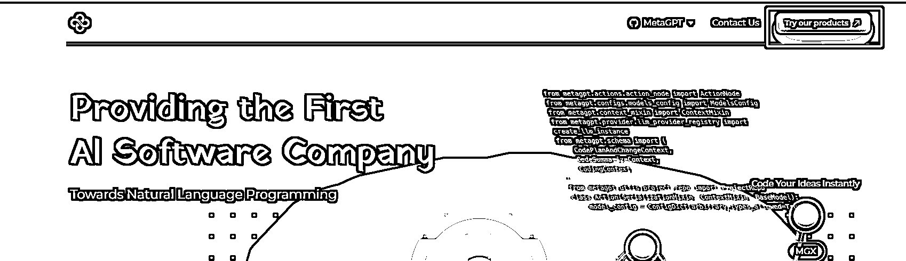
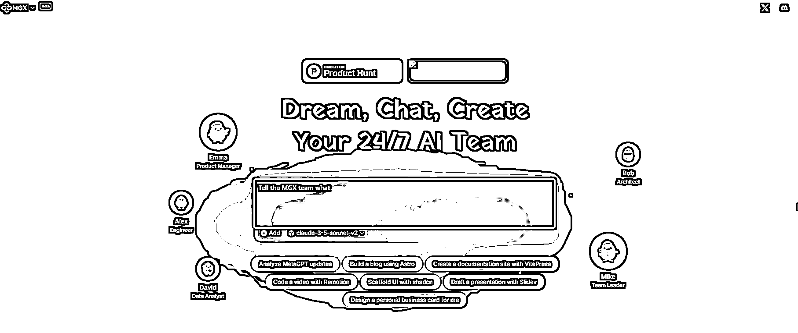
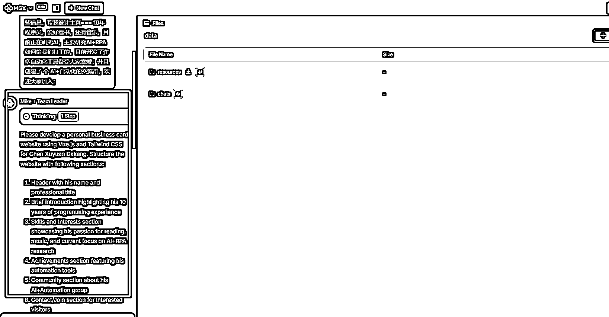
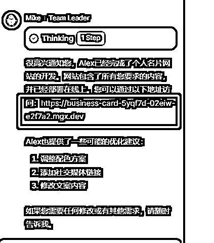
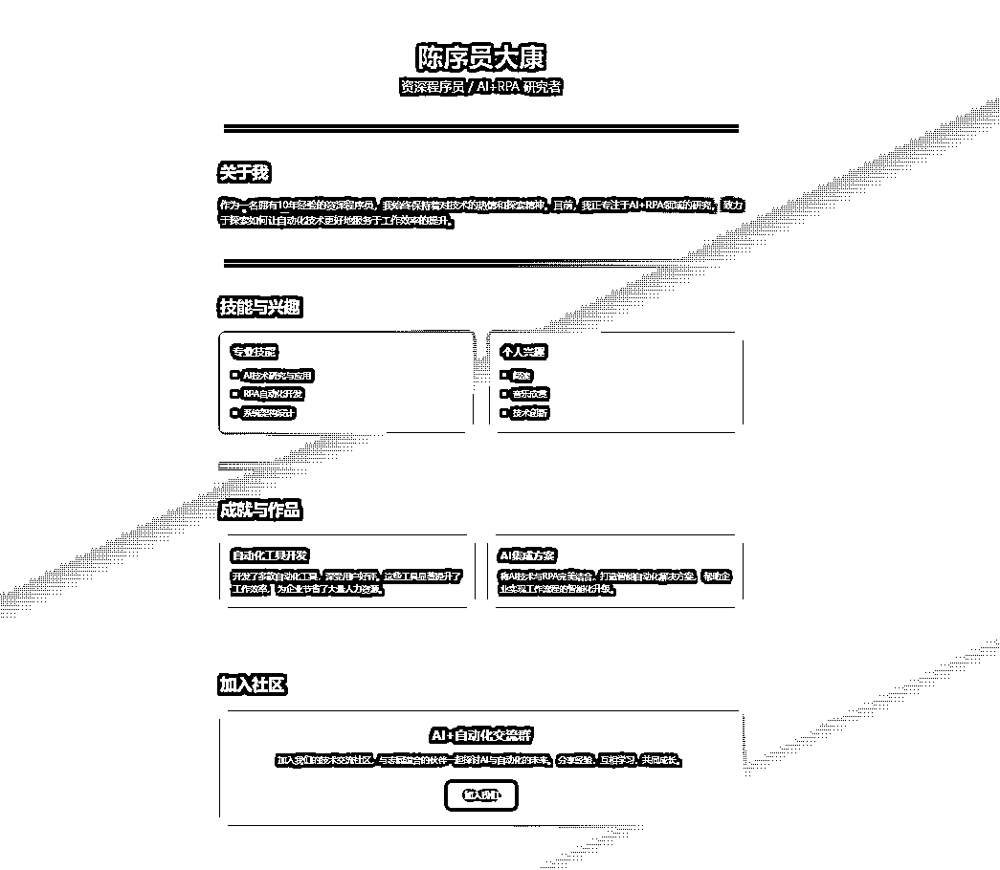
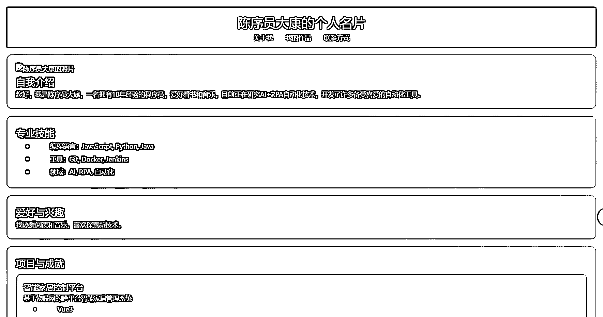
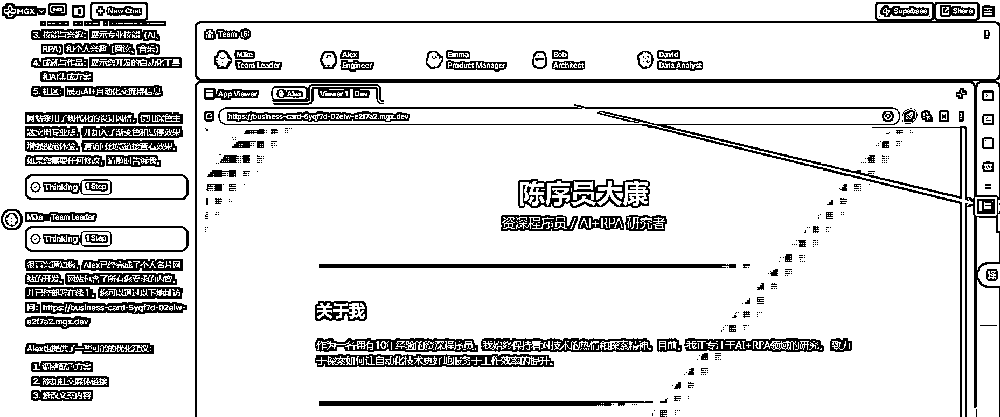
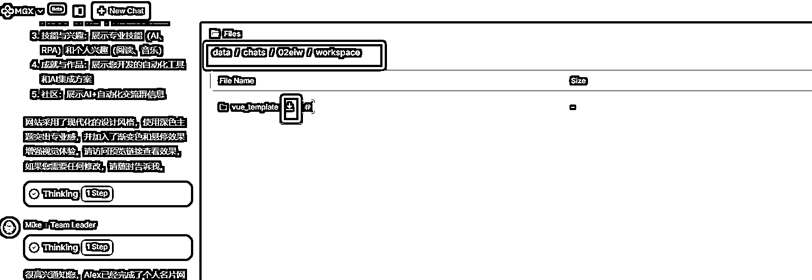
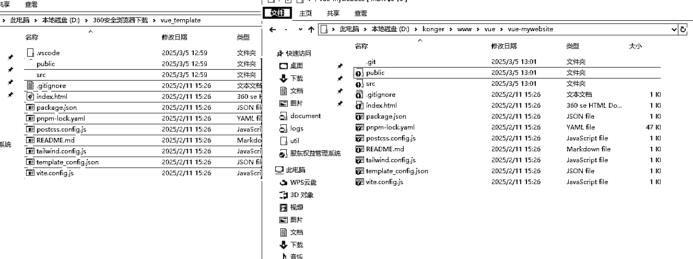
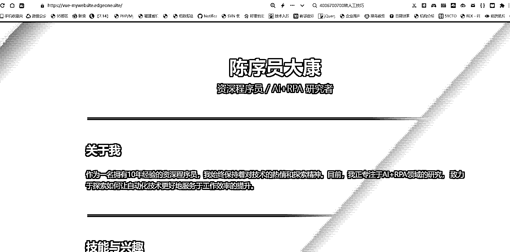

# 当开发团队被压缩成一个 AI 产品，个人也能玩转软件开发了

## MetaGPT 官宣 MGX，AI 全流程开发团队真的来了

作者： 陈序员大康

日期：2025-03-05

昨天我刚发了一篇干货，分享了怎么零成本、零代码经验就能用 Deepseek 给自己搭一个网站上线。

听起来很香，但实操会发现一个问题：非技术背景的人光靠跟 AI 天天聊天揉代码，想把一个网站打磨成型，沟通成本和折腾次数实在太高。

正当我觉得这种方式还不够丝滑的时候，MetaGPT 的 MGX 正式浮出水面。

MGX 究竟是啥？
简单说，它就是一个纯 AI 组成的软件公司。内部搭了五位虚拟员工：产品经理、架构师、研发工程师、测试员和数据分析师，这五个人会按真实的研发流水线自动配合，从解读需求、写 PRD、技术选型、写代码、跑测试到最终部署，全程不用你上手敲一行代码。

你只需要用大白话告诉它想要什么，它就会按正规公司的分工协作，自动产出文档、接口设计和可运行的代码，个人博客也好、企业内部工具也好、数据分析面板也好，都能直接生成。

这和我们普通人直接去用 AI 编程助手写代码的体验完全不一样。MGX 是在流程层面帮你把需求翻译成完整的交付物，省去了大量来回扯皮的环节。

## 实战体验：手把手做一个个人名片站

废话少说，直接上。

第一步，打开官网
[`www.deepwisdom.ai/`](https://www.deepwisdom.ai)

点右上角的进入按钮

进入工作台后是这样

为了公平对比，我复用了昨天那篇文章的例子，让它用 vue 做一个个人名片页。提示语我照抄了之前的输入：

请你用 vue 给我开发一下个人名片网站，以下是我的介绍信息，你需要先润化文案，然后根据文案设计这个名片网站：我叫陈序员大康，我需要做一个
个人介绍名片的网页，现在需要你帮我构思一下这个页面的大体结构包括文案的设计，以下是我个人的介绍，请你根据这些信息，帮我设计主页===

10 年程序员，爱好看书，还有音乐，目前正在研究 AI，主要研究 AI+RPA 如何给我们打工的。目前开发了许多自动化工具备受大家喜爱；并且创建了 个
AI+自动化的交流群，欢迎大家加入；

提交后，AI 团队立刻开工了

速度比我预期快很多，很快就给我生成了一个可用的站点

并且直接提供了在线预览链接，效果是这样的：

几乎一次成型，我完全没有额外修改。对比一下昨天我用 AI 编程工具 Trae 做同样的名片站，中间报错、反复沟通了好几轮才勉强可用：

更妙的是，MGX 产出的代码可以直接拿去部署。结合我上一篇教的免服务器部署方案，把拿到的源码覆盖到自己的仓库里就行，新手也能把网站搬到自己的环境。

## 怎么把代码搬到自己的网站上

### 1、回到刚生成的项目页，点击右侧 Files

### 2、按路径找到项目源码

不同语言的项目目录会不一样，自己点进去找到对应的文件夹下载就行。

### 3、把代码放到之前的仓库中
我的 Vue 项目长这样，和之前结构基本一致，直接覆盖进去

然后用上篇教程里的方法提交推送到自己的托管环境。

### 4、去 EdgeOne 看效果

完美上线。

**小结**
初上手 MGX 的体验超出预期，0 到 1 的简单项目基本都能一次搞定。更复杂的业务逻辑还需要更深度验证。

我的使用建议是：前期需求模糊、快速出原型时先交给 MGX 这种全流程 AI 团队；等到需要精细打磨、个性化定制时，再用 Cursor 这类专业编码工具接力。

两者不是谁取代谁，而是各司其职。

* * *

评论区：

倾听晚风 : 哇，这个很实用啊

陈序员大康 : 必须的[偷笑]

逑乐 : 我之前有在他们的微信群看到 但没用过抽空试试看[色]