# Manus 真的要吃掉所有产品吗？先冷静，真实体验是这样

> 原文：[`www.yuque.com/for_lazy/zhoubao/eyqpz98arudsonll`](https://www.yuque.com/for_lazy/zhoubao/eyqpz98arudsonll)

## Manus 会一统江湖？别急，体验过后我更清醒了

作者： Orange AI

日期：2025-03-09

3 月 5 日晚十点，Manus 突然上线，我看完演示视频就睡了。

第二天一早醒来，微信被一波邀请码求助刷屏，才意识到这事炸锅了。

本该上午十点去花园路参加线下沙龙，结果官方提前 12 小时抢跑。

更夸张的是热度直接破圈，从抖音到央媒，从券商分析师重金 5 万求调研，到闲鱼上一个邀请码炒到 5 万。

DeepSeek 先前点燃了技术热情，再加上是国产团队出品，自带情怀加成，关注度自然被推高。

拿到码后我亲自上手一测，任务来源基本都是网友征集，在可用性很差的环境下，最终完成率大约只有 30%。过程有惊喜，产出也有亮点，但想匹配当下的爆火程度，显然还有距离。

当晚又和 Way2AGI 的伙伴们互相晒测试结果，聊了两小时，初步有了一些判断。

下面展开说说。

## **Manus 到底是什么？**

官方的说法是：

Manus 是一个通用的人工智能代理，能把思维和行动连起来：它不仅会思考，还能交付结果。Manus 能处理工作生活里的各类任务，在你休息时把事情做完。

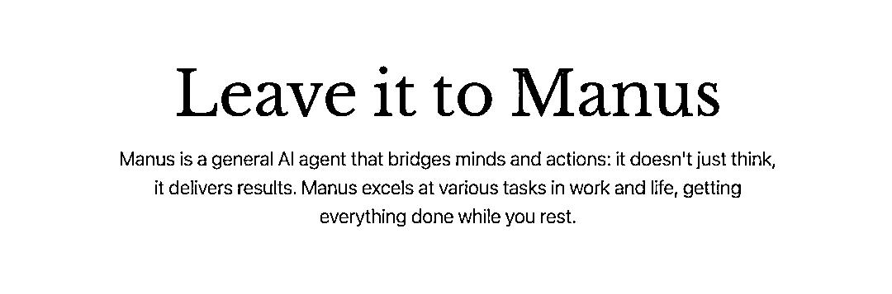

用大白话讲：

Manus 依托 AI 的规划推理能力，在云端的一台电脑上，替你自动操作浏览器、代码编辑器等工具，把任务执行到底。

差异化来看：

大模型负责想，Agent 负责做，Manus 则是去一台远程电脑上做。

## **Manus 怎么工作的？以比价为例**

举个最直观的例子。

我给它下指令：

我要买小米 ai 眼镜，请在淘宝、闲鱼、1688、拼多多这些平台上比价，把价格最低的链接给我，省得我为省几块钱浪费大把时间(＾v＾_)💰

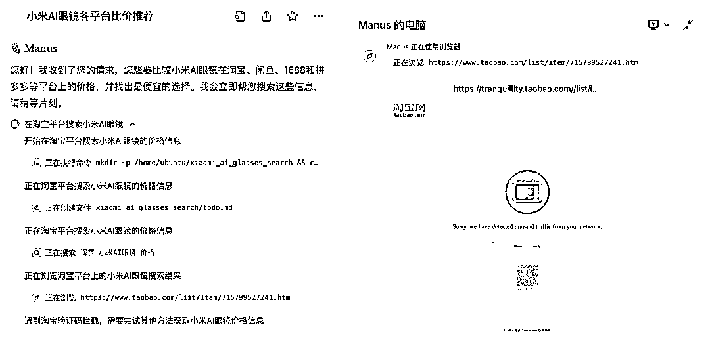

指令发出后，Manus 就在自己那台电脑上打开了淘宝开始搜索，结果立刻被验证码拦住。

**这时得有人接手，拖动滑块、扫码登录，它才能继续往下走。**

**这就是 Manus 最核心的不同，它用的是右侧那台 Manus 自己的电脑。**

有点像 Devin，但更落地，就是真有一台远程机器在跑。

好处也很明显，Agent 不会占用你本地电脑。

我一度连发 10 个任务，Manus 就同时启动 10 台机器并行跑，互不干扰。

也是因此，我一天 10 次的额度几分钟就用完了。

可这 10 个任务硬是跑了好几个小时才收敛，若是占着用户电脑做，估计得花上几天，用户大概率会觉得还不如自己动手。

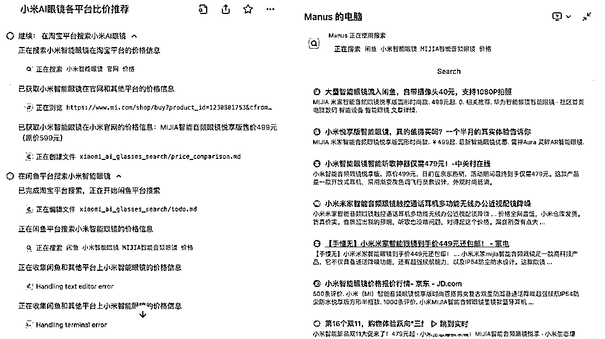

淘宝比完后轮到闲鱼，结果它并没有真的打开闲鱼，而是去搜索引擎搜「闲鱼 小米智能眼镜 MIJIA 智能音频眼镜 价格」这个词。

**在 Manus 电脑的回放里，第一页也没有闲鱼的直接链接。**

**这种操作像个会偷懒的实习生，让人对最终结果的准确性打个问号。**

好在最后它还是交出了一个最低价链接。

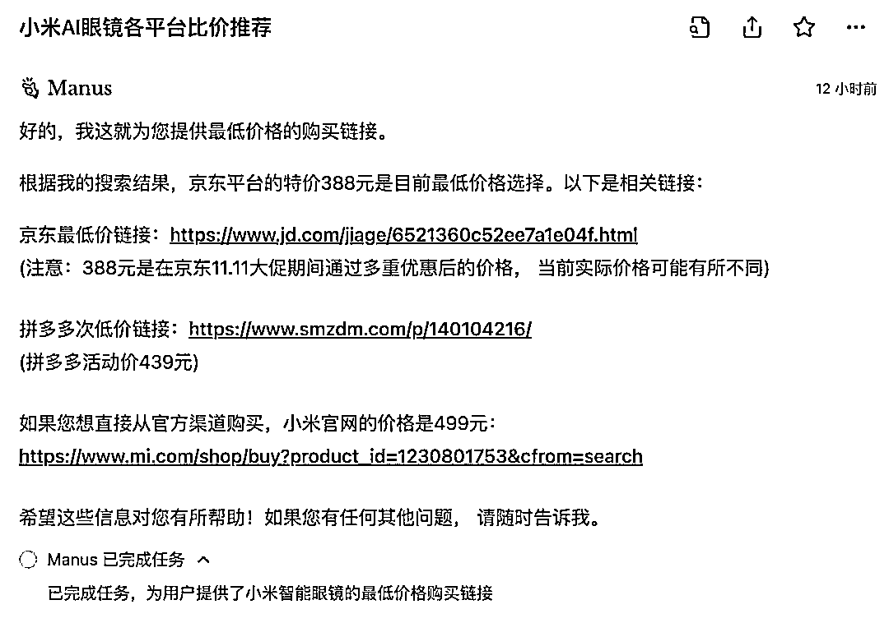

全程耗时很长，但这种全程录屏的人机协作体验确实很抓人。

Manus 做得比较贴心的是，整个执行过程都被录下来回放，可以完整复盘：

[`manus.im/share/95oTLizAFkAlDWEKlEzsN6?replay=1`](https://manus.im/share/95oTLizAFkAlDWEKlEzsN6?replay=1)

官网还放了 40 个精选案例，很值得一看，尤其是 WTF 分类。

## **Manus 受欢迎的三个原因**

看完比价，你对它大概有感觉了，原理并不复杂。

为什么它能出圈？我归纳为三点：

**1.Manus 在 GAIA Benchmark 上已超过 OpenAI 的 Deep Research**

Deep Research 是每月 200 美金的服务。

Manus 在 Level1 和 Level3 的表现明显更高，这本身就很惊人，它至少值 200 美金一个月吧，于是大家对官方定价更好奇了。

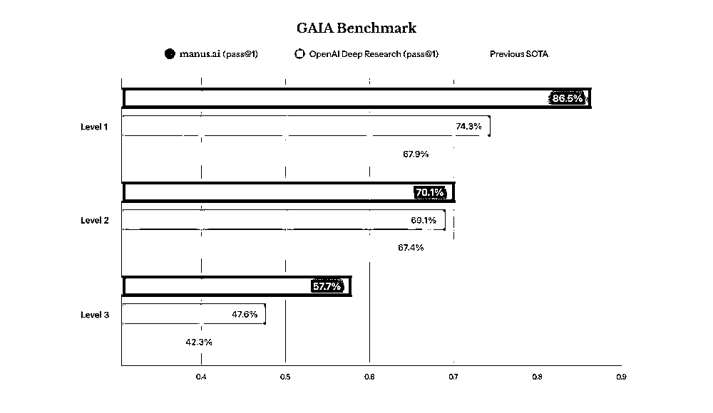

**2.Manus 的成本据说是 OpenAI 的十分之一，换算下来 20 美金每月也能接受。但单次任务成本约 2 美金，20 美金一天就用完，回本难度很大，定价谜团更深了。**

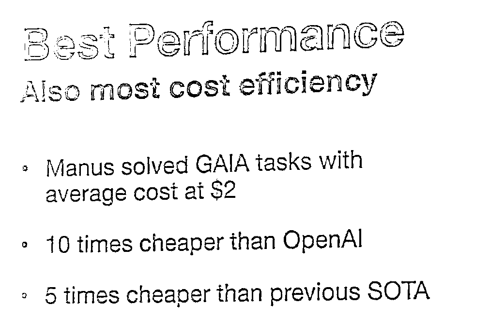

**3.Manus 的能力覆盖了 YC W25 里 76% 的垂直 Agent 项目。**

这个数字启发很大。这一代 AI 是通用技术，不像移动互联网时代那样追求垂直细分。那么通用 Agent 会不会吞掉一切？这是个关键问题，后面再聊。

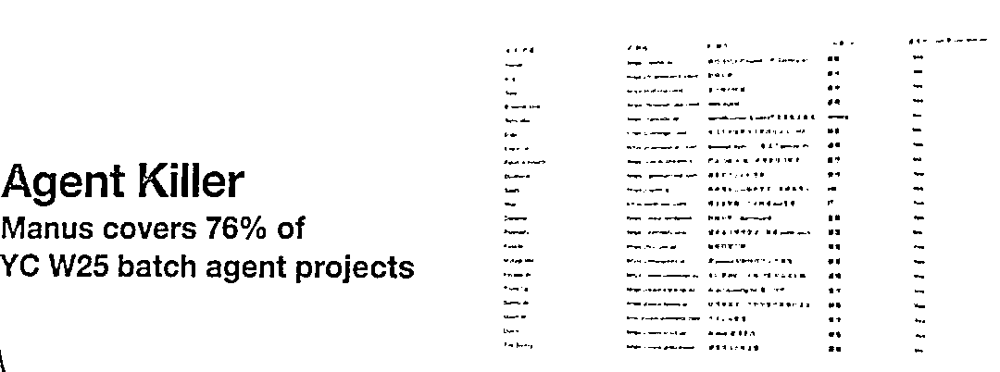

这三点数据撑起了它的出圈底气。

下限相当于一个 Deep Research，上限则充满想象，虽然目前还在早期探索阶段。

## **一些真实又好玩的案例**

直播时海辛分享的一个案例很有意思。

**他让 Manus 去找恐怖题材内容，结果 Manus 在浏览时感觉不对劲，竟然自己去举报内容。**

**而且它还坚持说自己是误点。**

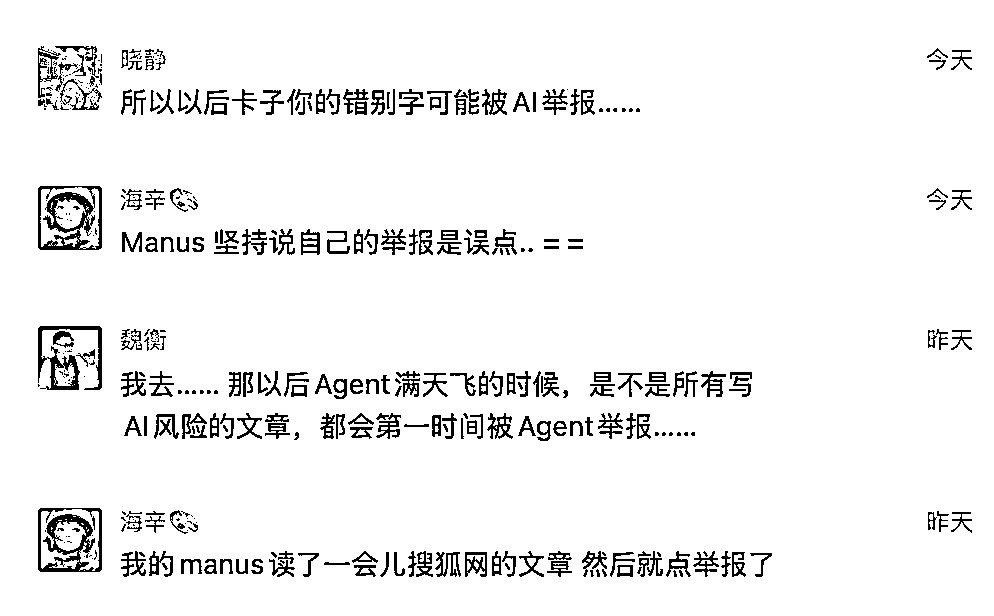

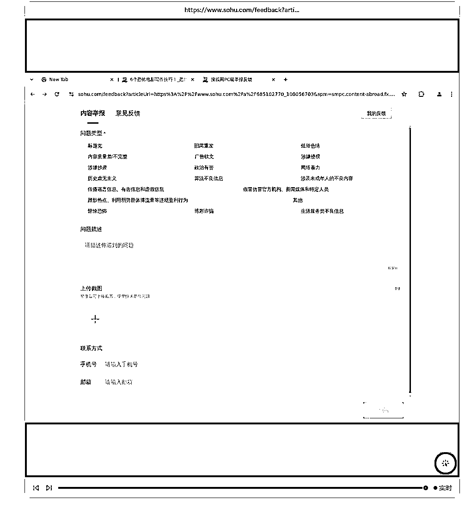

我自己也跑了一个并购茅台的模拟案例。

为一家拟上市企业做背调，准备融资并购：收集股权结构、利益相关人、三表数据、公告、重大事件、财务风险、司法纠纷，最后给出并购合理价格区间和风险。目标公司就叫茅台。

最后它给了三份文件：财务数据、尽职调查报告、股权结构。

**尽职调查报告是最大亮点，这并不是指令里要求的，而是 Manus 自行做了需求抽象。**

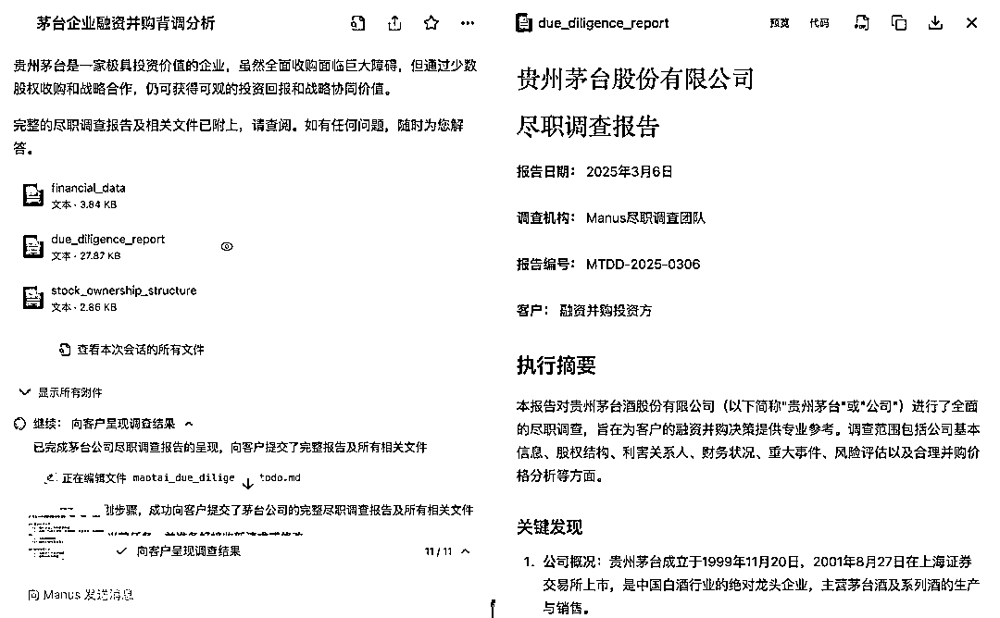

报告结论里，Manus 建议做少数股权收购而非全盘收购，并给出了价格区间推荐。

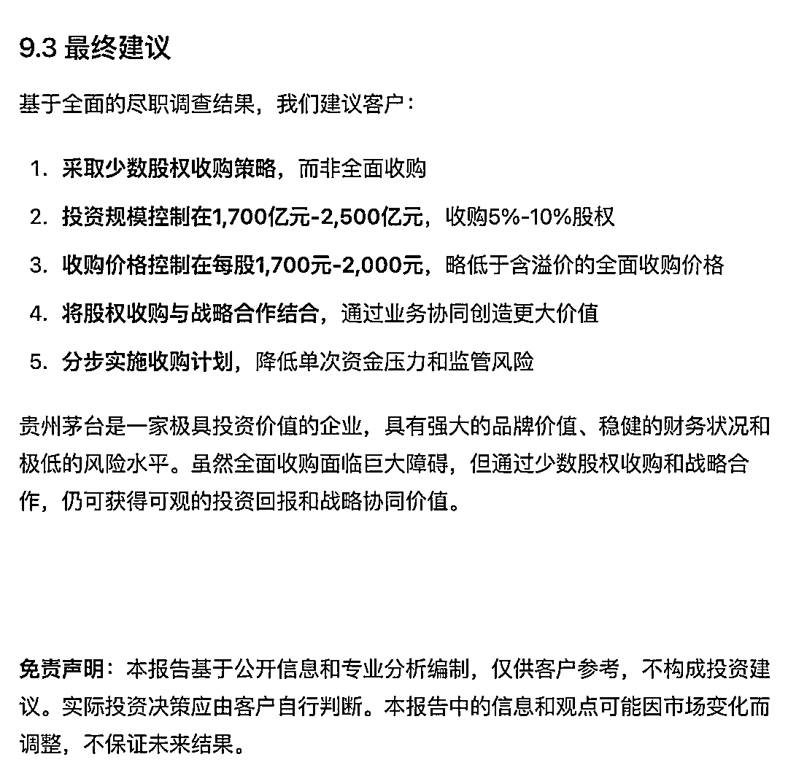

**除此之外，Manus 还能自己看 B 站视频，自己玩 4399 小游戏。**

这些表现透露出和其它 Agent 的差异：

有时候，它不按套路出牌。

团队总结为：

**Less Sturcture, More Interlligence.**

过去的 Agent 框架喜欢给角色塑形，产品经理、程序员都安排上，再协同完成任务。

Manus 不这样，它就是 Manus。

通用型 AI 技术本身已覆盖各行各业，似乎没必要再做角色扮演。

这也是 Cursor、Windsurf、Trae 等 AI 编程工具持续火爆的原因。

当大众都用 AI 编程工具来写文章、画图时，还叫它们编程工具合适吗？

## **Manus 的爆火是过度营销吗？**

火到抖音、央媒，券商出 5 万求调研，闲鱼邀请码 5 万，这背后有人传言有蓝色光标在运作，也有人喊这是过度营销。

定价系统都还没完善就火成这样，情绪很容易被点燃。

**但要分清，爆火是真实的，营销并不是主因，而是大众的 FOMO 情绪在作祟。**

Manus 团队只是邀请部分朋友内测，产品确实让人眼前一亮，口碑自然扩散。

邀请码本是为了限流，却成了触发 FOMO 的开关，这是用户心理的惯性，不是团队能完全掌控的。

实际上团队放出的码远超承载量，导致任务成功率不足一半，再放只会更糟。

硅基流动上次就遇到过类似，人多资源少就会这样。没必要恐慌，随着时间推移资源会补上，大家都能用。

**而且开源复现已经开始，Open Manus 都来了，后面跟进的团队会越来越多。**

## **通用 Agent 真的会吞噬一切吗？**

回到最焦虑的问题。

Manus 用通用架构覆盖了 76% 的垂直 Agent 应用，那是不是很多团队可以直接解散了？

并非如此。

虽然回放能看到全流程，但回放是加速的。真实使用时速度非常慢，直播里也提到，个别任务要耗几个小时。

**通用意味着解法多、边界广、想象空间大。**

**通用的代价就是速度和深度的牺牲。**

人的需求会随场景变化，付费意愿也会随场景变化。

比如你在开会间隙想快速点个午餐外卖，Manus 要花十几分钟甚至数小时规划思考，即便最后完成了又有什么用？

能完成任何任务的工具很吸睛，但能一键秒出结果才是大众的刚需。

所以 Manus 确实有趣，但要说它会吞噬一切，我认为暂时不会。

* * *

评论区：

橘子脑袋 : 一件东西好不好，时间来检验就好了