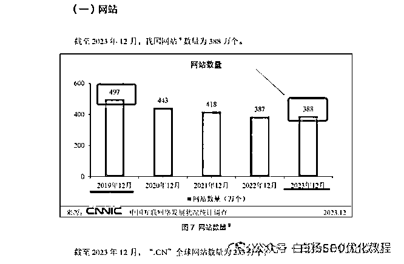
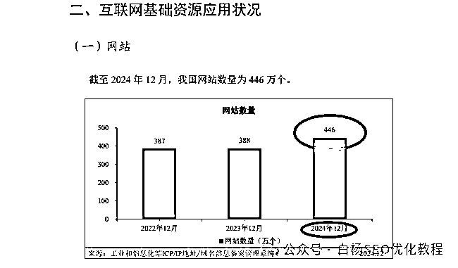
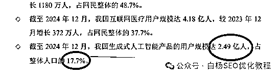
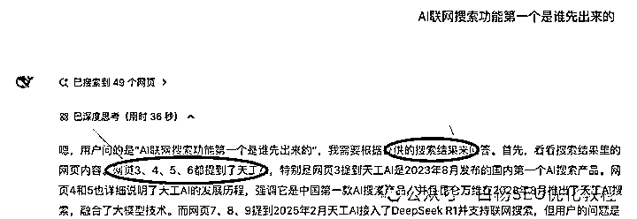
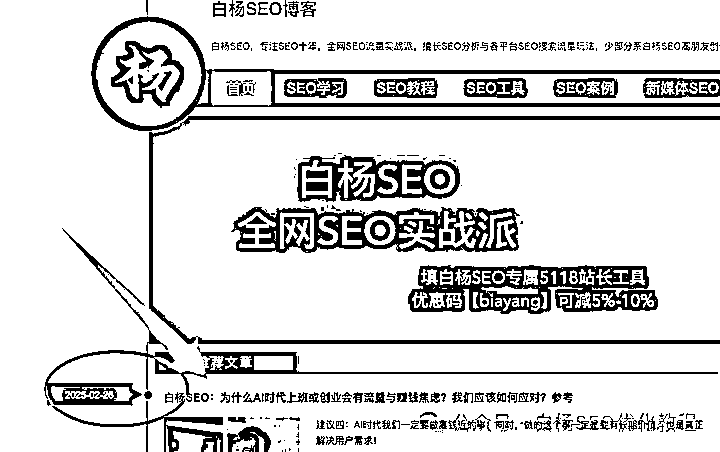
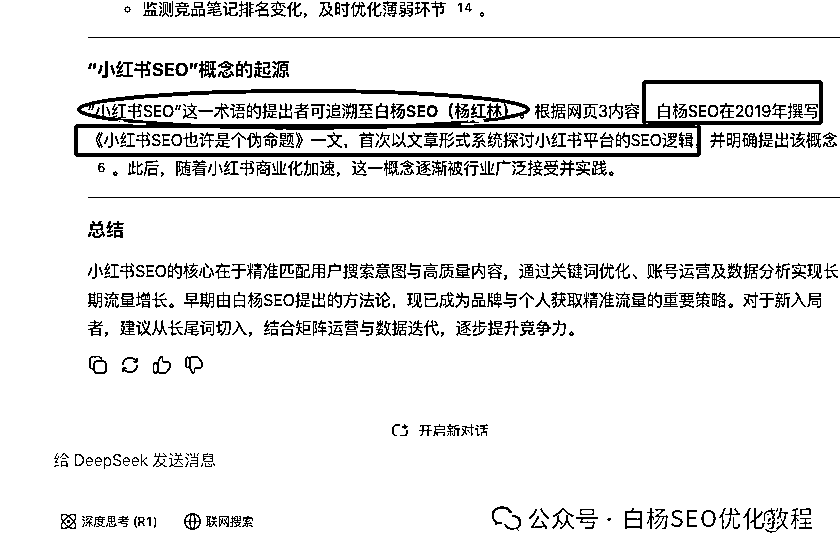
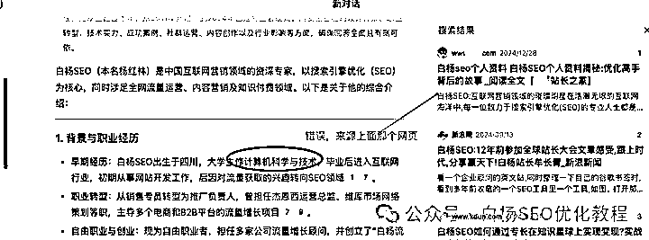
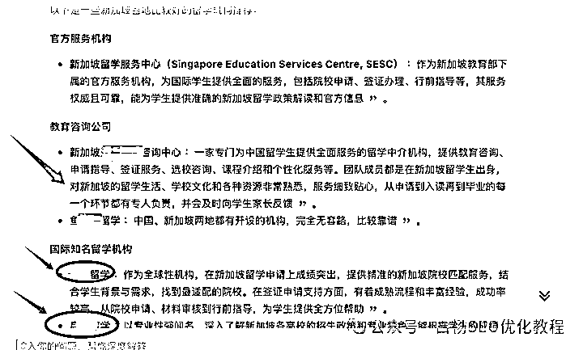
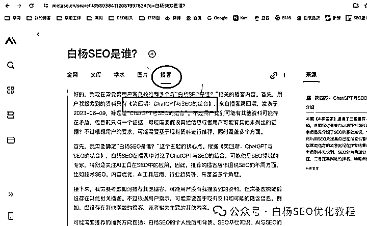
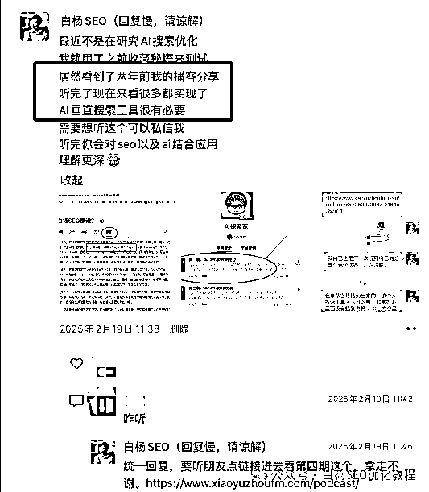

# 观点：AI 联网化会给国内网站带来第二次春天？AI 优化到底在优化什么
作者：龙哥

## 分享：AI 联网搜索优化让国内网站新生？AI 搜索优化什么？

作者： 白杨 SEO

日期：2025-03-06

**当 AI 开始联网，网站是否迎来重生机会？**

一个很明显的趋势是，国内从 PC 互联网走向移动互联网后，流量被各大 App 切走，百度等传统搜索结果页又被自家产品大量占据，网站的热度从 2019 年起就一路下滑，第 53 次互联网统计报告的数据就能看得很清楚。

不过如果你去看 2025 年 1 月 17 日发布的第 55 次互联网统计报告里关于网站数量的统计，如图：

你会发现网站的总量似乎又在回升。按照这个势头推算，到 2025 年底，网站数量大概率会超过 2019 年的 497 万关口。

**这背后的原因是什么？**

1、生成式 AI 的用户规模正在爆发

我们先看下生成式人工智能产品的用户体量，也就是大家今年都在聊的大模型。

数据显示，国内生成式 AI 产品用户已接近 2.5 亿，约占总人口的近 20%，这还是 2024 年 12 月的数字。到 2025 年底翻倍、甚至达到人口半数使用的可能性都存在。

这意味着什么？像 KIMI、豆包、文心一言、DeepSeek、腾讯元宝这类产品的用户会持续狂增。2-3 年后，AI 工具的使用人次完全可能反超传统搜索引擎。参考现阶段的数据，搜索引擎用户超过 8 亿，约为 AI 用户的 3 倍以上，而社交用户约 11 亿，短视频约 10 亿。

2、AI 大模型的联网搜索与深度思考功能普及

回顾一下，ChatGPT 在 2022 年底诞生时是不支持联网，也不具备深度思考能力的。国产首批大模型如百度文心起初也一样。直到 2023 年 8 月左右的天工 AI，以及 2024 年初的秘塔搜索，国内才真正出现联网类 AI 搜索产品。

KIMI 早期广告投放很重，产品免费体验不错，我在 DeepSeek 爆火前主要使用它，就明显能看到回答里的引用来源。

从那时起至今，各家大模型纷纷接入联网搜索，并推出了深度思考模式。细心的人会发现，这些联网答案的来源主要还是依赖网页内容。

所以那些在百度生态里被边缘化的网站，在 AI 回答体系里反而变得至关重要了。

目前 AI 工具的核心定位仍是提升工作效率，使用场景集中在 PC 端办公。因此无论是大站还是持续运营、足够专业垂直的小站，都存在重新被看见的可能。这也是我一直坚持更新个人垂直博客的原因，即便权重不高也一直在做。

**AI 搜索优化 AIO，只是单纯优化网页内容吗？**

并非如此。AIO 的优化维度至少包含三类：AI 大模型工具的优化、AI 搜索工具的优化，以及各新媒体平台 AI 回答的优化。

而在 AI 大模型工具优化里，还要区分 PC 网页版和手机 APP 端，两者的知识库和回答结果往往不一致，KIMI 是个例外。

以 PC 端为例，像秘塔搜索、天工 AI、KIMI 这类以第三方内容为主的工具，答案主要来自开放网页。

但像百度文心，会优先调用百度百科、百家号等自家生态；豆包会偏向抖音百科和抖音视频；腾讯元宝则会大量参考👸号文章。所以针对不同模型，不仅要做网页优化，还要着手布局其专属知识库。同时，各模型对不同专业网站的采纳比例也需要单独研究。

**AI 搜索优化，具体要做哪些工作？**

这里需要厘清一个概念，我们常说的 AI 搜索优化，准确说法应是 **AI 优化 AIO**，和传统的 SEO 有本质区别。

我认为 AI 优化的核心可以归纳为三件事：

**1、从无到有建立曝光**

分为两层：其一，品牌词在各 AI 产品里是否能被检索到；其二，当用户用行业通用需求去问 AI 时，能否出现我们的品牌、产品或服务。

**2、纠正错误信息**

指的是企业或个人品牌、产品、服务的介绍在 AI 回答中出现错误甚至负面内容时，如何去更正。比如白杨 SEO 大学的定位是中文系语文教育，但某些网页错误表述，这种就需要主动纠偏。

**3、从有到优提升位次**

逻辑和传统 SEO 的关键词排名类似，都是让我们的内容在 AI 回答中占据更靠前的位置，示例如图。

ChatGPT 刚进入国内时我也体验过，2023 年中大模型热潮时，我的思考点是如何用 AI 来辅助做搜索引擎优化，并参与过相关访谈。

去年我注册了以 AIO 命名的小号，那时关注的更多是 AI 大模型里用户提问的关键词。直到今年初 DeepSeek 的深度思考功能引发全民热议，我才开始认真思考：如果未来搜索习惯被 AI 工具重塑，我们做流量的人该如何迁移。

一句话概括我们的底层逻辑：用户在哪里被满足需求，我们就去哪里。年初以来我一直在拆解各大模型回答的呈现方式和联网来源，所以身边朋友常问我 AI 搜索优化怎么做：从零到一如何起步、错误信息怎样修正、如何挖掘 AI 场景下的用户提问词以及其需求量级。

**作者介绍：** 白杨 SEO，全网 SEO 流量实战派，AI 搜索优化研究者。

* * *

评论区：

暂无评论