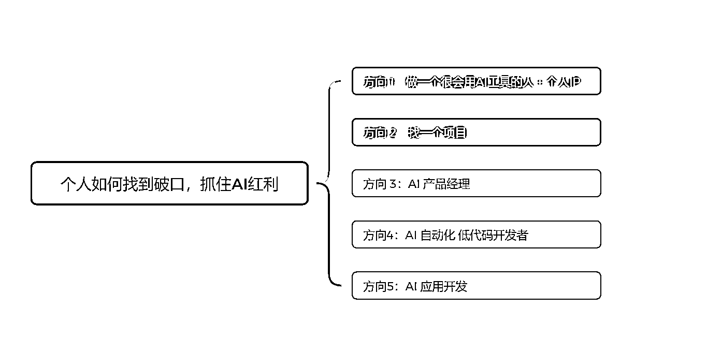

# 如何从零开始，逐步掌握 AI 红利，找到真正适合自己的变现路径

别再喊“All in AI”却原地踏步了，真正的问题不是AI行不行，而是你从哪儿下手。今天这篇内容，专门给想入局AI却卡在第一步的朋友——帮你理清一套从易到难的行动路径，并且拆解前两个最适合普通人启动的方向。

先看整体地图：五个方向，难度递增。方向①最容易上手，方向⑤门槛最高。这篇文章先把①和②讲透。

**方向一：把自己变成AI高手，顺带养一个个人IP**

这是门槛最低、现在就能开干的一条路。逻辑很简单：先在你自己的日常——工作、生活或学习里，把AI用得滚瓜烂熟，再通过持续输出让更多人看到你，慢慢形成个人IP，变现机会自然就浮现出来。

为什么这条路值得走？

第一，**自带护城河**。你的行业背景和岗位身份本身，就是别人进不来的地盘。比如你是外贸业务员，你懂整条外贸流程，这已经是天然优势；在此基础上你还会用AI分析销售线索、快速写个性化冷邮件，那就等于在原有的护城河上又加了一道墙。同行看不懂你，外行更进不来。

第二，**知识可以直接变成钱**。当你把业务流程梳理顺，该用AI的环节都用上，并且拿到了实际效果——比如AI写的开发信比传统邮件约到的客户更多——那你不仅能帮自己提效，还能把这套打法教给其他业务员，或卖给外贸公司的老板。更进一步，你甚至可以做成一套智能系统，像跨境电商领域的Linkfox，它的创始人之一其实就是亚马逊的亿级大卖家，这就是把行业Know-how和AI结合的样板。

那具体怎么落地？**核心就四个字：找准场景。**

要找什么样的场景？两个关键词：**容错率高、重复率高**。

先说容错率。AI再强，也没法保证次次都对，偶尔还会一本正经地胡说八道。所以你要选那些“错了也没大碍”的地方。举个例子，电商用AI客服给客户推荐商品完全没问题，顶多推荐得不合口味；可要是让AI代替政府工作人员回答市民的政务问题，那百分之百正确是底线，这类场景就不适合。再说重复率，你业务流程里那些一遍遍重复的活儿，比如发票录入、👸号写作、回复客户常见问题，都是AI大显身手的地方。

可能你会说：我既不是业务员，也没有固定工作，怎么办？学生有学习场景啊，AI+费曼学习法、跟AI练口语、用AI辅助查文献、让AI帮你改简历，学生的痛点只有学生最懂，你能解决这些痛点，就是你的壁垒。全职妈妈也有大把机会，之前火到上央视财经的“AI小智”，博主就是一位全职妈妈，从用AI学习、哄娃切入，很快就有了关注度。📕上的“Evan妈咪会AI”也是同样路子——你越会用AI，变现的切口就越多。

那如果实在找不到合适的场景呢？别急，还有方向二。

**方向二：直接选一个项目扎进去**

这一条几乎是“万能退路”，也是不想在生活工作中硬找场景的人的最优解。

为什么推荐这个方向？原因有二：

第一，**AI必须用起来才有价值**。脱离真实业务去学AI，基本等于花钱自嗨。你花19.9买了个AI做图课，学会了各种生图工具，然后呢？想变现，还是得找工作、做项目、接服务——绕不开“业务”二字。

第二，**AI能补齐你曾经缺的那块能力**。以前你想写小说，有热情没文笔，没时间学；现在AI可以快速帮你把叙事、文笔、框架这些短板补上。同样，AI编程工具一出，很多产品经理的代码短板也被填平。“一人公司”这个概念越来越火，正是因为以前需要整个团队干的活儿，现在用AI一两个人就能搞定。

具体怎么找项目？三个细分路径可走：

**1. 找AI原生型项目。** AI产品分两种：一种是“AI增强”，即老产品加AI功能，比如飞书接Deepseek，🛰️也接Deepseek；另一种是“AI原生”，没有AI根本不会出现的产品，比如陪伴类应用星野、Character.ai。项目也可以这么挑——做数字人并落到合适的业务场景，就是典型的AI原生项目。

**2. 参加已被验证过的AI项目。** 比如赚钱航海里的AI实操项目就很值得报名。它们满足两个条件：第一，让你在真实项目和业务中使用AI，比如AI赋能电商、AI做自媒体，一次性体验AI生文、生图、生视频的各种玩法；第二，这些项目已经被证明是能赚到钱的——既能让你练手，又有机会真金白银进账，一举两得。

**3. 挑一个“能力突破型”项目。** 想一想，有没有那么一件事，你一直想做，但过去因为能力不够而放弃了？把它找出来，认真评估AI能否帮你补上这个短板。如果能，那就去做——这可能就是你弯道超车的机会。

最后送上一句心法：**抓住AI风口，不意味着推翻过去的经验，而是把AI当作新工具，与你已有的专业积累结合，打造属于你的独家竞争力。** AI最大的诱惑，不是让你成为别人，而是让曾经挡在你面前的那扇门，第一次变得不那么高。过去因为能力所限够不着的事，现在也许正是开始的最好时机。