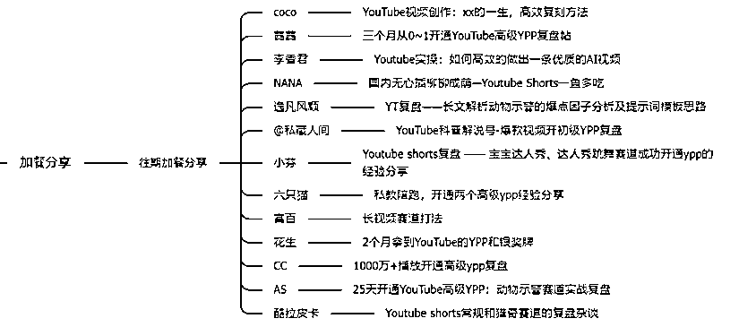
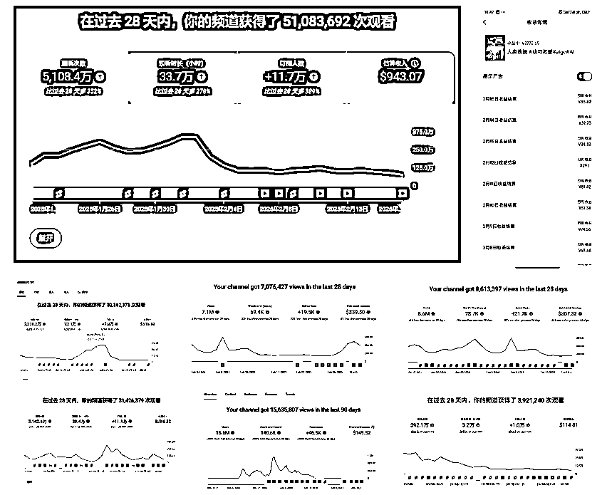

# 海外短视频AI赛道实战验证：104位学员共拿下107个YPP，复盘公开

原文：[`www.yuque.com/for_lazy/zhoubao/hrf0envxad49vgos`](https://www.yuque.com/for_lazy/zhoubao/hrf0envxad49vgos)

我是曹淦 Gary，与波妮共同负责生财有术旗下 YouTube AI Shorts 私人陪跑计划以及 YouTube 深海圈的整体带教，方向一直聚焦在 AI 内容出海。

首期陪跑从 1 月中旬 16 号开营，到 2 月底 28 号收官。沉淀了整整一个月，今天把最终的成绩单摊出来。

本次成果大致可归为三类：

1. **YPP 达成情况：** 全程跟进的伙伴共计 104 位，陪跑期内有超 70 位同学累计获得 107 个 YPP 资格，含已达标待审核的账号。换算下来基本做到人手一号。更有 20 多位同学实现两号起步，小芬、九月、茜茜三位同学在本次周期里单人贡献 4 个 YPP 的履历。
2. **知识沉淀情况：** 针对不同方向累计组织 6 场专题直播，并邀请优秀学员做增补分享 12 场。共同打磨出的分享文章共 17 篇，其中国内站精华置顶 7 篇。内容覆盖 AI 达人秀、AI 动物警示、AI 动物故事、解说类、故事类、长视频等多个细分赛道，每条线都附带提效提质的操作笔记。

1. **变现初显：** 陪跑窗口只有一个月，YPP 审核耗时叠加项目偏 AI 属性，当月到账的流水确实不高。但花生、小芬、逸凡风顺、AS、cc 这几位同学已经通过 YPP 跑出数百美金的收益；NaNa 将 YouTube 内容再次分发到视频号，单条实现近 3k 元的收入。

中期总结时我们曾立下冲 100 个 YPP 的目标，没想到最终不仅完成，还超出预期。很多人都在问这批账号到底是怎么冲出来的。

接下来对首期私人陪跑做一次阶段性拆解。中期交付的细节已在《YouTube AI shorts 私教陪跑中期复盘》里展开，不再重复。本文按交付节奏来对照目标、策略与体感，主要拆成三段：

1. **筑基 1-14 天，夯实根基** 以航海法为框架，重建 AI Shorts 爆款创作的心法与手法，吃透平台规则。
2. **结丹 15-25 天，成型应用** 熟练掌握一条赛道的方法论，完成百万播放级别的作品验证。
3. **元婴 25-44 天，渡劫变现** 扩散开枝、汇聚人气，集中冲刺 YPP 数量与多元化变现通道。

更系统的阅读版本已整理在飞书：[浪潮已至——YouTube AI shorts 私教陪跑复盘&YouTube 深海圈启动](https://ncnmu5q1eqm9.feishu.cn/wiki/SBELwT7T9iEbVIkiun4c9r9gn9C?from=from_copylink)

* * *

评论区精选：

方波妮 : [强]生财速度曹教练，牛牛牛，接下来继续一起猛猛干，YouTube 实战深海圈期待大家的加入：[`sourl.cn/ByHuXY`](https://sourl.cn/ByHuXY)

九月 : 猛猛干

不问东西 : 曹教练、波妮教练战绩卓越，终于发布了，call back 一下我帖子的结尾哈哈。欢迎大家加入 YouTube 深海圈！

逸凡风顺 : 必须猛猛干！学习曹哥，成为曹哥[呲牙]

六只猫 : 猛猛干[666]

私藏人间 : 猛猛干[加油]

Jiahao : Gary 教练和波妮教练太牛了！这种战绩，前无古人！[强][强][强]

As : 猛猛干