# 做 YouTube 到底选 Shorts 还是长视频？一份更适合执行的选择指南

如果你准备通过 YouTube 做内容变现，最先遇到的往往不是“拍什么”，而是：

**究竟该从短视频切入，还是直接投入长视频？**

这没有统一答案。更现实的判断方式，是先看你的阶段、资源和最终目标：

- 想尽快开始、测试题材、积累数据：短视频更友好；
- 想打造个人品牌、建立信任、拓展后续业务：长视频更值得投入；
- 两种目标都想兼顾：可以用短视频负责拓新，用长视频承接深度用户。

## 1. 为什么短视频适合作为起点？

短视频的制作链路通常更短，选题、脚本、拍摄和剪辑都不需要一次性投入太多精力。对刚进入平台的人而言，先把行动门槛降下来，比一上来就制作十几分钟的精致作品更实际。

长视频可能要准备数小时甚至几天，结果却未必理想。连续几次低数据之后，很多人不是能力不足，而是很难继续承受这种反馈周期。

短视频则能让你更快完成：

**构思—制作—发布—观察—调整**

行动阻力小，反馈来得早，也更容易形成稳定的生产习惯。

### 从高表现案例入手

如果不知道该做什么，可以先研究已经验证过的内容。寻找样本时，可以从两个角度展开：

1. **观察某个账号内部的异常高表现作品**  
   与该账号平时的平均数据相比，明显跑得更远的内容，通常值得拆解。

2. **围绕具体搜索词寻找同类作品**  
   从主题词、场景词、问题词出发，寻找表现突出的账号与视频。

一个较为实用的研究流程如下：

- 先在平台中寻找明显高于常态的数据样本；
- 再围绕细分主题，整理一批可参考的账号；
- 拆解开头、叙事顺序、画面节奏、字幕和标题；
- 结合自身素材重新设计，而不是机械搬运；
- 某个方向出现明显疲态后，再重新寻找新的样本。

热门内容之所以能传播，通常离不开好奇、反差、冲突、情绪、实用价值等稳定需求。研究已经被市场验证过的表达方式，往往比完全凭感觉试错更节省时间。

## 2. Shorts 是一套低成本训练系统

短视频的价值，不只是“更容易被看见”，还在于它能让你快速积累实践次数。

每一次发布，都可以看作一次小型实验：

- 哪种主题更容易让人停下来；
- 前两秒怎样设计更有吸引力；
- 多快的剪辑节奏更适合受众；
- 配音、字幕、音乐和画面如何组合；
- 同一个题材换一种开场，结果是否不同。

长视频的反馈周期较长，可能一周只能完成一次实验。短视频则允许你在相同时间里获得更多样本。

对于刚开始运营的人而言，频繁收集小规模反馈，往往比长时间打磨一条作品更有训练意义。

## 3. 为什么短视频更容易出现大曝光？

短内容的观看门槛较低，用户往往只需要几秒，就会决定继续停留还是划走。只要前段设计得足够有效，作品就可能进入更大的分发池。

持续发布的另一个好处，是能够增加试验次数。并不是每一条都会表现突出，但当样本足够多时，总有作品可能跑出远高于平均值的数据。

可以这样理解：

- 长视频：单次投入高，试错次数少；
- Shorts：单条成本低，测试频次高；
- 样本数量上升后，撞上高表现作品的概率也会提高。

有些账号并非每条内容都出色，而是依靠少数几条强势作品获得大量观看和订阅，进而达到 YPP 的相关门槛。

不过，必须区分“流量规模”和“收入规模”。短视频很容易形成巨大的曝光数字，但单次播放的收益逻辑，并不能简单套用长视频。

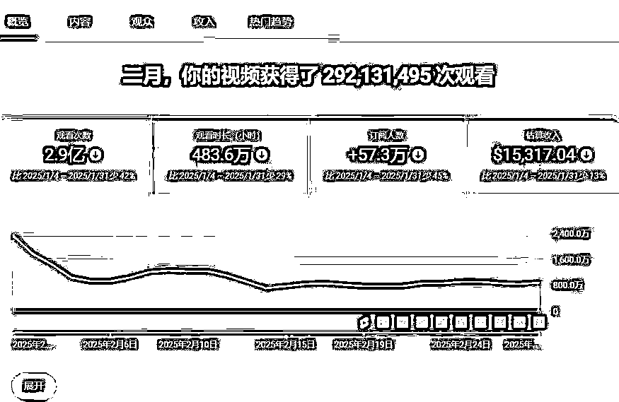

下面列出几个曾出现超高播放成绩的 Shorts 案例：

1、Paws of Courage

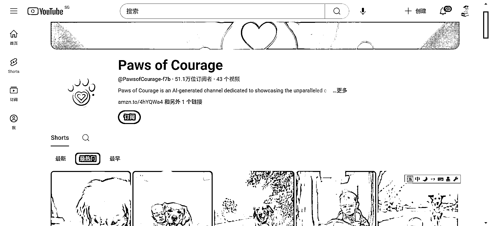

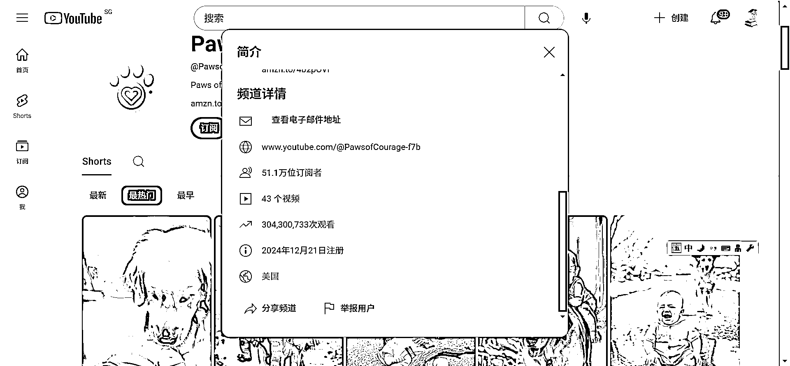

[www.youtube.com/@PawsofCourage-f7b](http://www.youtube.com/@PawsofCourage-f7b)

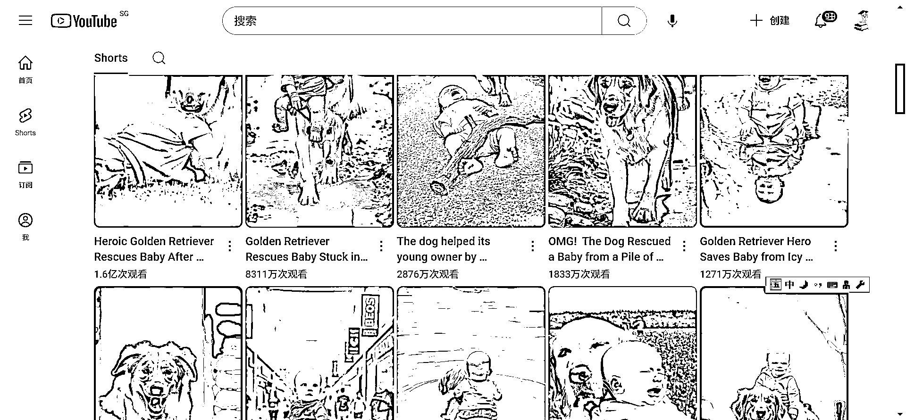

2、Duck's Quest

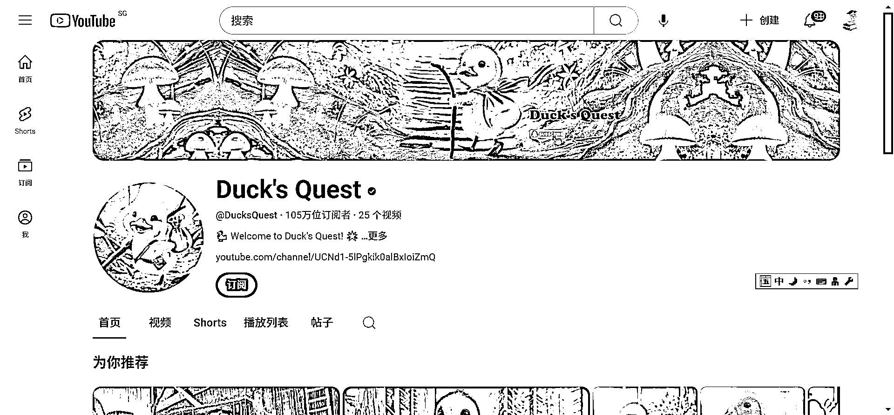

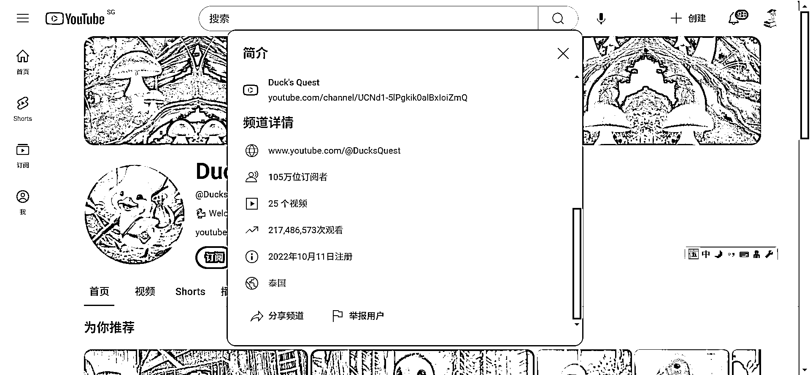

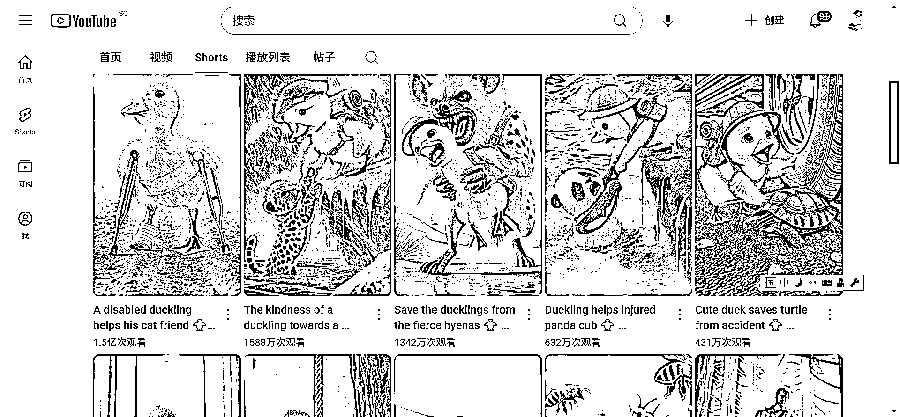

3、Rabbit's Journey

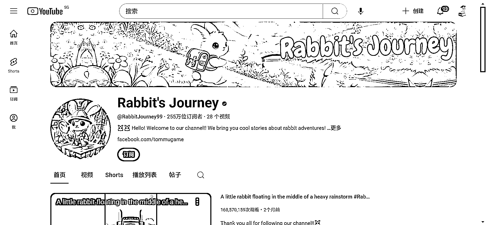

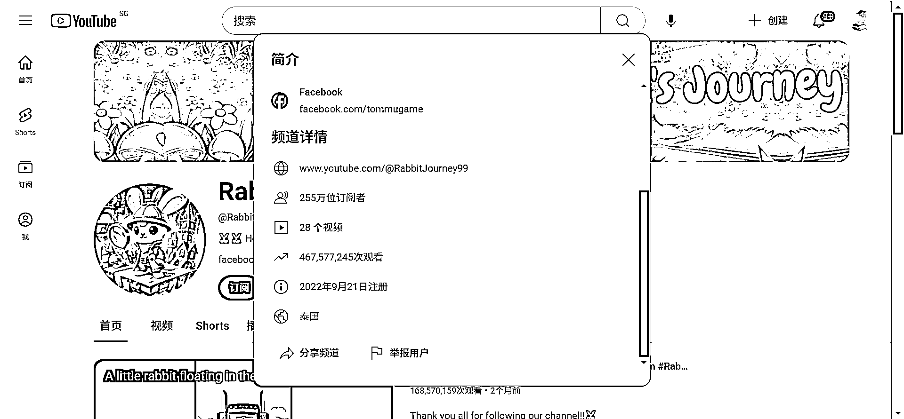

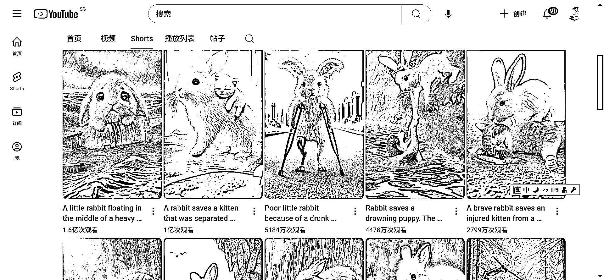

4、Catter Family

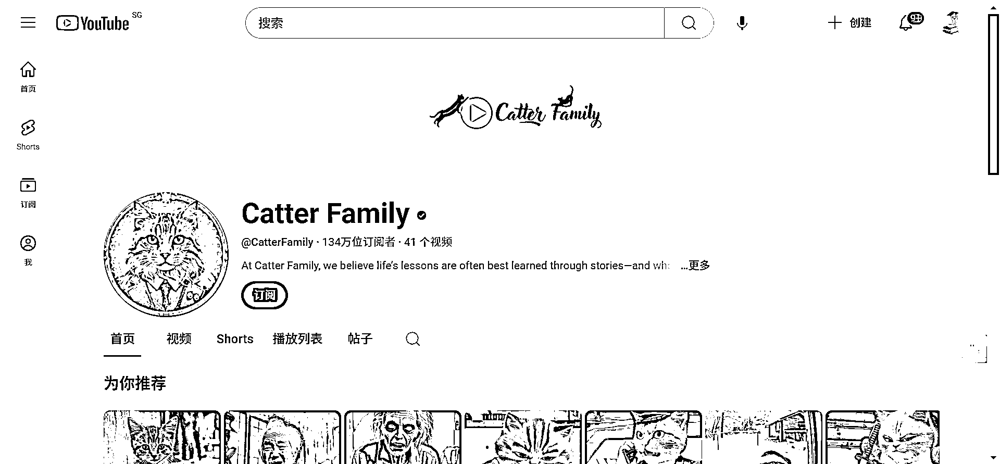

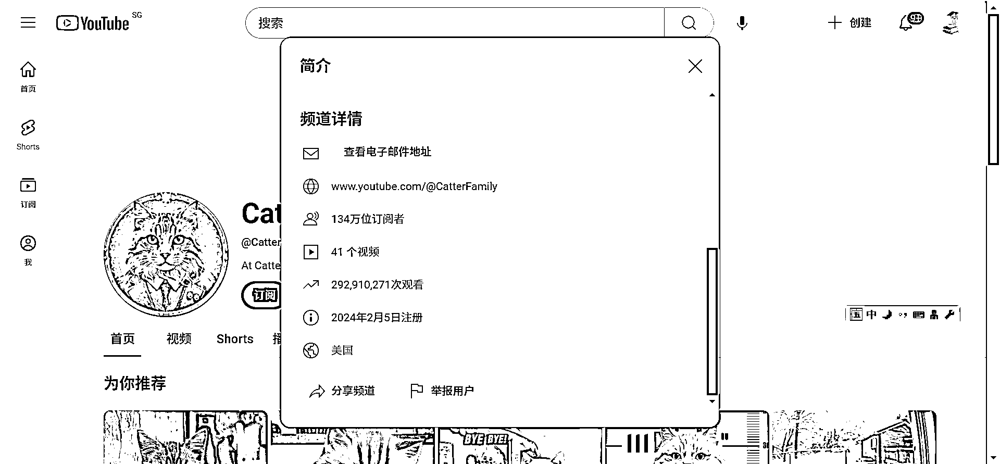

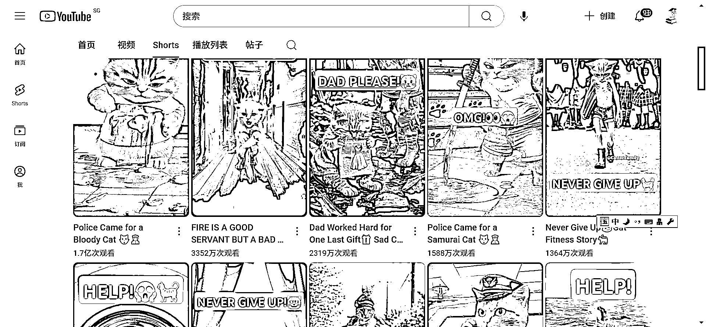

## 4. 短视频数据为什么忽高忽低？

Shorts 的数据起伏往往非常明显。同一条作品，第一次上传可能只有个位数观看，隔几天重新发布后，却可能增长到几百、几千甚至更多。

内容本身没有变化，首轮接触到它的人群和分发环境不同，结果就可能完全不同。

这不代表平台没有评价标准，而是短内容竞争密度很高，用户的滑动行为又非常快。作品在最初测试阶段没有获得足够停留，后续扩大分发的机会就可能降低。

### 如何判断是否真的被限制推荐？

不要因为某条作品数据低，就马上认定账号被限流。

一个简单的观察标准是：

**只要并非长期完全没有观看，就不能仅凭低播放下结论。**

如果账号持续出现零播放，再去排查账号状态、网络环境、节点质量、内容设置和发布流程。某些免费节点确实可能造成访问或上传过程不稳定，但它只是需要排查的因素之一。

### 删除后重新上传能不能做？

偶尔测试可以，但不能把它变成主要策略。

如果准备做十条短视频，却始终围绕同几条内容反复删除、重新上传，而没有继续产出新素材，那就会陷入低效循环。

更值得采用的方式是：

- 不断增加作品样本；
- 观察一段周期内的整体表现；
- 找到可复用的主题和结构；
- 把精力投入到新的内容生产中。

单条数据的偶然性无法完全消除，真正能降低风险的，是持续产出足够多的作品。

## 5. 供给增长，让短视频既有机会也有压力

随着 AI 生成、自动剪辑等工具越来越普及，平台上的视频数量持续增长。与此同时，手机仍是大量用户观看内容的重要入口，滑动速度也在不断加快。

公开统计资料显示：

- 用户每天在 YouTube 上消费的内容时长超过 1 亿小时；
- Shorts 的日观看量已经达到数十亿级别；
- 全球大量访问来自手机和其他移动终端；
- 美国也有相当比例的用户通过智能手机观看平台内容。

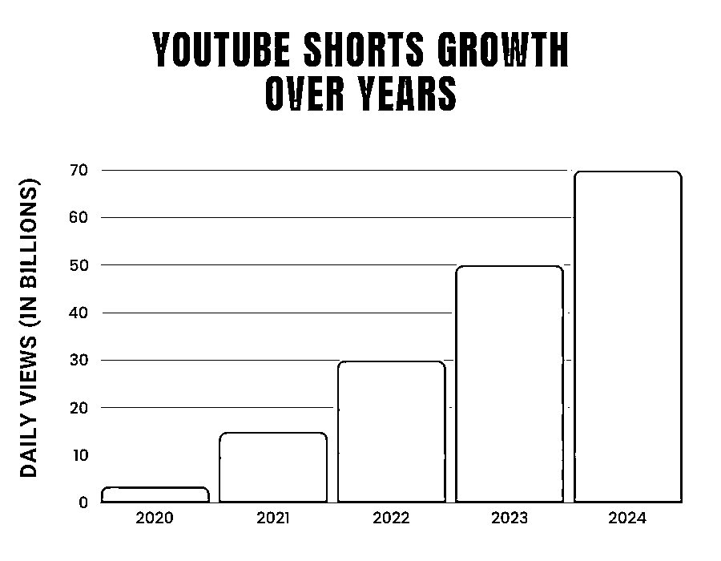

这说明短视频的市场足够大，但竞争也更加密集。平台会尝试把用户反应更好的作品继续推送，但在海量内容和快速滑动的环境下，一条作品也可能在早期测试阶段就停止扩散。

因此，不要只盯着某条视频的输赢，更应该观察一段时间内的总体趋势，例如：

- 最近二十条内容的平均表现；
- 前几秒的留存情况；
- 完播率与互动率；
- 观看转订阅的效率；
- 哪些选题多次得到较好反馈；
- 哪些开场结构更容易让人继续看。

## 6. Shorts 能不能赚钱？

能，但通常更依赖规模和爆发。

如果只靠 Shorts 的广告分成，想获得稳定而可观的收益，往往需要同时具备：

- 足够大的观看量；
- 持续出现高表现作品；
- 一定规模的订阅基础；
- 合适的内容赛道；
- 广告之外的收入来源。

所以，短视频更像一种高曝光、高波动的增长工具。它适合测试主题、扩大触达、积累订阅，也适合为后续品牌合作、产品销售或服务转化提供入口。

但如果把所有希望都押在单纯的播放分成上，收入很可能不够稳定。

## 7. 长短内容并非必须二选一

实际运营时，可以根据自身情况采用不同组合。

### 路径一：先短后长

先用短内容训练选题、剪辑、节奏和数据判断能力，等流程熟练后，再逐步增加长视频。

### 路径二：短长并行

让 Shorts 负责触达陌生用户，让长视频负责提供完整信息、建立信任和延长观看时间。

### 路径三：只做一种形式

如果时间有限，或者你的题材天然适合某种表达方式，也可以专注于单一形式。

真正需要统一的，不是视频时长，而是频道服务的人群和主题。一个账号里同时存在短片与长片并没有问题，但最好围绕相近的内容方向展开。这样更容易形成清晰定位，也能减少观众预期混乱。

### 不建议轻易清空旧作品

如果只是觉得早期内容影响页面观感，可以先改成私密或不公开，而不是一次性全部移除。

旧作品可能承载着观看记录、搜索入口、用户路径以及频道主题关联。全部删除之后，过去积累的信号也可能随之消失。

如果打算调整赛道，更稳妥的做法是分批处理，边观察数据边调整。部分早期作品虽然制作粗糙，却可能因为好奇心、搜索需求或后续内容带动，再次获得观看。

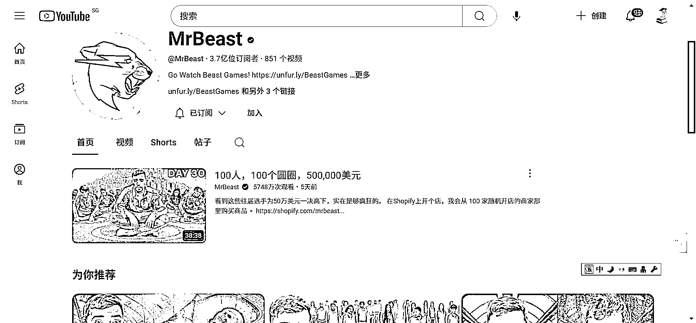

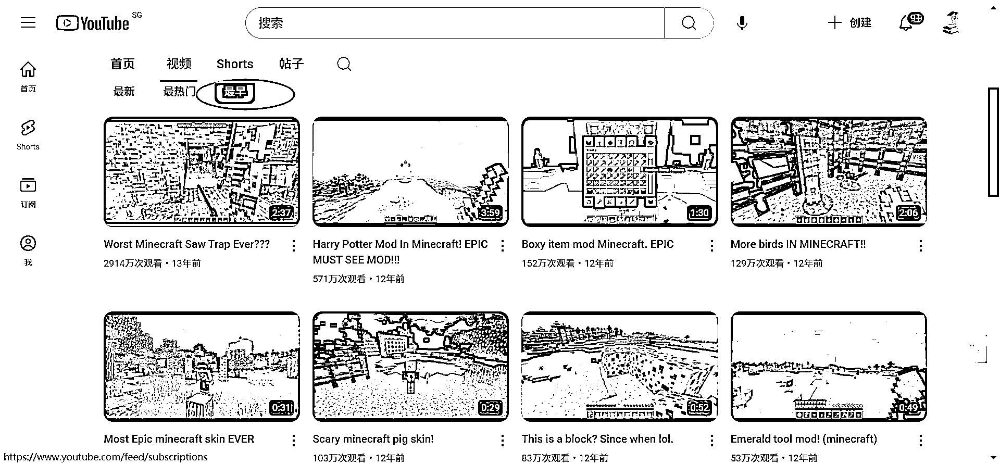

## 8. YouTube 的搜索表现主要看哪些因素？

平台每天接收大量上传内容，需要从中筛选出更符合用户意图的结果。理解搜索机制时，可以关注三个基础维度：

### 相关性

标题、描述、标签和实际内容，是否真正对应用户输入的查询词。

### 用户反应

点击、观看时长、互动以及后续行为，都可能帮助系统判断作品是否满足了用户需求。

### 专业度与可信度

账号是否长期围绕某个主题输出，是否在该方向上表现出足够的经验、稳定性和可靠性。

搜索结果也会因用户而不同。系统可能参考个人过去的浏览和观看偏好，因此两个人输入相同词语，最后看到的内容未必完全一样。

平台不会通过收取费用，让某个账号直接买到自然搜索中的更高位置。想提高自然曝光，仍然要回到内容匹配、用户满意度与持续积累。

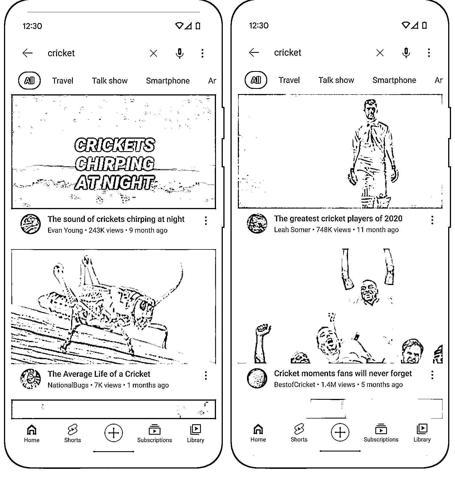

[官方文档链接](https://www.youtube.com/howyoutubeworks/product-features/search/)

## 9. 横屏和竖屏，应该怎么决定？

不要把画幅当成绝对答案，先看内容本身需要什么。

访谈、对话、旅行记录、户外活动、徒步和登山等内容，通常需要呈现更多空间关系，横屏往往更有优势。

如果作品主要依靠人物近景、快速信息传递、单点展示或手机端浏览，竖屏可能更加自然。

选择画幅时，不必过度纠结它最终被归类为短片还是长片。形式应该服务于表达，而不是让内容反过来迁就格式。

## 10. 想经营个人 IP，长视频通常更占优势

短内容擅长快速触达陌生用户，但个人品牌需要更完整的表达和更充分的信任积累。

长视频可以更清楚地呈现：

- 你的知识与判断；
- 个人经历和表达风格；
- 解决复杂问题的能力；
- 对某个主题的持续投入；
- 与观众建立长期关系的过程。

这些积累更容易延伸到咨询、课程、品牌合作、服务产品等商业模式。

有些个人品牌账号的总播放量未必比短视频账号高，但每位观众的信任程度和商业价值可能更高，收入结构也可能更加稳定。

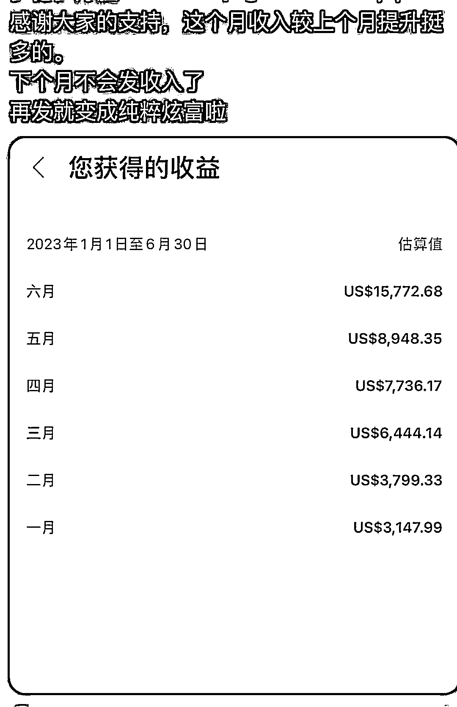

## 最终怎么做选择？

可以按下面的思路判断：

- 想尽快启动、练习基本功、寻找方向：从 Shorts 开始；
- 想建立专业形象、经营个人品牌：把长视频作为重点；
- 想兼顾增长和深度：短视频负责引流，长视频负责承接；
- 想降低试错压力：先用低成本内容验证，再决定是否扩大投入。

观看场景同样会影响内容选择。人们外出时更常用手机浏览碎片化内容，在家中则可能通过电视观看更完整的节目。随着大屏端使用持续增长，长视频也拥有自己的稳定空间。

因此，短片和长片并不存在谁一定更好。它们对应不同的观看习惯、运营目标和发展阶段。

选好适合自己的路径后，持续发布、复盘数据、改进表达，往往比反复纠结形式更重要。希望下一个完成增长和变现的人，就是你。

* * *

评论区：

国典（光悦）：谢谢前辈提醒，我之前总被长视频和高制作标准拖住，确实消耗了太多时间。

忆：想请教一下，截图里那笔约 1.5 万美元收入来自哪个题材？是作者本人运营的账号吗？😊