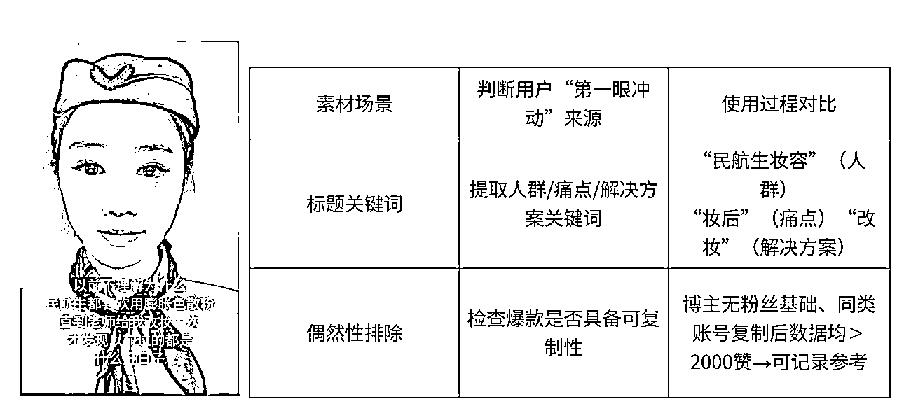

做小红书店铺，光靠投流可不行，真正能让自然流量翻倍的，是把内容本身打磨到位。今天我就把自己反复实测得出的思路拆给你听，全程干货，不绕弯子。

先抛一个核心认知：在小红书，爆款内容是有“惯性”的——火过的内容大概率还会再火，只是什么时候再火，存在一个不固定的周期。想抓住这波机会，你需要在“选对品”的基础上“持续输出”，同时让内容符合平台的爆款逻辑，系统才会给你额外的自然曝光。很多新手迟迟不出成绩，其实不是不够努力，而是没看懂这套逻辑。一旦你把内容的运转规则摸清，就能把爆款周期大大压缩，运营过程中也会慢慢找到手感。

我把这个过程分成两个阶段来聊。

阶段一：先把“爆款痕迹”找出来并拆碎。

所谓爆款痕迹，就是你这个类目下已经跑出来的爆款笔记。别光收藏，要动手记录。从展现方式、素材画面，到标题、文案，全部分解，然后判断：它到底是素材赢还是标题赢？新手最快起步的方法就是“抄”，1:1 模仿再输出，这在起号期确实效率很高，因为参考笔记本身已经验证过流量，比你凭空写要稳妥。但只抄还不够，你得做一步关键动作：判断这个爆款是素材本身够强，还是标题内容更抓人。素材和内容一旦不匹配，效果会大打折扣。

所以，记录完爆款痕迹后，要按点赞从高到低排序，拆开分析。具体看四个维度：

- 素材场景 → 推出对应的是什么人群
- 对应标题 → 推出热门关键词
- 对应内容 → 推出用户深层需求
- 二次筛选 → 判断它是偶然火，还是真优质

走完这一步你会发现，爆款从来不是运气。它的素材场景，恰好对应了人群；它的标题，恰好命中关键词；它的内容，恰好满足了需求。这时候你再回头看自己发的笔记：素材是不是对上了目标人群的使用场景？标题是不是匹配？如果没对上，流量差的原因当场就能找到。

记住这个关键点：

当爆款素材配上了对口的标题和内容，三者同频，爆款就会变得高频。我实测过，用这个方法连发 10 条内容，出了 2 条小爆款。而之前数据差的原因，恰恰就是拿爆款素材配了个不相关的标题和内容，平台识别为素材与标题不符，质量判定低，自然不给推荐。

所以阶段一的核心任务是：记录爆款素材，把对应场景、标题、内容整理清楚，让视频、标题、文案三者高度统一。

发之前，拿出这三条自查：

✅ 我的素材场景和标题内容匹配吗？  
✅ 我的标题是否包含了“人群+痛点+解决方案+爆款词”的完整结构？  
✅ 同类爆款是否已经有至少 3 个账号验证成功？

接着做两组测试：

- 固定爆款标题，只换封面素材，比如对比图换成产品图。
- 固定爆款素材，只改标题关键词，比如“民航生”换成“大学生”。

阶段二：摸透平台，主动制造爆款。

光会拆还不够，你要主动去创造。制造爆款的前提是熟悉平台的推荐机制：你的目标人群是谁？平台近期在推什么内容？账号标签是否精准？这些都要逐个测试排查，才能提升爆款概率。

操作路径是这样的：先把记录下来的爆款素材和对应内容整理成测试池，发出去后通过“小眼睛”数据判断系统把笔记推送给了什么人。小眼睛是平台给的真实反馈，用它来反推你的内容是否对准了目标用户，然后输出更精准的内容，曝光才会放大。

账号标签的测试，建议至少用三种不同的选题去试，每种选题用不同的展现素材。反馈逻辑很简单：

1. 小眼睛低于 100：立即换新选题测试。
2. 小眼睛高于 200：这个选题可以持续输出。
3. 后续小眼睛稳定在 200 以上，就说明内容优化已经生效。

除了标签，还要抓好三件事：

- 平台热点：多留意近期热门话题，内容中带上相应关键词，蹭话题下的自然曝光。
- 目标人群：从素材延伸出用户需求，然后优化内容表达。
- 具体测试：
  - 标题测试：同一条内容发 A/B 两个版本，比如“平价散粉”对比“学生党必入散粉”，看点击率差异。
  - 发布时间：在你目标人群的活跃时段发，通勤/学生党或下班/休闲时段各测一次，对比哪个时段效果更好。
  - 话题组合：热门大词（行业词+下拉词）+ 细分词（场景词+效果词）+ 热点词（比如创作中心相关词），组合起来用。

当标签、需求、热点三者对齐，数据自然会有一个明显提升。

记住这个内容优化公式：精准标签（让平台认识你）× 需求痛点（让用户依赖你）× 热点杠杆（让流量找到你）。

在小红书，内容优化不是玄学。它是可拆解、可复制、可标准化的运营动作。把爆款当作你了解行业和产品的入门教材，再结合账号自身数据不断纠偏，账号表现一定能走上坡路。内容平台的共性就是：只要你的内容持续符合平台和账号的推送逻辑，系统就会给你正向反馈。

如果你现在正卡在流量低洼区，别焦虑。用“测试-迭代”的思维去优化内容，而不是凭感觉硬发。希望这篇拆解能帮到你。